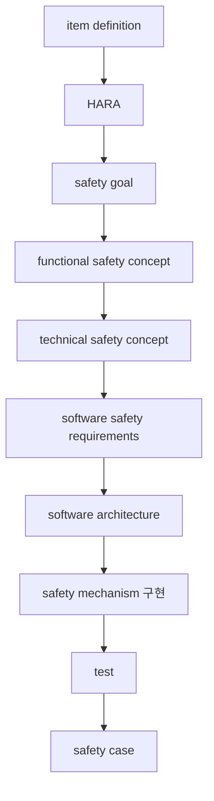

# 소프트웨어 엔지니어를 위한 기능 안전 (Functional Safety) - 가제

책 개요, 초안 v0.3 (2026-11-22)

이 문서는 무엇을 쓰는지를 정한다: 독자, 범위, 예제, 목차.
어떻게 쓰는지는 [PLAN.md](PLAN.md)에, 쓸 때 지키는 규칙은 [RULES.md](RULES.md)에, 참고 문서는 [references/](references/README.md)에 있다.

장마다 "핵심 질문"에 답할 수 있게 되는 것이 학습 목표이고, 그 답을 자기 말로 쓴 것이 원고가 된다.

## 1. 이 책에 대하여

### 독자

- 소프트웨어 엔지니어. C 계열 언어를 읽을 수 있고 요구사항, 설계, 테스트, 코드 리뷰, CI 같은 개발 과정에 익숙하다.
- 가정하지 않는 것: 임베디드 개발 경험, 하드웨어 지식, 안전 규격 경험.

### 책이 답하려는 질문

1. Safety는 품질이나 reliability와 무엇이 다른가?
2. "이 소프트웨어는 충분히 안전하다"는 말은 무슨 뜻이고, 누가 어떻게 판단하는가?
3. Hazard에서 출발해 내 코드에 대한 요구사항까지 어떻게 내려오는가?
4. 안전을 위해 아키텍처, 코드, 테스트는 평소와 무엇이 달라지는가?
5. 규격은 무엇을 요구하고, 왜 그렇게 요구하는가?

### 읽고 나면 할 수 있는 것

- 안전 관련 프로젝트의 문서(HARA, safety concept, safety requirement)를 읽고 자기 작업과 연결한다.
- Software safety requirement를 쓰고, 그것을 만족하는 아키텍처와 safety mechanism을 설계한다.
- Integrity level에 맞는 verification 방법을 고르고 그 근거를 설명한다.
- 규격 조항을 직접 찾아 읽고, 평가자(assessor)의 질문에 근거를 들어 답한다.
- 자동차, 로봇, 드론이 같은 안전 문제를 어떻게 다르게 푸는지 설명한다.

### 다루지 않는 것

- 하드웨어 설계와 정량 분석의 상세 (읽는 법까지만 다룬다)
- 특정 상용 tool의 사용법
- 규격 원문의 대체. 이 책은 규격을 읽기 위한 안내서이고, 규격 문장과 표를 옮겨 싣지 않는다.

## 2. 범위

아래는 책의 범위를 정하는 선택이다. 바꾸면 Part II 이후의 예제와 조항 대응이 달라진다.
기준으로 삼는 규격의 판은 [references/standards.md](references/standards.md)에 있다.

| 항목 | 선택 | 이유 |
|---|---|---|
| 개념의 뿌리 | IEC 61508 | 분야 공통의 기본 규격이고 대부분의 분야별 규격이 여기서 갈라져 나왔다 |
| 주 분야 | 자동차, ISO 26262 | 소프트웨어 관련 요구가 구체적이고 공개 자료가 가장 많다 |
| 보조 분야 | 로봇 (20장), 드론 (21장) | 위험을 따지는 방식이 자동차와 달라, 비교하면 개념이 분명해진다 |
| 그 밖의 분야 | 22장에서 비교 | 항공, 철도, 의료기기, 공정 |
| 원고 언어 | 한국어, 기술 용어는 영어 그대로 | 규격과 국제 자료를 바로 찾을 수 있게 |
| 예제 코드 | C (필요한 곳에 Rust 비교) | 안전 분야의 현재 주 언어 |

### 세 분야를 함께 다루는 방식

Part I-IV는 자동차를 기준으로 쓴다. 로봇과 드론은 Part V에서 한 장씩 다루고,
앞 장들에는 차이가 큰 곳에만 "로봇과 드론에서는"이라는 짧은 항목을 둔다.

세 분야는 같은 문제를 서로 다른 방식으로 푼다. 이 차이가 책의 비교 축이다.

| 비교 항목 | 자동차 | 로봇 | 드론 |
|---|---|---|---|
| 위험을 따지는 단위 | 제품의 기능 (item) | 기계와 작업 | 운용 (operation) |
| 위험 평가 방법 | HARA | ISO 12100 risk assessment | SORA |
| 등급 | ASIL A-D | PL a-e 또는 SIL 1-3 | SAIL I-VI (운용 단위의 등급) |
| 소프트웨어 요구의 출처 | ISO 26262-6 | ISO 13849-1, IEC 62061, IEC 61508-3 | ASTM F3201, 고위험 운용은 DO-178C |
| 대표적인 safe state | 기능 축소 또는 정지 | 정지 (protective stop) | 정지할 수 없음: 복귀, 착륙, 비행 종료 |

주의할 점
- 로봇에는 소프트웨어 개발 과정을 다루는 전용 규격이 없다. 로봇 규격은 필요한 safety function과 등급을 정하고, 만드는 방법은 기계류 제어 규격에 맡긴다.
- 드론에는 ISO 26262에 해당하는 단일 규격이 없다. 규제와 운용 위험 평가가 중심이고 나라마다 다르다. 이 책은 EU 체계 (SORA)를 기준으로 삼는다.
- 드론 쪽은 제도가 빠르게 바뀐다. 21장은 쓰는 시점에 다시 확인한다.

## 3. 관통 예제 (running example)

책 전체에서 시스템 하나를 hazard 분석부터 safety case까지 끌고 간다. 장마다 이 예제의 산출물이 하나씩 쌓인다.

- 제안: 구동 토크 제어 (drive torque control). 가속 페달 입력을 받아 구동 모터의 토크 명령을 만드는 소프트웨어.
- 대표 hazard: 의도하지 않은 가속 (unintended acceleration).
- 고른 이유
  - 위험이 직관적이어서 자동차 지식이 없어도 이해할 수 있다.
  - 공개된 감시 구조가 있다 (E-Gas monitoring concept: 엔진 제어기용으로 자동차 회사들이 공개한 3단계 감시 구조).
  - 1장의 실제 사례(Toyota unintended acceleration)와 이어진다.
  - 센서와 모터를 PC에서 시뮬레이션할 수 있어 개발 보드 없이 실습할 수 있다.

산출물의 흐름:

### 보조 예제

20장과 21장에서는 작은 예제를 하나씩 따로 쓴다. 위험 평가에서 구조 설계까지만 가고, 관통 예제와 나란히 놓고 비교한다.

- 로봇: 자율 이동 로봇의 protective stop. 사람이 감지 영역에 들어오면 정지하는 기능.
- 드론: 소형 multicopter의 geofence와 조종 link 상실 대응. 정해진 공역을 벗어나지 않고, 통신이 끊기면 미리 정한 동작으로 넘어가는 기능.

## 4. 목차

장마다 파일 하나가 `chapters/`에 있다. 장의 계획 (다룰 내용, 예제 산출물, 근거)은 각 파일의 앞부분에 있다.

### Part I. 사고방식과 기본 개념

| 장 | 제목 | 핵심 질문 |
|---|---|---|
| 1 | [소프트웨어가 사람을 다치게 할 때](chapters/ch01-accidents.md) | 소프트웨어는 닳지도 부러지지도 않는데 어떻게 사고를 일으키는가? |
| 2 | [기본 개념과 용어](chapters/ch02-concepts-and-terms.md) | safety, reliability, availability, security는 어떻게 다른가? |
| 3 | [Risk와 integrity level](chapters/ch03-risk-and-integrity-level.md) | 얼마나 안전해야 충분한가? 그 답이 어떻게 개발 방법의 엄격함으로 바뀌는가? |
| 4 | [규격 지도와 규격 읽는 법](chapters/ch04-standards-map.md) | 규격은 왜 이렇게 많고 서로 어떤 관계인가? 규격 문장은 어떻게 읽어야 하는가? |

### Part II. Hazard에서 소프트웨어 요구사항까지

| 장 | 제목 | 핵심 질문 |
|---|---|---|
| 5 | [Safety lifecycle과 safety management](chapters/ch05-safety-lifecycle.md) | 안전은 왜 기술만이 아니라 프로세스와 조직의 문제인가? |
| 6 | [Hazard analysis and risk assessment](chapters/ch06-hara.md) | 무엇이 위험한지 어떻게 빠짐없이 찾고, 등급을 매기는가? |
| 7 | [Safety concept: 요구사항을 아래로 내리기](chapters/ch07-safety-concept.md) | safety goal 한 문장이 어떻게 소프트웨어 요구사항 수십 개가 되는가? |
| 8 | [Safety analysis 기법](chapters/ch08-safety-analysis.md) | 설계가 safety goal을 위반할 수 있는 경로를 어떻게 찾는가? |
| 9 | [소프트웨어 엔지니어가 알아야 할 하드웨어](chapters/ch09-hardware-for-software-engineers.md) | 하드웨어는 어떻게 고장 나고, 그중 무엇이 소프트웨어의 일이 되는가? |

### Part III. 안전한 소프트웨어 만들기

| 장 | 제목 | 핵심 질문 |
|---|---|---|
| 10 | [Software safety requirements](chapters/ch10-software-safety-requirements.md) | 검증할 수 있는 안전 요구사항은 어떻게 쓰는가? |
| 11 | [Software architecture for safety](chapters/ch11-software-architecture.md) | 일부가 고장 나도 안전한 구조는 어떻게 만드는가? |
| 12 | [Software safety mechanism](chapters/ch12-safety-mechanisms.md) | 고장을 제때 감지하고 반응하는 구체적 수단은 무엇인가? |
| 13 | [Coding for safety](chapters/ch13-coding.md) | 언어와 코딩 습관은 안전에 얼마나 기여하는가? |
| 14 | [플랫폼: RTOS, OS, multicore](chapters/ch14-platform.md) | 내 코드 아래에 있는 소프트웨어와 프로세서는 믿을 수 있는가? |

### Part IV. 안전함을 보이기

| 장 | 제목 | 핵심 질문 |
|---|---|---|
| 15 | [Verification 전략: review, 정적 분석, formal method](chapters/ch15-verification-strategy.md) | 테스트만으로 부족한 것은 무엇이고, 무엇으로 메우는가? |
| 16 | [Testing](chapters/ch16-testing.md) | 언제 "충분히 테스트했다"고 말할 수 있는가? |
| 17 | [Tool과 기존 소프트웨어](chapters/ch17-tools-and-existing-software.md) | 내가 만들지 않은 것 (compiler, code generator, library, open source)을 어떻게 믿는가? |
| 18 | [변경, 형상, 릴리스 이후](chapters/ch18-change-and-configuration.md) | 한 번 안전하다고 보인 소프트웨어를 바꿀 때 무엇을 다시 해야 하는가? |
| 19 | [Safety case와 assessment](chapters/ch19-safety-case.md) | 흩어진 산출물이 어떻게 "안전하다"는 하나의 주장이 되는가? |

### Part V. 넓히기

| 장 | 제목 | 핵심 질문 |
|---|---|---|
| 20 | [로봇: 기계류 안전의 방식](chapters/ch20-robots.md) | 사람 옆에서 움직이는 기계의 안전은 자동차와 무엇이 같고 무엇이 다른가? |
| 21 | [드론: 운용 위험 기반의 방식](chapters/ch21-drones.md) | 멈출 수 없는 기계는 어떻게 안전해지는가? 제품이 아니라 운용을 기준으로 위험을 따지면 무엇이 달라지는가? |
| 22 | [그 밖의 분야의 소프트웨어 안전 규격](chapters/ch22-other-domains.md) | 같은 문제를 다른 분야는 어떻게 다르게 푸는가? |
| 23 | [Functional safety의 경계](chapters/ch23-boundaries.md) | 고장이 없어도 위험할 수 있다면, functional safety는 어디까지 책임지는가? |
| 24 | [실무에 적용하기](chapters/ch24-in-practice.md) | 배운 것을 내 프로젝트에 어디서부터 적용할 것인가? |

### 부록

| 부록 | 제목 |
|---|---|
| A | [용어집](chapters/appendix-a-glossary.md) |
| B | [규격 조항 대응표](chapters/appendix-b-clause-map.md) |
| C | [관통 예제의 산출물](chapters/appendix-c-example-artifacts.md) |
| D | [참고 문헌](chapters/appendix-d-references.md) |
