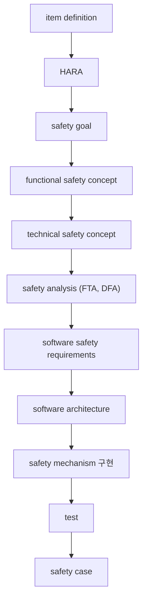

# 소프트웨어 엔지니어를 위한 기능 안전 (Functional Safety) - 가제

책 개요, 초안 v0.8 (2026-11-22)

이 문서는 무엇을 쓰는지를 정한다: 독자, 범위, 예제, 목차.
어떻게 쓰는지는 [PLAN.md](PLAN.md)에, 쓸 때 지키는 규칙은 [RULES.md](RULES.md)에, 참고 문서는 [references/](references/README.md)에 있다.

장마다 "핵심 질문"에 답할 수 있게 되는 것이 학습 목표이고, 그 답을 자기 말로 쓴 것이 원고가 된다.

## 1. 이 책에 대하여

### 책의 성격

- functional safety의 사고방식과 소프트웨어 기법을 다루는 책이다. 왜 그렇게 하는지를 사고 사례와 failure의 원리로 설명하고, 관통 예제로 직접 해 본다.
- ISO 26262는 구조와 용어 수준으로 소개한다. 요구사항을 조항별로 해설하지 않는다.
- 이 책은 ISO 26262:2018의 원문을 보지 않고 쓴다. 규격이 무엇을 요구하는지에 관한 문장은 2차 자료에 근거했음을 밝힌다. 이 사실을 책의 머리말에도 적는다.
- 근거는 누구나 받을 수 있는 공개 문서다: 사고 조사 보고서, 미국 정부의 연구 보고서, NASA와 EASA의 문서, AUTOSAR의 공개 규격 등. 독자가 같은 문서를 받아 확인할 수 있다.
- 초고와 근거 대조는 Claude가 한다. 이 사실도 머리말에 적는다.

### 독자

- 임베디드 시스템 개발 경험이 있는 소프트웨어 엔지니어. C로 MCU의 firmware를 만들어 보았고, interrupt, RTOS, 통신 (예: CAN), debugging에 익숙하다.
- 가정하지 않는 것: 안전 규격 경험, 자동차 분야의 지식, 하드웨어의 고장에 관한 정량 분석.

### 책이 답하려는 질문

1. Safety는 품질이나 reliability와 무엇이 다른가?
2. "이 소프트웨어는 충분히 안전하다"는 말은 무슨 뜻이고, 누가 어떻게 판단하는가?
3. Hazard에서 출발해 내 코드에 대한 요구사항까지 어떻게 내려오는가?
4. 안전을 위해 아키텍처, 코드, 테스트는 평소와 무엇이 달라지는가?
5. 규격은 어떻게 짜여 있고, 그 뒤에 있는 생각은 무엇인가?

### 읽고 나면 할 수 있는 것

- 안전 관련 프로젝트의 문서(HARA, safety concept, safety requirement)를 읽고 자기 작업과 연결한다.
- Software safety requirement를 쓰고, 그것을 만족하는 아키텍처와 safety mechanism을 설계한다.
- Verification 방법마다 무엇을 보장하고 무엇을 보장하지 못하는지 알고, 등급이 높을수록 왜 더 엄격한 방법을 쓰는지 설명한다.
- ISO 26262와 IEC 61508의 구조와 용어를 알고, 필요한 내용이 규격의 어디에 있는지 찾아간다.
- 자동차, 로봇, 드론이 같은 안전 문제를 어떻게 다르게 푸는지 설명한다.

### 다루지 않는 것

- 하드웨어 설계와 정량 분석의 상세 (읽는 법까지만 다룬다)
- 특정 상용 tool의 사용법
- 규격의 요구사항을 조항별로 해설하는 것. 실제 프로젝트에서는 규격의 원문을 따라야 하고, 이 책은 그것을 대신하지 못한다.
- 규격의 문장과 표를 옮겨 싣는 것.
- 임베디드 개발의 기초 (MCU, interrupt, RTOS). 독자가 안다고 본다. 차량의 전자 장치에 관한 최소 지식만 부록 E에서 다룬다.

## 2. 범위

아래는 책의 범위를 정하는 선택이다. 바꾸면 Part II 이후의 예제가 달라진다.
기준으로 삼는 규격의 판은 [references/standards.md](references/standards.md)에 있다.

| 항목 | 선택 | 이유 |
|---|---|---|
| 개념의 뿌리 | IEC 61508 | 분야 공통의 기본 규격이고, ISO 26262, IEC 62061, IEC 61511 같은 분야별 규격의 공통 기반이다. ISO 13849, DO-178C, IEC 62304는 계보가 다르다 |
| 주 분야 | 자동차 | 예제와 사례의 분야다. 공개 자료가 가장 많다. ISO 26262는 구조와 용어 수준으로 소개한다 |
| 보조 분야 | 로봇 (20장), 드론 (21장) | 위험을 따지는 방식이 자동차와 달라, 비교하면 개념이 분명해진다 |
| 그 밖의 분야 | 22장에서 비교 | 항공, 철도, 의료기기, 공정 |
| 원고 언어 | 한국어, 기술 용어는 영어 그대로 | 규격과 국제 자료를 바로 찾을 수 있게 |
| 예제 코드 | C (필요한 곳에 Rust 비교) | 안전 분야의 현재 주 언어 |

### 세 분야를 함께 다루는 방식

Part I-IV는 자동차를 기준으로 쓴다. 로봇과 드론은 Part V에서 한 장씩 다루고,
앞 장들에는 차이가 큰 곳에만 "로봇과 드론에서는"이라는 짧은 항목을 둔다.

세 분야는 같은 문제를 서로 다른 방식으로 푼다. 이 차이가 책의 비교 축이다.

| 비교 항목 | 자동차 | 로봇 | 드론 |
|---|---|---|---|
| 위험을 따지는 단위 | 제품의 기능 (item) | 기계와 작업 | 운용 (operation) |
| 위험 평가 방법 | HARA | ISO 12100 risk assessment | SORA |
| 위험 평가의 결과 | safety goal의 ASIL (A-D) | safety function에 요구되는 PL (a-e) 또는 SIL (1-3) | 운용의 SAIL (I-VI) |
| 소프트웨어의 엄격함을 정하는 것 | 요구사항이 물려받은 ASIL | 그 safety function의 PL 또는 SIL | SAIL이 높을수록 요구가 커진다. SAIL IV에서는 DAL C의 목표를 쓸 수 있는 방법으로 든다. SAIL V와 VI는 failure condition의 심각도에 따라 FDAL D, C, B를 준다 |
| 규격이 등급을 미리 정해 주는가 | 아니다. HARA로 정한다 | 로봇 규격이 safety function과 요구 등급을 정해 두는 경우가 많다 `(확인 필요)` | SORA가 SAIL마다 목표별로 요구되는 robustness를 정해 둔다 |
| 소프트웨어 요구의 출처 | ISO 26262-6 | ISO 13849-1, IEC 62061, IEC 61508-3 | EU: Special Condition Light-UAS와 그 means of compliance. 고위험 운용은 항공 규격 (ARP4754B, DO-178C)을 따른다. 미국: ASTM F3201 `(확인 필요)` |
| safe state와 그에 이르는 방법 | 토크 제한, 기능 축소, 정지. 조향과 제동처럼 끌 수 없는 기능도 있다 | 정지. 다만 정지에도 거리와 시간이 걸린다. 짐과 경사도 영향을 준다 `(확인 필요)` | 공중에서 동력을 끊는 것은 safe state가 아니다 `(확인 필요)`. 제자리 비행, 복귀, 착륙처럼 기능을 유지하는 대응이 필요하다. 비행 종료는 지상의 위험을 가두는 마지막 수단이다 |

주의할 점
- SAIL은 제품이나 기능의 등급이 아니라 운용의 등급이다. ASIL과 같은 종류의 값으로 읽지 않는다.
- 로봇에는 소프트웨어 개발 과정을 다루는 전용 규격이 없다. 로봇 규격은 필요한 safety function과 등급을 정하고, 만드는 방법은 기계류 제어 규격에 맡긴다 `(확인 필요)`. 로봇 규격은 받은 문서가 없다.
- 드론에는 ISO 26262에 해당하는 단일 규격이 없다. 규제와 운용 위험 평가가 중심이고 나라마다 다르다. 이 책은 EU 체계 (SORA)를 기준으로 삼는다.
- 드론 쪽은 제도가 빠르게 바뀐다. 21장은 쓰는 시점에 다시 확인한다.
- 로봇 열과 드론 열은 2026-11-22에 받은 문서와 견주었다. 받은 문서와 다른 칸은 없었다. `(확인 필요)`가 붙은 곳은 받은 문서로 확인하지 못한 것이다. 로봇 열의 근거는 ISO 13849-1의 2015년 판을 설명한 문서 하나다. 자동차 열은 규격 원문으로 확인하지 않았다.

## 3. 관통 예제 (running example)

책 전체에서 시스템 하나를 hazard 분석부터 safety case까지 끌고 간다. 장마다 이 예제의 산출물이 하나씩 쌓인다.

- 제안: 구동 토크 제어 (drive torque control). 가속 페달 입력을 받아 구동 모터의 토크 요구를 만드는 소프트웨어.
- 대표 hazard: 의도하지 않은 가속 (unintended acceleration).
- 고른 이유
  - 위험이 직관적이어서 자동차 지식이 없어도 이해할 수 있다.
  - 감시 구조의 본보기가 있다 (E-Gas monitoring concept: 엔진 제어기용 3단계 감시 구조). 다만 원문은 구하지 못했다. 받은 문서 (AUTOSAR의 공개 문서, 미국 정부의 보고서)에는 이 구조의 이름과 구현 위치만 나오고, 세 단계가 무엇인지는 나오지 않는다. 그래서 이 구조에 관한 문장은 `(확인 필요)`이고, 예제의 감시 구조는 이 책의 설계로 제시한다.
  - 1장의 Toyota 사례와 같은 hazard를 다룬다. 그 사례의 원인은 공식 조사와 재판의 결론이 갈린다.
  - 같은 주제를 다룬 미국 정부의 공개 보고서가 있다 (전기차의 가속 제어 시스템에 대한 functional safety 평가). hazard 분석에서 functional safety concept까지를 이 보고서와 견주어 볼 수 있다.
  - 센서와 모터를 PC에서 시뮬레이션할 수 있어 개발 보드 없이 실습할 수 있다.

### 예제의 범위

자세한 것은 [example/drive-torque/docs/scope.md](example/drive-torque/docs/scope.md)에 있다. 그 문서가 원본이다.

- item의 경계: 차량 제어기 (VCU) 하나다. 가속 페달에서 토크 요구를 만들어 inverter에 보낸다. inverter와 모터는 가정 (assumption of use)으로 받는 외부 요소다. 미국 정부의 보고서는 inverter까지 경계 안에 넣으므로, 그 보고서의 요구사항 가운데 inverter 쪽 몫은 예제에서 가정이 된다.
- item의 기능: 토크 요구 계산, 제동 우선 (brake override), 토크 요구 전송, 감시와 고장 대응. 회생 제동, creep, 다른 시스템의 토크 요구는 다루지 않는다.
- HARA에 올리는 hazard: 의도하지 않은 가속, 감속 부족, 잘못된 방향으로 움직임, 구동력의 감소나 상실, 구동 부족. 책 전체에서 끌고 가는 것은 의도하지 않은 가속 하나다. 정지 상태에서의 의도하지 않은 출발은 그 hazard의 운전 상황 하나로 다룬다.
- safe state: "토크 0" 하나가 아니다. 토크를 끊으면 구동력 상실이라는 다른 hazard가 되기 때문이다. 예제는 토크 요구의 제한, 토크 요구 0, 구동 허용 신호의 차단이라는 세 단계를 쓴다. 전기 모터는 끄는 방법에 따라 원치 않는 제동 토크가 생길 수 있어서, inverter 쪽의 전략은 가정 목록에 남긴다 `(확인 필요)`.
- 예제의 등급과 수치는 설명을 위한 가정이다.
- PC 시뮬레이션은 논리를 검증할 뿐이다. 감시 기능의 독립성, 실제 실행 시간, 하드웨어의 동작은 보여 주지 못한다.

산출물의 흐름:

### 보조 예제

20장과 21장에서는 작은 예제를 하나씩 따로 쓴다. 위험 평가에서 구조 설계까지만 가고, 관통 예제와 나란히 놓고 비교한다.

- 로봇: 자율 이동 로봇의 속도에 따른 보호 영역 전환과 정지. 안전 기능은 인증된 센서와 safety controller가 수행한다. 이 예제는 일반 소프트웨어가 안전 기능에서 하는 일과 하지 않는 일의 경계를 보인다.
- 드론: 소형 multicopter의 조종 link 상실, geofence 이탈, 위치 상실에 대한 대응. 고장이 나면 미리 정한 동작 (제자리 비행, 복귀, 착륙) 가운데 하나로 넘어가는 기능이다.

## 4. 목차

원고는 `chapters/`에, 장 계획 (다룰 내용, 예제 산출물, 근거, 상태)은 `plans/`에 장마다 파일 하나씩 있다. 두 폴더의 파일 이름은 같다.
목표 쪽수는 채워야 하는 양이 아니라 넘지 않으려는 상한이다. 범위가 늘어나는 것을 막고 일정을 추정하는 데 쓴다. 합은 300쪽 안팎이다. 전체 분량은 따로 정하지 않았다 (PLAN.md 12절). 1, 4, 5장은 초고가 상한을 넘어, 검토에서 겹친 곳을 줄인 뒤에 상한을 고쳤다 (2026-11-23: 12 -> 15, 8-10 -> 11, 10 -> 12). 사례에서 누가 무엇을 말했는지를 나눠 적는 데 드는 길이는 줄이지 않았다.

### Part I. 사고방식과 기본 개념

| 장 | 제목 (원고) | 장 계획 | 핵심 질문 | 목표 쪽수 |
|---|---|---|---|---|
| 1 | [소프트웨어가 사람을 다치게 할 때](chapters/ch01-accidents.md) | [계획](plans/ch01-accidents.md) | 소프트웨어는 닳지도 부러지지도 않는데 어떻게 사고를 일으키는가? | 15 |
| 2 | [기본 개념과 용어](chapters/ch02-concepts-and-terms.md) | [계획](plans/ch02-concepts-and-terms.md) | safety, reliability, availability, security는 어떻게 다른가? | 10 |
| 3 | [Risk와 integrity level](chapters/ch03-risk-and-integrity-level.md) | [계획](plans/ch03-risk-and-integrity-level.md) | 얼마나 안전해야 충분한가? 그 답이 어떻게 개발 방법의 엄격함으로 바뀌는가? | 12 |
| 4 | [규격 지도와 규격 읽는 법](chapters/ch04-standards-map.md) | [계획](plans/ch04-standards-map.md) | 규격은 왜 이렇게 많고 서로 어떤 관계인가? 규격 문장은 어떻게 읽어야 하는가? | 11 |

### Part II. Hazard에서 소프트웨어 요구사항까지

| 장 | 제목 (원고) | 장 계획 | 핵심 질문 | 목표 쪽수 |
|---|---|---|---|---|
| 5 | [Safety lifecycle과 safety management](chapters/ch05-safety-lifecycle.md) | [계획](plans/ch05-safety-lifecycle.md) | 안전은 왜 기술만이 아니라 프로세스와 조직의 문제인가? | 12 |
| 6 | [Hazard analysis and risk assessment](chapters/ch06-hara.md) | [계획](plans/ch06-hara.md) | 무엇이 위험한지 어떻게 빠짐없이 찾고, 등급을 매기는가? | 16 |
| 7 | [Safety concept: 요구사항을 아래로 내리기](chapters/ch07-safety-concept.md) | [계획](plans/ch07-safety-concept.md) | safety goal 한 문장이 어떻게 소프트웨어 요구사항 수십 개가 되는가? | 16 |
| 8 | [Safety analysis 기법](chapters/ch08-safety-analysis.md) | [계획](plans/ch08-safety-analysis.md) | 설계가 safety goal을 위반할 수 있는 경로를 어떻게 찾는가? | 14 |
| 9 | [소프트웨어 엔지니어가 알아야 할 하드웨어](chapters/ch09-hardware-for-software-engineers.md) | [계획](plans/ch09-hardware-for-software-engineers.md) | 하드웨어는 어떻게 고장 나고, 그중 무엇이 소프트웨어의 일이 되는가? | 8-10 |

### Part III. 안전한 소프트웨어 만들기

| 장 | 제목 (원고) | 장 계획 | 핵심 질문 | 목표 쪽수 |
|---|---|---|---|---|
| 10 | [Software safety requirements](chapters/ch10-software-safety-requirements.md) | [계획](plans/ch10-software-safety-requirements.md) | 검증할 수 있는 안전 요구사항은 어떻게 쓰는가? | 14 |
| 11 | [Software architecture for safety](chapters/ch11-software-architecture.md) | [계획](plans/ch11-software-architecture.md) | 일부가 고장 나도 안전한 구조는 어떻게 만드는가? | 18 |
| 12 | [Software safety mechanism](chapters/ch12-safety-mechanisms.md) | [계획](plans/ch12-safety-mechanisms.md) | 고장을 제때 감지하고 반응하는 구체적 수단은 무엇인가? | 20 |
| 13 | [Coding for safety](chapters/ch13-coding.md) | [계획](plans/ch13-coding.md) | 언어와 코딩 습관은 안전에 얼마나 기여하는가? | 16 |
| 14 | [플랫폼: RTOS, OS, multicore](chapters/ch14-platform.md) | [계획](plans/ch14-platform.md) | 내 코드 아래에 있는 소프트웨어와 프로세서는 믿을 수 있는가? | 10 |

### Part IV. 안전함을 보이고 유지하기

| 장 | 제목 (원고) | 장 계획 | 핵심 질문 | 목표 쪽수 |
|---|---|---|---|---|
| 15 | [Verification 전략: review, 정적 분석, formal method](chapters/ch15-verification-strategy.md) | [계획](plans/ch15-verification-strategy.md) | 테스트만으로 부족한 것은 무엇이고, 무엇으로 메우는가? | 12 |
| 16 | [Testing](chapters/ch16-testing.md) | [계획](plans/ch16-testing.md) | 언제 "충분히 테스트했다"고 말할 수 있는가? | 18 |
| 17 | [Tool과 기존 소프트웨어](chapters/ch17-tools-and-existing-software.md) | [계획](plans/ch17-tools-and-existing-software.md) | 내가 만들지 않은 것 (compiler, code generator, library, open source)을 어떻게 믿는가? | 12 |
| 18 | [변경, 형상, 릴리스 이후](chapters/ch18-change-and-configuration.md) | [계획](plans/ch18-change-and-configuration.md) | 한 번 안전하다고 보인 소프트웨어를 바꿀 때 무엇을 다시 해야 하는가? | 12 |
| 19 | [Safety case와 assessment](chapters/ch19-safety-case.md) | [계획](plans/ch19-safety-case.md) | 흩어진 산출물이 어떻게 "안전하다"는 하나의 주장이 되는가? | 12 |

### Part V. 넓히기

| 장 | 제목 (원고) | 장 계획 | 핵심 질문 | 목표 쪽수 |
|---|---|---|---|---|
| 20 | [로봇: 기계류 안전의 방식](chapters/ch20-robots.md) | [계획](plans/ch20-robots.md) | 사람 옆에서 움직이는 기계의 안전은 자동차와 무엇이 같고 무엇이 다른가? | 14 |
| 21 | [드론: 운용 위험 기반의 방식](chapters/ch21-drones.md) | [계획](plans/ch21-drones.md) | 동력을 끊는 것이 안전하지 않은 기계는 어떻게 안전해지는가? 제품이 아니라 운용을 기준으로 위험을 따지면 무엇이 달라지는가? | 14 |
| 22 | [그 밖의 분야의 소프트웨어 안전 규격](chapters/ch22-other-domains.md) | [계획](plans/ch22-other-domains.md) | 같은 문제를 다른 분야는 어떻게 다르게 푸는가? | 8 |
| 23 | [Functional safety의 경계](chapters/ch23-boundaries.md) | [계획](plans/ch23-boundaries.md) | 고장이 없어도 위험할 수 있다면, functional safety는 어디까지 책임지는가? | 8 |
| 24 | [실무에 적용하기](chapters/ch24-in-practice.md) | [계획](plans/ch24-in-practice.md) | 배운 것을 내 프로젝트에 어디서부터 적용할 것인가? | 6 |

### 부록

| 부록 | 제목 (원고) | 장 계획 |
|---|---|---|
| A | [용어집](chapters/appendix-a-glossary.md) | [계획](plans/appendix-a-glossary.md) |
| B | [규격 구조 대응표](chapters/appendix-b-standards-map.md) | [계획](plans/appendix-b-standards-map.md) |
| C | [관통 예제의 산출물](chapters/appendix-c-example-artifacts.md) | [계획](plans/appendix-c-example-artifacts.md) |
| D | [참고 문헌](chapters/appendix-d-references.md) | [계획](plans/appendix-d-references.md) |
| E | [차량 E/E 최소 지식](chapters/appendix-e-vehicle-ee-basics.md) | [계획](plans/appendix-e-vehicle-ee-basics.md) |
