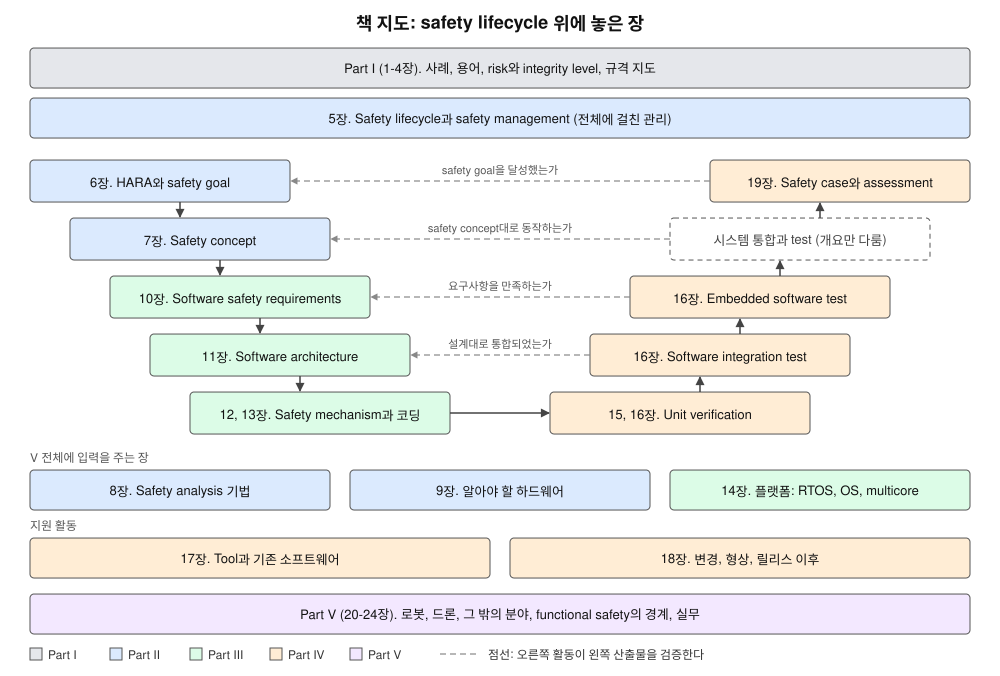
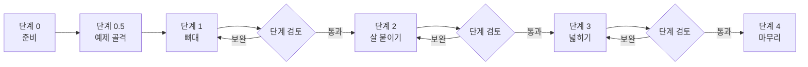
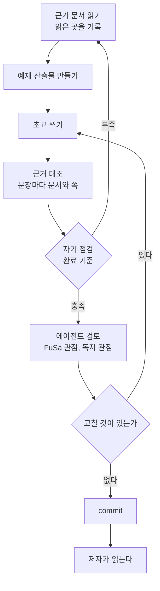
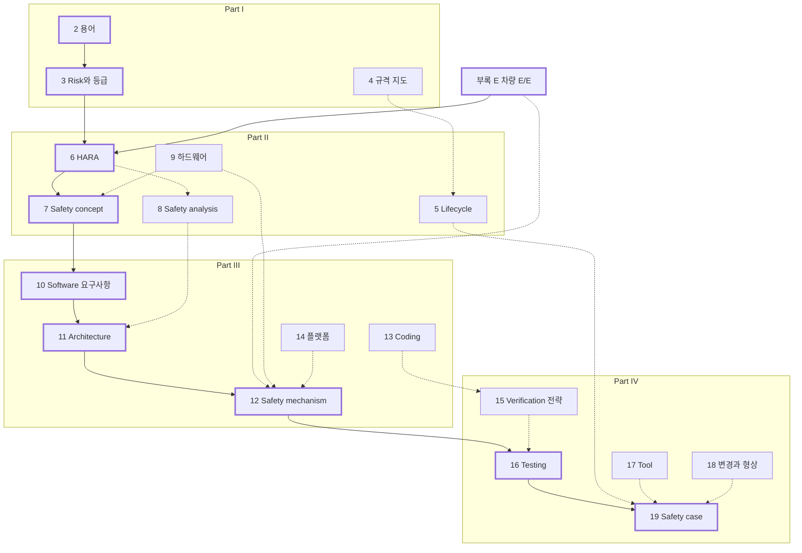
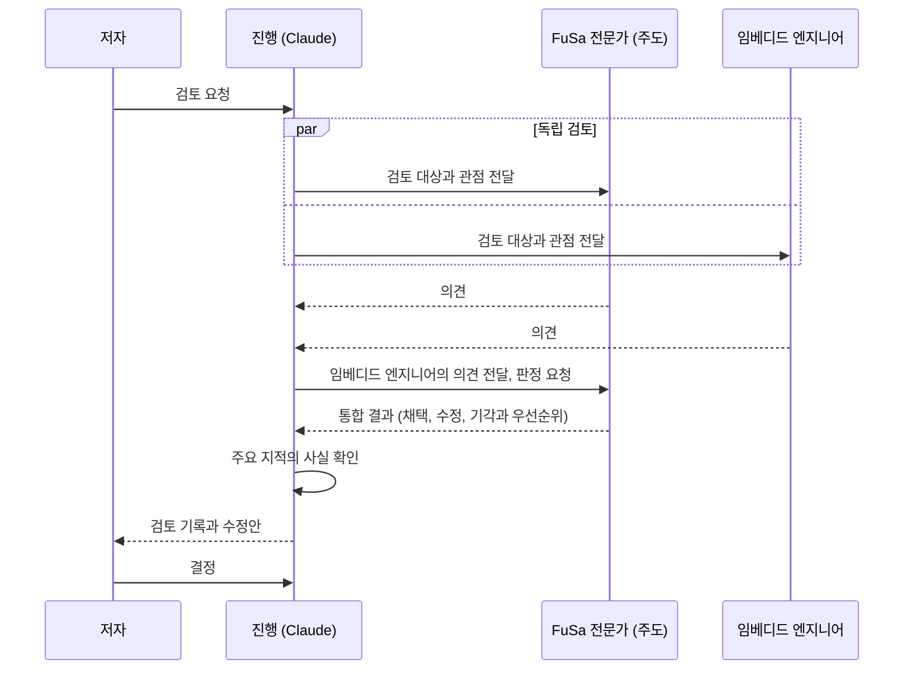

# 작성 계획

초안 v0.12 (2026-11-22)

이 문서는 책을 어떤 순서와 절차로 쓰고 어떻게 검증할지를 정한다.
무엇을 쓰는지는 [OUTLINE.md](OUTLINE.md)에, 쓸 때 지키는 규칙은 [RULES.md](RULES.md)에 있다.
이 판은 [2026-11-22 검토](reviews/2026-11-22-plan/README.md)의 결과를 반영했다.

## 1. 목표

- 산출물: 24개 장과 부록 5개의 원고 (장별 상한의 합은 300쪽 안팎), 관통 예제 (문서와 코드), 보조 예제 2개
- 학습 목표: 장마다 핵심 질문에 근거를 들어 답할 수 있다
- 완성의 뜻: 모든 장이 6절의 최종 완료 기준을 만족하고, 관통 예제의 safety goal이 요구사항, 코드, test, safety case까지 끊김 없이 이어진다

## 2. 접근 원칙

1. 배우는 것이 먼저다. 분량보다 핵심 질문에 답할 수 있는지를 기준으로 삼는다.
2. 얇게 끝까지 먼저 간다. 전체 흐름을 한 번 겪은 뒤에 깊이를 더한다.
3. 예제는 설명에 필요한 만큼만 만든다.
4. 확인하지 못한 것을 확인한 것처럼 쓰지 않는다. 표시하는 방법은 RULES.md에 있다.
5. 규격을 해설하지 않는다. 사고방식과 소프트웨어 기법을 다루고, ISO 26262는 구조와 용어 수준으로 소개한다.
6. 저자의 시간을 아낀다. 자료 읽기, 예제, 초고, 근거 대조, 검토는 Claude가 한다. 저자는 완성된 장을 읽고, 필요한 결정만 한다.
7. 근거는 Claude가 직접 읽을 수 있는 공개 문서로 한정한다. 저자만 볼 수 있는 문서에 기대면 저자가 대조해야 하기 때문이다.

## 3. 역할

저자의 시간을 적게 쓰는 방식으로 진행한다 (2026-11-22 결정).

| 일 | 저자 | Claude |
|---|---|---|
| 자료 읽기 | 하지 않아도 된다 | 받은 문서를 직접 읽고, 읽은 곳을 기록한다 |
| 예제 산출물과 코드 | 하지 않아도 된다 | 만든다 |
| 초고 | 하지 않아도 된다 | 쓴다 |
| 근거 대조 | 하지 않아도 된다 | 문장마다 받은 문서의 해당 쪽을 다시 읽어 대조하고 기록한다 |
| 검토 | 하지 않아도 된다 | 역할 에이전트 검토를 진행하고, 반영하고, 기록한다 |
| 완성된 장 읽기 | 읽는다. 이것이 저자의 학습이다 | 단계가 끝날 때 읽을 것을 모아 알린다 |
| 결정 | 12절의 정해야 할 것. 답하지 않으면 기본값으로 진행한다 | 결정이 필요한 것을 기본값과 함께 알린다 |

저자가 원하면 할 수 있는 일은 5절의 단계 0에 따로 적었다. 하지 않아도 작업은 진행된다.

## 4. 책 지도

장이 safety lifecycle의 어디에 놓이는지 보여 준다. 왼쪽은 요구를 아래로 내리는 장, 오른쪽은 그것을 검증하는 장이다. 굵은 테두리는 단계 1에서 쓰는 장이다.

## 5. 단계

### 단계 0. 준비

끝난 일
- [x] 참고 문서를 접근 등급으로 나누고, 받을 수 있는 것을 받았다 (`references/`, 33개)
- [x] 원고 파일과 장 계획 파일의 틀을 만들었다 (`chapters/`, `plans/`)
- [x] 작성 계획을 검토받고 반영했다 (`reviews/2026-11-22-plan/`)
- [x] 장마다 어느 문서의 어느 부분을 근거로 삼을지 장 계획에 적었다 ("근거 위치" 절). 받은 문서에 근거가 없는 항목도 함께 적었다
- [x] 예제 범위 문서를 썼다 (`example/drive-torque/docs/scope.md`). 받은 문서 nhtsa-etc-ev-fsa와 견주어 hazard 목록을 고쳤다
- [x] 도구를 확인했다 (`notes/tool-check.md`). GCC와 LLVM이 모두 MC/DC를 잰다. unit test는 예제 안의 작은 test 틀로 한다
- [x] `example/` 폴더 구조와 ID 체계를 정했다 (`example/README.md`)
- [x] 문서 검사 도구 `tools/lint`를 만들었다
- [x] `notes/claims.md`와 `notes/permissions.md`의 틀을 만들었다
- [x] 용어집 초안을 만들었다 (부록 A, 37개)
- [x] CBMC와 cppcheck를 확인했다. 저자가 두 도구를 설치했다. CBMC는 감시 함수 시제품에서 "출력이 한도 이하"와 "overflow 없음"을 증명했고, 일부러 넣은 결함을 찾았다

단계 0에서 알게 된 것
- 근거가 두터운 장: 6, 7, 8장 (미국 정부의 보고서), 11, 12장 (AUTOSAR의 공개 문서), 16장의 MC/DC, 19장 (GSN), 21장 (SORA와 EASA 문서)
- 근거가 얇은 장: 9장의 하드웨어 지표, 13-15장의 코딩 규칙과 정적 분석, 17장의 tool 분류, 18장의 갱신, 20장의 로봇 규격, 23장 전체. 이 장들은 쓰기 전에 공개 문서를 더 찾고, 찾지 못한 내용은 쓰지 않는다
- E-Gas의 3단계 감시 구조는 받은 문서로 설명할 수 없다. 받은 문서에는 이름과 구현 위치만 나온다. 예제의 감시 구조는 이 책의 설계로 제시한다

저자가 원하면 하는 일 (하지 않아도 진행된다)
- 직접 받아야 하는 문서를 받는다 (references/README.md). 받아 두면 Claude가 읽을 수 있는 근거가 늘어난다. 특히 Leveson의 Engineering a Safer World와 MIL-STD-882E
- KS C IEC 61508을 읽어 본다. 책의 근거로는 쓰지 않는다
- 단계 1 뒤에 검토해 줄 functional safety 실무자를 찾는다 (12절의 5번)

완료 기준: 남은 일이 끝났다. 2026-11-22에 모두 끝났다.

### 단계 0.5. 예제 골격

글을 쓰기 전에 예제를 돌릴 바탕을 만든다. 장을 쓰면서 바탕까지 만들면 장마다 시간이 모자란다.

- 할 일: 개발 container, build, plant model, HAL, fault injection 인터페이스, unit test, coverage, 정적 분석, CI, 요구사항 YAML과 추적 스크립트. 단계 0의 도구 확인 결과를 반영한다
- 완료 기준
  - 깨끗한 container에서 `make check`가 통과한다
  - coverage 보고서와 정적 분석 보고서가 만들어진다
  - 추적 스크립트가 빈 요구사항 목록에 대해 동작한다
- 상태 (2026-11-22): 끝났다. 다만 두 가지는 하지 못했다
  - 깨끗한 container에서 돌려 보지 못했다. 이 컴퓨터에서 docker가 실행 중이 아니었다. `make check`는 이 컴퓨터에서 통과한다
  - CI는 만들지 않았다. 저장소에 원격이 없다

### 단계 1. 뼈대

- 쓰는 장: 2, 3, 6, 7, 10, 11, 12, 16, 19장과 부록 E (차량 E/E)의 뼈대. 이 순서대로 쓴다
- 목표 분량: 2, 3, 19장과 부록 E는 1-2쪽, 6, 7, 10, 11, 12, 16장은 2-3쪽
- 예제: hazard 하나를 골라 safety goal에서 safety case까지 간다. 만드는 것은 8절의 표에서 "단계 1" 열에 있는 것이다
- 완료 기준
  - 예제의 safety goal 하나가 요구사항, 코드, test, safety case까지 추적된다
  - 9개 장과 부록 E가 6절의 1차 완료 기준을 만족한다
  - 단계 검토를 통과한다
  - 저자가 읽을 것을 한 번에 모아 알렸다
- 상태 (2026-11-22): 끝났다. 초고와 예제를 만들고 단계 검토를 세 번 받아 통과했다. 검토 기록은 `reviews/2026-11-22-stage1/`에 있다
  - 예제의 설계는 쓰기 전에 두 역할의 에이전트가 토론했다 (`reviews/2026-11-22-example-design/`)
  - `SG-01`에서 요구사항 25개, 코드, test 27개, safety case까지 추적된다. safety case는 닫히지 않았고, 닫히지 않은 가지 넷을 그대로 적었다
  - 단계 검토에서 반드시 고칠 것이 열 개 나왔고 모두 반영했다. 가장 무거운 둘은 감시의 허용 토크와 정상 동작 사이의 틈이었다
  - 합의되지 않은 쟁점은 예제 설계 토론의 1건뿐이다 (`notes/disputes.md`)
  - 장마다 따로 검토하지 않고 단계 검토 한 번으로 묶었다. 뼈대의 장이 1-3쪽씩이기 때문이다
  - 사람의 검토는 받지 않았다. 저자가 읽을 것은 `README.md`의 "지금 어디까지 왔는가"에 모았다

### 단계 2. 살 붙이기

- 새로 쓰는 장: 1, 4, 5, 8, 9, 13, 14, 15, 17, 18장
- 깊게 고치는 장: 단계 1의 9개 장과 부록 E
- 쓰는 순서
  1. 1, 4, 5장 (배경과 틀). 했다 (2026-11-23). 검토 두 번, 통과 (`reviews/2026-11-22-stage2-part1/`)
  2. 8, 9장을 쓰고 6, 7장을 깊게 고친다. 했다 (2026-11-23). 검토 세 번, 통과 (`reviews/2026-11-23-stage2-part2/`). 예제에 `SWR-13`과 `SWR-14`를 구현했고, 나머지 열 가지는 요구사항에 "구현 예정"으로 적었다
  3. 13, 14장을 쓰고 10, 11, 12장과 부록 E를 깊게 고친다
  4. 15, 17장을 쓰고 16장을 깊게 고친다
  5. 18장을 쓰고 19장을 깊게 고친다
- 예제: 8절의 표에서 "단계 2" 열에 있는 것
- 단계 1에서 넘긴 것
  - 검사 counter의 규칙: 이어지는 횟수를 유지하고, 간헐 고장을 따로 판정하는 검사를 더한다 (`notes/disputes.md`의 1번). 했다: `SWR-14` (2026-11-23)
  - 입력의 간헐 고장과 기능의 고장이 겹치는 경우를 막을지 정한다: 감시의 변화율 제한, 기능의 변화율 제한을 뺌, 간헐 고장의 판정, debounce 가운데 고른다 (`example/drive-torque/docs/technical-safety-concept.md` 3절). 했다: 감시의 변화율 제한 `SWR-13` (2026-11-23). 고른 경위는 `reviews/2026-11-23-example-stage2/`
  - 브레이크와 기어 신호의 검사, 토크 요구 메시지의 보호, 감시 자신의 고장 (safety case의 열린 가지 넷)
  - test 보고서의 숫자를 자동으로 만든다
- 완료 기준: 19개 장과 부록 E가 1차 완료 기준을 만족하고, 그 가운데 단계 1의 장들은 목표 분량에 이른다

### 단계 3. 넓히기

- 쓰는 장: 20, 21장 (보조 예제 포함), 22, 23, 24장
- 그다음: 3, 6, 7, 11, 12, 14, 19장의 "로봇과 드론에서는" 항목, 부록 A-D
- 완료 기준: 24개 장과 부록이 모두 있다

### 단계 4. 마무리

- 처음부터 끝까지 이어 읽으며 용어와 표기를 통일한다
- 규격의 판을 다시 확인한다 (IEC 61508 Edition 3, ISO 26262 3판, 드론 제도, EU Machinery Regulation)
- `(확인 필요)` 표시를 모두 없앤다
- 규격 구조 대응표 (부록 B)를 볼 수 있는 자료와 대조한다. 확인할 수 없는 줄은 뺀다
- 전체 검토를 받는다
- 완료 기준: 모든 장이 최종 완료 기준을 만족한다

## 6. 장 하나를 쓰는 절차

commit까지는 Claude가 한다. 저자가 읽는 것은 그 뒤이고, 다음 장은 저자를 기다리지 않고 진행한다.

### 1차 완료 기준

- [ ] 핵심 질문의 답이 본문에 있다
- [ ] 예제 산출물이 있고 본문이 그것을 가리킨다
- [ ] 예제 산출물이 있는 장은 `example/`에서 `make check`가 통과한다
- [ ] 이 장이 다루는 요구사항 ID가 코드와 test에 있음을 추적 스크립트가 확인한다
- [ ] 사실 주장마다 근거가 `notes/claims.md`에 있다. 받은 문서의 id와 쪽을 적고, Claude가 그 쪽을 직접 읽은 것만 적는다
- [ ] 규격에 관한 문장에 `(2차 자료)` 또는 `(확인 필요)` 표시가 있다
- [ ] 규격의 문장이나 표를 옮긴 곳이 없다
- [ ] 새로 나온 용어가 용어집에 있다
- [ ] 다이어그램과 그림이 제대로 그려진다
- [ ] `tools/lint`가 통과한다
- [ ] 풀리지 않은 질문이 `notes/`에 적혀 있다

### 최종 완료 기준

- [ ] 1차 완료 기준을 모두 만족한다
- [ ] `(확인 필요)`가 없다
- [ ] 규격 구조 대응표 (부록 B)에 이 장의 줄이 채워져 있다
- [ ] "흔한 오해" 항목과 확인 문제 3-5개가 있다
- [ ] 검토 의견이 반영되었거나, 반영하지 않은 이유가 적혀 있다

### 저자를 위한 선택 사항

- 장을 읽은 뒤 장 끝의 확인 문제를 풀어 본다.
- 이해가 안 되거나 이상한 곳이 있으면 알려 준다. 그 장을 고친다.

## 7. 장 사이의 의존 관계

- 실선: 앞 장의 내용이 있어야 뒤 장의 뼈대를 쓸 수 있다
- 점선: 앞 장이 있어야 뒤 장을 깊게 고칠 수 있다
- 굵은 테두리: 단계 1에서 쓰는 장
- 읽는 순서는 목차를 따른다. 이 그림은 쓰는 순서만 보인다

Part V의 장은 그림에서 뺐다. 20, 21장은 6, 7, 11, 12장을, 22장은 20, 21장을, 23장은 6장을, 24장은 19장을 바탕으로 한다.

단계 1의 장이 점선으로 기대는 내용 (8장의 분석, 9장의 하드웨어 가정)은 장의 원고 없이 예제 산출물로만 먼저 만든다 (8절).

## 8. 예제 계획

### 관통 예제의 산출물

| 산출물 | 장 | 단계 1 | 단계 2 |
|---|---|---|---|
| hazard와 fault 정리표 | 2 | 한 쪽 | 그대로 |
| 규격 구조 대응표의 틀 | 4 | 없음 | 전체 |
| safety plan | 5 | 없음 | 한 쪽 |
| item definition, E/E 구성도, item의 경계 | 6, 부록 E | 한 쪽 | 전체 |
| HARA | 6 | hazardous event 4-5개 | 전체 표 |
| safety goal, safe state, FTTI 가정값 | 6 | 1개 | 전체 |
| functional safety concept | 7 | safety goal 1개에 대해 | 전체 |
| technical safety concept | 7 | 입력 검사, 기능, 감시와 출력 단계로 나눈 구조 (이 책의 설계) | 전체 |
| 가정 목록 (inverter, MCU) | 7, 9 | 5-10줄 | 전체 |
| 시간 예산표 (FTTI, fault detection과 reaction의 시간, task 주기) | 7, 14 | 한 쪽 | 측정값 포함 |
| decomposition 또는 coexistence 판단 | 7 | 한 줄과 근거 | 전체 |
| hardware-software interface 명세 | 7 | 없음 | 전체 |
| FTA | 8 | safety goal 1개 | FMEA, STPA 추가 |
| 독립성 주장 목록 (dependent failure, freedom from interference) | 8, 11 | 한 쪽 | 전체 |
| 하드웨어 진단 목록 | 9 | 없음 | 전체 |
| software safety requirements (ID, YAML) | 10 | 5-10개 | 전체 |
| software architecture (입력 검사, 기능, 감시와 출력 단계, HAL, task table) | 11 | 정적 view와 동적 view 각 1개 | 전체 |
| 아키텍처 수준의 safety analysis | 11 | 없음 | 1건 |
| safety mechanism 구현 | 12 | 토크 감시, 페달 plausibility | 추가 mechanism |
| startup과 reset 동작 | 12 | 없음 | 구현과 test |
| coding guideline, 정적 분석 설정 | 13 | 없음 | 전체 |
| task 설계, timing 예산 | 14 | 없음 | 전체 |
| 정적 분석 결과, formal verification 시도 | 15 | 없음 | unit 1개 |
| verification plan과 report | 15, 16 | 없음 | 한 쪽씩 |
| test, fault injection, 반응 시간 측정, coverage | 16 | requirements-based test, fault injection 3건 이상 | coverage 측정 포함 |
| tool 분류표 | 17 | 없음 | 전체 |
| impact analysis | 18 | 없음 | 변경 1건 |
| safety case | 19 | 한두 쪽. FTA, 독립성 주장, test를 증거로 가리킨다 | 전체 |
| confirmation review 기록의 예 | 19 | 없음 | 1건 |
| "sim이 보이는 것과 못 보이는 것" 표 | 11, 12, 16 | 한 쪽 | 장마다 |

보조 예제는 단계 3에서 만든다.

- 로봇: 자율 이동 로봇의 속도에 따른 보호 영역 전환과 정지. 안전 기능의 정의, 요구 등급, Category 구조, 정지 거리 예산, 일반 소프트웨어와 safety controller의 경계 그림
- 드론: 소형 multicopter 운용 하나의 SAIL 결정, link 상실과 geofence 이탈과 위치 상실에 대한 상태 기계

### 설계 원칙

- 언어: C. 감시 함수는 고정소수점 정수 연산으로 쓴다
- 실행 모델: process 하나, thread 하나, 1 ms 단위의 가상 시계, 정적 task table. 실행 시간은 시뮬레이션이 넣어 주는 값이다
- HAL 경계: ADC, 토크 출력과 enable 신호, CAN, 시간, 비휘발성 memory, watchdog, reset 원인. 응용과 감시의 코드는 HAL만 부른다
- 페달 센서: 특성이 서로 다른 두 채널. 두 채널이 함께 틀어지는 공통 원인 고장을 한 가지 넣는다
- fault injection: HAL 뒤에서 넣거나, 모듈 전체를 link할 때 바꿔 끼워서 넣는다. 제품의 소스에는 test용 코드를 넣지 않는다
  - 센서: 고착, 튐, offset, 단선, 공통 원인
  - CAN: 소실, 값 정지, CRC 불일치, 지연
  - 실행: task 건너뜀, 지연 초과
  - memory: 고른 변수의 bit 반전
  - 비휘발성 memory: 쓰는 도중의 중단
  - startup: 센서가 안정되기 전의 구간
  - 감시 기능 자체의 고장
- 측정: fault를 넣은 시각부터 토크가 한도 아래로 내려간 시각까지를 재어 FTTI 가정값과 비교한다
- 기록: 시나리오마다 CSV 기록과 그래프를 남긴다

### 도구 (단계 0에서 확인)

확인한 결과는 `notes/tool-check.md`에 있다.

- compiler: GCC 16과 LLVM 23을 함께 쓴다. 두 compiler 모두 MC/DC를 잰다. 세는 단위가 달라 숫자를 그대로 견줄 수 없다
- unit test: 바깥의 framework를 받지 않고 예제 안에 작은 test 틀을 둔다
- 정적 분석: cppcheck 2.22와 clang-tidy를 함께 쓴다. 두 도구가 찾는 것이 다르다
- formal verification: CBMC 6.11. 감시 함수의 성질을 모든 입력에 대해 증명하는 데 쓴다
- 모든 도구는 qualification되지 않았다. 이 사실을 17장의 tool 분류표에 밝힌다

### 알고 있는 한계

- PC 시뮬레이션은 논리를 검증할 뿐이다. 다음은 보여 주지 못한다
  - interrupt의 선점과 그 때문에 생기는 data 경합
  - 실제 실행 시간과 그 흔들림
  - stack overflow, memory protection의 동작
  - hardware watchdog의 reset, startup과 reset 직후의 상태
  - ADC의 잡음과 오차, CAN의 오류 상태, 비휘발성 memory의 실제 동작
  - compiler와 정수 크기의 차이
- 독립성은 시뮬레이션되지 않는다. 감시를 다른 함수나 thread에 두는 것은 partitioning이 아니다. 예제를 쓰는 장마다 "sim이 보이는 것과 못 보이는 것" 표를 단다
- 예제의 등급과 수치는 설명을 위한 가정이다. 실제 제품의 근거로 쓸 수 없음을 본문에 밝힌다
- 보드나 emulator로 옮기지 않는다. PC 시뮬레이션까지 한다 (저자가 2026-11-22에 정했다). 그래서 위의 "못 보이는 것"은 이 책에서 끝까지 못 보이는 것으로 남는다. HAL 경계는 지킨다. 독자가 옮기려 할 때 응용과 감시의 코드를 바꾸지 않아도 되게 하기 위해서다

## 9. 검증과 검토

### 사실 검증

1. 근거는 Claude가 직접 읽을 수 있는 문서로 한정한다: 받은 문서 (접근 등급 A)와 공개된 웹 페이지.
2. 초고를 쓴 뒤 사실 주장마다 근거 문서의 해당 쪽을 다시 읽어 대조하고, `notes/claims.md`에 문서의 id와 쪽을 적는다.
3. 받은 문서로 확인되지 않는 문장은 뺀다. 꼭 필요하면 `(확인 필요)`로 남겼다가 단계 4까지 없앤다.
4. ISO 26262의 요구사항에 관한 문장은 `(2차 자료)`로 밝힌다. 주된 2차 자료는 미국 정부의 보고서 (nhtsa-etc-ev-fsa, nhtsa-safety-standards-assessment)와 AUTOSAR의 공개 문서다.
5. 단계 검토에서 다시 본다.

알고 있는 한계
- ISO 26262:2018의 원문은 사지 않기로 했다 (12절). 그래서 "ISO 26262가 요구한다"는 수준의 문장은 원문으로 확정할 수 없다.
- 저자가 볼 수 있는 IEC 61508의 한국어 번역본은 열람 조건 때문에 Claude가 읽을 수 없다. 책의 근거로 쓰지 않는다.
- 사람이 원문과 대조하지 않는다. 이 사실을 책의 머리말에 밝힌다.
- 무엇을 근거로 쓰는지는 [references/README.md](references/README.md)의 "원문 없이 쓰는 방법"에 있다.

### 단계 검토

단계가 끝날 때마다 두 역할의 에이전트가 검토한다. FuSa 전문가가 주도하고, 임베디드 소프트웨어 엔지니어가 독자와 실무의 관점에서 의견을 낸다.

- 두 검토자는 서로의 의견을 보지 않고 먼저 따로 검토한다. 서로의 결론에 끌려가지 않게 하기 위해서다.
- 의견이 갈리면 두 검토자가 상대의 의견을 읽고 다시 답한다. 3회까지 한다. 그래도 합의되지 않으면 진행자의 안으로 진행하고, 쟁점을 `notes/disputes.md`에 모아 저자에게 한 번에 알린다 (저자가 2026-11-22에 정했다).
- 검토 기록은 `reviews/`에 둔다.
- 에이전트 검토는 사람 전문가의 검토를 대신하지 못한다. 에이전트도 규격 원문을 볼 수 없다.
- 두 역할의 에이전트는 같은 계열의 모델이라 오류가 서로 닮을 수 있다. 두 검토가 일치하는 것을 사실 확인으로 여기지 않는다.
- 사람 functional safety 실무자의 검토는 선택 사항이다. 받으면 좋지만 사람을 찾는 데 저자의 시간이 든다. 받지 않으면 그 사실을 검토 기록과 책의 머리말에 적는다.

## 10. 분량과 일정

### 분량 목표

- 단계 1: 5절에 적은 장별 분량
- 최종: 전체 분량은 따로 정하지 않았다 (12절). 장별 목표는 OUTLINE.md 4절에만 적고, 그 합은 300쪽 안팎이다. 목표 쪽수는 채워야 하는 양이 아니라 넘지 않으려는 상한이다

### 저자의 시간

- 읽기: 완성된 원고. 단계가 끝날 때 모아서 읽는다
- 결정: 12절의 정해야 할 것. 기본값이 있어서 답하지 않아도 진행된다
- 그 밖에 저자가 꼭 해야 하는 일은 없다

### 일정

- 앞선 추정 (73주)은 저자가 주마다 6-8시간을 써서 읽고 고쳐 쓰는 것을 전제로 했다. 이제는 저자의 시간에 달려 있지 않으므로 그 추정을 쓰지 않는다.
- 작업은 세션 단위로 진행한다. 한 세션의 목표는 장 하나의 뼈대 또는 장 하나의 완성이다.
- 실제 속도는 단계 1의 처음 두 장을 써 본 뒤에 여기에 적는다.

## 11. 위험과 대응

| 위험 | 영향 | 대응 |
|---|---|---|
| ISO 26262:2018의 원문 없이 쓴다 | 규격이 요구한다는 수준의 문장을 확정할 수 없다. 규격 구조 대응표 (부록 B)를 요구사항 수준으로 만들 수 없다. 2차 자료의 오류를 그대로 배울 수 있다 | 그런 문장은 `(2차 자료)`로 밝히거나 뺀다. 원문을 보지 않고 썼음을 책의 머리말에 밝힌다. 사람 검토를 받는다면 원문을 볼 수 있는 사람에게 받는다 |
| Claude가 쓴 초고에 사실 오류가 있다 | 틀린 내용을 배운다 | 근거 표시 규칙, 볼 수 있는 자료와의 대조, 단계 검토 |
| 에이전트 검토의 오류가 서로 닮는다 | 틀린 내용이 검토를 통과한다 | 근거 대조를 문서의 쪽 단위로 한다. 사람 검토는 선택 사항이다 |
| 저자가 쓰지 않고 읽기만 한다 | 직접 쓸 때보다 덜 배운다 | 저자의 선택이다. 장 끝의 확인 문제로 보완할 수 있다 |
| 사람이 원문과 대조하지 않는다 | 오류가 남을 수 있다 | 근거를 Claude가 직접 읽은 공개 문서로 한정하고 쪽을 기록한다. 독자가 같은 문서를 받아 확인할 수 있다. 머리말에 밝힌다 |
| 2차 자료가 ISO 26262:2011을 기준으로 쓰였다 | 조항 번호와 구성이 틀린다 | 2차 자료의 기준 판을 적는 규칙 |
| 쓰는 동안 규격이 개정된다 (ISO 26262 3판, IEC 61508 Edition 3) | 내용이 낡는다 | ISO 26262는 2018년 판을 기준으로 끝까지 쓴다 (12절). 달라지는 것은 "새 판에서 달라지는 점" 항목에 적는다. 단계 4에서 규격의 판을 다시 확인한다 |
| EU Machinery Regulation이 2027-01-20부터 적용된다 | 20장의 틀이 바뀐다 | 20장을 쓸 때 다시 확인한다 |
| 드론 제도가 바뀐다 | 21장이 낡는다 | 쓰는 시점에 다시 확인한다 |
| 범위가 계속 늘어난다 | 끝내지 못한다 | 로봇과 드론은 한 장씩으로 제한한다. 장별 목표 쪽수를 지킨다 |
| 예제 구현에 시간을 너무 쓴다 | 글이 늦어진다 | 단계 0.5에서 바탕을 먼저 만든다. 예제는 장의 설명에 필요한 만큼만 만든다 |
| 시뮬레이션 결과를 검증된 것으로 오해한다 | 독자가 독립성과 timing을 잘못 배운다 | "sim이 보이는 것과 못 보이는 것" 표 |
| 예제의 코드와 등급이 실제 제품에 쓰인다 | 책임 문제 | 본문과 코드에 면책 문구를 둔다 |
| 규격의 문장이나 표를 옮긴다 | 저작권 문제 | 자기 말로 쓰고 조항 번호만 밝힌다. 그림은 직접 그린다 |

## 12. 정한 것과 정해야 할 것

### 정한 것

| 날짜 | 내용 |
|---|---|
| 2026-11-21 | 주 분야는 자동차 (ISO 26262), 보조 분야는 로봇과 드론 |
| 2026-11-22 | 원고는 Markdown, 다이어그램은 Mermaid, 그림은 SVG |
| 2026-11-22 | 원고는 `chapters/`에 장마다 파일 하나 |
| 2026-11-22 | 굵직한 변경마다 commit을 나누고, `Co-Authored-By`를 넣지 않는다 |
| 2026-11-22 | 받을 수 있는 참고 문서는 `references/`에 받는다 |
| 2026-11-22 | 작성 중의 규칙은 RULES.md에 모은다 |
| 2026-11-22 | ISO 26262:2018의 원문은 사지 않는다. 무료로 볼 수 있는 자료와 2차 자료로 쓴다 |
| 2026-11-22 | 책의 성격: functional safety의 사고방식과 소프트웨어 기법을 다루고, ISO 26262는 구조와 용어 수준으로 소개한다 |
| 2026-11-22 | 저자의 시간을 적게 쓰는 방식으로 진행한다. 자료 읽기, 초고, 근거 대조, 검토는 Claude가 하고, 저자는 완성된 장을 읽고 결정만 한다 |
| 2026-11-22 | 근거는 Claude가 직접 읽을 수 있는 공개 문서로 한정한다 |
| 2026-11-22 | 장 계획은 `plans/`에, 원고는 `chapters/`에 따로 둔다 |
| 2026-11-22 | 용어는 이 책의 말로 풀이하고 KS 번역본의 용어와 맞추지 않는다. fault, error, failure는 Avizienis 등의 분류를 따른다 |
| 2026-11-22 | CBMC와 cppcheck를 쓴다. 저자가 설치했다 |
| 2026-11-22 | 확인이 필요한 것은 에이전트끼리 토론한다. 3회 안에 합의되지 않으면 우선 진행하고, 쟁점을 모아 저자에게 알린다 |
| 2026-11-22 | 예제의 구조: 입력 검사, 기능, 감시, 출력 단계. 출력 단계가 토크 요구를 깎는다. 기능의 고장은 모듈을 바꿔 끼워 넣는다 (에이전트 토론에서 합의) |
| 2026-11-22 | 독자는 임베디드 시스템 개발 경험이 있는 소프트웨어 엔지니어로 본다. 부록 E는 차량 E/E만 다루고, 장으로 올리지 않는다. 9장과 14장의 목표 쪽수를 줄였다 |
| 2026-11-22 | 분량: 전체 분량은 따로 정하지 않는다. 장별 목표 쪽수는 넘지 않으려는 상한으로만 쓴다 (앞의 1번) |
| 2026-11-22 | 기준 판: ISO 26262는 2018년 판을 기준으로 끝까지 쓴다. 새 판에서 달라지는 것은 "새 판에서 달라지는 점" 항목에 적는다 (앞의 2번). 적는 곳과 근거는 아래 참고에 있다 |
| 2026-11-22 | 출판 형태: 정하지 않는다. 개인 학습이 먼저다 (앞의 3번). 출판을 막지 않도록 RULES.md 6절의 저작권 규칙은 그대로 지킨다 |
| 2026-11-22 | 예제의 item 경계: 차량 제어기 (VCU)만. inverter는 가정으로 받는다 (앞의 4번) |
| 2026-11-22 | 보드나 emulator로 옮기지 않는다. 예제는 PC 시뮬레이션까지 한다 (앞의 6번) |
| 2026-11-22 | 드론 장 (21장)은 EU의 제도를 중심으로 쓰고, 미국의 제도는 한 문단으로 둔다 (앞의 7번, 검토의 권고) |
| 2026-11-22 | 로봇의 보조 예제는 자율 이동 로봇의 속도에 따른 보호 영역 전환이다 (앞의 8번, 검토의 권고) |
| 2026-11-22 | 받은 참고 문서는 git에 넣지 않는다 (앞의 10번. 검토의 권고가 없어 기본값을 따랐다) |
| 2026-11-22 | 관통 예제는 전기차의 구동 토크 제어다 (앞의 11번, 검토의 권고) |
| 2026-11-22 | ISO 26262의 요구사항은 받은 공개 문서로만 확인한다. 주된 것은 미국 정부의 보고서와 AUTOSAR의 공개 문서다 (앞의 12번. 검토의 권고가 없어 기본값을 따랐다) |
| 2026-11-22 | 예제의 기능과 hazard 목록은 `example/drive-torque/docs/scope.md`대로 한다 (앞의 13번. 검토의 권고가 없어 기본값을 따랐다) |
| 2026-11-22 | MISRA C:2025 문서는 사지 않는다 (앞의 9번. 검토의 권고는 구입이었다). MISRA 규칙의 내용은 설명하지 않는다. 규칙 번호는 도구가 낸 것만 적고, 구체적인 규칙의 예는 공개된 SEI CERT C에서 든다. 준수의 절차는 받은 문서 (MISRA Compliance:2020)로 쓴다 |

### 정해야 할 것

"기본값"은 정하기 전까지 따르는 방식이다. "검토의 권고"는 2026-11-22 검토에서 나온 것이다.
5번을 뺀 나머지는 저자가 2026-11-22에 정해서 위의 표로 옮겼다. 7번부터는 "검토의 권고대로"라고 정했고, 권고가 없는 항목 (10, 12, 13번)은 기본값을 따랐다. 다른 문서가 번호로 가리키므로 남은 번호는 바꾸지 않는다.

| 번호 | 정할 것 | 선택지 | 검토의 권고 | 기본값 |
|---|---|---|---|---|
| 5 | 사람 실무자의 검토 | 단계 1 뒤 / 단계 4에만 / 받지 않음 | 단계 1 뒤에 한 번 | 받지 않는다. 사람을 찾는 데 저자의 시간이 들기 때문이다 |

5번에 관한 기록 (2026-11-22)
- 저자의 말: "사람 실무자의 검토를 하기 힘든 이유는 제가 Functional Safety에 대해서 잘 모르기 때문입니다." 정하지 않은 채로 두고, 기본값 (받지 않는다)으로 진행한다.
- 이 항목의 검토는 저자가 하는 것이 아니다. 밖의 functional safety 실무자가 원고를 읽는 것이다. 저자가 내용을 판단할 필요는 없고, 저자에게 드는 것은 사람을 찾고 원고를 건네는 시간이다 (진행자의 풀이).
- 받지 않는 동안 지키는 것: 근거를 문서의 쪽 단위로 남긴다, 확인하지 못한 것에 표시를 단다, 사람의 검토를 받지 않았다는 것을 원고와 검토 기록에 밝힌다 (9절, 11절).

기준 판에 관한 참고
- ISO 26262 3판의 초안이 이미 나와 있고 발행은 2027년 이후로 보인다. 원고가 끝날 때에는 3판이 현행일 수 있다.
- "새 판에서 달라지는 점" 항목은 4장 (규격 지도)에 모아서 둔다. 다른 장에는 그 장의 내용을 바꾸는 변경을 공개 문서로 확인했을 때만 둔다 (진행자의 해석이다. RULES.md 2절).
- 이 항목의 근거도 Claude가 직접 읽을 수 있는 공개 문서로 한정한다. 3판의 초안은 받은 문서에 없으므로 읽지 못한다. 확인하지 못한 것은 `(확인 필요)`로 두거나 쓰지 않는다.
