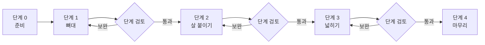
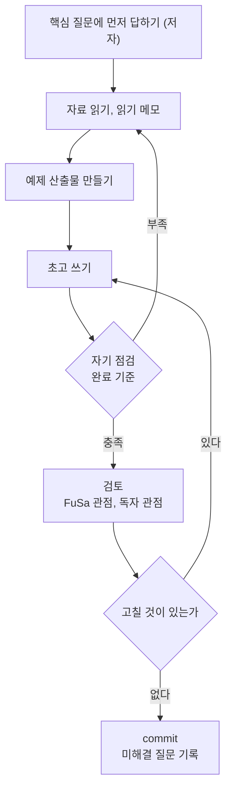
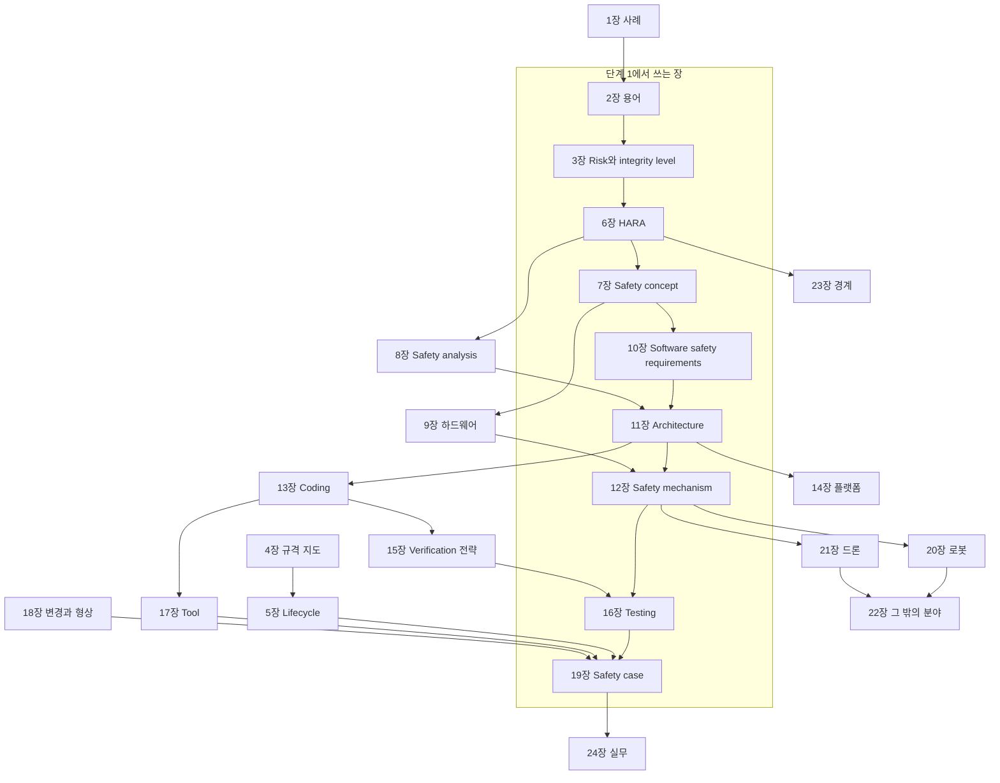
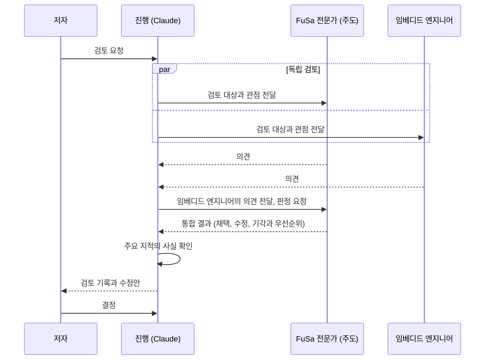

# 작성 계획

초안 v0.1 (2026-11-22)

이 문서는 책을 어떤 순서와 절차로 쓰고 어떻게 검증할지를 정한다.
무엇을 쓰는지는 [OUTLINE.md](OUTLINE.md)에, 쓸 때 지키는 규칙은 [RULES.md](RULES.md)에 있다.

## 1. 목표

- 산출물: 24개 장과 부록 4개의 원고, 관통 예제 (문서와 코드), 보조 예제 2개
- 학습 목표: 장마다 핵심 질문에 근거를 들어 답할 수 있다
- 완성의 뜻: 모든 장이 6절의 최종 완료 기준을 만족하고, 관통 예제의 safety goal이 요구사항, 코드, test, safety case까지 끊김 없이 이어진다

## 2. 접근 원칙

1. 배우는 것이 먼저다. 분량보다 핵심 질문에 답할 수 있는지를 기준으로 삼는다.
2. 얇게 끝까지 먼저 간다. 전체 흐름을 한 번 겪은 뒤에 깊이를 더한다.
3. 예제는 설명에 필요한 만큼만 만든다.
4. 확인하지 못한 것을 확인한 것처럼 쓰지 않는다. 표시하는 방법은 RULES.md에 있다.

## 3. 역할

| 일 | 저자 | Claude |
|---|---|---|
| 핵심 질문에 먼저 답하기 | 아는 만큼 짧게 쓴다 | 하지 않는다 |
| 자료 읽기 | 읽는다 | 읽을 곳을 짚어 주고 요약을 준비한다 |
| 예제 산출물 | 검토하고 고친다 | 초안과 코드 뼈대를 만든다 |
| 초고 | 자기 답과 비교하며 고쳐 쓴다 | 초고를 쓴다 |
| 사실 검증 | 규격 원문과 대조한다 | 받을 수 있는 자료로 확인하고, 확인하지 못한 것을 표시한다 |
| 검토 | 결정한다 | 역할 에이전트 검토를 진행하고 기록한다 |

이 분담은 기본값이다. 저자가 초고를 직접 쓰는 방식으로 바꿀 수 있다 (12절).

## 4. 책 지도

장이 safety lifecycle의 어디에 놓이는지 보여 준다. 왼쪽은 요구를 아래로 내리는 장, 오른쪽은 그것을 검증하는 장이다.

## 5. 단계

### 단계 0. 준비

- 할 일
  - 참고 문서를 접근 등급으로 나누고, 받을 수 있는 것을 받는다
  - 규격 원문을 어떻게 구할지 정한다 (구입, 기관 열람, KS 번역본)
  - 장 파일의 틀을 만든다 (`chapters/`)
  - 용어집 초안을 만든다 (2장에 필요한 30개 안팎)
  - 관통 예제의 범위와 기술 선택을 확정한다 (8절)
- 완료 기준: 참고 문서 목록이 있고, 장 파일의 틀이 있고, 예제의 기술 선택이 적혀 있다

### 단계 1. 뼈대

- 쓰는 장: 2, 3, 6, 7, 10, 11, 12, 16, 19장. 이 순서대로, 장마다 2-3쪽
- 예제: hazard 하나를 골라 safety goal 1개, software safety requirement 5-10개, 감시 기능 1개의 구현과 test, 한 쪽짜리 safety case까지 간다
- 완료 기준
  - 예제의 safety goal 하나가 요구사항, 코드, test, safety case까지 추적된다
  - 9개 장이 6절의 1차 완료 기준을 만족한다
  - 단계 검토를 통과한다

### 단계 2. 살 붙이기

- 새로 쓰는 장: 1, 4, 5, 8, 9, 13, 14, 15, 17, 18장
- 깊게 고치는 장: 단계 1의 9개 장
- 쓰는 순서
  1. 1, 4, 5장 (배경과 틀)
  2. 8, 9장을 쓰고 6, 7장을 깊게 고친다
  3. 13, 14장을 쓰고 10, 11, 12장을 깊게 고친다
  4. 15, 17장을 쓰고 16장을 깊게 고친다
  5. 18장을 쓰고 19장을 깊게 고친다
- 예제: HARA 전체, FTA와 FMEA, safety mechanism 추가, coverage 측정, 정적 분석
- 완료 기준: 19개 장이 1차 완료 기준을 만족하고, 그 가운데 단계 1의 9개 장은 목표 분량에 이른다

### 단계 3. 넓히기

- 쓰는 장: 20, 21장 (보조 예제 포함), 22, 23, 24장
- 그다음: 3, 6, 7, 11, 12, 14, 19장의 "로봇과 드론에서는" 항목, 부록 A-D
- 완료 기준: 24개 장과 부록이 모두 있다

### 단계 4. 마무리

- 처음부터 끝까지 이어 읽으며 용어와 표기를 통일한다
- 규격의 판을 다시 확인한다 (IEC 61508 Edition 3, ISO 26262 3판, 드론 제도)
- `(확인 필요)` 표시를 모두 없앤다
- 조항 대응표 (부록 B)를 원문과 대조한다
- 전체 검토를 받는다. 가능하면 실제 functional safety 실무자의 검토를 받는다
- 완료 기준: 모든 장이 최종 완료 기준을 만족한다

## 6. 장 하나를 쓰는 절차

먼저 답하는 이유: 모르는 부분이 드러나고, 초고를 읽을 때 자기 생각과 비교할 기준이 생긴다.

### 1차 완료 기준

- [ ] 핵심 질문의 답이 본문에 있다
- [ ] 예제 산출물이 있고 본문이 그것을 가리킨다
- [ ] 규격에 관한 모든 문장에 근거 표기 또는 `(확인 필요)` 표시가 있다
- [ ] 규격의 문장이나 표를 옮긴 곳이 없다
- [ ] 새로 나온 용어가 용어집에 있다
- [ ] 다이어그램과 그림이 제대로 그려진다
- [ ] 풀리지 않은 질문이 `notes/`에 적혀 있다

### 최종 완료 기준

- [ ] 1차 완료 기준을 모두 만족한다
- [ ] `(확인 필요)`가 없다
- [ ] 조항 대응표에 이 장의 줄이 채워져 있다
- [ ] "흔한 오해" 항목과 확인 문제 3-5개가 있다
- [ ] 검토 의견이 반영되었거나, 반영하지 않은 이유가 적혀 있다

## 7. 장 사이의 의존 관계

화살표는 "앞 장의 내용이 있어야 뒤 장을 쓸 수 있다"는 뜻이다. 가운데 묶음이 단계 1에서 쓰는 뼈대다.

## 8. 예제 계획

### 관통 예제의 산출물

| 산출물 | 장 | 단계 1 | 단계 2 |
|---|---|---|---|
| item definition | 6 | 한 쪽 | 전체 |
| HARA | 6 | hazardous event 3-5개 | 전체 표 |
| safety goal | 6 | 1개 | 전체 |
| functional safety concept | 7 | safety goal 1개에 대해 | 전체 |
| technical safety concept | 7 | 감시 구조 1개 | 전체 |
| FTA, FMEA, STPA | 8 | 없음 | 각 1개 |
| 하드웨어 가정, 진단 목록 | 9 | 없음 | 전체 |
| software safety requirements | 10 | 5-10개 | 전체 |
| software architecture | 11 | 기능과 감시의 분리 | 전체 |
| safety mechanism 구현 | 12 | 토크 감시 1개 | 추가 mechanism |
| coding guideline, 정적 분석 설정 | 13 | 없음 | 전체 |
| task 설계, timing 예산 | 14 | 없음 | 전체 |
| 정적 분석 결과, formal verification 시도 | 15 | 없음 | unit 1개 |
| test, coverage, fault injection | 16 | requirements-based test, fault injection 1건 | coverage 측정 포함 |
| tool 분류표 | 17 | 없음 | 전체 |
| impact analysis | 18 | 없음 | 변경 1건 |
| safety case | 19 | 한 쪽 | 전체 |

보조 예제 (로봇의 protective stop, 드론의 geofence와 link 상실 대응)는 단계 3에서 위험 평가부터 구조 설계까지만 만든다.

### 기술 선택 (단계 0에서 확정)

- 언어: C
- 실행 환경: PC에서 빌드하고 실행한다. 센서, 모터, 차량의 움직임은 단순한 모델로 시뮬레이션한다
- fault injection: 시뮬레이션에 고장을 넣는 지점을 둔다 (센서 값 고정, 값 튐, 통신 끊김, 실행 지연)
- test와 coverage: 무료 tool을 쓴다. MC/DC를 측정할 수 있는 compiler인지 확인한다
- 정적 분석과 formal verification: 무료 tool 가운데 고른다

### 알고 있는 한계

- PC 시뮬레이션은 실제 MCU의 동작을 보여 주지 못한다. memory protection, hardware watchdog, 실제 timing은 흉내만 낸다.
- 예제의 등급과 수치는 설명을 위한 가정이다. 실제 제품의 근거로 쓸 수 없음을 본문에 밝힌다.
- 필요하면 뒤 단계에서 emulator나 개발 보드로 옮긴다. 이것은 선택 사항이다.

## 9. 검증과 검토

### 사실 검증

1. 초고를 쓸 때 문장마다 근거 표시를 단다.
2. 받을 수 있는 자료로 확인한다.
3. 규격 원문이 있어야 하는 문장은 원문을 구한 뒤에 대조한다.
4. 단계 검토에서 다시 본다.

규격 원문은 대부분 유료다. 그래서 이 책의 주장 가운데 상당수는 원문을 구하기 전에는 확정할 수 없다. 어떤 문서를 볼 수 있는지는 [references/README.md](references/README.md)에 있다.

### 단계 검토

단계가 끝날 때마다 두 역할의 에이전트가 검토한다. FuSa 전문가가 주도하고, 임베디드 소프트웨어 엔지니어가 독자와 실무의 관점에서 의견을 낸다.

- 두 검토자는 서로의 의견을 보지 않고 먼저 따로 검토한다. 서로의 결론에 끌려가지 않게 하기 위해서다.
- 검토 기록은 `reviews/`에 둔다.
- 에이전트 검토는 사람 전문가의 검토를 대신하지 못한다. 에이전트도 규격 원문을 볼 수 없다.

## 10. 분량과 일정

### 분량 목표

- 단계 1: 장마다 2-3쪽
- 최종: 장마다 12-20쪽, 전체 350쪽 안팎

### 일정 (추정)

주당 6-8시간을 쓴다고 가정한 추정이다. 단계 1을 마친 뒤 실제 속도로 다시 계산한다.

| 단계 | 내용 | 기간 |
|---|---|---|
| 0 | 준비 | 1-2주 |
| 1 | 9개 장의 뼈대, 장마다 1주 | 9-10주 |
| 2 | 새 장 10개, 기존 장 9개 보강 | 20주 안팎 |
| 3 | 20-24장, 비교 항목, 부록 | 10주 안팎 |
| 4 | 마무리 | 4주 |
| 합계 | | 45주 안팎 |

## 11. 위험과 대응

| 위험 | 영향 | 대응 |
|---|---|---|
| 규격 원문을 구하지 못한다 | 조항 수준의 주장을 확정할 수 없다 | 단계 0에서 구하는 방법을 정한다. 구하지 못한 Part의 내용은 2차 자료에 근거했음을 밝힌다 |
| Claude가 쓴 초고에 사실 오류가 있다 | 틀린 내용을 배운다 | 근거 표시 규칙, 원문 대조, 단계 검토 |
| 쓰는 동안 규격이 개정된다 | 내용이 낡는다 | 장마다 "달라지는 점" 항목을 두고, 단계 4에서 다시 확인한다 |
| 범위가 계속 늘어난다 | 끝내지 못한다 | 로봇과 드론은 한 장씩으로 제한한다. 단계 1은 얇게 쓴다 |
| 예제 구현에 시간을 너무 쓴다 | 글이 늦어진다 | 예제는 장의 설명에 필요한 만큼만 만든다 |
| 규격의 문장이나 표를 옮긴다 | 저작권 문제 | 자기 말로 쓰고 조항 번호만 밝힌다. 그림은 직접 그린다 |
| 드론 제도가 바뀐다 | 21장이 낡는다 | 쓰는 시점에 다시 확인한다 |

## 12. 정한 것과 정해야 할 것

### 정한 것

| 날짜 | 내용 |
|---|---|
| 2026-11-21 | 주 분야는 자동차 (ISO 26262), 보조 분야는 로봇과 드론 |
| 2026-11-22 | 원고는 Markdown, 다이어그램은 Mermaid, 그림은 SVG |
| 2026-11-22 | 원고는 `chapters/`에 장마다 파일 하나 |
| 2026-11-22 | 굵직한 변경마다 commit을 나누고, `Co-Authored-By`를 넣지 않는다 |
| 2026-11-22 | 받을 수 있는 참고 문서는 `references/`에 받는다 |

### 정해야 할 것

1. 초고를 누가 쓰는가. 기본값은 3절의 분담이다.
2. 규격 원문을 구할 것인가. 구한다면 어느 Part부터인가.
3. 주당 쓸 수 있는 시간. 10절의 일정이 달라진다.
4. 출판 형태 (개인 학습용, 공개, 출판). 저작권을 다루는 엄격함과 참고 문서의 관리 방식이 달라진다. 기본값은 출판할 수도 있다고 보는 것이다.
5. 참고 문서 파일을 git에 넣을 것인가. 기본값은 넣지 않는 것이다.
6. 관통 예제: 구동 토크 제어로 가정했다.
7. 로봇의 중심: 자율 이동 로봇 (ISO 3691-4)으로 가정했다. 산업용 로봇 팔 (ISO 10218)이나 서비스 로봇 (ISO 13482)으로 바꿀 수 있다.
8. 드론의 중심: 소형 드론의 Specific category 운용 (EU 체계, SORA)으로 가정했다. 한국과 미국 제도를 얼마나 다룰지는 정하지 않았다.
9. 독자의 임베디드 경험: 없다고 가정했다. 있다고 보면 9장과 14장을 줄일 수 있다.
10. 관통 예제를 실제 보드로 옮길 것인가. 기본값은 PC 시뮬레이션까지다.
