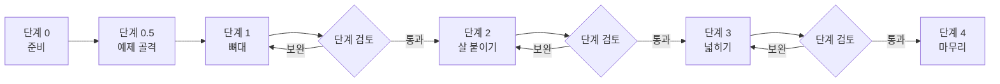
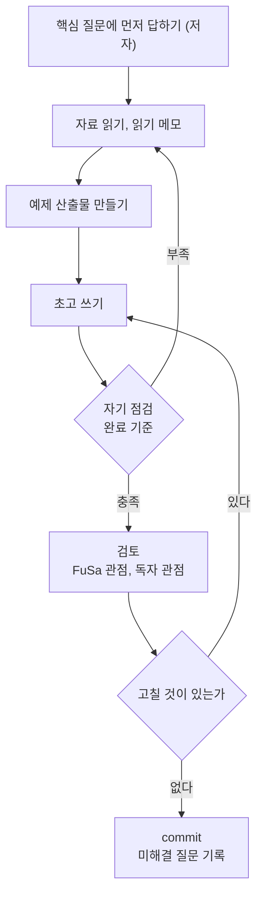
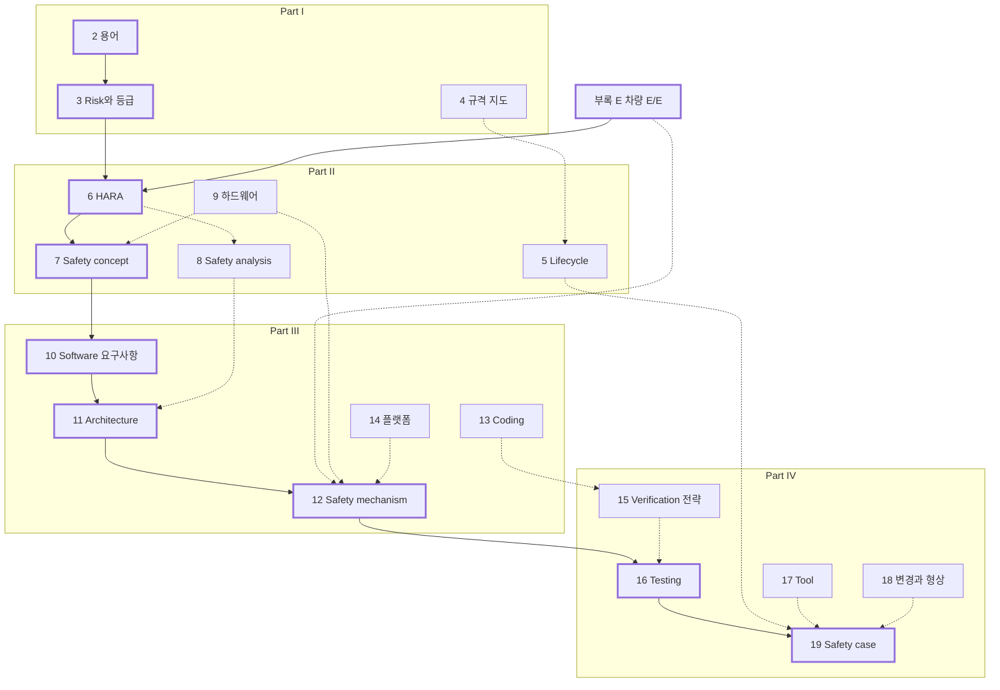
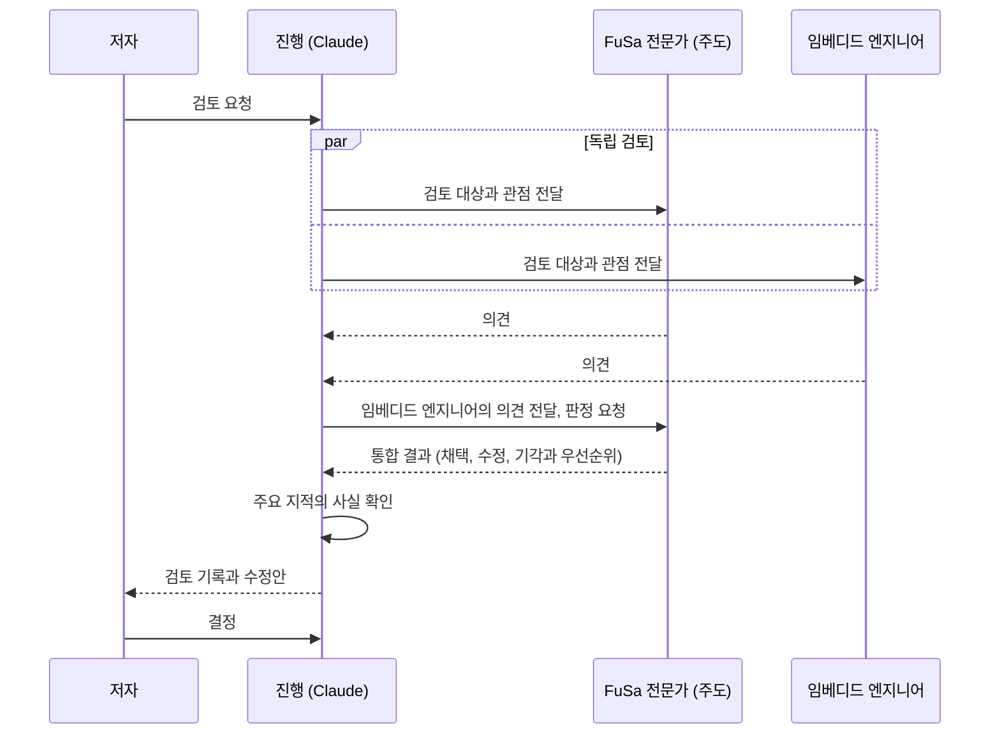

# 작성 계획

초안 v0.4 (2026-11-22)

이 문서는 책을 어떤 순서와 절차로 쓰고 어떻게 검증할지를 정한다.
무엇을 쓰는지는 [OUTLINE.md](OUTLINE.md)에, 쓸 때 지키는 규칙은 [RULES.md](RULES.md)에 있다.
이 판은 [2026-11-22 검토](reviews/2026-11-22-plan/README.md)의 결과를 반영했다.

## 1. 목표

- 산출물: 24개 장과 부록 5개의 원고 (300쪽 안팎), 관통 예제 (문서와 코드), 보조 예제 2개
- 학습 목표: 장마다 핵심 질문에 근거를 들어 답할 수 있다
- 완성의 뜻: 모든 장이 6절의 최종 완료 기준을 만족하고, 관통 예제의 safety goal이 요구사항, 코드, test, safety case까지 끊김 없이 이어진다

## 2. 접근 원칙

1. 배우는 것이 먼저다. 분량보다 핵심 질문에 답할 수 있는지를 기준으로 삼는다.
2. 얇게 끝까지 먼저 간다. 전체 흐름을 한 번 겪은 뒤에 깊이를 더한다.
3. 예제는 설명에 필요한 만큼만 만든다.
4. 확인하지 못한 것을 확인한 것처럼 쓰지 않는다. 표시하는 방법은 RULES.md에 있다.

## 3. 역할

| 일 | 저자 | Claude |
|---|---|---|
| 핵심 질문에 먼저 답하기 | 아는 만큼 짧게 쓴다 | 하지 않는다 |
| 자료 읽기 | 읽는다 | 읽을 곳을 짚어 주고 요약을 준비한다 |
| 예제 산출물 | 검토하고 고친다 | 초안과 코드 뼈대를 만든다 |
| 초고 | 자기 답과 비교하며 고쳐 쓴다 | 초고를 쓴다 |
| 사실 검증 | 규격 원문과 대조한다 | 받을 수 있는 자료로 확인하고, 확인하지 못한 것을 표시한다 |
| 검토 | 결정한다 | 역할 에이전트 검토를 진행하고 기록한다 |

이 분담은 기본값이다. 저자가 초고를 직접 쓰는 방식으로 바꿀 수 있다 (12절).

## 4. 책 지도

장이 safety lifecycle의 어디에 놓이는지 보여 준다. 왼쪽은 요구를 아래로 내리는 장, 오른쪽은 그것을 검증하는 장이다. 굵은 테두리는 단계 1에서 쓰는 장이다.

## 5. 단계

### 단계 0. 준비

끝난 일
- [x] 참고 문서를 접근 등급으로 나누고, 받을 수 있는 것을 받았다 (`references/`)
- [x] 원고 파일과 장 계획 파일의 틀을 만들었다 (`chapters/`, `plans/`)
- [x] 작성 계획을 검토받고 반영했다 (`reviews/2026-11-22-plan/`)

남은 일
- [ ] 규격 원문을 구한다. 구하는 방법과 범위는 references/README.md의 "원문을 구하는 방법"을 따른다. 구하기 전에도 할 수 있는 확인을 한다
  - ISO Online Browsing Platform에서 ISO 26262-1의 용어를 확인한다 (FTTI와 관련 시간 구간, safe state, freedom from interference, SEooC)
  - 미리보기로 ISO 26262-6과 IEC 61508-3의 목차와 Annex 제목을 확인한다
  - 결과를 `notes/claims.md`에 적는다
- [ ] E-Gas monitoring concept v4.0을 미국 NHTSA의 공개 문서철에서 직접 받아 본다. 받으면 판과 재배포 조건을 references/README.md에 적는다
- [ ] 직접 받아야 하는 문서를 받는다 (references/README.md)
- [ ] 예제 범위 문서 한 쪽을 쓴다: item의 경계, E/E 구성도, hazard 5개, 가정 목록 초안, 요구사항 ID 체계 (예: `SG-01`, `FSR-01`, `TSR-01`, `SWR-01`, `TC-01`)
- [ ] 도구를 하루씩 확인한다
  - GCC의 `gcov --conditions`가 MC/DC를 재는가, 보고서 도구가 그것을 보여 주는가
  - Clang의 `llvm-cov --show-mcdc`로 교차 확인할 수 있는가
  - CBMC가 감시 함수 시제품에서 "출력이 한도 이하"와 "overflow 없음"을 증명하는가
  - cppcheck의 MISRA 검사 (MISRA 문서를 구한 경우)
  - unit test framework 선택
- [ ] `example/` 폴더 구조를 정한다
- [ ] 문서 검사 도구 `tools/lint`를 만든다: ASCII와 한글 이외의 문자, `(확인 필요)`의 개수, 장 파일의 필수 제목, Mermaid 구문, 깨진 링크
- [ ] references/standards.md를 보완한다: Part마다 요구사항인지 해설인지를 적는 열
- [ ] `notes/claims.md`와 `notes/permissions.md`의 틀을 만든다
- [ ] 용어집 초안을 만든다 (30개 안팎). 다음을 반드시 넣는다: SIL의 두 가지 뜻, FTTI와 관련 시간 구간, safe state, freedom from interference, QM, SAIL, OSO
- [ ] 단계 1 뒤에 검토해 줄 functional safety 실무자를 찾는다 (12절의 5번)

완료 기준: 남은 일이 끝났다. 원문은 적어도 ISO 26262-6을 볼 수 있다.

### 단계 0.5. 예제 골격

글을 쓰기 전에 예제를 돌릴 바탕을 만든다. 장을 쓰면서 바탕까지 만들면 장마다 시간이 모자란다.

- 할 일: 개발 container, build, plant model, HAL, fault injection 인터페이스, unit test, coverage, 정적 분석, CI, 요구사항 YAML과 추적 스크립트. 단계 0의 도구 확인 결과를 반영한다
- 완료 기준
  - 깨끗한 container에서 `make check`가 통과한다
  - coverage 보고서와 정적 분석 보고서가 만들어진다
  - 추적 스크립트가 빈 요구사항 목록에 대해 동작한다

### 단계 1. 뼈대

- 쓰는 장: 2, 3, 6, 7, 10, 11, 12, 16, 19장과 부록 E (차량 E/E)의 뼈대. 이 순서대로 쓴다
- 목표 분량: 2, 3, 19장과 부록 E는 1-2쪽, 6, 7, 10, 11, 12, 16장은 2-3쪽
- 예제: hazard 하나를 골라 safety goal에서 safety case까지 간다. 만드는 것은 8절의 표에서 "단계 1" 열에 있는 것이다
- 완료 기준
  - 예제의 safety goal 하나가 요구사항, 코드, test, safety case까지 추적된다
  - 9개 장과 부록 E가 6절의 1차 완료 기준을 만족한다
  - 단계 검토를 통과한다. 이 검토에는 사람 실무자의 검토를 넣는다 (12절의 5번)
  - 장마다 쓴 시간과 쪽 수를 기록했다

### 단계 2. 살 붙이기

- 새로 쓰는 장: 1, 4, 5, 8, 9, 13, 14, 15, 17, 18장
- 깊게 고치는 장: 단계 1의 9개 장과 부록 E
- 쓰는 순서
  1. 1, 4, 5장 (배경과 틀)
  2. 8, 9장을 쓰고 6, 7장을 깊게 고친다
  3. 13, 14장을 쓰고 10, 11, 12장과 부록 E를 깊게 고친다
  4. 15, 17장을 쓰고 16장을 깊게 고친다
  5. 18장을 쓰고 19장을 깊게 고친다
- 예제: 8절의 표에서 "단계 2" 열에 있는 것
- 완료 기준: 19개 장과 부록 E가 1차 완료 기준을 만족하고, 그 가운데 단계 1의 장들은 목표 분량에 이른다

### 단계 3. 넓히기

- 쓰는 장: 20, 21장 (보조 예제 포함), 22, 23, 24장
- 그다음: 3, 6, 7, 11, 12, 14, 19장의 "로봇과 드론에서는" 항목, 부록 A-D
- 완료 기준: 24개 장과 부록이 모두 있다

### 단계 4. 마무리

- 처음부터 끝까지 이어 읽으며 용어와 표기를 통일한다
- 규격의 판을 다시 확인한다 (IEC 61508 Edition 3, ISO 26262 3판, 드론 제도, EU Machinery Regulation)
- `(확인 필요)` 표시를 모두 없앤다
- 조항 대응표 (부록 B)를 원문과 대조한다
- 전체 검토를 받는다
- 완료 기준: 모든 장이 최종 완료 기준을 만족한다

## 6. 장 하나를 쓰는 절차

먼저 답하는 이유: 모르는 부분이 드러나고, 초고를 읽을 때 자기 생각과 비교할 기준이 생긴다.

### 1차 완료 기준

- [ ] 핵심 질문의 답이 본문에 있다
- [ ] 저자가 핵심 질문의 답을 자료 없이 다시 쓸 수 있다
- [ ] 예제 산출물이 있고 본문이 그것을 가리킨다
- [ ] 예제 산출물이 있는 장은 `example/`에서 `make check`가 통과한다
- [ ] 이 장이 다루는 요구사항 ID가 코드와 test에 있음을 추적 스크립트가 확인한다
- [ ] 규격에 관한 모든 문장에 근거 표기 또는 `(확인 필요)` 표시가 있다
- [ ] 규격의 문장이나 표를 옮긴 곳이 없다
- [ ] 새로 나온 용어가 용어집에 있다
- [ ] 다이어그램과 그림이 제대로 그려진다
- [ ] `tools/lint`가 통과한다
- [ ] 풀리지 않은 질문이 `notes/`에 적혀 있다

### 최종 완료 기준

- [ ] 1차 완료 기준을 모두 만족한다
- [ ] `(확인 필요)`가 없다
- [ ] 조항 대응표에 이 장의 줄이 채워져 있다
- [ ] "흔한 오해" 항목과 확인 문제 3-5개가 있다
- [ ] 검토 의견이 반영되었거나, 반영하지 않은 이유가 적혀 있다

## 7. 장 사이의 의존 관계

- 실선: 앞 장의 내용이 있어야 뒤 장의 뼈대를 쓸 수 있다
- 점선: 앞 장이 있어야 뒤 장을 깊게 고칠 수 있다
- 굵은 테두리: 단계 1에서 쓰는 장
- 읽는 순서는 목차를 따른다. 이 그림은 쓰는 순서만 보인다

Part V의 장은 그림에서 뺐다. 20, 21장은 6, 7, 11, 12장을, 22장은 20, 21장을, 23장은 6장을, 24장은 19장을 바탕으로 한다.

단계 1의 장이 점선으로 기대는 내용 (8장의 분석, 9장의 하드웨어 가정)은 장의 원고 없이 예제 산출물로만 먼저 만든다 (8절).

## 8. 예제 계획

### 관통 예제의 산출물

| 산출물 | 장 | 단계 1 | 단계 2 |
|---|---|---|---|
| hazard와 fault 정리표 | 2 | 한 쪽 | 그대로 |
| 조항 대응표의 틀 | 4 | 없음 | 전체 |
| safety plan | 5 | 없음 | 한 쪽 |
| item definition, E/E 구성도, item의 경계 | 6, 부록 E | 한 쪽 | 전체 |
| HARA | 6 | hazardous event 4-5개 | 전체 표 |
| safety goal, safe state, FTTI 가정값 | 6 | 1개 | 전체 |
| functional safety concept | 7 | safety goal 1개에 대해 | 전체 |
| technical safety concept | 7 | 3단계 감시 구조 | 전체 |
| 가정 목록 (inverter, MCU) | 7, 9 | 5-10줄 | 전체 |
| 시간 예산표 (FTTI, fault detection과 reaction의 시간, task 주기) | 7, 14 | 한 쪽 | 측정값 포함 |
| decomposition 또는 coexistence 판단 | 7 | 한 줄과 근거 | 전체 |
| hardware-software interface 명세 | 7 | 없음 | 전체 |
| FTA | 8 | safety goal 1개 | FMEA, STPA 추가 |
| 독립성 주장 목록 (dependent failure, freedom from interference) | 8, 11 | 한 쪽 | 전체 |
| 하드웨어 진단 목록 | 9 | 없음 | 전체 |
| software safety requirements (ID, YAML) | 10 | 5-10개 | 전체 |
| software architecture (응용, 감시, HAL의 3층과 task table) | 11 | 정적 view와 동적 view 각 1개 | 전체 |
| 아키텍처 수준의 safety analysis | 11 | 없음 | 1건 |
| safety mechanism 구현 | 12 | 토크 감시, 페달 plausibility | 추가 mechanism |
| startup과 reset 동작 | 12 | 없음 | 구현과 test |
| coding guideline, 정적 분석 설정 | 13 | 없음 | 전체 |
| task 설계, timing 예산 | 14 | 없음 | 전체 |
| 정적 분석 결과, formal verification 시도 | 15 | 없음 | unit 1개 |
| verification plan과 report | 15, 16 | 없음 | 한 쪽씩 |
| test, fault injection, 반응 시간 측정, coverage | 16 | requirements-based test, fault injection 3건 이상 | coverage 측정 포함 |
| tool 분류표 | 17 | 없음 | 전체 |
| impact analysis | 18 | 없음 | 변경 1건 |
| safety case | 19 | 한두 쪽. FTA, 독립성 주장, test를 증거로 가리킨다 | 전체 |
| confirmation review 기록의 예 | 19 | 없음 | 1건 |
| "sim이 보이는 것과 못 보이는 것" 표 | 11, 12, 16 | 한 쪽 | 장마다 |

보조 예제는 단계 3에서 만든다.

- 로봇: 자율 이동 로봇의 속도에 따른 보호 영역 전환과 정지. 안전 기능의 정의, 요구 등급, Category 구조, 정지 거리 예산, 일반 소프트웨어와 safety controller의 경계 그림
- 드론: 소형 multicopter 운용 하나의 SAIL 결정, link 상실과 geofence 이탈과 위치 상실에 대한 상태 기계

### 설계 원칙

- 언어: C. 감시 함수는 고정소수점 정수 연산으로 쓴다
- 실행 모델: process 하나, thread 하나, 1 ms 단위의 가상 시계, 정적 task table. 실행 시간은 시뮬레이션이 넣어 주는 값이다
- HAL 경계: ADC, 토크 출력과 enable 신호, CAN, 시간, 비휘발성 memory, watchdog, reset 원인. 응용과 감시의 코드는 HAL만 부른다
- 페달 센서: 특성이 서로 다른 두 채널. 두 채널이 함께 틀어지는 공통 원인 고장을 한 가지 넣는다
- fault injection: HAL 뒤에서만 한다
  - 센서: 고착, 튐, offset, 단선, 공통 원인
  - CAN: 소실, 값 정지, CRC 불일치, 지연
  - 실행: task 건너뜀, 지연 초과
  - memory: 고른 변수의 bit 반전
  - 비휘발성 memory: 쓰는 도중의 중단
  - startup: 센서가 안정되기 전의 구간
  - 감시 기능 자체의 고장
- 측정: fault를 넣은 시각부터 토크가 한도 아래로 내려간 시각까지를 재어 FTTI 가정값과 비교한다
- 기록: 시나리오마다 CSV 기록과 그래프를 남긴다

### 도구 후보 (단계 0에서 확정)

- compiler: GCC 14 이상, Clang 18 이상. 두 compiler 모두 MC/DC 측정 기능이 있다고 알려져 있다. 실제로 되는지는 단계 0에서 확인한다
- formal verification: CBMC
- 정적 분석: cppcheck, clang-tidy
- unit test: Unity 또는 CMocka
- 모든 도구는 qualification되지 않았다. 이 사실을 17장의 tool 분류표에 밝힌다

### 알고 있는 한계

- PC 시뮬레이션은 논리를 검증할 뿐이다. 다음은 보여 주지 못한다
  - interrupt의 선점과 그 때문에 생기는 data 경합
  - 실제 실행 시간과 그 흔들림
  - stack overflow, memory protection의 동작
  - hardware watchdog의 reset, startup과 reset 직후의 상태
  - ADC의 잡음과 오차, CAN의 오류 상태, 비휘발성 memory의 실제 동작
  - compiler와 정수 크기의 차이
- 독립성은 시뮬레이션되지 않는다. 감시를 다른 함수나 thread에 두는 것은 partitioning이 아니다. 예제를 쓰는 장마다 "sim이 보이는 것과 못 보이는 것" 표를 단다
- 예제의 등급과 수치는 설명을 위한 가정이다. 실제 제품의 근거로 쓸 수 없음을 본문에 밝힌다
- 보드나 emulator로 옮기는 것은 선택 사항이다 (12절의 6번). HAL 경계를 지키면 응용과 감시의 코드를 바꾸지 않고 옮길 수 있다

## 9. 검증과 검토

### 사실 검증

1. 초고를 쓸 때 문장마다 근거 표시를 단다.
2. 받을 수 있는 자료로 확인한다.
3. 규격 원문이 있어야 하는 문장은 원문을 구한 뒤에 대조한다.
4. 단계 검토에서 다시 본다.

규격 원문은 대부분 유료다. 그래서 이 책의 주장 가운데 상당수는 원문을 구하기 전에는 확정할 수 없다. 어떤 문서를 볼 수 있는지는 [references/README.md](references/README.md)에 있다.

### 단계 검토

단계가 끝날 때마다 두 역할의 에이전트가 검토한다. FuSa 전문가가 주도하고, 임베디드 소프트웨어 엔지니어가 독자와 실무의 관점에서 의견을 낸다.

- 두 검토자는 서로의 의견을 보지 않고 먼저 따로 검토한다. 서로의 결론에 끌려가지 않게 하기 위해서다.
- 검토 기록은 `reviews/`에 둔다.
- 에이전트 검토는 사람 전문가의 검토를 대신하지 못한다. 에이전트도 규격 원문을 볼 수 없다.
- 두 역할의 에이전트는 같은 계열의 모델이라 오류가 서로 닮을 수 있다. 두 검토가 일치하는 것을 사실 확인으로 여기지 않는다.
- 단계 1이 끝나면 사람 functional safety 실무자의 검토를 한 번 받는다. 범위는 단계 1의 장과 예제이고, 몇 시간 분량이다. 받지 못하면 그 사실을 검토 기록에 적는다.

## 10. 분량과 일정

### 분량 목표

- 단계 1: 5절에 적은 장별 분량
- 최종: 전체 300쪽 안팎. 장별 목표는 OUTLINE.md 4절에만 적는다. 목표 쪽수는 채워야 하는 양이 아니라 넘지 않으려는 상한이다

### 일정 (추정)

주당 6-8시간을 쓴다고 가정한 추정이다. 2026-11-22 검토에서 처음의 45주가 낙관적이라는 지적을 받아 다시 추정했다. 단계 1에서 장마다 쓴 시간과 쪽 수를 기록해 다시 계산한다.

| 단계 | 내용 | 기간 |
|---|---|---|
| 0 | 준비 | 2주 |
| 0.5 | 예제 골격 | 3주 |
| 1 | 9개 장과 부록 E의 뼈대, 장마다 2주 | 18주 |
| 2 | 새 장 10개, 기존 장 보강 | 32주 |
| 3 | 20-24장, 비교 항목, 부록 | 12주 |
| 4 | 마무리 | 6주 |
| 합계 | | 73주 안팎 |

단계 검토에 드는 시간은 각 단계의 기간에 들어 있다. 같은 시간으로 45주 안에 끝내려면 분량을 180쪽 안팎으로 줄여야 한다 (12절의 1번).

## 11. 위험과 대응

| 위험 | 영향 | 대응 |
|---|---|---|
| 규격 원문을 구하지 못한다 | 조항 수준의 주장을 확정할 수 없다 | 단계 0에서 구하는 방법을 정한다. 구하지 못한 Part의 내용은 2차 자료에 근거했음을 밝힌다 |
| Claude가 쓴 초고에 사실 오류가 있다 | 틀린 내용을 배운다 | 근거 표시 규칙, 원문 대조, 단계 검토 |
| 에이전트 검토의 오류가 서로 닮는다 | 틀린 내용이 검토를 통과한다 | 단계 1 뒤의 사람 검토 |
| Claude가 초고를 쓰면서 저자가 배우지 못한다 | 학습 목표를 이루지 못한다 | 1차 완료 기준의 "자료 없이 다시 쓸 수 있다" |
| 2차 자료가 ISO 26262:2011을 기준으로 쓰였다 | 조항 번호와 구성이 틀린다 | 2차 자료의 기준 판을 적는 규칙 |
| 쓰는 동안 규격이 개정된다 (ISO 26262 3판, IEC 61508 Edition 3) | 내용이 낡는다 | 12절의 기준 판 결정을 따른다. 장마다 "새 판에서 달라지는 점" 항목을 둔다 |
| EU Machinery Regulation이 2027-01-20부터 적용된다 | 20장의 틀이 바뀐다 | 20장을 쓸 때 다시 확인한다 |
| 드론 제도가 바뀐다 | 21장이 낡는다 | 쓰는 시점에 다시 확인한다 |
| 범위가 계속 늘어난다 | 끝내지 못한다 | 로봇과 드론은 한 장씩으로 제한한다. 장별 목표 쪽수를 지킨다 |
| 예제 구현에 시간을 너무 쓴다 | 글이 늦어진다 | 단계 0.5에서 바탕을 먼저 만든다. 예제는 장의 설명에 필요한 만큼만 만든다 |
| 시뮬레이션 결과를 검증된 것으로 오해한다 | 독자가 독립성과 timing을 잘못 배운다 | "sim이 보이는 것과 못 보이는 것" 표 |
| 예제의 코드와 등급이 실제 제품에 쓰인다 | 책임 문제 | 본문과 코드에 면책 문구를 둔다 |
| 규격의 문장이나 표를 옮긴다 | 저작권 문제 | 자기 말로 쓰고 조항 번호만 밝힌다. 그림은 직접 그린다 |

## 12. 정한 것과 정해야 할 것

### 정한 것

| 날짜 | 내용 |
|---|---|
| 2026-11-21 | 주 분야는 자동차 (ISO 26262), 보조 분야는 로봇과 드론 |
| 2026-11-22 | 원고는 Markdown, 다이어그램은 Mermaid, 그림은 SVG |
| 2026-11-22 | 원고는 `chapters/`에 장마다 파일 하나 |
| 2026-11-22 | 굵직한 변경마다 commit을 나누고, `Co-Authored-By`를 넣지 않는다 |
| 2026-11-22 | 받을 수 있는 참고 문서는 `references/`에 받는다 |
| 2026-11-22 | 작성 중의 규칙은 RULES.md에 모은다 |
| 2026-11-22 | 규격 원문을 구한다 |
| 2026-11-22 | 장 계획은 `plans/`에, 원고는 `chapters/`에 따로 둔다 |
| 2026-11-22 | 독자는 임베디드 시스템 개발 경험이 있는 소프트웨어 엔지니어로 본다. 부록 E는 차량 E/E만 다루고, 장으로 올리지 않는다. 9장과 14장의 목표 쪽수를 줄였다 |

### 정해야 할 것

"기본값"은 정하기 전까지 따르는 방식이다. "검토의 권고"는 2026-11-22 검토에서 나온 것이다.

| 번호 | 정할 것 | 선택지 | 검토의 권고 | 기본값 |
|---|---|---|---|---|
| 1 | 분량과 일정 | 73주와 300쪽 / 45주와 180쪽 / 주당 시간을 늘림 | 73주 안팎. 검토가 적은 장별 쪽수를 더하면 290쪽이 아니라 300쪽 안팎이다 | 73주와 300쪽으로 적고, 단계 1의 실제 시간으로 다시 계산한다 |
| 2 | 기준 판 | ISO 26262:2018로 끝까지 / 3판이 나오면 옮김 | 2018년 판으로 끝까지 쓰고 "새 판에서 달라지는 점" 항목을 둔다 | 2018년 판 |
| 3 | 출판 형태 | 개인 학습용 / 공개 / 출판 | 정하지 않음 | 출판할 수도 있다고 보고 저작권 규칙을 지킨다 |
| 4 | 예제의 item 경계 | 차량 제어기만 / inverter까지 | 차량 제어기만. inverter는 가정으로 받는다 | 차량 제어기만 |
| 5 | 사람 실무자의 검토 | 단계 1 뒤 / 단계 4에만 / 받지 않음 | 단계 1 뒤에 한 번 | 단계 1 뒤에 받는 것으로 계획한다 |
| 6 | 보드나 emulator로 옮기기 | 하지 않음 / emulator / 저가 보드 | 단계 2 후반에 보드에서 네 가지만 보인다 (fault 뒤의 safe state, stack overflow 감지, watchdog reset, startup self test). 2주쯤 든다 | PC 시뮬레이션까지. HAL 경계를 지킨다 |
| 7 | 드론 장에서 미국의 제도 | EU만 / EU 중심에 미국 한 문단 / 둘 다 자세히 | EU 중심에 미국 한 문단 | EU 중심 |
| 8 | 로봇 보조 예제 | 이동 로봇의 보호 영역 전환 / 협동 로봇 / 서비스 로봇 | 이동 로봇의 보호 영역 전환 | 이동 로봇의 보호 영역 전환 |
| 9 | MISRA C:2025 문서를 살 것인가 | 구입 / 구입하지 않음 | 구입 (15 파운드 안팎). 13장과 도구 확인에 필요하다 | 규칙 번호만 쓴다 |
| 10 | 초고를 누가 쓰는가 | Claude가 쓰고 저자가 고쳐 씀 / 저자가 씀 | 다루지 않음 | 3절의 분담 |
| 11 | 받은 참고 문서를 git에 넣을 것인가 | 넣지 않음 / 넣음 | 다루지 않음 | 넣지 않는다 |
| 12 | 관통 예제 | 구동 토크 제어 / 다른 예제 | 구동 토크 제어가 적절하다 | 구동 토크 제어 |
