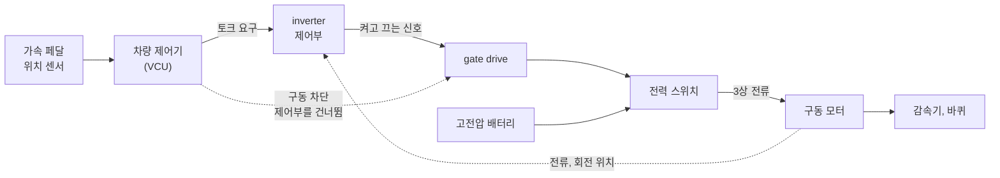

# 부록 E. 차량 E/E의 최소 지식

## 핵심 질문

관통 예제를 이해하려면 차량의 전자 장치에 대해 최소한 무엇을 알아야 하는가?

이 부록은 임베디드 시스템을 만들어 본 독자가 예제의 신호와 부품을 차 안에서 찾을 수 있을 만큼만 적는다. 부품의 설명은 미국 정부의 두 보고서 (전기차: Becker 외, 2020. 가솔린차: Becker 외, 2018)와 Toyota의 의도하지 않은 가속에 관한 NASA의 조사 보고서 (NASA, 2011)를 따랐다. 쪽은 PDF 파일의 쪽 번호다. 예제가 정한 값과 문서에 적힌 실제 차의 값은 따로 밝힌다.

## 가속 페달에서 바퀴까지

전기차에서 페달과 모터 사이는 센서와 제어기의 신호로 이어진다. 페달 위치 센서가 페달의 각도를 전압으로 바꾸어 차량 제어기에 보내고, 차량 제어기가 그 전압을 원하는 모터 토크로 바꾼다 (Becker 외, 2020, 33쪽). 아래 그림은 보고서의 블록 그림 (32쪽)을 줄인 것이다.

| 부품 | 하는 일 (Becker 외, 2020, 33-34쪽) |
|---|---|
| 차량 제어기 | 페달의 전압을 토크로 바꾸고, 다른 계통 (제동, cruise control)의 토크 요구와 조정해 inverter에 보낸다. 보고서는 EV PCM이라고 부른다 |
| inverter의 제어부 | 토크를 내는 데 필요한 전류를 계산해 gate drive에 켜고 끄는 신호를 보낸다. 모터의 전류와 회전 위치를 되받아 맞춘다 |
| gate drive | 신호를 키워 전력 스위치를 켜고 끈다. 제어부를 고전압 쪽에서 전기적으로 떼어 놓기도 한다 |
| 전력 스위치 | 배터리의 고전압 직류를 모터가 쓰는 교류로 바꾼다 |

전기차가 내연기관 차와 다른 점 가운데 소프트웨어와 관련된 것이 셋 있다 (Becker 외, 2020, 30-31쪽). 내연기관은 변속기가 진행 방향을 바꾸지만 전기차는 모터에 주는 전류가 방향을 정하므로, 구동 제어 계통이 차의 방향까지 맡는다. 내연기관은 페달을 놓아도 idle 토크로 천천히 움직이고 (creep) 엔진이 차를 늦추지만, 전기차는 페달을 놓으면 타력으로 가고 creep은 소프트웨어로 흉내 낸다. 그리고 모터는 속도가 0이어도 시동이 꺼지지 않지만, 구동 계통이 갑자기 꺼지면 그와 비슷하게 구동력을 잃는다. 가솔린차에서 같은 자리에 있는 것은 throttle valve다. 엔진 제어기가 PWM으로 모터를 돌려 이 valve를 여닫고, 흡입 공기량으로 출력을 조절한다 (Becker 외, 2018, 31쪽, 33쪽). 예제는 creep과 회생 제동을 뺐다.

## 예제의 신호는 차의 어디에 있는가

예제의 신호는 `example/drive-torque/docs/item-definition.md` 3절과 `docs/hsi.md`에 단위와 고장의 모습까지 적혀 있다. 아래 표는 그 신호를 보고서의 차와 맞대어 본 것이다.

| 예제의 신호 | 보고서의 차에서 | 예제의 가정 |
|---|---|---|
| 가속 페달 두 채널 (analog) | 페달 위치 센서. 직결선이나 CAN으로 온다 (Becker 외, 2020, 33쪽) | 0.5-4.5 V와 0.25-2.25 V. 전원과 접지는 따로 (`A-02`) |
| 브레이크 접점 둘 (digital) | 브레이크 페달의 각도를 재는 센서 (35쪽) | 서로 반대로 동작하는 접점 둘 (`HA-13`) |
| 기어 선택 | transmission range sensor가 알린다 (33쪽) | 부호 하나 (P, R, N, D)로 온다 |
| 차량 속도 (CAN) | 제동/안정성 제어기가 준다고 보고서가 가정한다 (29쪽) | 제동 제어기가 보내고 값은 그쪽이 책임진다 (`A-03`) |
| 토크 요구, inverter 상태 (CAN) | 차량 제어기와 inverter 제어부 사이의 통신 (32-33쪽) | 10 ms마다. counter와 CRC를 붙이고 검사한다 (`SWR-17`, `SWR-18`) |
| 구동 허용 신호 (직결선) | 제어부가 고장 나면 차량 제어기가 그것을 건너뛰고 gate drive로 모터 전류를 끊을 수 있다 (35쪽) | 끊기면 inverter가 토크를 내지 않는다 (`A-07`) |
| 경고 요청 (CAN) | 차량 제어기가 계기판의 고장 표시등을 켜라고 명령한다 (35쪽) | 없음, 주의, 경고. 계기판이 받았는지는 모른다 |

브레이크는 문서의 차와 예제가 다르다. 보고서의 전기차는 페달의 각도를 재고, NASA가 조사한 차의 고장 표에는 브레이크 스위치의 두 극 (pole)이 서로 맞지 않으면 DTC를 낸다는 줄이 있다 (NASA, 2011, 78쪽). 예제는 접점 둘을 서로 반대로 쓰도록 정했다. connector가 빠져 두 선이 함께 끊기면 한쪽은 "밟음", 다른 쪽은 "놓음"으로 읽혀 어긋남이 드러나기 때문이다 (`docs/hsi.md` 5절, `SWR-15`). 이것은 예제의 선택이고 그 차의 설계를 옮긴 것이 아니다.

## 가속 페달 센서는 왜 둘인가

NASA가 조사한 차의 페달 센서는 신호 둘 (VPA1, VPA2)을 내고, VPA2는 같은 기울기로 0.8 V 높게 시작한다. 제어기는 두 전압을 견주어 센서의 문제를 찾는다 (NASA, 2011, 58쪽). NASA의 보고서는 두 센서를 견주는 것이 고장이 두 센서를 함께 유효한 전압으로 망가뜨리지 않는 한 지켜 주고, offset을 둔 것은 두 신호를 함께 그럴듯한 값으로 만드는 공통 원인 고장을 막으려는 것이라고 적는다 (72쪽). 같은 차의 페달 센서는 센서마다 전용의 전원선과 귀선을 가진다 (96쪽). 예제의 전압 범위는 예제가 정한 값이고 그 차의 값이 아니다. 전원을 따로 주는 까닭은 예제의 fault injection이 보인다. 두 채널의 전원이 함께 20% 오르면 두 값이 같은 비율로 올라 서로 맞고, 검사는 알아채지 못한다 (`FI-03`).

견주기만으로는 어긋났다는 것만 안다. 어느 쪽이 틀렸는지를 가려 계속 가려면 다른 검사와 줄인 동작이 있어야 한다. 그 차는 센서마다의 범위 검사 (낮은 전압, 높은 전압)와 두 센서의 상관 검사를 서로 다른 DTC로 둔다 (NASA, 2011, 63쪽). 센서 하나가 고장으로 판정되면 limp home으로 들어가 남은 센서로 throttle을 좁은 범위에서만 연다 (49쪽, 67쪽). limp home은 고장 뒤에 낮은 출력으로 계속 달리게 하는 동작이다. 예제도 같은 꼴이다. 한 채널만 범위를 벗어나면 그 채널을 빼고 남은 채널로 가며 허용 토크를 40 Nm로 묶는다 (`SWR-24`, `FI-30`). 줄여 가는 동안 남은 채널이 범위 안에서 틀리면 견줄 상대가 없어 알아채지 못하고, 묶어 둔 상한만 남는다 (`FI-31`).

## 제어기와 network

차량의 제어기 (ECU)는 network로 이어진다. 보고서는 차량 bus의 예로 CAN을 든다 (Becker 외, 2020, 27쪽). CAN의 data frame은 11 bit나 29 bit의 identifier와 0-8 byte의 data를 싣고, identifier의 값이 작을수록 우선순위가 높다. 수신 노드는 CRC를 다시 계산해 견주고, 오류를 찾으면 error frame으로 그 전송을 끊으며, 송신 쪽은 다시 보낸다. 고장 난 노드는 스스로 bus에서 물러난다 (bus-off) (CAN in Automation, "CAN CC", 2026-11-23에 봄).

이 보호는 선 위의 전송에 대한 것이다. AUTOSAR의 문서는 통신의 고장을 되풀이, 잃음, 늦음, 끼어듦, 사칭, 잘못된 순서, 손상 등으로 나누고, 그 원인에 transceiver의 하드웨어 고장과 간섭만이 아니라 ECU와 gateway 안의 통신 소프트웨어의 체계적 고장도 넣는다 (AUTOSAR, 2025, Functional Safety Measures, 33-34쪽). network의 검사는 bus 위에서 생긴 손상만 볼 수 있다. 보내는 쪽의 소프트웨어가 틀린 값을 실었거나 같은 값을 되풀이해 보내면 frame은 멀쩡하다. 그래서 안전에 관련된 값은 응용이 counter와 CRC를 따로 붙이고 받는 쪽이 검사한다 (12장). 이 둘을 나누어 보는 것은 이 책의 정리다.

예제는 구동 허용 신호를 network 밖의 직결선으로 둔다. network나 그것을 다루는 소프트웨어가 틀려도 inverter가 토크를 내지 못하게 하려는 이 책의 설계다. 보고서의 그림에도 차량 제어기에서 gate drive로 곧장 가는 "Disable Motor" 선이 있다 (32쪽). 그 선이 무엇을 대비한 것인지는 보고서가 inverter 제어부의 고장이라고만 적는다 (35쪽).

## 고장의 표시: DTC와 경고등

DTC (diagnostic trouble code)는 제어기가 고장을 찾았을 때 남기는 고장 코드다. 두 보고서는 제어기가 고장을 찾으면 DTC를 기록하고, limp home 같은 safe state로 보낼 수 있으며, 계기판의 고장 표시등 (MIL)을 켠다고 적는다 (Becker 외, 2020, 35쪽. Becker 외, 2018, 34쪽). DTC와 표시등은 고장의 기록일 뿐 고장이 아니다. NASA가 만든 저항성 단락 상태에서 DTC를 지우고 표시등을 끄자 다시 켜지지 않았지만 차의 동작은 그대로였다 (NASA, 2011, 81쪽). 보고서는 업계에서 흔한 예로 주황색 (safety goal을 어길 확률이 중간)과 빨간색 (높거나 이미 어김) 경고를 든다 (Becker 외, 2020, 68쪽). 예제의 경고 요청도 주의와 경고의 두 단계다. 경고등 자체는 보고서의 분석 범위 밖이다 (28쪽).

## 제어기 안의 소프트웨어 층

제품의 제어기는 흔히 AUTOSAR Classic의 구조로 소프트웨어를 짠다. 받은 문서가 말한 만큼만 옮긴다 (AUTOSAR, 2025, Functional Safety Measures).

| 이름 | 문서의 설명 | 예제에서 |
|---|---|---|
| SW-C (software component) | RTE 위의 응용. 하드웨어에 독립이다 (11쪽) | `src/app/`, `src/input/`, `src/monitor/` |
| RTE | SW-C는 ECU 안팎의 정보를 RTE로만 주고받는다 (11쪽) | `src/vcu/vcu.c`가 값을 넘긴다 |
| OS | SW-C의 함수를 task에 넣어 주기나 사건으로 실행하고 (12쪽), partition의 메모리를 서로 보호한다 (10쪽) | 없다. 하드웨어에 대한 가정 (`HA-03`, `HA-04`) |
| basic software | 예: Watchdog Manager가 실행의 감시와 watchdog 하드웨어를 잇는다 (23쪽) | `src/hal/`의 interface와 그 뒤 |
| complex driver | 입출력을 직접 다룬다. 감시 소프트웨어를 여기에 두는 설계가 있다 (60쪽) | 없다 |

같은 문서는 AUTOSAR가 안전 수단을 주지만 완전한 해법이 아니고, 그것으로도 안전하지 않은 계통을 만들 수 있다고 적는다 (7쪽). 예제는 AUTOSAR를 쓰지 않고 HAL 하나로 줄였다.

## 흔한 오해

- "CAN에는 CRC가 있으니 값이 옳다." CAN의 CRC는 frame이 bus 위에서 바뀌었는지를 본다. 보내는 제어기 안에서 틀린 값, 묵은 값의 되풀이, 아예 오지 않는 메시지는 frame의 검사에 걸리지 않는다.
- "센서를 둘 달고 견주면 고장 하나를 견딘다." 견주기는 알아채기만 한다. 견디려면 어느 쪽이 틀렸는지 가리는 다른 검사 (범위)와 줄인 동작이 있어야 한다.
- "토크를 0으로 하면 차가 멈춘다." 구동 토크가 0이면 전기차는 타력으로 간다 (Becker 외, 2020, 31쪽). 멈추는 것은 브레이크의 일이다.

## 확인 문제

1. 두 페달 채널의 전원이 같으면 어떤 고장을 견주기로 알아채지 못하는가? 전압 범위를 다르게 하면 그 고장이 잡히는가?
2. 구동 허용 신호를 CAN 메시지로 보내면 무엇을 잃는가?
3. 예제에서 차량 제어기가 받는 신호 가운데 한 채널뿐인 것은 무엇인가? 그 신호가 틀리면 어떤 hazard가 되는가?

## 이 부록이 다루지 않는 것

받은 문서에 근거가 없어 뺀 것이 있다. CAN의 bit timing, 오류 계수기의 규칙, CAN FD와 Ethernet의 특성, gateway의 역할은 다루지 않는다. 12 V 전원의 전압 범위, 시동 때의 전압 강하, ignition의 상태와 wake-up도 뺐다. 보고서는 12 V 전원과 ignition key의 위치를 이름으로만 적는다. 진단의 통신 (OBD-II의 방식, UDS)과 DTC의 형식, 계기판이 경고를 받는 경로, inverter의 제어 원리, AUTOSAR의 층 가운데 services, ECU abstraction, microcontroller abstraction도 다루지 않는다. 센서의 전압 범위를 전원의 끝에서 띄우는 까닭을 설명한 문서도 찾지 못했다. 예제는 선이 끊기면 정상 범위 아래로 읽힌다고 가정할 뿐이다 (`HA-12`, `docs/hsi.md` 2절).
