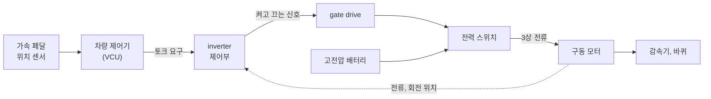

# 부록 E. 차량 E/E의 최소 지식

## 핵심 질문

관통 예제를 이해하려면 차량의 전자 장치에 대해 최소한 무엇을 알아야 하는가?

이 부록은 임베디드 시스템을 만들어 본 독자가 차량 쪽의 말을 따라갈 수 있을 만큼만 적는다. 아래의 부품 설명은 미국 정부의 보고서를 따랐다 (Becker 외, 2020).

## 가속 페달에서 바퀴까지

전기차에서 운전자의 발과 바퀴 사이에는 기계적인 연결이 없다. 신호가 이어 준다.

| 부품 | 하는 일 |
|---|---|
| 가속 페달 위치 센서 | 페달의 각도를 전압으로 바꾼다 |
| 차량 제어기 | 전압을 운전자가 원하는 토크로 바꾸어 inverter에 요구한다. 보고서는 EV PCM이라고 부른다 |
| inverter의 제어부 | 요구받은 토크를 내는 데 필요한 전류를 계산하고, 스위치를 켜고 끄는 신호를 만든다. 모터의 전류와 회전 위치를 되받아 맞춘다 |
| gate drive | 제어부의 신호를 키워 전력 스위치를 켜고 끈다 |
| 전력 스위치 | 배터리의 직류를 모터에 맞는 전류로 바꾼다 |
| 구동 모터 | 전류를 토크로 바꾼다. 전류의 방향이 회전 방향을 정한다 |

내연기관 차량과 다른 점 가운데 소프트웨어에 닿는 것이 셋 있다.

- 방향. 내연기관은 변속기가 방향을 바꾼다. 전기차는 모터에 가는 전류가 방향을 정한다. 그래서 구동을 제어하는 소프트웨어가 차의 진행 방향까지 맡는다.
- 페달을 놓았을 때. 내연기관은 페달을 놓아도 천천히 움직이고 (creep), 엔진이 속도를 줄인다. 전기차는 그 느낌을 소프트웨어로 흉내 낸다. 페달을 놓으면 모터를 발전기로 써서 속도를 줄이는 설계도 있다 (회생 제동).
- 멈춤. 모터는 속도가 0이어도 꺼지지 않는다. 그러나 구동 계통이 갑자기 꺼지면 주행 중에 구동력을 잃는다.

이 책의 예제는 creep과 회생 제동을 뺐다. 페달을 놓으면 토크 요구는 0이고 차는 타력으로 간다.

## 가속 페달 센서는 왜 둘인가

페달의 위치는 운전자의 뜻을 전하는 하나뿐인 신호다. 이 신호가 틀리면 그 뒤가 모두 틀린다. 그래서 센서를 둘 달고 서로 견준다. 아래는 예제의 설계이고, 저자의 설명이다.

- 두 채널의 전압 범위를 다르게 한다. 예제에서는 0.5-4.5 V와 0.25-2.25 V다. 두 선이 서로 붙으면 두 값이 맞지 않게 된다.
- 쓰는 전압의 범위를 전원의 끝에서 띄운다. 0 V나 전원 전압이 읽히면 선이 끊겼거나 붙은 것이다.
- 전원과 접지를 따로 준다. 함께 쓰면 그곳의 고장이 두 채널을 함께 틀리게 한다 (11장, 12장).

## 제어기와 network

차량에는 제어기 (ECU)가 여럿 있고 network로 이어져 있다. 예제의 차량 제어기는 제동 제어기에서 차량 속도를 받고, inverter에 토크 요구를 보낸다. 보고서도 차량의 network로 CAN을 예로 든다.

소프트웨어 엔지니어가 알아야 할 것은 network가 믿을 수 있는 통로가 아니라는 점이다. 메시지는 손상될 수 있고, 사라질 수 있고, 되풀이될 수 있고, 늦을 수 있고, 다른 메시지와 뒤바뀔 수 있다 (AUTOSAR, 2025). 그래서 안전에 관련된 값은 보내는 쪽이 검사 정보를 붙이고 받는 쪽이 검사한다 (12장).

network와 별개로 직결선을 쓰기도 한다. 예제의 구동 허용 신호가 그렇다. network나 그것을 다루는 소프트웨어가 틀려도 구동을 막을 수 있는 길을 따로 두는 것이다. 보고서의 구성도에도 제어기가 inverter의 제어부를 거치지 않고 gate drive에 직접 닿아 모터의 전류를 끊는 길이 있다.

## 제어기 안의 소프트웨어 층

차량 제어기의 소프트웨어는 흔히 층으로 나뉜다. AUTOSAR Classic의 구조를 줄이면 이렇다 (AUTOSAR, 2025).

| AUTOSAR의 층 | 하는 일 | 예제에서 대응하는 것 |
|---|---|---|
| 응용 소프트웨어 (SWC) | 제어 기능 | `src/app/`, `src/input/pedal_check.c`, `src/monitor/` |
| RTE | 응용 사이, 응용과 아래 층 사이의 값을 나른다 | `src/vcu/vcu.c`가 값을 넘겨 준다 |
| basic software, OS | 입출력, 통신, task의 실행, 감시 | `src/hal/`의 interface와 그 뒤 |
| complex driver | 층을 거치지 않고 입출력에 직접 닿는 부분 | 없다 |

예제는 AUTOSAR를 쓰지 않는다. HAL 하나로 줄였다. 실제 제어기에서 메모리 보호, 실행 시간의 감시, 통신의 보호는 아래 층이 준다. 예제에는 그것이 없고, 가정으로 남아 있다.

## 관통 예제의 구성

예제의 구성도는 `example/drive-torque/docs/scope.md`에, 신호의 표는 `item-definition.md`에 있다. 보고서는 페달부터 inverter와 그 센서까지를 분석의 범위로 잡는다. 예제는 차량 제어기만 item으로 잡고, inverter부터는 가정으로 받는다.

## 흔한 오해

- "CAN에는 CRC가 있으니 값이 옳다." network의 CRC는 선 위의 손상을 잡는다. 보내는 제어기 안에서 값이 틀렸거나, 메시지가 오래된 것이거나, 오지 않은 것은 잡지 못한다.
- "센서가 둘이면 고장 하나는 견딘다." 견주는 것은 틀린 것을 알아챌 뿐이다. 어느 쪽이 맞는지는 모른다. 견디려면 셋이 있거나, 다른 정보가 있어야 한다.
- "토크를 0으로 하면 차가 멈춘다." 구동 토크가 0이면 타력으로 간다. 멈추는 것은 브레이크의 일이다.

## 확인 문제

1. 두 페달 채널의 전압 범위가 같다면 어떤 고장을 알아채지 못하는가?
2. 구동 허용 신호를 CAN 메시지로 보내면 무엇을 잃는가?
3. 예제에서 차량 제어기가 받는 신호 가운데 한 채널뿐인 것은 무엇인가? 그 신호가 틀리면 어떤 hazard가 되는가?
