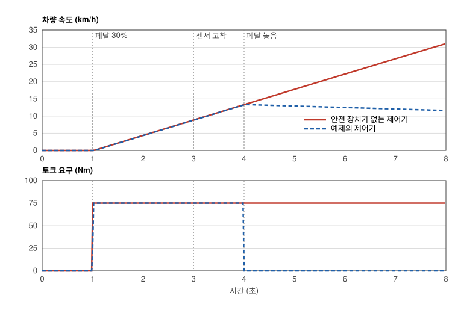

# 1장. 소프트웨어가 사람을 다치게 할 때

## 핵심 질문

소프트웨어는 닳지도 부러지지도 않는데 어떻게 사고를 일으키는가?

## 소프트웨어는 고장 나지 않는다, 그런데

베어링은 닳고 전선은 끊어진다. 소프트웨어는 그렇지 않다. 같은 입력과 같은 상태에서는 늘 같은 결과를 낸다. Ariane 5의 첫 발사가 실패한 뒤 조사 위원회는 이렇게 적었다. 소프트웨어는 기계 시스템과 같은 뜻으로 고장 나지 않는다 (Ariane 501 조사 위원회, 1996).

그런데도 소프트웨어가 든 시스템에서 사람이 다치고 죽는다. 이 장은 네 사례에서 그 길을 본다. 둘은 짧게, 둘은 깊게 본다. 사례마다 공식 조사가 내린 결론과, 다툼이 남아 있는 부분을 나눠 적는다.

네 사례를 다 읽고 나면 공통점이 보일 것이다. 넷 가운데 코드를 잘못 짠 것이 원인으로 확인된 사례는 하나뿐이다.

## 사례 1. Therac-25

Therac-25는 컴퓨터로 제어하는 방사선 치료기다. 1985년 6월부터 1987년 1월 사이에 환자에게 처방보다 훨씬 많은 방사선을 쪼인 사고가 여섯 건 알려져 있고, 죽거나 크게 다친 사람이 나왔다. 아래는 두 연구자가 소송 기록과 규제 기관의 문서를 모아 재구성한 것이다 (Leveson과 Turner, 1993). 공식 사고 조사 보고서가 아니고, 저자들은 제조사의 소프트웨어 개발과 품질 관리에 관한 자세한 자료를 구하지 못해 서신 등에서 미루어 알았다고 밝힌다.

무엇이 있었는가.

- 앞선 기종인 Therac-6과 Therac-20은 컴퓨터가 없어도 돌아가던 기계에 컴퓨터를 얹은 것이었다. 업계 표준의 하드웨어 안전 장치와 interlock이 그대로 있었다.
- Therac-25는 처음부터 컴퓨터로 제어하게 설계했다. 제조사는 기존의 하드웨어 안전 장치와 interlock을 모두 다시 넣지 않기로 했다. 그 일을 소프트웨어가 맡았다.
- 소프트웨어는 앞선 기종의 것을 바탕으로 만들었다.
- 사고에 관련된 결함 가운데 둘이 밝혀져 있다. 하나는 키보드 입력을 처리하는 task와 치료 값을 받아들이는 routine이 공유 변수로 이야기하는 방식의 결함이다. 조작자가 값을 빠르게 고치면 고친 값이 반영되지 않았다. 다른 하나는 1 byte짜리 변수를 검사 때마다 1씩 올린 것이다. 256번째마다 0이 되어 검사를 건너뛰었다.
- 제조사의 처음 안전 분석 (fault tree)은 소프트웨어의 오류를 분석에 넣지 않았다.

이 사례에서 가장 날카로운 사실은 따로 있다. 한 사고에 관련된 결함은 앞선 기종인 Therac-20의 소프트웨어에도 있었다. Therac-20에서는 아무도 다치지 않았다. 독립된 하드웨어 보호 회로가 빔이 켜지는 것을 막았기 때문이다. 같은 결함이 한 기계에서는 퓨즈가 나가는 불편이었고 다른 기계에서는 사람을 죽였다.

저자들이 든 교훈 가운데 이 책과 닿는 것은 이렇다.

- 특정한 결함에 눈을 모으는 것은 안전한 시스템을 만드는 길이 아니다. 결함은 늘 하나 더 있다.
- 소프트웨어에만 안전의 책임을 지우지 않는다. 소프트웨어의 오류 하나가 큰 사고가 되게 설계하지 않는다. hardware interlock을 없앤 것이 소프트웨어를 single point of failure로 만들었다.
- 소프트웨어를 다시 쓴다고 해서 새 시스템의 안전이 따라오지 않는다.
- Therac-25는 coding의 오류가 관련된 드문 경우다. 컴퓨터가 관련된 사고의 대부분은 coding의 오류가 아니라 소프트웨어 요구사항의 오류에서 나왔다. 빠진 요구사항, 잘못 다룬 환경 조건과 시스템 상태가 그것이다.

## 사례 2. Ariane 5 Flight 501

1996년 6월 4일, Ariane 5의 첫 발사는 비행을 시작한 지 40초쯤 뒤에 궤도를 벗어나 부서지고 폭발했다. 조사 위원회는 사건의 사슬을 재현하고, 건져 낸 장치의 메모리를 읽고, 코드를 검토해 기술적인 원인을 "합리적인 의심의 여지 없이" 밝혔다고 적었다 (Ariane 501 조사 위원회, 1996). 이 사례에는 다툼이 없다.

사슬은 이렇다.

1. 관성 기준 장치는 하드웨어와 소프트웨어가 같은 두 대가 함께 돌았다. 하나가 고장 나면 다른 하나로 넘어가는 구조다.
2. 장치 안의 소프트웨어가 64-bit 부동소수점 값을 16-bit 정수로 바꾸다가 값이 범위를 넘어 예외가 났다. 같은 곳의 비슷한 변환 가운데 일부는 보호되어 있었고 이 변환은 보호되어 있지 않았다.
3. 예외가 난 부분은 발사 전에 장치를 정렬하는 기능이다. 이륙한 뒤에는 쓸모가 없다. 그런데 이륙한 뒤에도 40초쯤 계속 돌았다. 이 시간은 앞선 기종 Ariane 4의 요구사항에서 온 것이고 Ariane 5에는 필요하지 않았다.
4. 값이 범위를 넘은 까닭은 Ariane 5의 초기 궤적이 Ariane 4와 달라 수평 속도가 훨씬 컸기 때문이다.
5. 명세는 예외가 나면 processor를 멈추라고 되어 있었다. 대기하던 장치는 같은 소프트웨어를 돌리고 있었으므로 바로 앞 주기에 같은 이유로 이미 멈춰 있었다.
6. 멈춘 장치가 내보낸 것은 비행 data가 아니라 진단용 bit 무늬였다. 비행 컴퓨터는 그것을 자세 data로 읽고 노즐을 끝까지 꺾었다.

위원회의 판단에서 눈여겨볼 것이 넷 있다.

- 보호하지 않기로 한 것은 실수가 아니라 결정이었다. 변환 일곱 개를 분석해 넷을 보호하고 셋은 두었다. 값이 물리적으로 제한되거나 여유가 크다고 보았기 때문이다. 그 추론에 Ariane 5의 궤적 data는 쓰이지 않았다. 궤적 data를 장치의 요구사항과 명세에 넣지 않기로 여러 회사가 함께 합의했다.
- processor를 멈추는 명세의 뒤에는 random hardware failure만 다루는 문화가 있었다. 하드웨어가 고장 났다면 멈추고 대기 장치에 넘기는 것이 합리적이다. 그러나 이번 것은 소프트웨어 설계의 systematic한 오류였고, 같은 소프트웨어를 돌리는 대기 장치는 같은 순간에 같이 멈춘다.
- 장치의 공급자는 명세를 따랐을 뿐이다. 명세가 "예외가 나면 멈춘다"였다.
- 이 장치를 Ariane 5의 궤적으로 시험한 일이 없었다. 했다면 드러났을 것이라고 위원회는 적는다. 앞선 기종에서 써 본 장치이니 검증된 것으로 보았다.

위원회는 소프트웨어를 보는 눈을 바꾸라고 권고했다. 틀렸다고 드러나기 전까지 옳다고 보지 말고, 옳다고 보일 때까지 틀렸다고 보라는 것이다.

## 사례 3. Toyota의 의도하지 않은 가속

이 사례는 원인이 확정되지 않았다. 그래서 누가 무엇을 말했는지를 나눠 적는다.

### 무슨 일이 있었는가

2000년대에 Toyota 차량이 운전자의 뜻과 다르게 가속했다는 신고가 미국 교통 당국에 많이 들어왔다. 이 차들은 가속 페달과 throttle을 기계로 잇지 않고 전자 제어로 잇는다. 미국 교통 당국은 NASA에 조사를 맡겼다. 물음은 둘이었다. 이 전자 제어의 설계나 구현에 의도하지 않은 가속을 일으킬 약점이 있는가. 있다면 실제 사용에서 일어날 수 있는가.

### NASA의 조사가 적은 것

NASA의 조사단은 설계 문서, 소프트웨어의 소스 코드, 신고된 차량에 제한 없이 접근했다고 적는다 (NASA, 2011).

- 구조: 제어는 주 시스템과 감시 시스템으로 이루어진 여러 층의 fail-safe 구조다.
- 신고의 통계: 전자 제어가 도입된 때에 신고가 늘지 않았고, 언론 보도와 함께 늘었다.
- 가설: 고장 코드를 남기지 않고 의도하지 않은 가속을 일으킬 수 있는 길을 둘 세웠다. 페달 위치 센서의 고장이 둘 겹치는 경우와, 감시 시스템이 잡지 못하는 주 processor의 systematic한 소프트웨어 오동작이다. 둘 다 가설로 적혀 있다.
- 소프트웨어: 28만 줄이 넘는 코드를 정적 분석과 model checking 등으로 살폈다. 쓴 도구로는, 혼자서 의도하지 않은 가속을 일으키는 소프트웨어 결함을 찾지 못했다.
- 결론: 신고된 큰 가속을 전자 제어가 일으켰다는 증거를 찾지 못했다.

보고서는 이 결론의 한계를 스스로 적는다.

- 증거를 찾지 못했다는 것이 일어날 수 없다는 뜻은 아니다.
- 분석의 대부분은 한 연식의 한 차종에 한정되었다.
- 소프트웨어를 살핀 기간은 넉 달쯤이다.
- 사건이 난 뒤에 그 전의 소프트웨어 상태를 남기는 수단이 차량에 없다.

보고서는 일부 사례에 대해 운전자가 페달을 잘못 밟았을 가능성도 적는다. 얼마나 잦은지는 추정할 수 없다고 한다.

### 재판에서 원고 쪽 전문가가 주장한 것

2013년에 한 사망 사고의 민사 재판이 열렸다. Toyota는 운전자의 실수를 주장했고 원고는 전자 제어를 탓했다. 아래는 그 재판에서 원고 쪽 소프트웨어 전문가로 증언한 사람이 뒤에 발표한 자료의 주장이다 (Koopman, 2014). 한쪽의 주장이라는 것을 염두에 두고 읽어야 한다.

- NASA는 결정적인 증거를 찾지 못했을 뿐이고 시스템에 문제가 없다고 한 것이 아니다. 일정이 빠듯했고 정보가 제한되었다.
- 감시하는 칩과 주 processor가 페달 센서의 입력을 같은 경로로 받는다. 그래서 그 공유된 입력이 single point of failure다.
- watchdog이 주요 task가 죽은 것을 알아채지 못한다. 그 task가 throttle의 계산과 대부분의 fail-safe를 맡는다.
- 코드의 품질이 낮다: 전역 변수가 아주 많고, 복잡도가 매우 높은 함수가 있고, 재귀를 쓰며 stack의 여유가 작다.
- 차량 수준의 시험만으로는 안전을 보일 수 없다. 시험한 시간은 차량 전체가 도로에서 보내는 시간에 견주면 아주 작다.

이 자료가 든 숫자의 상당수는 NASA 보고서의 부록과 재판 증언을 출처로 단다. 이 책은 그 부록과 증언 기록을 직접 확인하지 않았다.

### 둘이 갈리는 곳

| 물음 | NASA의 보고서 | 원고 쪽 전문가 |
|---|---|---|
| 전자 제어가 원인인가 | 가능성이 높은 원인이라는 것을 찾지 못했다. 일어날 수 없다는 뜻은 아니다 | 문제가 없다고 밝혀진 것이 아니다 |
| 안전 구조는 충분한가 | 고장 하나와 일부 고장 둘에 대해 여러 독립된 안전 기능이 있다 | 감시와 주 제어가 입력을 함께 쓴다. 같은 곳에 있는 fail-safe는 같은 고장에 함께 당한다 |
| 메모리의 보호 | 메모리에 오류 검출과 정정이 있다 | 그 연식의 RAM에는 없었다 |
| 소프트웨어 | 쓴 도구로는 결함을 찾지 못했다 | 같은 조사의 자료가 코드의 품질이 낮음을 보인다 |

셋째 줄은 사실이 서로 부딪친다. 받은 문서만으로는 어느 쪽이 맞는지 가릴 수 없다.

### 법정의 결과

- 2013년의 민사 재판에서 배심은 원고에게 300만 달러를 배상하라고 평결했다. Toyota는 징벌적 배상을 다루기 전에 합의했다. Toyota는 전자 제어에 결함이 있다는 것을 부인한다. 민사 재판의 기준은 "그럴 가능성이 더 높다"이고, 배심은 기술 전문가가 아니다 (Koopman, 2014).
- 2014년에 Toyota는 미국 법무부와 12억 달러에 합의했다. 이 합의는 바닥 매트와 걸리는 페달에 관한 것이고 전자 제어의 소프트웨어와는 관련이 없다 (Koopman, 2014).

### 이 사례에서 가져갈 것

원인을 모른다는 것이 이 사례의 교훈이다.

- 조사단은 넉 달 동안 소스 코드 전체를 가지고도 "아니다"라고 말하지 못했다. "찾지 못했다"고만 말할 수 있었다. 안전을 나중에 밖에서 증명하기는 이만큼 어렵다. 안전은 만드는 쪽이 만드는 동안 보여야 한다. 19장의 safety case가 그것이다.
- 다툼의 중심은 결함 하나가 아니라 구조였다. 감시가 주 제어와 무엇을 함께 쓰는가. 이 물음은 11장과 12장에서 다시 나온다.
- 사건이 난 뒤에 그때의 상태를 알 수 없었다. 고장을 기록하는 일도 설계의 일부다.

이 책의 관통 예제가 가속 페달에서 구동 토크까지를 다루는 까닭이 이 사례다.

## 사례 4. Boeing 737 MAX의 MCAS

2018년 10월에 Lion Air 610편이, 2019년 3월에 Ethiopian Airlines 302편이 추락했다. 두 사고에서 346명이 숨졌다 (NTSB, 2019). 아래는 인도네시아 사고 조사 기관의 최종 보고서 (KNKT, 2019), 여러 나라 항공 당국의 합동 검토 (JATR, 2019), 미국 사고 조사 기관의 권고 보고서 (NTSB, 2019)를 따른다. Ethiopian 302편의 최종 조사 보고서는 이 책이 읽지 못했다.

### MCAS가 무엇인가

737 MAX는 앞선 737의 파생형이다. 더 큰 엔진을 달면서 조종 특성이 달라질 것으로 보였고, 그것을 앞선 기종과 비슷하게 맞추려고 비행 제어 컴퓨터에 제어 법칙 하나를 더했다. 그것이 MCAS다. 기수가 너무 들렸다고 판단하면 수평 꼬리 날개를 움직여 기수를 내린다 (KNKT, 2019).

### 무엇이 잘못되었는가

- 입력 하나에 기댔다. MCAS는 받음각 센서 둘 가운데 하나의 값만 썼다. 그 센서 하나가 큰 값을 잘못 내면 MCAS가 움직였다. 조사 기관은 이것을 기여 요인의 하나로 든다 (KNKT, 2019). 합동 검토는 MCAS에 센서 값의 투표나 권한의 한계 같은 fault tolerant한 특징이 없었다고 적는다 (JATR, 2019).
- 되풀이해서 움직였다. 조종사가 trim 스위치로 되돌려도, 잘못된 값이 그대로면 5초 뒤에 다시 기수를 내렸다. Lion Air 사고기에서는 6분쯤 동안 20번 넘게 움직였다 (NTSB, 2019).
- 위험의 등급을 낮게 매겼다. 제조사의 hazard 평가는 MCAS가 명령 없이 움직이는 것을 "major"로 분류했다. 그 등급에서는 더 깊은 분석 (FMEA, fault tree)이 요구되지 않았고, 그래서 하지 않았다 (KNKT, 2019).
- 그 등급은 사람에 대한 가정 위에 서 있었다. 조종사가 이상을 바로 알아보고, 3초 안에 반응하고, 외워 둔 절차대로 조치한다는 가정이다 (KNKT, 2019). 실제 비행에서 조종사들의 반응은 이 가정과 맞지 않았다. 같은 센서 고장이 속도와 고도의 불일치 경고, 실속 경고 장치의 작동 등 여러 경고를 한꺼번에 일으켰다. 평가를 위한 시험에서는 꼬리 날개가 움직이는 것만 흉내 냈고, 센서가 틀린 값을 내는 원인은 흉내 내지 않았다. 그래서 함께 오는 경고들이 평가에 없었다 (NTSB, 2019).
- 가정을 다시 썼다. 조종사의 반응에 관한 같은 가정이 앞선 개발에서 공식적인 검증 없이 넘어왔다. 앞선 기종의 안전 분석 일부를 충분한 평가 없이 다시 썼다 (JATR, 2019).
- 기능이 바뀌었는데 분석이 따라가지 않았다. MCAS는 개발 중에 낮은 속도에서도 움직이도록 넓어졌다. 합동 검토는 그 뒤의 요구사항 개정에 대해 문서로 남은 hazard, 고장, 안전 분석을 찾지 못했다고 적는다 (JATR, 2019).
- 조종사는 MCAS를 몰랐다. 비행 매뉴얼과 훈련에 MCAS의 안내가 없었다 (KNKT, 2019).

### 조직

합동 검토는 기술만 보지 않았다 (JATR, 2019).

- 시스템마다 같은 팀이 설계와 안전 평가를 함께 했다. 그것을 조율하는 독립된 안전 조직이 있는지 확인하지 못했다.
- hazard 평가가 설계를 이끄는 도구가 아니라 이미 정해진 설계를 문서로 만드는 데 쓰인다는 인식이 있었다.
- 위험을 없애거나 설계로 줄이기 전에 조종사의 조치를 주된 대책으로 삼은 것은 그 회사 자신의 설계 지침에도 맞지 않았다.

검토의 의장은 보고서를 보내는 글에 이렇게 적었다. 해당하는 모든 규정과 규격을 지킨다고 해서 꼭 안전이 보장되는 것은 아니다.

### 다툼이 남은 부분

- 미국 하원 위원회의 보고서는 더 나아간다. 생산의 압박이 있었고, 조종사의 반응이 10초를 넘으면 치명적이라는 내부 시험 결과가 당국에 전해진 기록을 찾지 못했으며, 개발 중에 한 엔지니어가 "센서 하나의 고장에 취약하지 않은가"를 물었다고 적는다. MCAS가 회사 자신의 설계 요구사항 둘 (조종을 방해하지 않는다, 급강하에서 벗어나는 것을 방해하지 않는다)을 만족하지 못했다고도 적는다 (미국 하원 교통 기반 시설 위원회, 2020). 이것은 사고 조사 기관의 결론이 아니라 의회 위원회 다수당 직원의 보고서다. 회사의 내부 문서와 면담이 근거이고, 회사와 당국의 반론은 이 책이 읽은 문서에 없다.
- 조사 기관이 든 기여 요인에는 설계만이 아니라 정비 (교체한 센서의 교정 오류)와 승무원의 대응도 들어 있다. 조사 기관은 기여 요인을 시간 순서로 적었을 뿐 무게의 순서가 아니라고 밝힌다 (KNKT, 2019).

### 이 사례에서 가져갈 것

이 책이 읽은 보고서들은 코드를 잘못 짠 것을 원인으로 들지 않는다. MCAS는 센서가 큰 받음각을 알리면 기수를 내리게 설계되었고, 설계한 대로 움직였다. 틀린 것은 그 위에 있었다.

- 입력이 틀릴 수 있다는 것을 요구사항이 다루지 않았다.
- 그것을 다루지 않아도 된다는 판단은 사람이 제때 알아서 조치한다는 가정에 기댔다.
- 그 가정은 검증되지 않은 채 앞선 개발에서 넘어왔다.
- 기능이 바뀔 때 분석을 다시 하지 않았다.
- 위의 요구사항 (조종을 방해하지 않는다)은 있었다. 그것이 아래의 설계에서 지켜지는지를 확인하는 고리가 끊겨 있었다. (마지막 문장은 저자의 풀이다.)

6장의 controllability (운전자가 제때 대응해 피할 수 있는가)가 바로 이 가정이다. 등급을 낮추는 가정은 요구사항이 되고, 검증해야 한다.

## 되풀이되는 모양

네 사례를 나란히 놓으면 같은 모양이 되풀이된다.

| 모양 | Therac-25 | Ariane 501 | Toyota | 737 MAX | 이 책의 장 |
|---|---|---|---|---|---|
| 요구사항이 빠졌거나 틀렸다 | | 궤적 data를 명세에 넣지 않았다. 예외가 나면 멈춘다 | | 입력이 틀린 경우를 다루지 않았다 | 6, 7, 10 |
| 검증 없이 다시 썼다 | 앞선 기종의 소프트웨어 | 앞선 기종의 장치와 요구사항 | | 앞선 기종의 가정과 분석 | 17, 18 |
| 한 곳에 기댔다 | 소프트웨어만 | 같은 소프트웨어 두 벌 | 감시와 주 제어가 함께 쓰는 입력 (원고 쪽 주장) | 센서 하나 | 8, 11 |
| 독립된 보호를 없앴다 | hardware interlock | | | | 9, 12 |
| 사람의 대응에 기댔다 | | | | 조종사가 3초 안에 조치한다 | 6 |
| 분석에서 소프트웨어를 뺐다 | 처음의 fault tree | random hardware failure만 다루는 문화 | | | 2, 8 |
| 바뀔 때 다시 분석하지 않았다 | | | | 기능을 넓힌 뒤 | 18 |
| 조직 | | 여러 회사가 함께 내린 결정이 밖의 검토에 보이지 않았다 | | 설계와 안전 평가를 같은 팀이 | 5 |

빈칸은 그 사례에 그 모양이 없었다는 뜻이 아니다. 이 책이 읽은 문서에서 확인하지 못했다는 뜻이다.

## 결함 없는 코드와 안전한 시스템

이 장의 물음으로 돌아간다. 소프트웨어는 닳지 않는데 어떻게 사고를 일으키는가. 네 사례의 답은 셋이다.

첫째, 소프트웨어는 시킨 대로 한다. Ariane의 장치는 명세대로 멈췄고, MCAS는 설계한 대로 기수를 내렸다. 시킨 것이 틀렸다. Therac-25를 조사한 저자들은 컴퓨터가 관련된 사고의 대부분이 coding이 아니라 요구사항의 오류에서 나왔다고 적는다. 2장에서 systematic failure라는 이름으로 다시 나온다.

둘째, 소프트웨어는 맞았던 곳에서 틀린 곳으로 옮겨진다. Ariane 4에서 옳았던 코드가 Ariane 5의 궤적에서는 틀렸다. 코드는 한 글자도 바뀌지 않았다. 바뀐 것은 코드가 놓인 시스템이다. 안전은 코드의 성질이 아니라 시스템의 성질이다.

셋째, 소프트웨어는 같은 것을 여러 벌 두어도 함께 틀린다. 하드웨어는 두 대를 두면 둘이 같은 순간에 고장 날 가능성이 낮다. 같은 소프트웨어를 돌리는 두 대는 같은 입력에서 같은 순간에 같이 틀린다. 그래서 소프트웨어의 결함은 중복으로 막지 못하고, 서로 다른 것 (다른 원리의 감시, 하드웨어의 보호)으로 막는다.

그래서 "결함이 없는 코드"와 "안전한 시스템"은 다른 말이다.

- 결함이 없는 코드가 안전하지 않을 수 있다. 요구사항이 틀렸을 때다.
- 결함이 있는 코드가 든 시스템이 안전할 수 있다. Therac-20이 그랬다. 결함이 사고가 되기 전에 다른 것이 막았다.

functional safety는 두 번째 문장을 일부러 만드는 일이다. 결함을 줄이려고 애쓰되, 결함이 남아 있다고 보고 설계한다.

## 관통 예제 소개

이 책은 예제 하나를 끝까지 끌고 간다. 전기차의 차량 제어기 (VCU)가 가속 페달의 위치를 읽어 모터의 구동 토크를 요구하는 기능이다. 코드는 C로 쓰고 PC에서 시뮬레이션으로 돌린다. 예제는 `example/drive-torque/`에 있다.

- 등급과 수치는 설명을 위한 가정이다. 예제의 코드는 실제 제품에 쓸 수 없다.
- 예제는 ISO 26262의 용어와 흐름을 따른다. 그러나 규격의 요구사항을 만족하는지 확인한 것이 아니다.

먼저 안전 장치가 하나도 없는 제어기를 본다. `intro/naive_vcu.c`이고 58줄이다. 하는 일은 하나다. 페달 센서의 한 채널을 읽어 그 위치에 비례하는 토크를 요구한다.

```c
static void task_torque(vcu_t *vcu)
{
    /* 센서의 채널 하나만 읽는다. 값이 맞는지 확인할 방법이 없다 */
    permille_t pedal = pedal_from_mv(hal_adc_read_mv(HAL_ADC_APPS1));
    gear_t gear = hal_gear_read();
    torque_t torque = 0;

    if (gear == GEAR_D) {
        torque = (pedal * TORQUE_MAX) / PEDAL_FULL;
    }
    /* 브레이크를 보지 않는다. 계산한 토크를 검사하는 것도 없다 */
    vcu->torque_out = torque;
    hal_can_tx_torque(torque);
}
```

이 코드에는 결함이 없다. 요구사항이 "페달 위치에 비례하는 토크를 요구한다"라면 그대로 한다.

이제 고장을 하나 넣는다. 운전자가 페달을 30% 밟고 달리는 중에 센서의 값이 그 자리에 굳는다. 1초 뒤에 운전자가 페달을 놓는다.



- 안전 장치가 없는 제어기 (실선): 운전자가 페달을 놓았는데 토크 요구가 75 Nm 그대로다. 차는 4초 동안 13 km/h에서 31 km/h로 계속 빨라진다.
- 예제의 제어기 (점선): 페달을 놓자 토크 요구가 0이 되고 차는 느려진다. 이 제어기는 센서의 두 채널을 견주어, 둘이 어긋나면 작은 쪽을 따르고 고장으로 판정한다.

`make intro`로 직접 돌려 볼 수 있다. 두 제어기를 가르는 것은 코드를 얼마나 잘 짰는가가 아니다. "센서가 틀리면 어떻게 하는가"라는 요구사항이 있는가다. 그 요구사항은 어디에서 오는가. 무엇이 일어나면 안 되는지를 먼저 정해야 나온다. 6장에서 시작한다.

예제의 제어기도 이것으로 끝이 아니다. 두 채널이 함께 틀리면 알아채지 못하고, 감시하는 코드 자신이 틀릴 수 있고, 가정이 깨질 수 있다. 이 책의 나머지는 그 "그러면 이것은 어떻게 하는가"를 하나씩 따라가는 일이다.

## sim이 보이는 것과 못 보이는 것

| 보이는 것 | 못 보이는 것 |
|---|---|
| 센서의 값이 굳었을 때 두 제어기의 논리가 어떻게 다르게 동작하는가 | 실제 센서가 어떤 모양으로 고장 나는가. 시뮬레이션의 고착은 값이 그 자리에 멈추는 것 하나다 |
| 가정한 차량에서 속도가 얼마나 달라지는가 | 실제 차량의 값. 질량, 기어비, 저항은 가정이다 |
| | 운전자가 어떻게 반응하는가. 시뮬레이션의 운전자는 정해진 시각에 페달을 놓을 뿐이고 브레이크를 밟지 않는다 |

## 흔한 오해

- "소프트웨어 사고는 버그 때문이다." 네 사례 가운데 coding의 오류가 원인으로 확인된 것은 하나다. 하나는 원인이 확정되지 않았고, 나머지 둘은 요구사항, 다시 쓰기, 구조, 가정의 문제다.
- "코드를 완벽하게 짜면 안전하다." 틀린 요구사항을 완벽하게 구현한 코드가 Ariane과 737 MAX에 있었다.
- "앞선 제품에서 문제가 없었으니 검증된 코드다." 검증된 것은 그 코드가 앞선 제품의 조건에서 동작한다는 것이다. 조건이 바뀌면 다시 본다.
- "두 벌을 두면 안전하다." 같은 소프트웨어 두 벌은 같이 틀린다.
- "사람이 대응하면 된다." 사람이 제때 알아보고 옳게 조치한다는 것은 가정이다. 가정은 검증해야 하고, 여러 경고가 한꺼번에 올 때의 사람은 가정과 다르게 움직였다.
- "조사에서 원인이 안 나왔으니 문제가 없다." 찾지 못한 것과 없는 것은 다르다. 조사한 쪽이 스스로 그렇게 적었다.

## 확인 문제

1. Therac-20과 Therac-25에는 같은 소프트웨어 결함이 있었다. 결과가 달랐던 까닭을 이 장의 말로 설명해 보라. 이 차이를 만든 것을 소프트웨어 엔지니어가 정할 수 있었는가?
2. Ariane 501에서 "예외가 나면 processor를 멈춘다"는 명세는 어떤 고장을 생각하고 쓴 것인가? 소프트웨어의 결함에 대해서는 왜 통하지 않았는가?
3. Toyota 사례에서 NASA의 결론을 "전자 제어에는 문제가 없다"로 옮기면 무엇이 틀리는가? 원고 쪽 전문가의 주장을 "소프트웨어 결함이 사고를 일으켰다"로 옮기면 무엇이 틀리는가?
4. MCAS의 위험 등급은 조종사의 반응에 관한 가정에 기댔다. 그 가정을 검증하려면 무엇을 흉내 냈어야 하는가?
5. `intro/naive_vcu.c`에 빠진 요구사항을 셋 넘게 적어 보라. 페달 센서의 고착 말고 어떤 고장에서 차가 운전자의 뜻과 다르게 움직이는가?
