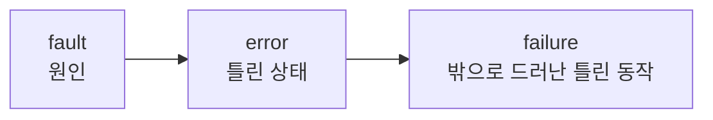

# 2장. 기본 개념과 용어

## 핵심 질문

safety, reliability, availability, security는 어떻게 다른가?

## 네 낱말은 서로 다른 것을 묻는다

임베디드 시스템을 만들 때 이 네 낱말을 섞어 쓰기 쉽다. 널리 쓰이는 분류는 이렇게 나눈다 (Avizienis 외, 2004).

| 낱말 | 묻는 것 |
|---|---|
| availability | 쓰려고 할 때 쓸 수 있는가 |
| reliability | 쓰는 동안 올바른 동작이 끊기지 않는가 |
| safety | 사람과 환경에 큰 피해를 주지 않는가 |
| security | 허락받지 않은 사람이 정보를 보거나 바꾸거나 못 쓰게 하지 못하는가 |

네 가지는 따로 움직인다. 구동 토크를 제어하는 제어기로 예를 들면 이렇다.

- 가속 페달 신호가 조금만 이상해도 구동을 끊는 제어기는 의도하지 않은 가속에 대해서는 안전하다. 그러나 자주 멈추므로 availability가 낮다.
- 한 번도 멈추지 않고 페달 신호대로 토크를 내는 제어기는 reliability가 높아 보인다. 그러나 페달 신호가 틀렸을 때 틀린 토크를 그대로 내므로 안전하지 않다.

safety와 reliability가 다른 까닭이 하나 더 있다. 부품이 하나도 고장 나지 않아도 사고가 날 수 있다. 부품들이 저마다 명세대로 동작했는데 그 사이의 상호 작용이 위험한 경우다 (Leveson과 Thomas, 2018). 요구사항이 틀렸거나 빠진 경우가 여기에 든다.

## fault, error, failure

고장을 말할 때 세 낱말을 구분한다 (Avizienis 외, 2004).

- fault는 원인이다. 끊어진 선, 뒤집힌 bit, 코드의 결함, 틀린 요구사항이 모두 fault다.
- error는 시스템 안의 틀린 상태다. 변수에 든 틀린 값이 그 예다.
- failure는 시스템이 밖으로 내놓는 동작이 올바른 동작에서 벗어나는 것이다.

fault가 있다고 해서 꼭 error가 생기지는 않고, error가 있다고 해서 꼭 failure가 되지는 않는다. 안전을 위한 설계는 fault가 failure로 이어지는 이 길을 끊는 일이다.

| 끊는 곳 | 하는 일 | 이 책의 장 |
|---|---|---|
| fault를 만들지 않는다 | 요구사항, 설계, 코딩을 엄격하게 한다 | 10, 11, 13장 |
| fault를 미리 찾는다 | 검토, 분석, test | 8, 15, 16장 |
| error를 알아채고 failure가 되기 전에 막는다 | 감시, 입력 검사, 통신 보호 | 12장 |
| failure가 났을 때 피해를 줄인다 | safe state로 간다 | 7장 |

한 시스템의 failure는 그것을 품은 더 큰 시스템에서는 fault다. 제어기가 틀린 토크 요구를 내보내는 것은 제어기의 failure이고, 차량에서 보면 구동 계통의 fault다.

이 세 낱말은 문서마다 조금씩 다르게 쓴다. 이 책이 따르는 뜻은 부록 A에 있다.

## hazard와 risk

- hazard는 사고로 이어질 수 있는 시스템의 상태다. 자동차에서는 차량 수준에서 적는다. 예: 운전자가 요구하지 않았는데 차가 가속한다.
- risk는 해로운 일이 일어날 가능성과 그 결과의 심각도를 함께 본 것이다.

"토크 요구가 틀렸다"는 제어기의 failure이고, "차가 운전자의 뜻보다 크게 가속한다"는 hazard다. 같은 failure도 서 있을 때와 고속으로 달릴 때의 risk가 다르다. hazard를 찾고 risk를 평가하는 일은 6장에서 한다.

## 두 가지 failure

위험한 failure는 원인에 따라 둘로 나눈다 `(2차 자료)`.

| 종류 | 원인 | 다루는 법 |
|---|---|---|
| random hardware failure | 하드웨어의 열화 | 고장률을 추정하고, 중복과 진단으로 견딘다 |
| systematic failure | 명세의 오류, 빠진 요구사항, 하드웨어 설계의 오류, 소프트웨어의 결함, 전자기 간섭, 사람의 실수, 변경 | 개발 과정을 엄격하게 하고, 구조로 영향을 가둔다 |

systematic failure는 소프트웨어만의 것이 아니다. 하드웨어의 설계가 틀린 것도 여기에 든다. 소프트웨어는 닳지 않는다. 입력, 상태, 실행의 시간과 순서가 모두 같으면 늘 같은 결과를 낸다. interrupt의 경합처럼 드물게 나타나는 결함도 그 조건이 되면 반드시 나타난다. 그래서 소프트웨어의 결함에서 나온 failure는 모두 systematic failure다. 고장률을 계산해서 "충분히 낮다"고 말할 수 없다. 이것이 소프트웨어의 안전을 숫자가 아니라 방법으로 다루는 까닭이다. 3장에서 이어진다.

## functional safety

functional safety는 safety 가운데 시스템이 입력에 맞게 올바르게 동작하는 데 달려 있는 부분이다 `(2차 자료)`. 자동차에서는 전기, 전자 시스템의 오동작이 만드는 hazard 때문에 생기는 불합리한 risk가 없는 것을 가리킨다 `(2차 자료)`.

이 정의에는 경계가 있다. 오동작에서 나오는 위험만 다룬다. 시스템이 설계한 대로 동작했는데도 위험한 경우와, 누군가 일부러 공격하는 경우는 다른 분야가 다룬다. 23장에서 그 경계를 본다.

## safe state

고장을 알아챘을 때 시스템이 옮겨 가는 상태가 safe state다. 꺼진 상태만 safe state인 것은 아니다. 정상 동작일 수도 있고 성능을 낮춘 동작일 수도 있다 `(2차 자료)`. 기능을 끄는 것이 오히려 위험한 시스템이 많기 때문이다. 달리는 차의 구동력을 갑자기 끊으면 뒤차에 받힐 수 있다.

## 관통 예제에 적용

예제의 제어기에서 fault, error, failure, hazard를 한 줄씩 따라가 본다. 전체 표는 `example/drive-torque/docs/fault-table.md`에 있다.

| fault | error | 제어기의 failure | 차량의 hazard |
|---|---|---|---|
| 페달 채널 1의 선이 전원에 단락된다 | 채널 1의 페달 위치가 100%로 읽힌다 | 감시가 없다면 토크 요구가 최대가 된다 | 의도하지 않은 가속 |
| 기능의 코드에 결함이 있다 | 토크 요구가 운전자의 요구보다 크다 | 감시가 없다면 큰 토크 요구가 나간다 | 의도하지 않은 가속 |
| 허용 토크의 계산에 결함이 있다 | 허용 토크가 실제보다 크다 | 평소에는 드러나지 않는다 | 기능이 함께 틀릴 때 의도하지 않은 가속 |
| 브레이크 신호의 선이 끊겨 "밟음"으로 읽힌다 | 브레이크 상태가 틀리다 | 토크 요구가 0이 된다 | 구동력의 상실 |

셋째 줄은 평소에 드러나지 않는 fault다. 다른 fault와 겹칠 때에야 failure가 된다. 넷째 줄은 토크를 끊는 쪽으로 틀려도 hazard가 된다는 것을 보인다.

## 규격에서의 위치

- ISO 26262-1 (Vocabulary): 자동차 functional safety의 용어
- IEC 61508-4 (Definitions and abbreviations): 일반 functional safety의 용어

이 책은 두 규격의 정의 문장을 옮기지 않는다. 용어의 풀이와 근거는 부록 A에 있다.

## 흔한 오해

- "reliability가 높으면 안전하다." 틀린 입력을 충실히 따르는 시스템은 reliability가 높고 안전하지 않다. 거꾸로 자주 멈추는 시스템이 안전할 수 있다.
- "소프트웨어는 닳지 않으니 random failure와 상관없다." 소프트웨어의 결함은 systematic이다. 그러나 소프트웨어는 하드웨어 위에서 돈다. 메모리나 register의 bit가 뒤집히면 그 결과는 소프트웨어의 틀린 동작으로 나타난다. bit 하나가 task 하나를 멈출 수 있다 (Koopman, 2014).
- "safe state는 꺼진 상태다." 끄는 것이 안전한지는 hazard마다 따져야 한다.
- "부품이 모두 명세대로 동작하면 안전하다." 명세가 틀렸을 수 있다.

## 확인 문제

1. 주행 중에 계기판이 꺼졌다 켜지는 것은 availability, reliability, safety 가운데 무엇의 문제인가? 경우에 따라 답이 달라지는 까닭을 말해 보라.
2. "CAN 메시지의 CRC가 맞지 않는다"는 fault, error, failure 가운데 무엇인가? 어느 시스템의 눈으로 보는지에 따라 답해 보라.
3. 관통 예제에서 "토크 요구를 0으로 한다"가 safe state가 되는 hazard와 되지 않는 hazard를 하나씩 들어 보라.
4. 소프트웨어의 failure에 고장률을 매기기 어려운 까닭은 무엇인가?
