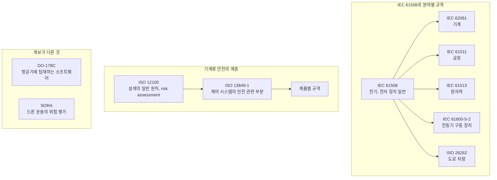

# 4장. 규격 지도와 규격 읽는 법

## 핵심 질문

규격은 왜 이렇게 많고 서로 어떤 관계인가? 규격 문장은 어떻게 읽어야 하는가?

## 규격이 여럿인 까닭

functional safety의 규격은 하나가 아니다. 분야마다 다치는 방식이 다르고, 고장이 났을 때 갈 수 있는 상태가 다르고, 누가 무엇을 책임지는지가 다르기 때문이다. 그래도 서로 무관하지는 않다. 크게 세 묶음으로 볼 수 있다.

### IEC 61508과 분야별 규격

IEC 61508은 분야를 가리지 않는 기본 규격이다. 전기, 전자, 프로그램 가능한 전자 장치로 만든 안전 관련 시스템이면 원칙으로는 어디에나 적용된다. 산업이 그대로 쓸 수도 있고, 분야별 규격과 제품별 규격을 만드는 바탕이 되기도 한다. IEC의 발표 자료는 그렇게 만들어진 규격으로 기계의 IEC 62061, 공정 산업의 IEC 61511, 원자력의 IEC 61513, 전동기 구동 장치의 IEC 61800-5-2를 든다 `(2차 자료)` (IEC, 2022).

ISO 26262는 IEC 61508을 도로 차량에 맞게 고친 규격이라고 한다 `(2차 자료)` (Van Eikema Hommes, 2016. ISO 26262:2011 기준). 고쳤다는 말이 중요하다. 등급의 이름과 정하는 방법이 다르고 (3장), 개발의 단계를 자동차 산업의 일하는 방식에 맞춰 나눴다. IEC 61508의 지식이 그대로 통하는 곳과 통하지 않는 곳이 있다.

### 기계류 안전의 계층

기계 분야는 규격을 층으로 쌓는다. 맨 위의 ISO 12100은 기계를 안전하게 설계하는 일반 원칙과 risk assessment의 절차를 정한다. 그 아래의 ISO 13849-1은 제어 시스템의 안전 관련 부분을 어떻게 설계하는지를 다룬다. 전기와 전자만이 아니라 유압, 공압, 기계 장치까지 다룬다는 점이 IEC 61508이나 IEC 62061과 다르다. 그 아래에 기계의 종류마다 제품별 규격이 있고, 이 규격들이 거의 모두 ISO 13849-1을 가리킨다 `(2차 자료)` (Hauke 외, 2019. EN ISO 13849-1:2015 기준).

기계의 제어 시스템에는 ISO 13849-1과 IEC 62061의 두 길이 있다. 방법은 다르지만 비슷한 수준의 risk 감소에 이를 수 있고, 두 규격의 요구사항을 섞어 쓰면 안 된다는 데에 널리 합의되어 있다고 한다 `(2차 자료)` (Hauke 외, 2019). 20장에서 다룬다.

### 계보가 다른 것

항공의 DO-178C는 IEC 61508에서 나오지 않았다. 항공기에 탑재하는 소프트웨어에 관한 업계의 합의 문서이고, 소프트웨어의 개발을 전체 시스템 개발의 한 부분으로 본다. 안전에 관한 요구사항은 그 위의 시스템 수준에서 정해져서 소프트웨어 개발이 시작될 때 주어진다고 가정한다 `(2차 자료)` (Van Eikema Hommes, 2016).

드론은 또 다르다. SORA는 제품의 규격이 아니라 운용 하나의 위험을 평가하는 방법이다. 요구사항을 처방하지 않고, 위험에 맞춘 안전 목표를 제시한다. 점검표처럼 쓰지 말라고 문서 스스로 적는다 (JARUS, 2024). 21장에서 다룬다.

철도, 의료 기기처럼 이 그림에 없는 분야는 22장에서 다룬다.

## 규격의 네 가지 방식

미국 정부의 한 보고서는 자동차 전자 제어에 관련된 규격 여섯을 견주면서, 규격이 안전을 확보하려는 방식을 넷으로 나눈다 (Van Eikema Hommes, 2016).

| 방식 | 정하는 것 | 보고서가 든 예 |
|---|---|---|
| 과정을 정한다 | 안전을 위해 어떤 일을 어떤 순서로 하는가 | ISO 26262, MIL-STD-882E, DO-178C |
| 방법을 나열한다 | 단계마다 쓸 수 있는 분석 방법 | ISO 26262 (FMEA, FTA, HAZOP 등을 든다) |
| 성능을 정한다 | 완성된 제품이 내야 하는 최소 성능 | 미국의 자동차 안전 기준 (FMVSS) |
| 설계를 정한다 | 설계의 한 측면 | AUTOSAR (구조), MISRA C (coding) |

이 구분은 "규격을 따랐다"는 말의 뜻을 가려 준다.

- 성능을 정하는 규격은 시험으로 합격과 불합격을 가른다. 어떻게 만들었는지는 묻지 않는다.
- 과정을 정하는 규격은 완성품의 성능 목표를 정하지 않는다. 설계자가 설계의 선택이 안전에 미치는 영향을 따지게 한다. 그래서 규격을 따른 결과가 얼마나 안전한지는 적용하는 사람에 따라 달라질 수 있다. 보고서가 드는 약점이다.
- 방법을 나열하는 규격은 알맞은 방법을 고르는 데 도움이 된다. 그 대신 목록이 낡는다.
- 설계를 정하는 규격은 알맞은 단계에서 쓰면 강하다. 그러나 설계의 한 측면만 본다. coding 규칙을 다 지킨 코드가 틀린 요구사항을 충실히 구현할 수 있다.

ISO 26262는 앞의 두 방식을 함께 쓴다 `(2차 자료)` (Van Eikema Hommes, 2016. ISO 26262:2011 기준). 과정을 정하고, 단계마다 방법을 든다. 방법을 표로 들고 등급마다 권하는 정도를 다르게 적는다고 하는데, 이 책은 그 표를 원문으로 확인하지 못했다 `(확인 필요)`.

## 규격이 정해 주는 것과 맡기는 것

규격은 틀을 주고, 값은 프로젝트가 정한다. IEC 61508을 예로 들면, safety function이 무엇을 하는지는 hazard 분석에서 나오고, 얼마나 믿을 수 있어야 하는지는 risk 평가에서 나온다 `(2차 자료)` (IEC, 2022). 둘 다 규격에 적혀 있지 않다. 규격은 그것을 정하는 절차와, 정해진 등급에 따라 해야 하는 일을 적는다.

규격이 일부러 열어 두는 곳도 있다.

- ISO 13849-1은 등급을 계산하는 방법을 쓰는 사람에게 맡긴다. 미리 정해 둔 구조와 간단한 계산법을 주지만, 그것은 편의를 위한 선택 사항이다 `(2차 자료)` (Hauke 외, 2019).
- 기계의 제품별 규격에 해당하는 내용이 없으면 safety function은 기계의 설계자가 정한다 `(2차 자료)` (Hauke 외, 2019).
- ISO 26262는 safety를 "불합리한 risk가 없는 것"으로 정의하는데, 무엇이 불합리한지는 더 정의하지 않는다고 한다 `(2차 자료)` (Van Eikema Hommes, 2016. ISO 26262:2011 기준).

그래서 규격을 읽을 때에는 "이 문장은 무엇을 정해 주고 무엇을 나에게 남기는가"를 물어야 한다. 남긴 것은 프로젝트가 정하고, 정한 근거를 적는다. 이 책의 예제에서 safety goal의 값 (1.0 m/s^2, 200 ms)이 "가정"이라고 적힌 까닭이다.

## 규격은 법이 아니다

규격은 대개 민간의 합의 문서다. 법이 되는 것은 규제가 그 규격을 가리킬 때다. 가리키는 방식이 분야마다 다르다.

| 분야 | 규제와 규격의 관계 |
|---|---|
| 항공 (미국) | FAA의 문서 (AC 20-115D)는 DO-178C를 규정을 지켰음을 보이는 방법으로 인정한다. 인정된 방법 가운데 하나이고 유일한 방법은 아니다. 이 문서 자체는 의무도 규정도 아니다. 다만 이 방법을 쓰기로 했으면 해당하는 모든 점에서 따라야 한다 (FAA, 2017) |
| 기계 (EU) | 규격이 EU의 관보에 조화 규격으로 실리면, 그 규격을 따른 설계는 지침의 필수 요구사항을 만족한다고 추정한다 `(2차 자료)` (Hauke 외, 2019) |
| 자동차 (미국) | 자동차 안전 기준 (FMVSS)은 법으로 정한 성능 요구사항이고 제조사가 스스로 인증한다. ISO 26262는 업계가 자발적으로 따르는 규격이다 (Van Eikema Hommes, 2016) |
| 드론 | SORA는 위험을 평가하는 인정된 방법으로 제안된 것이다. 당국은 방법을 바꾸거나 조치를 더 요구할 수 있다 (JARUS, 2024) |

법이 아니라고 해서 가볍다는 뜻은 아니다. 규제 기관이 국제 규격을 "합리적인 수준"의 기준으로 삼는 일이 늘고 있다 (IEC, 2022). 사고가 난 뒤에 "업계가 아는 방법을 썼는가"를 물을 때 규격이 그 잣대가 된다.

## 규격의 문장을 읽는 법

ISO와 IEC의 규격은 문서를 쓰는 규칙이 따로 정해져 있다 (ISO/IEC Directives, Part 2, 2021). 규격을 읽을 때 가장 먼저 알아야 하는 것이 조동사의 뜻이다.

| 조동사 | 뜻 | 읽는 법 |
|---|---|---|
| shall | 요구사항 | 그 규격을 따랐다고 주장하려면 벗어날 수 없다 |
| should | 권고 | 특히 알맞다고 보는 선택이다. 다른 길을 막지는 않는다 |
| may | 허용 | 문서가 주는 허락이다 |
| can | 가능성, 능력 | 할 수 있다는 서술이다. 요구사항이 아니다 |

- 요구사항은 객관적으로 확인할 수 있는 기준이어야 한다. 그래서 shall이 들어간 문장은 "했는지 안 했는지"를 가릴 수 있게 읽는다.
- must는 요구사항에 쓰지 않는다. 법이나 자연 법칙처럼 문서 밖에서 주어진 제약을 가리킬 때만 쓴다.
- 문서의 요소는 둘로 나뉜다. normative는 규정을 담는 부분이고, informative는 이해를 돕거나 배경을 알려 주는 부분이다. 부록이나 주석에 적힌 예는 대개 요구사항이 아니다.

GSN 표준이 이 구분을 보여 주는 쉬운 예다. 표기법의 정의를 담은 Part 1만 normative이고, 개념을 소개하는 Part 0과 쓰는 법을 안내하는 Part 2는 informative다 (ACWG, 2021).

이 규칙은 ISO와 IEC의 문서에만 해당한다. 다른 기관의 문서는 같은 낱말을 다르게 쓴다.

- SORA는 should가 "강한 의무"를 나타낸다고 문서 안에서 정의한다 (JARUS, 2024).
- FAA의 문서는 의무가 아니라고 밝히면서도, 그 방법을 쓰는 경우에는 모두 따르라고 한다.

문서를 읽기 전에 그 문서가 조동사를 어떻게 정의하는지부터 찾는다.

## ISO 26262의 구성

ISO 26262:2018은 12개의 Part로 되어 있다. 제목은 ISO의 목록에서 확인한 것이다.

| Part | 제목 | 이 책의 장 |
|---|---|---|
| 1 | Vocabulary | 2, 4 |
| 2 | Management of functional safety | 5, 19 |
| 3 | Concept phase | 3, 6, 7 |
| 4 | Product development at the system level | 7 |
| 5 | Product development at the hardware level | 9 |
| 6 | Product development at the software level | 10-16 |
| 7 | Production, operation, service and decommissioning | 18 |
| 8 | Supporting processes | 5, 10, 17, 18 |
| 9 | Automotive safety integrity level (ASIL)-oriented and safety-oriented analyses | 3, 7, 8, 11 |
| 10 | Guidelines on ISO 26262 | 4, 17 |
| 11 | Guidelines on application of ISO 26262 to semiconductors | 9 |
| 12 | Adaptation of ISO 26262 for motorcycles | 다루지 않는다 |

- 흐름은 Part 3에서 7까지다. hazard에서 시작해 시스템, 하드웨어, 소프트웨어로 내려가고 생산과 운용으로 이어진다. Part 2와 8은 그 전체에 걸친 관리와 지원이다.
- 2011년 판은 10개의 Part였고, Part 2에서 7까지가 핵심이며 나머지가 그것을 받친다고 한다 `(2차 자료)` (Van Eikema Hommes, 2016).
- 소프트웨어 엔지니어가 Part 6만 읽으면 안 되는 까닭이 여기에 있다. 소프트웨어의 요구사항은 Part 3과 4에서 내려오고, 등급을 나누는 규칙과 분석은 Part 9에, 도구와 변경의 관리는 Part 8에 있다.
- 표의 셋째 열은 제목을 보고 이 책이 정한 대응이다. 장의 내용이 그 Part의 요구사항을 설명한다는 뜻이 아니다. 이 책은 원문을 보지 않고 쓴다.

## IEC 61508의 구성

IEC 61508:2010은 7개의 Part다.

| Part | 제목 |
|---|---|
| 1 | General requirements |
| 2 | Requirements for electrical/electronic/programmable electronic safety-related systems |
| 3 | Software requirements |
| 4 | Definitions and abbreviations |
| 5 | Examples of methods for the determination of safety integrity levels |
| 6 | Guidelines on the application of IEC 61508-2 and IEC 61508-3 |
| 7 | Overview of techniques and measures |

IEC의 발표 자료는 이 규격의 뼈대를 이렇게 설명한다 `(2차 자료)` (IEC, 2022).

- safety lifecycle이 셋 있다: 전체, 전기와 전자 시스템, 소프트웨어.
- 규격을 따른다는 것은 네 가지로 이루어진다: functional safety의 관리, 사람의 역량, 기술 요구사항, 확인 활동. 이 넷이 lifecycle의 단계마다 적용된다.

## 따랐다, 평가받았다, 인증받았다

이 말들은 자주 섞인다. 이 책에서는 이렇게 구분한다. (저자의 정리다. 규격의 정의가 아니다.)

| 말 | 누가 | 무엇을 말하는가 |
|---|---|---|
| 따랐다 (compliance, conformance) | 만든 쪽 | 규격의 요구사항을 만족한다고 주장한다 |
| 평가받았다 | 만든 쪽에서 떨어진 누군가 | 그 주장을 따져 보았다. 무엇을 따졌는지를 물어야 한다. 규격의 요구사항을 만족하는지를 본 것과, functional safety가 달성되었는지를 증거로 판단한 것 (functional safety assessment)은 다른 일이다. 5장에서 다룬다 |
| 인증서를 받았다 | 인증을 하는 제삼자 기관 | 평가한 결과를 문서로 냈다. 그 문서가 법의 승인인지는 분야와 나라마다 다르다 |
| 승인받았다 | 규제 당국 | 법이 정한 절차로 인정했다. 항공기의 형식 증명이 그 예다 |

분야마다 어디까지 요구하는지가 다르다.

- 항공: 인증은 항공기, 엔진, 프로펠러에 대해 한다. 당국은 소프트웨어를 따로 떼어 인증하지 않는다. 소프트웨어가 든 시스템과 장비는 특정한 인증의 맥락 안에서 승인된다 `(2차 자료)` (Van Eikema Hommes, 2016이 DO-178C를 인용). "인증받은 소프트웨어"라는 말을 조심해야 하는 까닭이다.
- 자동차: 미국 정부의 보고서는 ISO 26262에 대해 둘을 적는다. 개발하면서 만든 산출물을 모아 safety case를 이루고 그것으로 규격의 과정을 따랐음을 보인다는 것, 그리고 등급에 따라 산출물의 검토를 두고 검토하는 사람이 만든 사람에게서 독립적이게 한다는 것이다 `(2차 자료)` (Van Eikema Hommes, 2016. ISO 26262:2011 기준. 이 책은 이 보고서 하나로만 확인했다). 이 책은 safety case를 규격을 따랐다는 증빙의 묶음이 아니라 안전하다는 주장의 논증으로 다룬다 (19장). 검토와 독립은 5장에서 다룬다.
- 일반: IEC 61508의 목표 가운데 하나는 필요할 때 적합성을 평가하는 서비스가 만들어질 수 있게 하는 것이다 `(2차 자료)` (IEC, 2022). 인증서는 규격이 아니라 그 서비스를 하는 기관이 낸다.
- 군수: MIL-STD-882E는 인증을 위한 규격이 아니다 (Van Eikema Hommes, 2016).

부품을 살 때 "어느 규격의 어느 등급까지 인증받았다"는 문서를 받는다면, 그것은 대개 당국의 승인이 아니라 제삼자 기관의 인증서다. 누가 무엇을 어떤 판과 어떤 조건에서 확인했는지를 읽어야 한다. 그 조건이 내 시스템에서 성립하는지는 내가 확인한다. 17장에서 다룬다.

## 이 책이 규격을 다루는 방식

이 책은 ISO 26262와 IEC 61508의 원문을 보지 않고 쓴다. 그래서 규격의 요구사항을 옮기거나 풀이하지 않는다. 다루는 것은 규격의 구조와 용어, 그리고 규격이 풀려는 문제다.

- 표시가 없는 문장은 공개된 문서의 해당 쪽을 직접 읽고 쓴 것이다.
- `(2차 자료)`는 규격의 원문이 아니라 규격을 설명한 공개 자료로 확인했다는 뜻이다. 그 자료가 기준으로 삼은 판이 지금의 판과 다르면 함께 적는다.
- `(확인 필요)`는 확인하지 못했다는 뜻이다.

실제 프로젝트에서 "규격이 무엇을 요구하는가"를 따질 때에는 원문을 읽어야 한다. 이 책은 원문을 읽을 때 길을 잃지 않게 하는 지도다.

## 관통 예제에 적용

예제의 산출물이 ISO 26262의 어느 Part에 해당하는지를 제목 수준에서 대응시키면 이렇다. 책 전체의 대응표는 부록 B에 있다.

| 예제의 산출물 | 파일 | Part |
|---|---|---|
| safety plan | `docs/safety-plan.md` | 2 |
| item definition, HARA, functional safety concept | `docs/item-definition.md`, `docs/hara.md`, `docs/functional-safety-concept.md` | 3 |
| technical safety concept | `docs/technical-safety-concept.md` | 4 |
| software safety requirement, 구조, 코드, test | `docs/requirements.yaml`, `docs/architecture.md`, `src/`, `test/` | 6 |
| safety analysis | `docs/fta.md` | 9 |
| safety case | `docs/safety-case.md` | 2 |

- 이 표는 "예제가 그 Part를 따랐다"는 뜻이 아니다. 예제는 규격의 용어와 흐름을 빌렸을 뿐이고, 요구사항을 만족하는지 확인하지 않았다.
- 예제에는 Part 5 (하드웨어)와 Part 7 (생산과 운용)에 해당하는 산출물이 없다. 하드웨어는 가정으로 받는다.
- 앞에서 본 네 가지 방식으로 보면, 예제가 한 일은 과정 (hazard에서 safety case까지의 흐름)과 방법 (FTA, MC/DC, fault injection)을 써 본 것이다. 성능의 기준은 없다. `SG-01`의 값을 스스로 가정했기 때문이다.

## 새 판에서 달라지는 점

이 책은 ISO 26262:2018과 IEC 61508:2010을 기준으로 쓴다. 두 규격 모두 다음 판이 만들어지고 있다. 아래는 2026-11-22에 발행 기관의 공개 페이지에서 확인한 것이다.

ISO 26262
- 2018년 판은 현행이다.
- 다음 판의 초안이 Part마다 공개되어 ISO의 회원 기관이 의견을 내는 단계에 있다. 발행 예정일은 페이지에 없다.
- Part 3의 제목이 "Concept phase"에서 "Product development at the item level"로 바뀐다.
- 초안의 소개 글에 따르면, 새 판이 발행되기 전에 이미 개발 중이던 시스템은 새 판의 적용 범위에서 빠진다.
- 내용이 무엇이 달라지는지는 확인하지 못했다. 초안은 유료이고, 발행 기관이 공개한 변경 요약을 찾지 못했다. 업체와 컨설팅 회사의 전망 글은 근거로 쓰지 않았다.

IEC 61508
- 2010년 판 (Edition 2)이 현행이다.
- Edition 3이 만들어지고 있다. IEC의 판매 페이지는 Part 1의 발행 예정일을 2026-10-22로 적었는데, 확인한 날에는 그 날짜가 지났고 아직 발행되지 않았다.
- 내용이 무엇이 달라지는지는 확인하지 못했다.

규격의 판은 계약과 프로젝트가 정한다. 문서를 읽을 때 가장 먼저 판을 확인한다. 로봇과 드론에 관련된 개정은 20장과 21장에서 다룬다.

## 규격에서의 위치

- ISO 26262-1 (Vocabulary), ISO 26262-10 (Guidelines on ISO 26262)
- IEC 61508-1 (General requirements)
- ISO/IEC Directives, Part 2: ISO와 IEC의 문서를 쓰는 규칙

## 흔한 오해

- "규격을 따르면 안전하다." 과정을 정하는 규격은 완성품이 얼마나 안전한지를 정하지 않는다. 따른 결과는 적용한 사람에 따라 달라진다. 규격은 해야 할 일의 최소한이다.
- "규격은 법이다." 규격은 대개 합의 문서다. 법이 되는 방식은 분야와 나라마다 다르다.
- "should는 안 해도 된다." ISO와 IEC의 문서에서 should는 권고다. 그러나 다른 기관의 문서는 should를 강한 의무로 쓰기도 한다. 그 문서의 정의를 먼저 본다.
- "우리 소프트웨어는 인증을 받았다." 누가, 무엇을, 어떤 조건에서 확인했는지가 빠진 말이다. 항공에서는 소프트웨어만 따로 인증하지 않는다.
- "coding 규칙을 다 지켰으니 규격을 따른 것이다." coding 규칙은 설계의 한 측면을 정할 뿐이다.
- "새 판이 나오면 지금 하는 개발을 새 판에 맞춰야 한다." 판은 프로젝트가 정한다. ISO 26262 다음 판의 초안은 이미 개발 중인 시스템을 적용 범위에서 뺀다고 소개한다. 그렇다고 새 판을 몰라도 된다는 뜻은 아니다. 규격은 "합리적인 수준"의 잣대로 쓰이고, 그 잣대는 판과 함께 움직인다. (마지막 두 문장은 저자의 의견이다.)

## 확인 문제

1. FMVSS와 ISO 26262는 "따랐다"를 확인하는 방법이 어떻게 다른가? 규격의 방식으로 설명해 보라.
2. 어떤 규격에 "The software unit design should be reviewed"라는 문장이 있다. 이 문장을 ISO의 규칙으로 읽을 때와 SORA의 정의로 읽을 때 무엇이 달라지는가?
3. ISO 26262의 Part 6만 읽고 소프트웨어를 개발하면 무엇을 놓치는가? 예제의 산출물 가운데 Part 6 밖에서 온 것을 들어 보라.
4. 부품 공급자가 "이 RTOS는 ASIL D까지 인증받았다"고 한다. 확인해야 할 것을 셋 들어 보라.
5. 예제의 `SG-01`에 들어 있는 두 값은 규격이 정해 준 것인가? 누가 정하고, 무엇을 근거로 삼아야 하는가?
