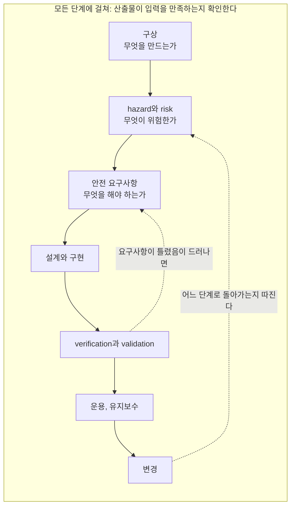

# 5장. Safety lifecycle과 safety management

## 핵심 질문

안전은 왜 기술만이 아니라 프로세스와 조직의 문제인가?

## 결함은 어디에서 들어오는가

영국의 안전 보건 당국 (HSE)은 제어 시스템이 관련된 사고 34건을 모아, 사고의 뿌리가 어느 단계에서 생겼는지를 나눠 보았다 (HSE, 2003).

| 뿌리가 생긴 단계 | 건수 | 비율 |
|---|---|---|
| 명세 (무엇을 해야 하는지, 얼마나 믿을 수 있어야 하는지) | 15 | 44% |
| 설계와 구현 | 5 | 15% |
| 설치와 시운전 | 2 | 6% |
| 운전과 유지보수 | 5 | 15% |
| 쓰기 시작한 뒤의 변경 | 7 | 20% |

이 표를 읽을 때 알아야 할 것이 있다. HSE가 스스로 적은 한계다.

- 표본이 작아서 통계로서의 의미는 낮다. 모든 제어 시스템의 고장으로 넓힐 때에는 조심하라고 한다.
- 사고는 HSE에 알려졌거나 HSE의 조사 보고서에 있던 것이다. 고른 기준은 적혀 있지 않다.
- 사고는 대개 여러 단계의 잘못이 겹친 것이다. 어느 단계가 주된 원인인지는 분석한 사람의 판단이고, 다른 사람은 다르게 볼 수 있다고 한다.
- 분석은 1995년의 초판과 같다. 오래된 자료다.
- 사고는 화학 공장과 기계의 제어 시스템에서 난 것이다. 소프트웨어가 중심인 임베디드 제품의 통계가 아니다.

그래도 방향은 분명하다. 설계와 구현의 잘못은 15%이고, 그 앞 (명세)과 뒤 (설치, 운전, 변경)의 잘못이 나머지다. 코드를 아무리 잘 짜도 닿지 않는 곳에 사고의 대부분이 있다. HSE의 결론도 그렇다. 사고의 대부분은 제어 시스템의 미묘한 고장 방식 때문이 아니라, 처음부터 끝까지 체계적으로 접근했다면 막을 수 있었던 결함 때문이었다.

소프트웨어 쪽의 자료도 같은 말을 한다. NASA의 지침서는 소프트웨어 문제의 대부분이 실은 명세의 문제라고 적고, 결함을 고치는 비용은 개발이 진행될수록 급격히 커진다고 적는다 (NASA, 2004).

여기에서 이 장의 답이 나온다. 결함이 들어오는 곳이 개발의 모든 단계에 걸쳐 있으므로, 막는 일도 모든 단계에 걸쳐 있어야 한다. 그것을 단계와 산출물로 정리한 것이 safety lifecycle이고, 그 일이 실제로 되게 하는 것이 safety management다. 이 장에서 "과정"이라고 쓰는 것은 process, 곧 일을 하는 정해진 절차다.

## safety lifecycle

safety lifecycle은 안전에 관한 일을 처음 구상할 때부터 폐기할 때까지 단계로 나눈 것이다. 단계마다 입력, 목적, 활동, 산출물이 있고, 한 단계의 산출물이 다음 단계의 입력이 된다. 모든 단계에 걸쳐 verification과 assessment가 있다 (HSE, 2003).

보통의 프로젝트 계획과 무엇이 다른가. HSE는 둘을 든다.

- 결과를 평가하고 검증하는 절차가 정해져 있다. 한 단계의 산출물이 그 단계의 입력을 만족하는지를 다음 단계로 가기 전에 확인한다.
- 앞 단계로 돌아가 다시 본다. 뒤에서 내린 결정이 앞에서 한 일을 무너뜨리지 않는지를 공식으로 다시 검토한다. 그래서 lifecycle은 한 줄로 흐르지 않고 되풀이된다.

오해하기 쉬운 것도 있다.

- lifecycle은 waterfall이 아니다. 한 활동을 끝내야 다음을 시작할 수 있는 것이 아니고, 특정한 조직 구조를 요구하지도 않는다 (HSE, 2003). NASA의 지침서도 단계의 이름은 모든 개발 방식에 적용되는 개념일 뿐이라고 적는다.
- lifecycle은 개발에서 끝나지 않는다. 앞의 표에서 사고의 35%는 쓰기 시작한 뒤에 뿌리가 생겼다. ISO 26262의 lifecycle에도 생산, 운용, 정비, 폐기가 들어 있다 `(2차 자료)` (Van Eikema Hommes, 2016. ISO 26262:2011 기준). 18장에서 다룬다.

규격마다 lifecycle을 조금씩 다르게 그린다.

- IEC 61508에는 lifecycle이 셋 있다: 전체, 전기와 전자 시스템, 소프트웨어 `(2차 자료)` (IEC, 2022).
- ISO 26262의 concept phase를 따라간 미국 정부의 보고서는 그 흐름을 이렇게 그린다: item을 정한다, 차량 수준의 hazard를 찾는다, risk를 평가한다, safety goal을 만든다, safety analysis를 한다, functional safety concept을 만든다, functional safety requirement를 낸다 `(2차 자료)` (Becker 외, 2020. ISO 26262의 2011년 최종 초안 기준). 6장과 7장이 이 순서를 따른다.

개발의 부분은 흔히 V자로 그린다. 왼쪽으로 내려가며 요구사항을 나누고, 오른쪽으로 올라오며 같은 높이의 요구사항에 대해 검증한다. 이 책의 장도 그렇게 놓여 있다. 6장에서 12장까지가 내려가는 쪽이고, 15장과 16장이 올라오는 쪽이다. 17장에서 19장까지는 그 전체를 받치고 묶는다.

## safety plan

lifecycle은 일반적인 틀이다. 그것을 이 프로젝트에서 누가, 언제, 무엇으로 하는지를 적은 것이 safety plan이다. NASA의 지침서는 안전 계획이 안전에 관련된 소프트웨어를 개발하고 분석하기 위한 전제라고 적고, 그 안에 들어가는 것을 이렇게 든다 (NASA, 2004).

- 조직의 구조와 서로의 interface
- 분석, 보고, 평가의 기준과 기록의 보존
- 분석의 일정과 결과를 전하는 방법
- 활동을 승인하는 절차
- 안전을 위한 노력을 이 프로젝트에 맞게 줄이거나 늘린 내용

계획은 따로 된 문서일 수도 있고 다른 계획의 일부일 수도 있다. 형식은 중요하지 않다. 중요한 것은 계획이 먼저 있고, 다른 사람이 그것을 검토한다는 것이다. 계획 없이 한 안전 활동은 "한 것을 모은 목록"이 되고, 빠진 것이 보이지 않는다.

## 역할과 책임

NASA의 지침서는 소프트웨어 안전에 관여하는 사람을 이렇게 든다 (NASA, 2004).

| 역할 | 하는 일 |
|---|---|
| 프로젝트 관리자 | 전체를 본다. 어떤 분석이 필요한지 다툼이 있으면 대개 마지막에 정한다. 프로젝트가 질 risk의 크기도 정한다 |
| 시스템 엔지니어 | 하드웨어와 소프트웨어에 일을 나눈다 |
| 시스템 안전 엔지니어 | 무엇이 위험한지를 정한다 |
| 소프트웨어 안전 엔지니어 | 안전 요구사항이 있고 설계에 반영되는지를 확인한다. 분석과 test를 한다 |
| 소프트웨어 개발자 | 설계와 구현으로 안전에 영향을 준다 |
| 소프트웨어 보증 엔지니어 | 과정을 지켜보고 추적을 확인한다. 밖에서 본 눈을 준다 |

- 이 사람들 사이의 소통의 길을 만들고 유지하는 것이 아주 중요하다고 지침서는 적는다. 안전 요구사항은 역할의 경계에서 떨어지기 쉽다. (뒤의 문장은 저자의 풀이다.)
- 작은 팀에서는 한 사람이 여러 역할을 맡을 수 있다. 그래도 역할은 남는다. 누가 그 역할인지 적어 두지 않으면 아무도 하지 않는다.
- 관리자가 risk를 정한다는 것과, 관리자를 거치지 않는 보고의 길이 따로 있다는 것이 함께 있다. 지침서는 안전 보증 조직과 독립 검증 조직이 독립된 보고의 길을 준다고 적는다. 일정을 책임지는 사람과 "안전하지 않다"고 말하는 사람이 같으면 그 말은 나오기 어렵다. (뒤의 문장은 저자의 풀이다.)

## 누가 확인하는가

만든 것을 확인하는 일은 묻는 것에 따라 넷으로 나뉜다.

| 확인 | 묻는 것 | 근거 문서의 풀이 |
|---|---|---|
| verification | 이 산출물이 맞는가 | 산출물이 그 단계의 입력을 만족하는지를 다음 단계로 가기 전에 확인한다. 문서 검토, 설계 검토, test가 그 예다 (HSE, 2003) |
| audit | 정한 과정을 따랐는가 | 기준이 얼마나 지켜졌는지를 증거로 평가하는, 체계적이고 독립적이며 기록이 남는 과정이다 (NASA, 2022) |
| validation | 만든 것이 쓰이는 곳에서 요구사항을 만족하는가 | 정해진 쓰임에서 요구사항이 충족되었음을 객관적인 증거로 확인한다. 안전에서는 시스템이 안전 요구사항의 명세를 모든 면에서 만족함을 보이는 일이다 (HSE, 2003) |
| functional safety assessment | 그래서 안전한가 | 프로젝트 팀에서 독립된 사람이 증거를 바탕으로 functional safety가 달성되었는지를 판단한다. HSE는 요구사항의 명세 자체가 쓰는 사람의 안전상의 필요를 옳게 담았는지도 여기에서 본다 (HSE, 2003) |

넷은 서로를 대신하지 못한다. 산출물이 하나하나 옳아도 과정에서 빠진 단계가 있을 수 있고, 과정을 다 따랐어도 안전하지 않을 수 있다. 4장에서 "평가받았다"는 말을 들으면 무엇을 평가했는지 물으라고 한 까닭이 이것이다. 과정을 따랐는지를 본 것 (audit)과 안전이 달성되었는지를 판단한 것 (functional safety assessment)은 다른 일이다.

ISO 26262에도 이런 확인이 있다. AUTOSAR의 문서는 자기가 제공하지 않는 것으로 confirmation measure와 functional safety audit을 든다 `(2차 자료)` (AUTOSAR, 2025). 미국 정부의 보고서는 ISO 26262가 등급에 따라 confirmation review를 두고, 검토자가 개발자, 프로젝트 관리, 산출물의 작성자로부터 독립적이게 한다고 적는다 `(2차 자료)` (Van Eikema Hommes, 2016. ISO 26262:2011 기준. 이 책은 이 보고서 하나로만 확인했다). 어느 산출물을 어느 등급에서 누가 확인해야 하는지는 이 책이 확인하지 못했다.

### 독립이란 무엇인가

"다른 사람이 본다"만으로는 부족하다. NASA의 표준은 독립된 검증 조직의 독립을 세 가지로 나눈다 (NASA, 2022). 이것은 NASA가 자기 조직에 대해 정한 틀이다. ISO 26262가 확인 활동마다 요구하는 독립의 정도는 다른 틀이고, 이 책이 확인하지 못했다. 그래도 "독립"이라는 말이 무엇으로 이루어지는지를 보는 데에는 이 셋이 쓸모 있다.

| 독립 | 뜻 |
|---|---|
| 기술의 독립 | 확인하는 사람이 그 시스템의 개발에 참여하지 않았다 |
| 관리의 독립 | 개발 조직과 다른 조직에 속한다. 무엇을 어떻게 언제 볼지를 스스로 정한다. 결과를 낼 때 개발 조직의 승인을 받지 않는다 |
| 재정의 독립 | 확인하는 일의 예산을 개발 조직이 쥐고 있지 않다 |

얼마나 독립적이어야 하는지는 위험의 크기에 따른다. NASA의 지침서는 위험이 가장 큰 소프트웨어에는 완전히 독립된 검증 조직을, 낮은 쪽에는 조직 안의 보증만을 대응시킨다.

독립에는 대가가 있다.

- 멀리 있는 검토자는 설계를 잘 모른다. 개발팀은 안전하다는 증거를 힘써 내놓고, 설계를 깊이 모르는 검토자는 그 증거가 덮지 않는 위험을 찾지 못할 수 있다. 정말 독립된 검토자는 구하기도 어렵다 (Van Eikema Hommes, 2016).
- 가까이 있는 검토자는 같은 것을 못 본다. 737 MAX를 검토한 여러 나라 당국의 보고서는, 시스템마다 같은 팀이 설계와 안전 평가를 함께 하고 있었고 그것을 조율하는 독립된 안전 조직이 있는지 확인하지 못했다고 적는다. 보고서는 설계 조직에서 독립되고 설계에 영향을 줄 권한을 가진 안전 기능을 두라고 권고한다 (JATR, 2019).

두 번째 줄의 마지막이 중요하다. 독립은 조직도의 문제만이 아니다. 독립된 눈이 쓸모 있으려면 설계를 알 만큼의 정보와, 설계를 바꾸게 할 권한이 있어야 한다.

## 공급망에서 책임을 나눈다

자동차의 소프트웨어는 한 회사가 다 만들지 않는다. 책임이 회사의 경계에서 떨어지지 않게 하는 일이 필요하다.

NASA의 지침서는 계약으로 소프트웨어를 만들 때 정해 둘 것을 이렇게 든다 (NASA, 2004).

- 안전 요구사항을 명세에 분명히 적는다. 나중에 바꾸면 돈이 든다.
- 안전 요구사항을 하청 업체에도 넘기게 한다.
- 어떤 분석과 test를 누가 하고, 그 결과를 누가 보는지를 정한다.
- 받는 쪽이 만드는 쪽의 과정을 들여다볼 수 있게 한다. 결과만 보는 계약에서도 안전에 관련된 소프트웨어는 "어떻게 만들었는가"가 중요하다.
- 지켜보는 방식을 정한다. 같이 일하며 보는 방식과, 기록을 받아 보고 표본을 audit하는 방식이 있다.
- 변경을 정하는 자리에 받는 쪽이 참여한다.
- 코드만이 아니라 계획, 설계 문서, test, 도구, 보증의 기록을 함께 받는다. 만든 쪽이 떠난 뒤에도 유지해야 하기 때문이다.

거꾸로, 받은 것이 무엇을 해 주지 않는지도 알아야 한다. AUTOSAR의 문서가 좋은 예다. 안전에 관련된 응용을 만드는 쪽이 lifecycle이 알맞은지를 스스로 보장해야 한다고 적고, AUTOSAR가 해 주지 않는 것을 목록으로 든다: hazard 분석, safety concept, 등급의 판정, dependent failure analysis, safety case, 확인 활동, 구현에 대한 test 등이다 (AUTOSAR, 2025). platform을 사는 것으로 이 일들이 없어지지 않는다.

## 줄이기 (tailoring)

모든 프로젝트가 같은 무게의 과정을 질 필요는 없다. NASA의 지침서는 목표를 한 줄로 적는다: 필요한 일은 다 하고, 필요한 일만 한다 (NASA, 2004). 줄이는 근거가 되는 것은 위험의 크기와 시스템의 복잡도다. HSE도 고장의 결과가 작거나 설계가 단순하면 경험과 점검표에 바탕을 둔 접근으로 충분할 수 있고, 위험이 크거나 복잡하면 HAZOP이나 FMEA 같은 정해진 기법을 쓰라고 한다.

ISO 26262가 활동을 줄이는 데 두는 규칙은 이 책이 확인하지 못했다. 아래는 NASA와 HSE의 문서가 말하는 원칙이다. 자동차 프로젝트에서 무엇을 줄일 수 있는지는 규격의 원문을 따라야 한다. 4장에서 본 것처럼 shall이 붙은 것에서는 벗어날 수 없다.

줄일 때의 원칙은 셋이다.

- 줄일 수 없는 바닥이 있다. 어떤 수준에서도 명세, 설계, 구현, test, 변경 요청, 문제 보고는 위험이 새로 들어오지 않았는지 검토한다. 안전 요구사항이 설계와 코드와 test로 추적되는지는 늘 확인한다 (NASA, 2004).
- 줄이면 이유를 댄다. 강하게 권장되는 기법을 빼려면 그래도 안전이 나빠지지 않음을 보여야 한다. NASA의 표준은 요구사항을 줄여 달라는 요청에 근거, risk의 평가, 뒷받침하는 자료를 넣게 하고, 개발 조직이 아닌 쪽의 승인을 받게 한다 (NASA, 2022).
- 범위를 나눠서 줄인다. 안전에 관련된 부분을 나머지와 나누면 무거운 과정을 그 부분에만 적용할 수 있다 (11장).

지침서에는 눈에 띄는 경고가 하나 있다. 작은 프로젝트가 "우리 소프트웨어에는 안전에 관련된 부분이 없다"고 주장하는 일이 너무 잦고, 그것은 그 딱지가 붙으면 일이 크게 늘어난다고 걱정해서라는 것이다. 지침서의 답은 범위를 나누면 일이 그만큼 늘지 않는다는 것이다. 줄이기가 일을 피하는 수단이 되지 않게 하려면, 줄인 것마다 "그래서 무엇을 주장할 수 없게 되는가"를 함께 적는다. (이 마지막 문장은 저자의 제안이다.)

## safety culture

과정이 종이에 있는 것과 지켜지는 것은 다르다. 그 차이를 만드는 것을 흔히 safety culture라고 부른다. 받은 문서에 이 말의 정의는 없다. 대신 그것이 없을 때의 모습이 여러 문서에 적혀 있다.

- HSE: 제어 시스템의 고장은 기술만의 문제가 아니다. 서로 부딪치는 경영의 우선순위, 안전 공학의 교육 부족, safety culture의 부재, 부실한 계약 절차가 기술적인 원인에 크게 보탠다. 경영진에게는 조직의 모든 수준에서 safety culture를 기를 책임이 있다 (HSE, 2003).
- NASA: 관리자는 사고가 일어날 조건을 만들 수 있다. 원인의 유형으로 안전과 맞지 않는 목표, 일정의 압박, 규칙을 무시하라는 압박, 소통의 실패, 교육 부족, 안전이 우선순위를 받지 못함을 든다 (NASA, 2004).
- 737 MAX를 검토한 여러 나라 당국의 보고서: 인증 요건을 지키는 것보다 안전한 제품을 만드는 것을 앞에 두는 문화를 권고한다. 보고서가 본 것 가운데에는 이런 것이 있다. hazard 분석이 설계를 이끄는 도구가 아니라 이미 정해진 설계를 문서로 만드는 데 쓰인다는 인식이 있었다. 앞선 기종의 안전 분석 일부를 충분한 평가 없이 재사용했다. 조종사의 조치를 주된 대책으로 삼은 것은 그 회사 자신의 설계 지침에도 맞지 않았다 (JATR, 2019).
- 미국 하원 위원회의 보고서: 같은 사고에 대해 다섯 가지를 든다: 생산의 압박, 틀린 설계 가정, 정보를 감추는 문화, 회사 직원이 당국을 대신해 확인하는 구조의 이해 충돌, 감독에 대한 회사의 영향. 이것은 조사 기관의 결론이 아니라 의회 위원회의 판단이다 (미국 하원 교통 기반 시설 위원회, 2020).

ISO 26262도 safety culture를 기르는 것과 안전 관리를 강조한다고 한다 `(2차 자료)` (Van Eikema Hommes, 2016).

엔지니어의 자리에서 이 말은 추상적이지 않다. 아래는 이 문서들을 읽고 저자가 정리한 물음이다.

- 안전 분석을 설계가 정해지기 전에 하는가, 정해진 뒤에 문서로 만드는가.
- "이것은 안전하지 않다"는 말이 일정을 책임지는 사람을 거치지 않고 올라갈 길이 있는가.
- 앞선 제품의 분석과 가정을 재사용할 때, 그 가정이 지금도 성립하는지를 누가 확인하는가.
- 검토에서 나온 지적이 닫힐 때까지 누가 따라가는가.

## 엔지니어의 일로 옮기면

이 장의 내용은 조직의 말로 적혀 있다. 코드를 쓰는 사람의 하루로 옮기면 이렇다. (저자의 정리다.)

| 이 장의 말 | 하는 일 |
|---|---|
| lifecycle | 안전 요구사항의 ID를 설계, 코드, test, 변경 기록까지 잇는다. 끊긴 곳이 있으면 그 단계가 빠진 것이다 |
| 앞 단계로 돌아가 다시 본다 | 코드를 바꿀 때 "이 변경이 어느 안전 요구사항과 어느 분석에 닿는가"를 먼저 적는다 |
| safety plan | 내가 만드는 산출물이 계획의 어느 줄에 있는지, 누가 그것을 확인하는지를 안다 |
| 독립 | 내 코드를 내가 검토하지 않는다. 검토자에게 설계의 가정을 숨기지 않고 넘긴다 |
| 공급망 | 받은 소프트웨어가 해 주지 않는 것의 목록을 찾아, 그 일이 우리 계획의 어디에 있는지 확인한다 |
| 줄이기 | 건너뛴 활동과 그 이유를 적는다. 말없이 건너뛰지 않는다 |
| safety culture | 검토에서 나온 지적을 닫힐 때까지 따라간다. 안 좋은 소식을 일찍 말한다 |

## 관통 예제에 적용

예제의 safety plan은 `example/drive-torque/docs/safety-plan.md`에 있다. 두 쪽쯤이다. 이 장의 눈으로 읽으면 약한 곳이 스스로 보인다.

| 이 장의 물음 | 예제의 답 | 판정 |
|---|---|---|
| 계획이 먼저 있었는가 | 책의 작성 계획이 먼저 있었고, safety plan은 뒤에 그것을 옮겨 적었다 | 약하다 |
| 역할이 나뉘어 있는가 | 안전 책임자와 만드는 사람이 같다 (진행자) | 약하다 |
| 검토자는 독립적인가 | 다른 에이전트가 검토했다. 그러나 만든 쪽과 같은 계열의 모델이다 | 기술의 독립은 일부, 관리와 재정의 독립은 없다 |
| audit과 assessment를 했는가 | 하지 않았다 | 없다 |
| 줄인 것에 이유가 있는가 | 줄인 것마다 이유와 "그래서 못 하는 주장"을 적었다. 다만 이유를 승인한 사람이 없다 | 일부 |

독립된 눈이 무엇을 하는지는 예제의 기록이 보여 준다. 단계 1의 검토에서 가장 무거운 결함은 만든 쪽의 test, coverage 100%, 증명이 모두 통과한 뒤에 검토자가 찾았다 (7장, 16장). 만든 쪽은 자기가 세운 가정 안에서 확인한다. 가정 자체가 틀렸는지는 다른 눈이 본다.

독립의 한계도 같은 기록에 있다. 두 검토자는 같은 계열의 모델이어서 같은 것을 놓칠 수 있다. 두 검토자의 의견이 같다는 것은 그것이 옳다는 근거가 아니다. 그래서 safety plan은 assessment를 "하지 않았다"고 적는다. 사람 실무자의 검토를 받지 않았다는 사실은 이 책의 머리말에도 적는다.

## 규격에서의 위치

- ISO 26262-2 (Management of functional safety): 안전 관리, 확인 활동
- ISO 26262-8 (Supporting processes): 회사 사이의 개발
- IEC 61508-1 (General requirements): lifecycle, functional safety의 관리

## 흔한 오해

- "안전은 안전 담당자의 일이다." 결함은 명세, 설계, 구현, 변경의 모든 단계에서 들어온다. 그 단계에 있는 사람이 막는다.
- "lifecycle은 waterfall이다." 단계는 일의 종류이고 순서의 강제가 아니다. 다만 뒤의 결정이 앞의 산출물을 무너뜨리지 않는지를 다시 보는 절차는 있어야 한다.
- "코드를 완벽하게 짜면 된다." HSE의 분석에서 설계와 구현의 몫은 15%였다. 틀린 명세를 완벽하게 구현한 코드는 안전하지 않다.
- "검토자는 멀수록 좋다." 멀면 설계를 모르고, 가까우면 같은 것을 못 본다. 필요한 것은 거리만이 아니라 정보와 권한이다.
- "우리 프로젝트는 작아서 과정이 필요 없다." 줄일 수는 있다. 줄인 이유와 그래서 못 하는 주장을 적어야 한다.
- "과정을 다 지켰으니 안전하다." 과정을 지킨 것은 audit이 보고, 안전한지는 assessment가 본다. 둘은 다른 물음이다.

## 확인 문제

1. HSE의 표에서 "쓰기 시작한 뒤의 변경"이 20%다. 출시한 뒤에 소프트웨어를 바꾸는 일 (결함의 수정, 기능의 추가, 보정값의 변경, 부품이 바뀐 데 따른 수정) 가운데 하나를 골라, lifecycle의 어느 단계로 돌아가야 하는지 말해 보라.
2. 같은 팀의 동료가 하는 code review, 품질 부서의 과정 점검, 외부 기관의 평가를 NASA의 세 가지 독립 (기술, 관리, 재정)으로 각각 판정해 보라.
3. 예제의 safety plan에서 "줄인 것" 한 줄을 골라, 그것 때문에 `example/drive-torque/docs/safety-case.md`의 어느 주장을 할 수 없게 되는지 찾아 보라.
4. 구매한 RTOS의 공급자가 "이 제품을 안전에 관련된 시스템에 쓸 때 지켜야 할 것"을 적은 문서를 준다. 이 장의 내용으로 볼 때 그 문서에서 가장 먼저 찾아야 할 것은 무엇인가?
5. 일정이 밀린 프로젝트에서 "이 분석은 지난 제품의 것을 그대로 쓰자"는 제안이 나왔다. 받아들이기 전에 확인할 것을 들어 보라.
