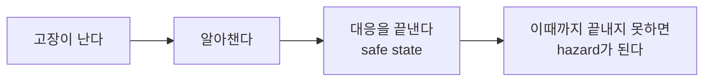

# 7장. Safety concept: 요구사항을 아래로 내리기

## 핵심 질문

safety goal 한 문장이 어떻게 소프트웨어 요구사항 수십 개가 되는가?

## 한 문장에서 코드까지

safety goal은 차량에서 일어나면 안 되는 일을 적은 한 문장이다. 코드는 그 문장을 모른다. 그 사이를 요구사항의 계단으로 잇는다.

| 단계 | 묻는 것 | 예제의 ID |
|---|---|---|
| safety goal | 차량에서 무엇이 일어나면 안 되는가 | `SG-` |
| functional safety requirement | 그러려면 item이 무엇을 해야 하는가 | `FSR-` |
| technical safety requirement | 그것을 어떤 구조와 어떤 값으로 하는가 | `TSR-` |
| software safety requirement | 소프트웨어의 어느 부분이 정확히 무엇을 하는가 | `SWR-` |

이 네 단계의 이름은 ISO 26262의 것이다. 받은 문서에서 위의 두 단계는 쓰임을 확인했고 `(2차 자료)`, 아래의 두 단계는 이름만 확인했다 `(확인 필요)`.

계단을 내려갈 때마다 두 가지를 한다. 요구사항을 더 구체적으로 쓰고, 그것을 누가 받는지 정한다 (allocation). 아래 단계의 요구사항은 위 단계의 요구사항을 가리킨다. 이 고리가 끊기면 "이 코드는 왜 있는가"와 "이 요구사항은 어디에서 구현되었는가"에 답할 수 없다.

## functional safety concept: 무엇을 하는가

functional safety concept은 safety goal에서 functional safety requirement를 끌어내어 item의 요소에 나눠 주는 일이다 `(2차 자료)`. 미국 정부의 보고서는 요구사항을 끌어내는 틀을 이렇게 든다 (Becker 외, 2020).

- 고장을 막거나 알아챈다
- 고장을 알아채면 정해진 시간 안에 safe state로 간다
- 운전자에게 알리고, 무엇을 해야 하는지 알린다

이 단계에서는 구현을 정하지 않는다. "가속 페달 위치를 두 신호로 읽어 서로 견준다"는 functional safety requirement다. "두 채널의 차이가 5%를 넘는 주기가 3번 이어지면"은 다음 단계다.

운전자에게 알리는 것도 concept의 일부다. 보고서는 경고를 단계로 나눈 예를 든다: safety goal을 어길 가능성이 중간이면 주의 표시, 높거나 이미 어겼으면 경고 표시와 소리.

## technical safety concept: 어떻게 하는가

technical safety concept은 구조를 정하고 값을 정한다. 어느 요소가 무엇을 하는가, 한계값은 얼마인가, 몇 ms 안에 반응하는가, 바깥의 요소에 무엇을 기대하는가.

여기에서 감시 구조가 나온다. 가장 널리 쓰는 꼴은 기능을 하는 부분과 그것을 지켜보는 부분을 나누는 것이다. 주 CPU가 계산하고 다른 CPU가 검사하는 구조는 안전 시스템의 흔한 틀이다 (Koopman, 2014). 예제는 감시를 같은 MCU 안에 두었다. 그래서 이 틀이 주는 독립을 갖지 않는다 (11장).

감시를 나눌 때 정할 것이 있다.

- 감시는 무엇을 보는가. 기능을 통째로 다시 계산하면 감시도 기능만큼 복잡해진다. 예제의 감시는 운전자의 입력에서 토크의 상한만 계산한다.
- 넘었을 때 무엇을 하는가. 넘는 값을 그 자리에서 깎을 수도 있고, 넘는 상태가 이어질 때 끊을 수도 있다. 앞의 것은 넘는 값이 한 번도 나가지 않지만 기능의 결함이 가려진다. 뒤의 것은 판정이 날 때까지 틀린 값이 나간다.
- 감시의 한계는 어디에 두는가. 감시가 허용하는 값과 정상인 기능이 내는 값 사이의 틈은 safety goal의 한계보다 작아야 한다. 틈이 크면 기능이 틀려 한계까지 요구해도 감시는 알아채지 못하고, 그 틈만큼이 차량으로 나간다. 감시의 한계는 기능에서 나오는 것이 아니라 safety goal에서 나온다.
- 감시와 기능이 함께 기대는 것은 무엇인가. 같은 입력, 같은 MCU, 같은 메모리를 쓴다면 그곳이 함께 틀리는 지점이다.

## 시간을 나눠 쓴다

6장에서 hazard에는 시간의 성질이 있다고 했다. 고장이 난 뒤 위험한 상태가 되기 전까지의 시간이다. 사고는 그 뒤에 온다. 이 시간을 FTTI (fault tolerant time interval)라고 부른다. 받은 문서들은 이 시간을 둘로 나눠 쓴다: 고장을 알아채는 시간과 알아챈 뒤 대응하는 시간 (AUTOSAR, 2025) `(2차 자료)`.

소프트웨어 엔지니어에게 이 그림은 예산표다. 주어진 시간에서 내가 쓸 수 있는 몫을 계산한다.

| 쓰는 곳 | 정하는 것 |
|---|---|
| 고장이 난 때부터 다음 주기까지 | 제어 주기 |
| 고장으로 판정할 때까지 | 몇 주기 이어지면 고장인가 (debounce) |
| 출력이 actuator에 닿을 때까지 | 통신의 주기와 지연 |
| actuator가 반응할 때까지 | 바깥 요소에 대한 가정 |

debounce를 길게 잡으면 잠깐의 잡음에 멈추지 않는다. 그러나 예산을 더 쓴다. 이 맞바꿈이 설계의 한가운데에 있다. 그리고 표의 마지막 두 줄은 소프트웨어가 정할 수 없는 값이다. 가정으로 적고, 그 요소를 만드는 쪽에 요구사항으로 넘긴다.

용어에 관한 주의: 이 책은 FTTI의 규격 정의를 확인하지 못했다. 위의 설명은 받은 문서들의 쓰임을 따른 것이다. 예제에서는 FTTI라는 이름을 쓰지 않고 "safety goal의 시간"과 "시간 예산"이라고 부른다.

## 등급을 나눠 주는 일

safety goal의 등급은 그것에서 나온 요구사항으로 내려간다. 여기에서 두 가지 질문이 나온다.

첫째, 기능과 감시가 같은 등급을 받아야 하는가. 요구사항 하나를 독립된 두 요소가 함께 맡으면 각각의 등급을 낮출 수 있는 규칙이 규격에 있다고 한다 (ASIL decomposition). 보고서도 구현 사이의 독립을 보일 수 있으면 다른 등급으로 구현할 수 있다고 적는다 `(2차 자료)`. 열쇠는 독립이다. 이 책은 그 규칙의 조건을 원문으로 확인하지 못했으므로 규칙을 설명하지 않고, 예제에서도 쓰지 않는다.

둘째, 등급이 다른 소프트웨어를 한 제어기에 함께 실을 수 있는가. AUTOSAR의 문서는 ISO 26262를 들어 두 길을 적는다 (AUTOSAR, 2025) `(2차 자료)`. 전체를 가장 높은 등급으로 개발하거나, 낮은 쪽이 높은 쪽을 방해하지 않음을 보인다. 이 책은 이 내용을 이 문서 하나로만 확인했다. 방해는 메모리, 시간과 실행, 정보 교환에서 생긴다. 이것을 freedom from interference라고 하고, 11장과 14장에서 다룬다.

어느 쪽이든 "다른 함수에 두었다"는 답이 되지 못한다.

## 관통 예제에 적용

예제의 산출물은 `example/drive-torque/docs/`에 있다.

- `functional-safety-concept.md`: `SG-01`에서 나온 functional safety requirement 다섯 개와 고장 대응표
- `technical-safety-concept.md`: 구조, technical safety requirement 일곱 개, 값, 시간 예산표, 가정, 독립에 관한 주장
- `requirements.yaml`: `SG-01`에서 `SWR-12`까지 스물다섯 개의 요구사항과 추적

요구사항 하나가 내려가는 모습은 이렇다.

| ID | 요구사항 |
|---|---|
| `SG-01` | 운전자의 요구보다 1.0 m/s^2 넘게 큰 가속이 200 ms 넘게 이어지지 않게 한다 |
| `FSR-04` | 토크 요구가 허용 토크를 계속 넘으면 VCU는 기능의 고장으로 보고, 토크 요구를 0으로 하고 구동 허용 신호를 끊고 경고를 요청한다 |
| `TSR-05` | 깎인 주기가 5번 이어지면 기능의 고장으로 고정한다. 그 주기에 토크 0을 보내고 구동 허용 신호를 끊는다. 가장 나쁜 경우 50 ms다 |
| `SWR-08` | 토크 요구를 깎은 주기가 5번 이어지면 기능의 고장으로 고정한다. 한 주기라도 깎지 않으면 다시 센다 |

예제의 구조는 입력 검사, 기능, 감시, 출력 단계로 나눈다. `SG-01`의 요구사항은 입력 검사, 감시, 출력 단계가 받는다. 기능은 `SG-01`에 대해서는 요구사항을 받지 않는다. 이 말은 `SG-01`에 한정된다. 기능이 토크를 덜 내는 hazard를 끌고 갔다면 기능도 요구사항을 받는다.

이 말이 성립하려면 감시만으로 `SG-01`이 지켜져야 한다. 예제의 처음 설계는 그렇지 못했다. 기능은 후진에서 토크를 40%로, 높은 속도에서는 더 작게 냈는데, 감시의 허용 토크는 속도와 방향을 보지 않았다. 그 상태에서 기능이 틀려 허용 토크까지 요구하면 깎이지도 고정되지도 않았고, 가속의 차이는 1.1-2.4 m/s^2로 `SG-01`의 1.0을 넘었다. test, coverage, 증명은 모두 통과하고 있었다. 단계 검토에서 찾았다.

고친 것은 요구사항이다. `TSR-03`에 조건을 더했다: 허용 토크와 정상인 기능의 토크 요구의 차이는 `SG-01`의 가속 한계에 해당하는 토크 (가정한 차량에서 55 Nm)보다 작다. 그리고 그 조건이 성립하도록 기능을 단순하게 하고, 감시에 후진의 비율을 넣었다. 지금의 틈은 5 Nm다.

시간 예산은 이렇다. `SG-01`의 시간은 200 ms다.

| 고장 | 다음 주기까지 | 판정 | 전달 | inverter의 응답 | 합 |
|---|---|---|---|---|---|
| 페달 채널 하나가 틀림 | 최대 10 ms | 20 ms | 2 ms | 60 ms | 92 ms |
| 기능이 큰 토크를 요구: 차단까지 | 최대 10 ms | 40 ms | 1 ms | 60 ms | 111 ms |

판정의 20 ms와 40 ms는 세는 규칙에서 나온다. 3번째로 이어서 실패를 본 주기에 반영하므로, 처음 본 주기 뒤로 두 주기가 더 걸린다. 5번째면 네 주기다. 전달과 응답의 값은 가정이다. 시뮬레이션에서 잰 값은 88 ms와 108 ms였다 (`test-report.md`).

## sim이 보이는 것과 못 보이는 것

| 보이는 것 | 못 보이는 것 |
|---|---|
| 요구사항이 위에서 아래로 이어진다 (추적 스크립트) | 요구사항이 옳고 빠짐없다는 것 |
| 판정까지의 주기 수가 예산과 맞는다 | 실제 실행 시간과 통신 지연 |
| 가정한 plant에서 차량의 가속이 한계 안에 있다 | inverter가 가정대로 반응한다는 것 |
| | 기능이 감시를 방해하지 않는다는 것 |
| | 입력을 읽은 때부터 출력을 낼 때까지의 지연. 시뮬레이션의 task는 실행 시간이 0이다 |
| | reset 직후의 동작. 예제의 고장 상태는 RAM에 있어 reset이 지운다 |

## 규격에서의 위치

- ISO 26262-3 (Concept phase): functional safety concept
- ISO 26262-4 (Product development at the system level): technical safety concept
- ISO 26262-9 (ASIL-oriented and safety-oriented analyses): 등급을 나누는 규칙 `(2차 자료)`

## 흔한 오해

- "감시를 넣으면 기능은 대충 만들어도 된다." 감시는 정한 hazard 하나만 막는다. 예제의 감시는 토크가 모자라는 것을 알아채지 못한다. 감시의 한계 안에서 틀리는 것도 알아채지 못한다. 그리고 감시가 있어도 기능과 감시가 함께 틀리는 길이 남는다.
- "요구사항을 둘로 나누면 등급이 내려가서 싸진다." 나누는 값은 독립을 보이는 일이다. 그 일이 더 비쌀 수 있다. (저자의 의견이다.)
- "debounce는 길수록 안전하다." 길수록 잘못 멈추는 일은 줄지만 시간 예산을 쓴다.
- "시간 예산은 소프트웨어의 문제다." 예산의 큰 몫은 통신과 actuator가 쓴다. 그 값은 가정이고, 누군가 책임져야 한다.

## 확인 문제

1. `FSR-04`와 `TSR-05`의 차이는 무엇인가? `TSR-05`에만 있는 정보를 모두 들어 보라.
2. 예제에서 제어 주기를 20 ms로 바꾸면 시간 예산표의 어느 칸이 어떻게 바뀌는가? 200 ms 안에 드는가?
3. 넘는 토크를 깎는 구조와 넘는 상태가 이어질 때 끊는 구조를 견주어, 각각 어떤 고장에 약한지 말해 보라.
4. 기능과 감시가 같은 가속 페달 값을 쓰면 무엇을 얻고 무엇을 잃는가?
5. 기능이 높은 속도에서 토크를 절반으로 줄이도록 바꾼다고 하자. 감시를 그대로 두면 무엇이 깨지는가? 감시를 고친다면 감시의 입력에 무엇이 더해지고, 어떤 요구사항이 새로 필요한가?
