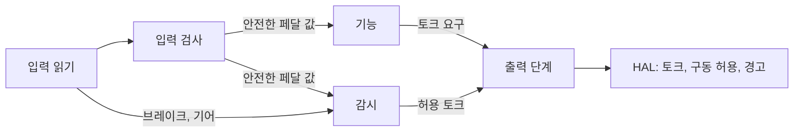

# 11장. 안전을 위한 software architecture

## 핵심 질문

일부가 고장 나도 안전한 구조는 어떻게 만드는가?

## 구조가 맡는 일

결함이 하나도 없는 소프트웨어를 만들 수는 없다. 하드웨어의 bit도 뒤집힌다. 그래서 안전한 구조는 "고장이 없다"가 아니라 "고장이 나도 그 영향이 갇힌다"를 목표로 한다.

이 생각을 한 낱말로 줄인 것이 fault containment region이다. 안에서 난 고장이 밖으로 번지지 않고, 밖의 고장이 안으로 들어오지 않는 구역이다 (Koopman, 2014). 여기에서 두 가지가 따라 나온다.

- 한 구역은 자기 안의 고장을 다 잡아내지 못한다. 고장 난 것이 자기를 검사할 수는 없다.
- 그래서 고장을 잡으려면 서로 독립된 구역이 둘 넘게 있어야 한다. 한 구역이 다른 구역을 지켜본다.

함께 쓰는 자원은 구역의 벽에 난 구멍이다. 전원, clock, 메모리, 입력 신호를 함께 쓰면 그곳의 고장 하나가 두 구역을 함께 망가뜨린다.

## 기능과 감시를 나누는 두 가지 꼴

안전 시스템에서 자주 쓰는 구조는 둘이다 (Koopman, 2014).

| 구조 | 생김새 | 드는 것 |
|---|---|---|
| 여러 채널 | 같은 일을 하는 채널을 둘 넘게 두고 서로 견주거나 다수결을 한다 | 채널 수만큼의 하드웨어 |
| 기능과 감시 | 주 연산이 계산하고, 따로 있는 감시가 그 결과를 검사한다 | 감시용 연산과 차단 수단 |

미국 정부의 보고서도 주 제어기의 건전성을 보조 processor로 확인하는 것을 구동 제어의 흔한 전략으로 든다 (Becker 외, 2020).

감시는 기능보다 단순해야 한다. 감시가 기능만큼 복잡하면 감시도 그만큼 틀린다. 그래서 감시는 기능을 다시 계산하지 않고, 결과가 넘으면 안 되는 범위만 계산한다.

단순함에는 값이 있다. 감시의 범위가 기능의 정상 동작보다 넓으면, 그 사이에서 틀리는 것은 감시를 지나간다. 그 틈은 safety goal의 한계보다 작아야 한다 (7장). 기능이 복잡해질수록 (속도, 온도, 주행 모드에 따라 달라질수록) 틈을 좁게 유지하려면 감시도 그것을 따라가야 한다. 감시를 얼마나 단순하게 둘 수 있는지는 safety goal이 정한다.

기능이 가진 상태도 마찬가지다. 예제의 기능은 처음에 제동 우선이 걸린 상태를 기억했다. 두 페달을 함께 밟으면 걸리고, 브레이크를 놓아도 가속 페달을 놓을 때까지 토크 0을 냈다. 감시에는 상태가 없어서 브레이크를 놓는 순간 페달 값대로 허용했다. 그 사이에 기능이 틀리면 허용 토크 전부가 나갔다. 기능이 상태나 모드를 가지면 감시도 같은 것을 가져야 틈이 닫힌다. 예제는 감시를 키우는 대신 기능에서 그 상태를 뺐다.

## 방해받지 않는다는 것

기능과 감시를 한 MCU에 함께 실으면 값이 싸다. 그 대신 한 가지를 보여야 한다: 기능이 감시를 방해하지 못한다. 이것을 freedom from interference라고 한다. AUTOSAR의 문서는 방해의 종류를 넷으로 든다 (AUTOSAR, 2025) `(2차 자료)`.

| 방해 | 예 | 막는 수단 |
|---|---|---|
| 메모리 | 남의 변수를 고쳐 쓴다, stack이 넘친다 | 메모리 보호 (MPU)로 영역을 나눈다 |
| 시간 | 한 task가 너무 오래 실행되어 다른 task가 늦는다 | 실행 시간의 상한을 두고 OS가 감시한다 |
| 실행 | 막힘, deadlock, 순서가 틀림 | 실행 순서와 주기를 감시한다 (12장) |
| 정보 교환 | 넘겨준 값이 손상되거나 오래되었다 | 값에 검사 정보를 붙인다 (12장) |

여기에서 임베디드 엔지니어가 자주 하는 착각이 나온다. 함수나 파일이나 thread를 나누는 것은 소스 코드를 나눈 것이다. 실행 중의 방해를 막지 못한다. 잘못된 pointer 하나는 파일의 경계를 모른다. 메모리를 나누려면 하드웨어의 보호 장치가 있어야 하고, 실행 시간을 강제하는 것도 하드웨어의 도움이 필요하다 (AUTOSAR, 2025).

그리고 방해를 다 막아도 남는 것이 있다. 같은 MCU의 고장은 기능과 감시를 함께 틀리게 한다. 그래서 MCU 밖에 따로 동작하는 감시 요소를 둔다. 이것은 9장과 12장에서 다룬다.

## 설계의 버릇

구조를 안전하게 만드는 버릇은 화려하지 않다.

- 단순하게 한다. 안전에 관련된 부분일수록 작고 뻔하게 만든다.
- 경계를 좁힌다. 모듈이 주고받는 것을 값 몇 개로 줄인다. 전역 변수로 이어진 모듈은 나뉜 것이 아니다.
- 상태를 줄인다. 상태가 없는 함수는 test하기 쉽고 증명하기 쉽다. 감시하는 쪽이 따라가야 할 것도 줄어든다.
- 하드웨어를 부르는 코드와 계산하는 코드를 나눈다. 계산하는 코드는 PC에서 빠짐없이 검증할 수 있다.
- 안전에 관련된 부분이 그렇지 않은 부분의 결과에 기대지 않게 한다. 기대야 한다면 그 값을 검사한다.

## 구조를 정한 뒤에 다시 분석한다

구조를 그리면 새 질문이 생긴다. 이 화살표의 값이 틀리면? 이 상자가 실행되지 않으면? 두 상자가 함께 기대는 것은? 그래서 7장의 concept에서 한 분석을 구조 위에서 다시 한다. 분석 기법은 8장에서 다룬다.

## 관통 예제에 적용

예제의 구조는 `example/drive-torque/docs/architecture.md`에 있다.

- 기능은 감시를 부르지 않고, 감시는 기능을 부르지 않는다. 주기 실행부가 값을 넘겨 준다.
- 감시는 기능의 결과를 쓰지 않는다. 운전자의 입력에서 허용 토크를 따로 계산한다.
- 계산하는 모듈은 하드웨어를 부르지 않는다. 전역 변수가 없다.
- 10 ms마다 입력, 기능, 감시와 출력의 순서로 실행한다. thread는 하나다.

이 구조를 fault tree (`fta.md`)에 놓으면 약한 곳이 보인다.

| 약한 곳 | 까닭 | 예제가 한 것 |
|---|---|---|
| 입력 검사 | 기능과 감시가 같은 안전한 페달 값을 쓴다. 입력 검사가 틀리면 둘이 함께 틀린다 | 가장 단순하게 만들고, test와 증명을 모두 했다 |
| 감시와 출력 단계 | 고장 나도 평소에는 드러나지 않는다 | 단계 1에서는 하지 않았다 |
| 브레이크와 기어의 입력 | 한 채널이고 검사하지 않는다. 기능과 감시가 같은 값을 쓴다 | 단계 1에서는 하지 않았다 |
| 같은 MCU, 같은 메모리 | 기능의 결함이 감시의 변수를 망가뜨릴 수 있다 | 가정으로 남겼다 (`A-10`, `A-19`) |

`technical-safety-concept.md`의 7절은 독립에 관한 주장 여섯 개를 적고, 각각을 단계 1에서 보였는지를 적는다. 여섯 개 가운데 구조로 보인 것은 하나 ("감시는 기능의 결과를 쓰지 않는다")뿐이다. 나머지는 가정이다.

## sim이 보이는 것과 못 보이는 것

| 보이는 것 | 못 보이는 것 |
|---|---|
| 모듈이 정한 순서로 실행될 때의 논리 | interrupt가 끼어들 때의 data 경합 |
| 모듈 사이로 넘어가는 값 | 기능이 감시의 메모리를 고쳐 쓰는 경우 |
| task의 순서 | task의 실행 시간, 마감 초과, 건너뜀 |
| | stack의 넘침, 메모리 보호의 동작 |
| | reset 직후의 동작. 예제의 고장 상태는 RAM에 있어 reset이 지운다 |

PC에서 기능과 감시는 같은 process, 같은 주소 공간에 있다. 예제가 보이는 것은 "구조가 요구사항대로 동작한다"이고, "감시가 기능에서 독립이다"가 아니다.

## 규격에서의 위치

- ISO 26262-6 (Product development at the software level)
- ISO 26262-9 (ASIL-oriented and safety-oriented analyses)
- IEC 61508-3 (Software requirements)

## 흔한 오해

- "thread를 나누면 partitioning이다." thread는 주소 공간을 함께 쓴다. 나뉜 것은 실행의 흐름이지 메모리가 아니다.
- "감시가 있으니 기능은 등급이 낮아도 된다." 두 가지가 먼저다. 감시만으로 safety goal이 지켜져서 기능에 그 safety goal의 요구사항이 가지 않아야 한다. 그리고 기능이 감시를 방해하지 않음을 보여야 한다 (7장).
- "메모리 보호가 없는 MCU에서는 코드를 잘 나누면 된다." 나눌 수단이 없으면 방해가 없음을 보일 수 없다. 남는 길은 전체를 가장 높은 등급의 방법으로 만들거나, 감시를 다른 MCU로 옮기는 것이다.
- "감시를 두 개 두면 두 배로 안전하다." 둘이 같은 입력과 같은 MCU를 쓰면 함께 틀린다. 값어치는 독립에서 나온다.
- "구조는 그림이다." 구조는 규칙이다. 누가 누구를 부를 수 있는지, 무엇을 함께 쓰는지를 정하고, 그것을 도구로 검사할 수 있어야 한다.

## 확인 문제

1. 예제에서 기능이 감시의 함수를 직접 부르도록 바꾸면 무엇이 나빠지는가?
2. 기능과 감시가 가속 페달의 ADC 값을 따로 읽게 하면 무엇을 얻는가? 여전히 함께 틀리는 원인을 둘 들어 보라.
3. 메모리 보호가 없는 MCU에서 기능과 감시를 함께 실어야 한다면 어떤 선택이 남는가?
4. 예제의 fault tree에서 "기능이 큰 토크를 요구한다"와 "감시가 제 일을 못 한다"가 AND로 묶여 있다. 이 AND를 OR로 바꿔 버리는 원인을 하나 들어 보라.
