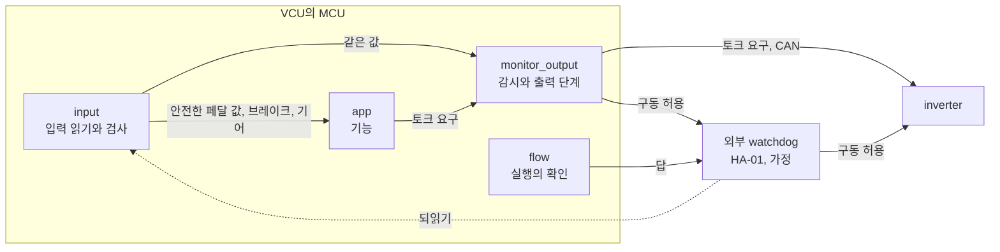

# 11장. 안전을 위한 software architecture

## 핵심 질문

일부가 고장 나도 안전한 구조는 어떻게 만드는가?

## 구조가 맡는 일

결함이 하나도 없는 소프트웨어는 만들 수 없다. NASA의 지침서는 결함을 가장 엄격하게 줄여도 모든 fault를 막지는 못하므로 어느 정도의 failure tolerance가 보통 필요하다고 적는다 (NASA, 2004, 141쪽). 하드웨어의 bit도 뒤집힌다 (9장). 그래서 안전을 위한 구조가 목표로 하는 것은 "고장이 없다"가 아니라 "고장이 나도 그 영향이 정한 곳 안에 갇히고, 갇힌 것을 다른 곳이 알아챈다"이다.

이 생각을 한 낱말로 줄인 것이 fault containment region (FCR)이다. 안에서 난 fault는 안에 머물고 밖의 fault는 밖에 머무는 구역이다. 재판에서 원고 쪽 전문가였던 사람의 발표 자료가 이 말의 공학적인 뜻을 정리한다 (Koopman, 2014, 31-32쪽). 구역 안의 fault는 그 구역 안에서 얼마든지 나쁜 일을 할 수 있다. 그래서 한 구역은 자기의 failure mode를 모두 스스로 감시할 수는 없고, 구역 안에 둔 fail-safe가 바로 그것이 찾는 fault 때문에 망가질 수도 있다. 한 구역은 다른 구역을 감시할 수 있지만 자기는 모든 경우에 감시하지 못한다. 그러므로 고장을 알아채려면 서로 독립인 구역이 여럿 있어야 한다.

이 말은 "자기 검사는 쓸모없다"가 아니다. 범위 검사나 두 채널의 견줌처럼 한 구역 안에서 하는 검사도 많은 고장을 잡는다 (12장). 말하는 것은 그런 검사가 잡지 못하는 고장이 반드시 남는다는 것이고, 특히 검사하는 장치 자신을 망가뜨리는 고장이 남는다는 것이다. 같은 자료는 자체 시험만으로는 안전에 충분하지 않다고 적는다.

구역의 벽에 구멍을 내는 것은 함께 쓰는 것이다. 같은 자료는 함께 쓰는 자원을 위험한 single point of failure라고 부르고, 완전한 보호에는 입력 값을 따로 관찰하는 것이 필요하다고 적는다. 미국 정부의 보고서는 redundant 요소를 쓸 때 common cause failure를 따져야 한다는 예시 요구사항에서, 한 요소의 전원과 통신 경로의 고장이 다른 요소의 것에 영향을 주지 않아야 한다는 두 가지를 든다 (Becker 외, 2020, 74쪽). 받은 문서가 직접 드는 것은 이 셋, 곧 전원, 통신 경로, 함께 쓰는 입력이다. 이 책은 여기에 clock, memory, processor의 시간, 실행 순서를 정하는 scheduler를 더한다. 기능과 감시를 한 MCU에 실으면 이것들이 모두 함께 쓰는 것이 되기 때문이다. 이 목록은 이 책이 예제의 dependent failure analysis (8장)에서 얻은 것이다.

## 기능과 감시를 나누는 꼴

안전 시스템에서 흔한 꼴은 둘이다 (Koopman, 2014, 32쪽). 여러 채널의 구조에서는 CPU 여럿이 서로 견주거나 다수결을 한다. 감시의 구조 (monitor/actuator)에서는 주 CPU가 계산하고 보조 CPU가 확인한다. 기능과 감시를 왜 나누는가는 7장에서 다뤘다. 이 장은 나눈 것을 어떻게 배치하는가를 본다.

### 실제의 예: Toyota의 throttle 제어기

NASA의 조사 보고서는 Toyota의 전자식 throttle 제어기의 구조를 자세히 적는다 (NASA, 2011). 이 제어기를 두고 NASA의 조사와 원고 쪽 전문가의 결론이 다르다는 것은 1장에서 보았다. 여기에서는 구조의 서술만 가져온다.

제어기에는 CPU가 둘 있다. 주 CPU와 첫째 센서들이 throttle을 얼마나 열지 정하고, Sub-CPU와 둘째 센서들은 센서의 data가 일관되고 주 CPU가 제대로 동작하는지를 확인한다. throttle을 열려면 두 CPU가 모두 동의해야 한다. 보고서는 센서와 CPU가 throttle을 여는 쪽으로 "직렬"로 놓였다고 표현하고, 그래서 이 시스템은 throttle을 닫는 쪽으로는 redundant이지만 여는 쪽으로는 아니라고 적는다 (67쪽). 어느 하나가 고장을 선언하면 닫을 수 있지만, 여는 데에는 모두가 있어야 한다. 이 구조에서는 감시의 고장이 차를 세우는 쪽으로 간다.

감시하는 쪽은 주 CPU의 계산을 되풀이하지 않는다. Sub-CPU는 같은 논리를 돌려 주 CPU와 견주지 않고, 주 CPU와 throttle motor의 성능에 관한 진단을 한다 (56쪽). 그 대신 하드웨어의 길을 쥐고 있다. throttle motor를 구동하는 H-Bridge는 두 CPU 모두에서 입력이 와야 motor에 전원을 줄 수 있고, 어느 CPU가 reset되어도 그 출력이 낮게 당겨져 motor가 꺼진다 (144쪽).

두 CPU가 함께 쓰지 않게 한 것도 있다. CPU마다 자기 oscillator, memory의 오류 검출과 정정, 그리고 processor를 reset할 수 있는 watchdog을 가진다 (67쪽). 이 가운데 memory의 오류 검출과 정정은 1장에서 본 다툼이 있는 부분이다. 원고 쪽 전문가는 그 연식의 RAM에 이것이 없었다고 주장한다. 서로를 보는 길도 있다. 주 CPU의 heartbeat 신호는 전원 ASIC과 Sub-CPU로 가고, Sub-CPU의 watchdog 신호는 주 CPU로 간다. 주 CPU는 Sub-CPU를 reset할 수 있고, 전원 ASIC은 두 CPU를 모두 reset할 수 있다 (145-146쪽). 감시하는 쪽까지 보는 셋째 요소가 있는 셈이다. 보고서가 적은 약한 곳도 있다. 두 CPU 사이의 직렬 통신에는 data의 검사도 재시도도 없다 (146쪽). 감시가 기능에게서 받는 정보가 보호되지 않은 채 오간다.

watchdog을 누가 재시작하는지에 대해서는 두 자료의 서술이 다르다. NASA의 보고서는 소프트웨어가 하드웨어 watchdog을 계속 재시작해야 하고, 재시작하는 함수가 가장 낮은 우선순위의 task에서 실행되므로 그 task가 실행되지 않으면 처리나 timing이 비정상이라는 뜻이라고 적는다 (NASA, 2011, 146쪽). 원고 쪽 전문가의 자료는 watchdog이 하드웨어 timer의 서비스 routine에서 kick되고, throttle 각도의 계산과 대부분의 fail-safe를 맡는 task를 포함한 주요 task의 죽음을 알아채지 못하며 1 ms task의 죽음만 알아챈다고 주장한다 (Koopman, 2014, 45쪽). 이 책은 어느 쪽이 맞는지 가리지 않는다. 다만 두 서술이 이렇게 갈린다는 것이 한 가지를 보인다. watchdog이 있다는 것만으로는 아무것도 말할 수 없고, 누가 어디에서 그것을 재시작하는지가 그 감시의 값을 정한다 (12장).

### 감시는 얼마나 단순해야 하는가

"감시는 기능보다 단순해야 한다"는 말을 흔히 한다. 이 책이 받은 문서에는 이것을 원칙으로 적은 곳이 없다. 가까운 서술은 둘이다. NASA의 지침서는 고성능의 주 소프트웨어에 문제가 생기면 high-assurance kernel이 제어를 넘겨받는 구조를 소개하면서, 그 kernel은 주 소프트웨어와 기능이 같을 수도 있고 범위가 더 좁을 수도 있으며 거의 틀림없이 덜 최적화되어 있다고 적는다 (NASA, 2004, 144쪽). 그리고 N-version programming이 복잡도를 높이고 복잡도는 오류의 수와 직접 관계가 있다고 하면서, 실험 항공기를 연구한 예를 든다. 시험에서 찾은 소프트웨어 문제가 모두 redundancy를 관리하는 소프트웨어에서 나왔고, 제어 소프트웨어는 흠 없이 동작했다 (143-144쪽). 지키려고 더한 쪽이 문제의 근원이 된 것이다.

그래서 이 책의 판단은 이렇다. 감시는 기능이 하는 일을 다시 하지 않고, 결과가 넘으면 안 되는 범위만 계산하는 편이 좋다. 감시가 기능만큼 복잡하면 감시에도 기능만큼의 결함이 들어갈 수 있고, 같은 요구사항에서 같은 방식으로 만든 두 계산은 같은 생각의 잘못을 함께 갖는다 (8장). 그러나 단순함에는 값이 있다. 감시가 허용하는 범위와 정상인 기능 사이의 틈이 safety goal의 한계보다 작아야 하고, 기능이 상태를 가지면 감시도 그것을 알아야 한다. 예제가 이 조건을 세 번 놓친 이야기는 7장에 있다.

## 여러 채널과 voting

같은 일을 둘 넘게 두는 구조는 반드시 동작해야 하는 기능에 쓴다. NASA의 지침서는 그런 기능의 failure tolerance를 독립된 병렬 redundancy로 얻는다고 하고, 다수결 (majority voting)은 셋 가운데 둘이면 고장 하나를, 다섯 가운데 셋이면 고장 둘을 견디며 홀수 개가 필요하다고 적는다 (NASA, 2004, 142쪽). 동작하면 안 되는 기능에는 반대로 독립된 막음을 직렬로 여럿 두고, 그 막음이 독립이려면 대개 서로 다른 소프트웨어를 실은 서로 다른 processor가 맡아야 한다고 적는다 (7장).

어느 쪽이든 값은 독립에서 나온다. 같은 코드를 두 벌 돌리면 결함도 두 벌이고, 따로 만든 코드도 정말 독립이기는 어렵다 (8장). 지침서는 구조 쪽의 한계를 하나 더 적는다. 우주 왕복선의 규정에 따르면 같은 운영체제를 돌리는 두 processor는 응용을 아무리 따로 만들었어도 서로 독립이 아니고 서로의 failure를 견디지도 못한다 (143쪽). 응용이 달라도 그 아래에 함께 쓰는 소프트웨어가 있으면 그곳이 공통의 원인이 된다.

## 소프트웨어만으로 나눈 것의 한계

기능과 감시를 한 MCU에 함께 실으면 값이 싸다. 그 대신 두 가지를 보여야 한다. 기능이 감시를 방해하지 못한다는 것, 그리고 MCU 자신의 고장이 둘을 함께 망가뜨리는 경우를 다른 무엇이 막는다는 것이다. 이 절은 앞의 것을 소프트웨어로 어디까지 할 수 있는지를 본다. 이 장의 가장 중요한 근거가 여기에 있다. 두 가지는 이름도 다르다. 앞의 것이 아래에서 볼 freedom from interference이고, 뒤의 것은 그것으로 보장되지 않는다. 한 원인이 둘을 함께 틀리게 하는 길은 dependent failure analysis가 본다 (8장). memory 보호를 켰다고 해서 감시가 기능에서 독립이 되는 것은 아니다. 두 이름을 이렇게 나누는 것이 ISO 26262의 정의와 맞는지는 원문으로 확인하지 못했다 `(확인 필요)`.

NASA의 지침서는 FCR을 하드웨어로 나누거나 막는 것이 가장 좋다고 적는다 (NASA, 2004, 144쪽). Leveson을 들어, 응용과 운영체제를 떼어 놓는 것처럼 "논리적인" firewall로 소프트웨어 부품을 격리할 수 있고 방어적 프로그래밍과 소프트웨어 안의 redundancy로 어느 정도는 된다고 인정한다. 그러나 NASA 안에서는 이것을 hazard를 줄이는 것 (mitigation)으로 셀 뿐 hazard를 막는 것 (control)으로 세지 않는다. 소프트웨어와 논리로 만든 보호는 하드웨어의 고장이나 전자파와 방사선의 영향으로 무너질 수 있기 때문이다.

같은 쪽은 한 processor 위의 FCR이 받아들여지는 경우도 적는다. FCR 사이의 독립을 얻는 전형적인 방법은 서로 다른 독립된 processor에 싣는 것이고, 하드웨어의 구성에 따라 같은 processor에 두어도 되는 때가 있다. 지침서가 드는 예는 두 FCR을 서로 다른 memory chip에 두고 같은 CPU에서 동시에 multitasking하지 않는 경우다. 조건이 아주 좁다. 한 MCU의 한 memory 안에서 함수를 나눈 것은 여기에 들지 않는다.

### partitioning과 freedom from interference

자동차 쪽에서는 이 문제를 freedom from interference라고 부른다. 한 요소가 다른 요소를 방해하지 않는다는 뜻이다. AUTOSAR의 문서는 ISO 26262를 들어, ASIL이 다른 부품으로 이루어진 소프트웨어는 전체를 가장 높은 ASIL로 개발하거나 높은 쪽이 낮은 쪽에게서 방해받지 않음을 보장해야 한다고 적고, 방해를 일으키는 fault를 memory, timing, 실행, 정보 교환으로 묶는다 `(2차 자료)` (AUTOSAR, 2025, 9쪽. ISO 26262:2018을 설명). 규격이 이렇게 요구한다는 것을 이 책은 이 문서 하나로만 확인했다. 그 문서가 드는 수단과 한계는 이렇다.

| 방해 | 수단 | 문서가 적는 조건과 한계 |
|---|---|---|
| memory | OS-Application마다 memory 영역을 나눈다 (memory partitioning) | MPU 같은 하드웨어가 있는 MCU를 가정한다. core 안의 MPU는 DMA나 다른 core의 접근을 막지 못한다. 같은 OS-Application 안의 부품끼리는 막지 않는다. trusted로 둔 것에는 적용되지 않는다. task 수준의 나눔은 OS가 꼭 구현해야 하는 것이 아니다 (15쪽, 18쪽, 20-21쪽) |
| timing과 실행 | 실행 시간과 자원 잠금의 상한, task가 오는 간격의 하한을 OS가 감시한다 | 실행 시간을 강제하려면 하드웨어의 지원이 필요하다 (26쪽) |
| 정보 교환 | 값에 검사 정보를 붙인다 | 12장에서 다룬다 |

표에서 두 가지를 읽는다. 첫째, 나누는 일은 하드웨어 위에 선다. memory를 나누는 것도 실행 시간을 강제하는 것도 MCU의 장치가 하고, OS는 그 장치를 설정한다. 둘째, 나누는 단위는 소스 코드의 파일이나 함수가 아니라 OS가 아는 영역이다. 같은 영역 안에서는 결함이 있는 부품이 다른 부품의 memory를 고치는 것을 막지 못한다고 문서는 적는다. 잘못된 pointer 하나는 파일의 경계를 모른다.

문서는 나누는 쪽에 대해서도 두 가지를 적는다. 하나는 memory 보호 같은 안전 수단 자체가 안전에 관련된 것이어서 그에 맞게 개발하고 통합해야 한다는 것이다 (9쪽). 항공의 multicore 지침도 나누는 소프트웨어는 나누는 대상 가운데 가장 높은 등급 이상인 것이 좋다고 적는다 (FAA, 2024, 5쪽. 원문은 "should"다). 다른 하나는 AUTOSAR가 해 주지 않는 것의 목록에 dependent failure analysis가 들어 있다는 것이다 (46쪽). 나누는 수단을 가져다 써도, 둘이 함께 고장 나는 길을 따지는 일은 쓰는 쪽에 남는다 (8장).

등급이 다른 소프트웨어를 한 제어기에 섞는 일 (mixed criticality)도 이 틀로 본다. ASIL이 다른 부품은 같은 OS-Application에 두지 않는 편이 좋다고 문서는 적는다 (15쪽). 나누지 못하면 남는 길은 전체를 높은 등급으로 만드는 것이다. NASA의 지침서도 안전 소프트웨어와 같은 물리적 platform에 있는 소프트웨어는 충분히 나뉘지 않는 한 안전 소프트웨어로 본다고 적는다 (NASA, 2004, 20쪽).

### E-Gas의 감시 구조

엔진 제어에서 알려진 구조로 E-Gas monitoring concept이 있다. 이 구조는 감시를 몇 단계로 나눈다고 알려져 있지만, 받은 문서로는 그 단계를 설명할 수 없어서 이 책은 설명하지 않는다. AUTOSAR의 문서가 적는 것은 이 개념이 AUTOSAR 규격의 일부가 아니라 다른 working group이 표준화했다는 것과, 이 개념을 AUTOSAR 구조에 실으려면 무엇이 되어야 하는가다 (AUTOSAR, 2025, 60-64쪽). 그림 3.6은 엔진 제어의 응용 소프트웨어와 감시 소프트웨어를 한 MCU 안에 그리고, 감시 소프트웨어를 입출력을 직접 다루는 Complex Driver에 둔다. 그 감시 소프트웨어는 지연이 한정된 우선권으로 SPI bus를 쓸 수 있어야 하고, 정상 동작의 data 취득을 방해하지 않고 A/D 변환기를 시험할 수 있어야 하고, 차단 경로의 actuator를 직접 시험할 수 있어야 하고, ADC와 디지털 입력의 raw 값을 읽을 수 있어야 한다. 감시를 품는 설계가 감시에게 해 주어야 하는 일의 목록이다. 응용을 거치지 않는 입력과 출력, 그리고 제때의 통신이다.

## 구조를 정한 뒤에 다시 분석한다

구조를 그리면 새 질문이 생긴다. 이 화살표의 값이 틀리면? 이 상자가 실행되지 않으면? 두 상자가 함께 기대는 것은? NASA의 지침서는 설계 단계에서 fault tree와 FMEA를 갱신하라고 하고, 안전에 관련된 부품에 영향을 줄 수 있는 부품은 그 자신이 안전에 관련된 부품이 된다고 적는다 (NASA, 2004, 157쪽). 영향을 찾는 길은 호출 구조, 전역 변수와 공유 변수, 직접 넘기는 인자다 (158쪽). 기법은 8장에서 다뤘다. 그 분석이 예제의 구조에 무엇을 요구했는지는 아래에서 본다.

## 주요 예제에 적용

예제의 구조는 `example/drive-torque/docs/architecture.md`에 있다. 정적 view는 모듈과 그 사이의 의존을, 동적 view는 한 주기에 무엇이 어떤 순서로 실행되는지를 보인다.

### 모듈과 task

모듈은 입력 읽기, 입력 검사 (페달, 브레이크, 기어), 기능, 감시와 출력 단계, inverter가 알린 토크의 검사, 고장 대응의 상태 기계, 통신의 보호, 실행의 확인, 그리고 이것들을 부르는 주기 실행부 (`src/vcu/vcu.c`)다. 하드웨어는 HAL 뒤에 있고, PC에서는 sim이 HAL을 구현한다. 10 ms마다 task 넷이 정한 순서로 한 번씩 실행된다. thread는 하나이고 선점이 없다.

| 순서 | task | 하는 일 |
|---|---|---|
| 1 | input | 지난 주기에 쓴 구동 허용 신호를 되읽는다. 입력을 한 번 읽고, 받은 메시지를 검사하고, 안전한 페달 값과 브레이크의 판정과 받아들인 기어를 정한다 |
| 2 | app | 기능이 토크 요구를 만든다 |
| 3 | monitor_output | 감시가 허용 토크를 계산하고 출력 단계가 토크 요구를 깎는다. 구동 허용 신호를 쓰고 토크 요구를 보낸다 |
| 4 | flow | 앞의 셋이 이 순서로 한 번씩 실행되었는지를 확인하고, 맞으면 외부 watchdog에 답한다 |



### 규칙과 그 까닭

구조는 그림이 아니라 규칙이다. 예제의 규칙은 다섯이고, 저마다 까닭이 있다.

기능과 감시는 서로를 부르지 않는다. 둘은 주기 실행부가 넘겨 주는 값으로만 이어진다. 감시는 기능의 토크 요구를 계산에 쓰지 않고 운전자의 입력에서 허용 토크를 따로 계산한다. 이것이 `technical-safety-concept.md` 7절에 적힌 독립에 관한 주장 여섯 가운데 구조로 보인 유일한 것이다.

계산하는 모듈은 하드웨어를 부르지 않는다. 입력 검사, 기능, 감시, 출력 단계, 상태 기계, 통신, 실행의 확인이 그렇고, 하드웨어를 부르는 것은 입력 읽기와 주기 실행부뿐이다. 그래서 계산하는 모듈은 그 모듈만으로 unit test를 하고 증명을 한다. 하드웨어가 없는 PC에서 모든 32-bit 입력에 대해 성질을 증명할 수 있는 것은 이 규칙 덕분이다 (15장).

전역 변수가 없다. 상태는 구조체 하나 (`vcu_t`)에 있고 주기 실행부가 가진다. 누가 무엇을 고칠 수 있는지가 함수의 인자에 드러나므로, 앞에서 본 independence analysis가 따라갈 길이 짧아진다. 그러나 이것은 소스 코드의 규칙이다. 실행 중에 기능의 잘못된 pointer가 감시의 구조체를 덮어쓰는 것은 이 규칙이 막지 못한다.

감시는 상태를 갖지 않는다. 허용 토크가 오르는 속도를 제한하려면 지난 값이 필요한데 (`SWR-13`), 그 값은 감시가 기억한 지난 허용값이 아니라 출력 단계가 실제로 보낸 토크이고, 주기 실행부가 넘겨 준다.

고장 대응의 주인은 상태 기계 하나다 (`src/reaction/`). 고장을 알아챈 모듈은 사건만 알리고, 토크의 상한, 구동 허용 신호, 경고는 그 상태에서 나온다. 상태는 정상, 줄여 감, 토크 0, 구동 허용 차단의 순서로 안전한 쪽으로만 바뀐다 (하나씩 거치는 것이 아니다. 단계를 건너뛸 수 있다). 대응이 여러 곳에 흩어져 있으면 두 대응이 서로 다른 출력을 원할 때 누가 이기는지가 코드의 순서에 숨는다. 대가도 있다. 모든 반응이 이 기계 하나를 지나므로 이 기계가 반응의 single point가 된다 (`dfa.md` 6절). 외부 watchdog이 이 기계를 거치지 않고 구동 허용 신호를 끊는 것이 그 대가를 일부 덮는다.

규칙이 하나 더 있는데, 코드의 주석에 적혀 있다 (`src/app/app.c`).

```c
/* 후진은 전진 토크의 40%까지.
 * 감시의 ALLOWED_REVERSE_PCT와 값이 같아야 한다. 일부러 상수를 함께 쓰지 않았다.
 * 함께 쓰면 이 값을 바꿀 때 감시의 한계가 검토 없이 따라 바뀐다.
 * 따로 두면 두 값이 어긋날 때 TC-007이 실패한다 */
#define REVERSE_PERCENT     ((int32_t)40)
```

같은 값은 한 곳에 두라는 것이 보통의 코딩 습관이다. 기능과 감시 사이에서는 그 습관이 공통의 원인을 만든다. 기능의 값을 고치는 변경이 감시의 한계를 함께 고치기 때문이다. 따로 두고 test가 두 값을 견주게 하면, 어긋남은 test의 실패로 드러나고 감시의 한계를 바꾸는 일은 따로 검토를 받는다. 다만 최대 토크나 페달의 범위 같은 상수는 지금도 같은 header를 쓰고, 그것은 test의 기댓값을 요구사항의 숫자로 적어 지킨다 (`dfa.md` 3절).

### 제품과 test와 증명이 한 함수를 부른다

구조의 경계는 검증에도 걸린다. 감시와 출력 단계를 잇는 순서는 처음에 제품의 네 줄이었고, 증명의 파일은 그 네 줄을 옮겨 적었다. 그러면 제품의 연결이 바뀌어도 증명은 통과한다. 검토에서 지적을 받아 그 순서를 함수 하나 (`monitor_output_cycle`, `src/monitor/monitor.h`)로 묶고, 제품, unit test, 증명이 모두 그 함수를 부르게 했다 (`test-report.md` 5절). 증명의 밖에 남는 것은 제품이 그 함수에 무엇을 넘기는가이고, 그것은 시나리오 test와 변이 검사가 지킨다. 실제로 주기 실행부가 감시에 브레이크를 넘기지 않게 바꾼 변이를 처음에는 test가 놓쳤다 (`test-report.md` 6절). 모듈의 경계는 검증이 끊기는 자리이기도 하다.

### 구조가 만든 공통 지점

기능과 감시가 서로를 부르지 않아도 함께 기대는 곳이 있다. 입력 검사다. 입력은 주기마다 한 번 읽고, 입력 검사가 정한 안전한 페달 값을 기능과 감시가 함께 쓴다. 단계 2에서는 브레이크의 판정과 받아들인 기어도 입력 단계 한 곳에서 정해 둘에 같은 값을 준다 (`vcu.c`의 `SWR-15`, `SWR-16` 주석). `dfa.md`는 이것을 받아들인 공통 지점으로 적는다. 입력 검사가 틀리면 둘이 함께 틀린다.

따로 정하는 길도 있었다. 감시가 raw 값을 따로 읽고 따로 판정하면, 입력 검사의 결함이 둘을 함께 틀리게 하지는 않는다. 입력을 따로 관찰하라는 Koopman의 말과, E-Gas의 감시 소프트웨어가 raw 값을 읽을 수 있어야 한다는 AUTOSAR 문서의 조건이 이쪽이다. 그 대신 두 판정이 어긋나는 동안의 문제가 생긴다. 브레이크를 기능은 "놓음"으로, 감시는 "밟음"으로 보는 주기에는 정상인 기능이 깎이고, 반대이면 틈이 열린다. 예제는 같은 값을 주고, 그 대가로 입력 검사를 가장 엄격하게 만드는 쪽 (test, 증명, 변이 검사)을 골랐다. 이것은 예제의 선택이다. 두 채널을 다른 ADC로 읽을 수 있는 제어기라면 다른 선택이 나을 수 있다.

### MCU 밖의 요소

예제가 MCU 밖에 두는 요소는 외부 watchdog과 구동 허용 신호의 선이다. `hardware-assumptions.md`의 `HA-01`은 이렇게 가정한다. 주 MCU와 따로 동작하는 감시 요소가 있고, 정해진 때에 옳은 답을 받지 못하면 MCU의 소프트웨어를 거치지 않고 구동 허용 신호를 끊는다. 이 요소는 MCU와 clock을 함께 쓰지 않고, 소프트웨어가 그 설정을 바꿀 수 없다. Toyota의 제어기에서 H-Bridge가 두 CPU 모두의 입력을 요구한 것과 같은 자리다. 토크가 나가려면 소프트웨어의 판단과 MCU 밖 요소의 판단이 모두 "된다"여야 한다.

소프트웨어 쪽에는 이 요소와 맞물리는 것이 둘 있다. 실행의 확인 (`SWR-20`)은 task가 주기마다 남긴 표시를 보고, 셋이 정한 순서로 한 번씩 실행되었을 때에만 답을 쓴다. 답에는 그 주기에 보낸 토크가 허용 토크 안에 있는지도 들어간다. 되읽기 (`SWR-21`)는 지난 주기에 쓴 구동 허용 신호를 watchdog을 지난 뒤의 선에서 읽어, 쓴 값과 견준다. 그래서 watchdog이 끊은 것도 되읽기에 걸린다. watchdog은 다른 구역을 감시하는 구역이고, 소프트웨어는 그 구역이 볼 수 있는 답을 만들어 주는 쪽이다.

fault injection의 두 경우가 이 맞물림을 보인다. `FI-23`은 달리는 중에 입력을 읽는 task가 실행되지 않게 하고, 100 ms 뒤에 운전자가 페달을 놓는다. VCU는 지난 입력으로 75 Nm를 계속 보냈다. 표시가 하나 모자라 답이 나가지 않았고, watchdog이 15 ms 안에 구동 허용 신호를 끊었다. 모터의 토크가 5% 아래로 내려가기까지 73 ms였다. 실행의 확인을 뺀 대조 (`NC-005`)에서는 가속의 차이가 1.36 m/s^2로 `SG-01`을 어겼다. 그런데 VCU는 끊긴 것을 몰랐고 경고도 요청하지 않았다. 되읽기가 멈춘 입력의 task 안에 있기 때문이다. `FI-26`은 출력 단계가 깎지 않는 결함 (감시의 고장)을 넣고 기능이 100 Nm 더 요구하게 한다. 기능이 정상인 동안 이 고장은 드러나지 않았다. 넘는 토크를 보낸 주기에 답이 틀리게 나갔고 watchdog이 그 주기에 끊었다. VCU는 다음 주기의 되읽기에서 끊긴 것을 알아채고 구동 허용 차단과 경고로 갔다.

한계도 분명하다. 답에 든 확인은 출력 단계와 같은 허용 토크를 쓰므로 허용 토크의 계산이 틀린 것은 잡지 못한다. watchdog은 task가 돌았는지와 그 확인 하나를 볼 뿐, 감시의 계산이 옳은지는 보지 못한다. 허용 토크의 계산이 틀리는 원인은 둘이고 기대는 것이 다르다. 설계와 코드의 결함은 검증 (test, 증명, 변이 검사)이 다룬다. 달리는 중에 생긴 processor나 memory의 고장이 계산을 틀리게 하는 것은 검증으로 덮을 수 없고, 이 watchdog으로도 덮이지 않는다. 답을 만드는 것이 같은 MCU이기 때문이다. 예제는 그것을 하드웨어에 대한 가정에 맡긴다 (`hardware-assumptions.md`의 `HA-02`와 `HA-15`: memory의 오류 검출과 정정, 달리는 중의 processor 진단).

### 처음에 틀렸던 구조

규칙 가운데 둘은 틀린 뒤에 생겼다. 처음의 기능은 제동 우선이 걸린 상태를 기억했다. 브레이크를 놓아도 가속 페달을 놓을 때까지 토크 0을 냈는데, 감시는 상태가 없어 그 상태를 몰랐다. 그동안에 기능이 틀리면 허용 토크 전부 (페달 80%에서 205 Nm)가 감시를 지나갔다. 예제는 감시에 같은 상태를 넣는 대신 기능에서 그 상태를 뺐다 (7장). 그래서 정적 view의 표에 기능의 상태로 "감시가 모르는 상태는 두지 않는다"가 적혀 있다.

둘째는 그것을 고칠 때 나왔다. 허용 토크가 오르는 속도를 제한하려면 지난 값이 필요하고, 감시가 자기의 지난 허용값을 기억하는 길도 있었다. 그러면 감시가 기능의 상태를 따라 갖는 둘째 사본이 되고, 두 사본이 어긋나는 길이 새로 생긴다. 그래서 기준을 출력 단계가 실제로 보낸 토크로 잡았고, 그것이 "감시는 상태를 갖지 않는다"는 규칙이 되었다 (`architecture.md`). 두 번 모두 고친 것은 계산이 아니라 상태를 어디에 두는가였다.

### 이 예제의 나눔은 어디에 서는가

예제의 기능과 감시는 한 MCU, 한 주소 공간, 한 thread 안에 있고, memory 보호도 실행 시간의 감시도 없다. 기능이 감시의 memory를 망가뜨리지 않는다는 것과 기능이 오래 걸려도 감시가 제때 실행된다는 것은 가정 `A-19` (VCU의 메모리 보호와 실행 시간 감시가 기능과 나머지를 나눈다)에, MCU의 고장으로 실행이 멈추거나 흐트러져도 구동이 막힌다는 것은 가정 `A-10` (따로 동작하는 감시 요소)에 기댄다 (`technical-safety-concept.md` 4절과 7절). MCU의 고장이 계산만 조용히 틀리게 하는 경우는 `A-10`이 덮지 못하고, 하드웨어에 대한 가정 `HA-02`와 `HA-15`에 기댄다. 초고에서는 이 경우도 `A-10`에 맡긴다고 적었다. 바로 위에서 watchdog이 감시의 계산을 보지 못한다고 적어 놓고서다. 검토에서 두 문장이 어긋난다는 지적을 받았다. PC에서는 sim의 watchdog도 제품과 같은 process에서 도는 코드다.

NASA 지침서의 144쪽에 대어 보면 이렇다. 예제의 일부 방어, 예를 들어 상태를 담은 변수가 알 수 없는 값이면 구동 허용 차단으로 읽는 것 (`SWR-25`)은 지침서가 mitigation으로 세는 방어적 프로그래밍에 든다고 볼 수 있다. 그러나 서로 부르지 않는다, 전역 변수가 없다는 규칙은 소스 코드를 정리한 것이지 실행 중의 방해를 막는 장치가 아니다. 지침서가 control로 셀 만한 자리에 있는 것은 MCU 밖의 watchdog과 구동 허용 신호뿐이고, 그것도 예제에서는 가정이다. 이 판정은 이 책의 것이다. 예제가 보이는 것은 "구조가 요구사항대로 동작한다"까지이고, "감시가 기능에서 독립이다"가 아니다.

### 구현하지 않은 것

상태 기계의 상태와 받아들인 기어를 뒤집은 사본과 함께 두는 것 (`SWR-22`)과, 고장 상태를 비휘발성 memory에 적는 것 (`SWR-23`)은 구현하지 않았다. 요구사항과 설계만 있다. 그래서 상태를 담은 변수가 다른 유효한 값으로 바뀌는 고장 (예: 구동 허용 차단이 정상으로)을 막는 것은 memory의 오류 검출과 정정이라는 가정 (`HA-02`) 하나다. 그리고 달리는 중에 MCU가 reset되면 (고치지 못한 memory 오류, 전압, clock의 감시가 일으키는 reset) 소프트웨어는 정상 상태에서 시작해 세 주기 뒤에 구동을 다시 허용한다. 외부 watchdog이 끊은 경우는 여기에 들지 않는다. 그 요소는 MCU를 reset하지 않고, 끊은 것을 MCU의 reset과 상관없이 유지한다고 가정했기 때문이다 (`HA-01`). 자세한 것은 12장에 있다.

## sim이 보이는 것과 못 보이는 것

NASA의 지침서는 simulation으로 실패의 시나리오를 미리 시험해 볼 수 있다고 하면서도, 시험한 것은 simulation이고 실제 소프트웨어의 동작은 다를 수 있다고 적는다 (NASA, 2004, 158쪽). 항공의 multicore 지침은 소프트웨어 사이의 방해가 processor 안의 공개되지 않은 기구를 통해 일어나므로, 그 기구를 흉내 낸 simulation은 목표 processor에서 하는 시험보다 기능과 실행 시간을 덜 대표하고 오류를 찾을 가능성도 낮다고 적는다 (FAA, 2024, 10쪽). 이 장의 주제가 바로 그 방해다.

| 보이는 것 | 못 보이는 것 |
|---|---|
| 모듈이 정한 순서로 실행될 때의 논리. 모듈 사이로 넘어가는 값 | interrupt가 끼어들 때의 data 경합 |
| task가 빠지거나, 모두 멈추거나, 주기가 두 배로 늘어질 때 실행의 확인과 sim의 watchdog이 구동 허용을 끊는다 (`FI-23` - `FI-25`) | task의 실행 시간, jitter, 마감 초과. sim의 실행 시간은 0이다 |
| 출력 단계가 깎지 않는 고장이 답을 거쳐 드러난다 (`FI-26`) | 기능이 감시의 memory를 고쳐 쓰는 경우. sim에는 memory 보호가 없다 |
| 계산하는 모듈의 성질 (증명) | 증명의 전제. 순서대로 한 번씩 실행되고 다른 코드가 변수를 바꾸지 않는다는 것 |
| | watchdog이 MCU와 따로 동작한다는 것. sim의 watchdog은 같은 process의 코드다 |
| | stack의 넘침. MCU의 고장이 기능과 감시를 함께 틀리게 하는 경우 |
| | reset 직후의 동작. 고장 상태는 RAM에 있어 reset이 지운다 |

## 규격에서의 위치

- ISO 26262-6 (Product development at the software level): AUTOSAR의 문서는 Coexistence (7.4.8), Partitioning (7.4.9), Dependent failure analysis (7.4.11)와 Annex D (Freedom from interference between software elements)를 든다 `(2차 자료)` (AUTOSAR, 2025, 9쪽, 14쪽, 21쪽. ISO 26262:2018을 설명)
- ISO 26262-9 (ASIL-oriented and safety-oriented analyses): dependent failure analysis `(2차 자료)`
- IEC 61508-3 (Software requirements)
- NASA Software Safety Guidebook 7.4절과 7.5절: 이 장이 구조의 원칙을 따른 공개 문서

## 흔한 오해

- "thread를 나누면 partitioning이다." thread는 주소 공간을 함께 쓴다. AUTOSAR의 문서는 OS가 나눈 한 영역 안의 부품끼리도 서로의 memory를 고칠 수 있다고 적는다. 나뉜 것은 실행의 흐름이지 memory가 아니다.
- "감시가 있으니 기능은 등급이 낮아도 된다." 감시만으로 safety goal이 지켜져야 하고 (7장), 기능이 감시를 방해하지 않음을 보여야 한다. 보이지 못하면 같은 platform의 소프트웨어는 모두 안전 소프트웨어로 다룬다.
- "memory 보호가 없는 MCU에서는 코드를 잘 나누면 된다." 막을 장치가 없으면 막았다고 할 수 없다. 남는 길은 전체를 가장 높은 등급의 방법으로 만들거나, 감시를 다른 processor로 옮기거나, 감시의 data가 바뀐 것을 제때 알아채는 수단을 두는 것이다 (예: 뒤집은 사본. 예제의 `SWR-22`가 그 꼴이고, 구현하지 않았다). 마지막 것은 막는 것이 아니라 알아채는 것이다. NASA의 지침서가 방어적 프로그래밍을 control이 아니라 mitigation으로 세는 것과 같은 구별이다.
- "MPU를 켜면 나뉜다." MPU는 그 core의 접근만 막고, 설정이 맞아야 하며, 설정하는 소프트웨어도 안전에 관련된 것이 된다. 같은 MCU의 하드웨어 고장은 여전히 둘을 함께 틀리게 한다.
- "감시를 두 벌 두면 두 배로 안전하다." 같은 입력, 같은 MCU, 같은 요구사항을 쓰면 함께 틀린다. 값은 독립에서 나온다.
- "watchdog이 있으니 감시가 감시된다." 누가 어디에서 재시작하는지와 답이 무엇을 담는지가 값을 정한다. 같은 제어기를 두고도 두 자료의 서술이 갈렸다.
- "구조는 그림이다." 구조는 규칙이다. 누가 누구를 부를 수 있는지, 무엇을 함께 쓰는지, 상태를 누가 갖는지를 정한다.

## 확인 문제

1. 예제에서 감시가 기능의 토크 요구를 받아 그것이 지나치게 큰지를 판정하도록 바꾸면 무엇이 나빠지는가? `technical-safety-concept.md` 7절의 주장 가운데 어느 것이 무너지는가?
2. 기능과 감시가 가속 페달의 값을 따로 읽고 따로 판정하게 하면 무엇을 얻고 무엇을 잃는가? 여전히 함께 틀리는 원인을 둘 들어 보라.
3. memory 보호가 없는 MCU에 기능과 감시를 함께 실어야 한다면 어떤 선택이 남는가? NASA의 지침서가 같은 processor 위의 FCR을 받아들이는 조건과 견주어 보라.
4. `FI-23`에서 VCU는 watchdog이 끊은 것을 알지 못했다. 경고가 나가게 하려면 구조의 어디를 바꿔야 하는가? 바꾸면 무엇을 새로 함께 쓰게 되는가?
5. 기능과 감시가 후진의 비율을 한 상수로 함께 쓰도록 바꾸었다. 어떤 test가 무엇을 더는 잡지 못하게 되는가?
6. Toyota의 제어기는 throttle을 닫는 쪽으로는 redundant이고 여는 쪽으로는 아니었다. 예제의 구동 토크에 같은 말을 대면 어떻게 되는가? 그것이 `SG-02`에 주는 대가는 무엇인가?
