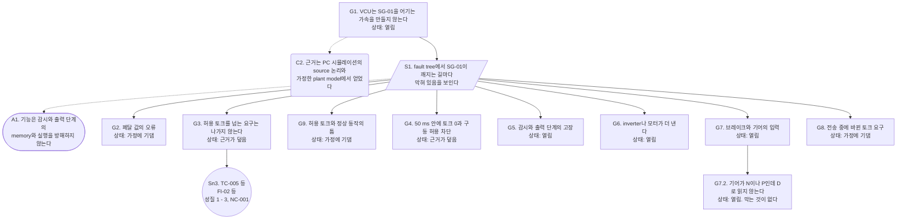

# 19장. Safety case와 assessment

## 핵심 질문

흩어진 산출물이 어떻게 "안전하다"는 하나의 주장이 되는가?

## 문서 더미는 논증이 아니다

여기까지 오면 hazard 분석, 요구사항, 구조, 분석, test와 증명의 결과가 쌓여 있다. 그것을 모두 모아도 "그래서 안전한가"에는 답하지 못한다. 무엇을 주장하는지, 근거가 어디에 있는지, 근거에서 주장이 왜 따라 나오는지가 적혀 있지 않기 때문이다. NASA의 System Safety Handbook은 Holloway의 말을 옮겨 논증 없는 근거 묶음은 설명되지 않은 것이라고 하고, 완화 계획으로 다룬 위험을 그때그때 늘어놓은 목록은 safety case가 아니라고 적는다 (NASA, 2011, PDF 29쪽).

GSN Community Standard 3판 (영국 SCSC의 Assurance Case Working Group, 2021. 이하 GSN 표준)은 먼저 assurance case를 정의한다. 근거 묶음이 뒷받침하는, 이치에 맞고 설득력 있는 논증으로서, 시스템, 서비스, 조직이 정해진 환경의 정해진 쓰임에서 뜻한 대로 동작한다는 것을 보이는 것이다. 대상이 시스템에 한정되지 않는다. safety case는 그 가운데 초점이 안전에 있는 것으로, 주어진 시스템이 주어진 맥락에서 받아들일 만큼 안전함을 보인다. argument (논증)는 전체 주장을 세우려고 이어 놓은 주장들의 열이고, 결국은 근거를 가리켜야 한다 (ACWG, 2021, 10-11쪽).

| 요소 | 뜻 | 예제에서 |
|---|---|---|
| 주장 (claim) | 참이라고 내세우는 명제 | 허용 토크를 넘는 토크 요구는 VCU에서 나가지 않는다 |
| 논증 (argument) | 주장을 받치는 주장들의 연결 | `SG-01`이 깨지는 길을 fault tree에서 모두 들고, 길마다 막혀 있음을 보인다 |
| 근거 (evidence) | 가리킬 수 있는 산출물 | test, fault injection, 증명의 결과 |

미국 정부의 보고서는 ISO 26262가 표준이 정한 과정의 work product를 모두 모아 safety case를 이루게 하고, 그 safety case로 과정을 따랐음을 보인다고 적는다 `(2차 자료)` (Van Eikema Hommes, 2016, PDF 34쪽, ISO 26262:2011 기준). 이 보고서는 그 정의가 규격의 맥락에서는 알맞지만 넓게 쓰면 오해를 부를 수 있다고 하면서, 시스템 안전 공학에서 safety case는 흔히 시스템이 주어진 운용 맥락에서 받아들일 만큼 안전하다는 정량적 논증 (quantitative argument)을 가리킨다고 적는다. GSN 표준의 정의에는 정량적이라는 한정이 없다. 이 장은 GSN 표준의 뜻으로 쓴다. 산출물의 묶음과, 거기에서 안전하다는 결론을 끌어내는 논증은 같은 것이 아니다. 같은 문단은 Leveson을 인용해, 시스템이 안전하다는 것을 증명하려 하면 확증 편향 (confirmation bias. 이 책의 풀이로는 이미 가진 결론에 맞는 것을 더 찾고 더 믿는 경향)의 덫에 빠질 수 있고, 시스템이 완전히 안전하다는 것은 누구도 증명하지 못할 수 있다고 적는다.

## GSN: 논증을 적는 표기

GSN (Goal Structuring Notation)은 논증의 요소와 구조, 논증과 근거의 관계를 그림으로 적는 표기법이다 (ACWG, 2021, 11쪽). 요소는 아래와 같다 (17-18쪽).

| 요소 | 하는 일 |
|---|---|
| goal | 논증의 일부인 주장 하나. 명사구와 동사구로 된 명제로 적는다 |
| strategy | goal과 그것을 받치는 goal 사이의 추론을 적는다 |
| solution | 근거 하나를 가리킨다 |
| context | 주장이 성립하는 범위나 쓰는 말의 정의를 가리킨다 |
| assumption | 일부러 입증하지 않고 두는 진술 |
| justification | 그 주장이나 strategy를 둔 이유 |
| undeveloped | 아직 펼치지 않은 줄기임을 goal이나 strategy에 표시한다 |

읽는 법에서 중요한 것은 화살표 하나하나가 주장이라는 점이다. goal G1 아래에 G2와 G3을 두는 것은 둘이 참이면 G1이 참임을 세우기에 충분하다고 주장하는 것이고, goal 아래에 solution을 두는 것도 그 근거로 충분하다는 주장이다 (19쪽, 21쪽). 주장은 정해진 context 안에서만 참이라고 내세울 수 있고, context와 goal에 붙인 assumption은 아래의 논증 전체에 이어지지만 justification은 붙은 요소에만 걸린다 (22-23쪽).

GSN 표준은 위에서 아래로 만드는 여섯 걸음을 든다 (59-60쪽).

1. 받칠 goal을 찾는다.
2. 그 goal을 적은 바탕 (context)을 정한다.
3. goal을 받칠 strategy를 찾는다.
4. 그 strategy를 적은 바탕을 정한다.
5. strategy를 펼친다. 새 goal이 나오면 1로 돌아간다.
6. 기본이 되는 solution을 찾는다.

넷째 걸음은 strategy가 왜 맞는지를 적는 일로만 읽기 쉽지만, 표준이 먼저 드는 것은 그보다 넓다. strategy가 꺼냈지만 정의하지 않은 말 (예: "확인된 모든 운전 hazard")을 context로 정의해서, strategy가 옳은지 따질 수 있고 그것으로 다음 수준의 goal을 끌어낼 수 있게 하는 것이다. 이유 (justification)와 strategy가 기대는 전제 (assumption)는 그 위에 필요하면 붙인다 (65-66쪽).

펼치다 보면 바닥의 주장을 닫을 근거가 없거나, 있는 근거가 주장을 덮지 못하는 일이 흔하다고 표준은 적는다. 근거를 더 찾아도 안 되면 근거로 말할 수 있는 만큼 주장을 다시 쓰고 (덜 구체적으로, 또는 범위를 좁혀), 그 주장에 기대는 위의 주장을 모두 다시 본다. 표준은 이것을 주장을 약하게 하는 일이라고 부른다 (70쪽).

표준은 GSN의 논증이 반드시 충분하다고 주장하지 않고, 논증을 쓴 사람이 근거를 내보이고 읽는 사람이 따지게 할 뿐이며 (11쪽), GSN을 쓴다고 논증이 참이 되지도 않는다고 적는다 (15쪽). 이 책이 보기에 그림이 해 주는 것은 근거가 달리지 않은 goal, 정의되지 않은 말, 크게 뛰는 걸음을 숨기기 어렵게 하는 것이다.

## 논증이 틀리는 모양

GSN 표준은 흔한 잘못을 말의 잘못과 구조의 잘못으로 나눠 들고, 경험에서 모은 것이어서 빠짐없지 않다고 적는다 (80쪽). 이름의 한국어는 이 책의 것이다.

| 잘못 | GSN 표준의 설명 |
|---|---|
| 상자 속의 글 (essay in the box) | 요소 하나에 논증의 요약을 길게 써서, 구조 안에서 받치거나 펼칠 수 없는 주장이 여럿 들어간다 (81쪽) |
| 모호함 (ambiguity) | 낱말의 뜻이 여럿이거나 문장의 구조가 여러 풀이를 허락해서, 한 주장이 둘 이상으로 읽힌다 (82-83쪽) |
| 막연함 (vagueness) | 'normal', 'appropriate', 'timely' 같은 말은 정의하지 않으면 거의 뜻이 없으므로, 검증할 수 있는 말로 뜻을 정한 context를 붙인다. 'all', 'every'는 그만큼 센 주장이 정당한지 본다 (83쪽) |
| 지나친 단순화 (oversimplification) | 특히 맨 위의 goal을 단순하게 줄여, 막연해지거나 시스템에 대해 실제보다 큰 주장이 된다. 예: 주요 hazard만 완화했는데 "모든 hazard를 완화했다"고 적는다 (84쪽) |
| 앞질러 가기 (jumping ahead) | 논증의 목적 자체가 아니라 그 목적을 받치는 주장을 맨 위에 적는다. 예: "위험 X가 줄었다" 대신 "기계에 interlock을 달았다". 그 완화가 왜 맞는지의 윗단 정당화가 논증에서 빠진다 (84쪽) |
| 믿음의 도약 (leaps of faith) | 주장과 주장, 또는 주장과 근거 사이의 귀납적 도약이 너무 커서 읽는 사람이 흐름을 놓친다. 근거로 goal을 너무 일찍 닫는 것도 같은 잘못이다 (86-87쪽) |
## 읽는 사람은 무엇을 보는가

GSN 표준은 검토를 적어도 네 단계로 나눈다: 논증의 이해, 형식의 점검, 표현이 충분한지의 점검, 논증의 비판과 반박이다 (90쪽). 이해의 단계는 GSN의 모양만 갖춘 피상적인 논증을 걸러 내고, 형식의 단계는 순환 논증, 받침이 없는 주장, 맡은 일이 분명하지 않은 근거를 찾는다 (91쪽). 넷째 단계에서 표준은 보증 논증이 대개 귀납적이어서 결론의 참을 확실히 세울 수 없다고 하면서, 전제를 모두 합친 것이 결론을 받치기에 충분한지를 여섯 성질로 따진다 (92-93쪽). coverage (근거가 결론을 얼마나 덮는가), dependency (근거들이 정말 독립인가), definition (지나치게 좁은 맥락에 걸려 있지 않은가), directness (과정의 근거는 제품의 주장에 간접적이다), relevance (예: 앞선 판의 test로 나중 판을 주장한다), robustness (근거가 조금 바뀌면 결론이 무너지는가)다.

다섯째는 근거의 감사로, 가리킨 근거가 실제로 있고 주장을 실제로 받치는지를 검토자가 확인한다 (94쪽). 좋은 assurance case는 논증과 근거를 골라서 내보일 수 없으므로, 내보이지 않은 사실이 논증을 반박하는지를 따질 준비를 해야 한다고도 적는다. 논증을 반박하는 길은 둘이다. rebuttal은 결론에 반하는 결론에 이르는 근거가 있는 경우이고, undercutting은 전제가 참인데도 결론이 거짓일 수 있게 하는 사실로 추론을 흔드는 경우다 (94-95쪽).

Bloomfield와 Rushby는 이 일을 평가의 중심에 두자고 제안한다. 만드는 쪽이 시스템을 지지하는 사례를 짓고 있으니 확증 편향은 자연스러운 우려이고, 외부 검토자는 좋은 방어이지만 보통 끝 무렵에야 들어온다는 것이다 (Bloomfield와 Rushby, 2021, 2쪽). 그래서 논증을 무너뜨릴 수 있는 의심과 반론 (defeater)을 빠짐없이 찾고, 찾은 것마다 defeater가 아님을 보이거나 시스템이나 사례를 고쳐 없애자고 하며, defeater를 찾는 일을 안전 공학에서 hazard를 찾는 일에 견준다 (2-3쪽). 두 사람의 제안이고 규제 기관의 지침이 아니다. 확신을 숫자로 재는 기법들은 믿을 만한 결과를 낸다는 증거가 거의 없어 더 검증해야 한다고 NASA Langley의 기술 메모가 결론짓는다 (Graydon과 Holloway, 2016, 5쪽). NASA의 handbook은 평가자의 점검표를 safety case의 구조와 따로 짜야 만든 쪽의 가정에 얽매이지 않는다고 적는다 (NASA, 2011, PDF 102쪽).

이 책은 safety case를 마지막에 쓰는 보고서로 보지 않는다. GSN 표준에 그런 문장이 있는 것은 아니고 이 책의 판단이다. 표준은 수명 주기 내내 단계별로 검토하는 것이 바람직하고 논증의 strategy를 일찍 검토하면 매우 유용할 수 있다고 적고 (ACWG, 2021, 89쪽), 근거가 주장을 덮지 못하면 주장을 약하게 고쳐야 한다고 적는다 (70쪽). 마지막에 쓰면 약해진 주장을 받아들이는 길만 남고, 설계나 검증을 바꿔 주장을 지킬 시간은 없다.

## 형식만 갖춘 safety case

safety case 제도에 대한 공식 비판으로 자주 드는 것이 2006년에 잃은 영국 공군기 Nimrod XV230에 관한 독립 조사 보고서 (Nimrod Review, 2009)다. 이 보고서가 평가한 것은 영국 국방부 제도 (Def Stan 00-56)의 safety case이며 자동차나 ISO 26262의 것이 아니다. 여기서는 그 보고서의 22장 (safety case의 평가)만 본다.

이 보고서는 safety case 제도가 길을 잃었고 진짜 안전을 희생해 "paper safety"의 문화를 낳았으며, 위험을 생각하는 데 돕도록 의도된 safety case가 그 자체로 목적이 되었다고 결론짓는다 (Haddon-Cave, 2009, PDF 534쪽). 결함의 하나로는 safety case가 platform이 안전하다고 주장하면서 위험이 왜 그것을 안전하지 않게 만들 수 있는지를 따지지 않아 자기충족적 예언에 그친다는 것을 들고, 각주는 GSN의 최상위 목표 "platform이 받아들일 만큼 안전하다고 여겨진다"가 이미 가정한 결론을 끌고 갈 수 있다고 적는다 (536쪽). audit이 실질보다 과정을 보는 경향도 든다 (536쪽). 그러나 이 보고서는 safety case라는 생각을 버리지 않았다. 이름을 "Risk Case"로 바꿔 안전을 가정하지 않고 위험을 관리하는 것임을 강조하고, 정의를 위험이 ALARP로 관리되고 있다는 합리적 확인으로 바꾸자고 권고한다 (545쪽). 자동차에 그대로 옮길 수는 없지만, 결론을 먼저 정하고 근거를 맞추는 모양은 앞의 확증 편향과 같은 물음이다. 이 연결은 이 책의 풀이다.

737 MAX에 관한 공동 기술 검토 (JATR)의 보고서는 safety case라는 말을 쓰지 않는다. 다만 신청자가 준수만을 위해 설계하지 말고 안전을 위한 기본 원칙도 따르도록 FAA가 권장해야 한다고 권고하고 (JATR, 2019, PDF 50쪽), FHA 보고서가 이미 정한 설계를 문서로 적는 데 쓰였다는 인식이 있다고 적으며 (PDF 52쪽), 모든 가정에 실질적인 뒷받침을 요구하라고 권고한다 (PDF 55쪽). 이것을 근거가 주장에 맞춰졌는가라는 safety case의 물음으로 읽는 것은 이 책의 풀이다.

## 누가 확인하는가

ISO 26262에서 확인하는 일은 confirmation measure라는 이름으로 묶인다고 설명하는 글이 둘 있다 `(2차 자료)` (Chonnad 외, Synopsys 백서, 연도와 기준 판 미표기, 2-3쪽. ZVEI, 2020, 6-7쪽, 기준 판 미표기). 두 글은 그 확인이 세 가지이고, 독립성의 정도가 ASIL에 따라 달라지며, 마지막 판단을 하는 사람이 앞의 두 확인의 결과에 기댄다고 함께 적는다. confirmation review는 safety case 같은 특정 work product를 검토하고, functional safety audit은 안전에 필요한 과정이 실제로 구현되었는지를 보며, functional safety assessment는 item이 functional safety를 달성했는지를 판단한다. Synopsys의 글은 safety case의 confirmation review가 그 논증이 충분히 설득력 있는지를 판단하고, assessment의 판단에는 수용, 조건부 수용, 거부의 권고가 들어간다고 적는다 (3쪽). ASIL마다 어느 정도의 독립이 필요한지는 두 글 어디에도 나오지 않는다.

미국 정부의 보고서는 ISO 26262:2011의 Part 2의 표가 ASIL에 따라 confirmation review를 정하고, 검토자가 개발자, 프로젝트 관리, 작성자로부터 독립하기를 요구한다고 적는다 `(2차 자료)` (Van Eikema Hommes, 2016, PDF 34쪽). 같은 보고서가 정말 독립한 검토자는 설계를 잘 몰라 위험을 찾지 못할 수 있다고 비판한 것은 5장에서 다뤘다. GSN 표준은 만드는 조직의 자체 검토도 쓸모 있다고 하면서, 사례를 만드는 일에서 독립을 지켜 온 사람이나 "내가 받아들이는 책임자라면 무엇이 설득력이 없는가"를 상상할 수 있는 사람이 있어야 한다고 적는다 (ACWG, 2021, 89쪽).

다른 분야는 둘만 든다. 자율주행 차량의 규격 UL 4600을 주도해 쓴 Koopman은 그 규격이 공학 방법이 아니라 안전이 왜 받아들일 만한지의 설명을 표준화하고, 설계팀과 거리를 둔 평가자가 확인하되 꼭 외부 사람일 필요는 없다고 설명한다 (Koopman, 2023, PDF 3-4쪽). 영국 교통부는 채택 전의 UNECE 자율 주행 시스템 규정이 구조화된 safety case를 요구할 것이라고 적는다 (Department for Transport, 2026).

## 주요 예제에 적용

예제의 safety case (`example/drive-torque/docs/safety-case.md`)는 VCU가 두 safety goal (`SG-01`, `SG-02`)을 지킨다는 주장을 GSN으로 적는데, 첫 절이 먼저 말하는 것은 이 논증이 닫히지 않는다는 것이다. 맨 위 주장 G1과 H1이 모두 "열림"이다. `SG-01` 쪽에서는 기어가 N이나 P인데 D로 읽는 고장을 막는 것이 없고 (G7.2), 판정한 고장 상태를 reset이 지우는 길이 열려 있으며 (G5.5. 고장 기록 `SWR-23`을 구현하지 않았다), 요구가 빠르게 오르내리는 동안 inverter가 더 내는 토크를 제때 끊지 못한다 (G6.3). `SG-02` 쪽에서는 든 길이 빠짐없다고 할 수 없고 (H5), 셋째 구절 (구동력이 바뀔 때 차의 안정)은 가정 `A-26` 하나뿐이며 (H4), 둘째 구절을 그대로 어기는 길도 둘 있다 (H3.14, H3.16).

주장 47개는 상태를 셋 가운데 하나로 받는다 (`safety-case.md` 1절). 근거가 주장을 덮는 "근거가 덮음"이 3개, 덮으려면 이 논증이 확인하지 않은 가정 (`A-`, `HA-`)이 더 필요한 "가정에 기댐"이 20개, 근거도 가정도 덮지 못하는 (막는 것이 없거나, 근거가 없거나, 맡는 쪽이 없는 가정 하나에만 기대거나, 펼치지 않은) "열림"이 24개다. "근거가 덮음"인 셋도 맥락 C2 (근거는 PC 시뮬레이션의 source 논리다)와 가정 A1 (기능이 감시를 방해하지 않는다) 위에서의 말이고, 문서는 이것이 "확립되었다"는 뜻이 아니라고 적는다. 세 상태는 GSN에 없는 것으로, 이 책이 덧붙였다. 그러므로 이 safety case는 예제가 안전하다는 것을 보이지 못한다. 보이는 것은 근거가 어디까지 뒷받침하고 어디가 비어 있는가다.

아래 그림은 그 문서의 그림 1 (`SG-01`의 위쪽)을 줄인 것이다. 근거의 원은 G3의 것 하나만 남기고, 맥락 C1, G7.1, 가정 셋 (`A-18`, `A-20`과 `HA-13`, `A-21`)을 뺐으며, goal과 solution의 글도 줄였다. 원래의 글은 그 문서에 있다. 점선은 GSN의 InContextOf다.

G3에는 test, 증명, 대조 test까지 달려 있다. 그러나 S1 아래의 goal은 모두 있어야 G1을 받치므로, G7.2 하나가 열려 있으면 G1도 열려 있고 그림은 이것을 숨기지 못한다. 근거가 주장보다 좁은 곳은 4절의 표가 근거의 종류마다 적는다. 셋을 줄여 옮긴다.

| 근거 | 말해 주는 것 | 말해 주지 않는 것 |
|---|---|---|
| 증명 (CBMC, 성질 15개) | 증명한 코드가 가능한 모든 입력에서 성질을 지킨다 | compiler가 만든 기계어, 실행 시간, 하드웨어의 고장. 성질 6, 7에는 전제가 있다 |
| coverage (statement, branch, MC/DC 100%) | test가 코드를 빠짐없이 실행했다 | test가 옳은 것을 확인했다는 것. 100%인 상태에서 검토자가 넣은 변이를 test가 놓친 일이 여러 번 있었다 |
| 차량 수준의 측정 | 가정한 plant model에서 가속의 차이가 한계 안에 있다 | 실제 inverter, 모터, 차량에서의 값. 차량의 값은 이름값 하나 (`A-18`)다 |

이 논증은 검토를 받을 때마다 고쳐졌다 (`safety-case.md` 7절). 단계 1의 첫 논증은 G3에서 "`SG-01`이 지켜진다"로 바로 갔다. 허용 토크가 운전자의 요구보다 훨씬 큰 운전 상태가 있었으므로 이 걸음은 성립하지 않았고, 그 틈을 말하는 G9가 빠져 있었다. 앞의 표로 보면 믿음의 도약이다. 그때 test, coverage 100%, 증명, 변이 검사는 모두 통과하고 있었고, 틀린 것은 근거와 주장 사이였다.

가장 최근의 고침은 단계 2의 끝에 FMEA를 다시 하다가 시작되었다 (`fmea.md` 5절). 받는 쪽의 검사는 inverter의 상태 메시지를 잃어도 50 ms까지 마지막 값을 유효로 넘기는데, 그 값을 쓰는 inverter의 검사는 값이 한 주기까지만 묵는다고 믿고 거짓 차단의 여유를 쟀다 (FM-29). 그 근거 `TC-123`은 그 믿음 안에서 잰 것이었다 (GSN 표준의 relevance). 변경 요청 CR-001로 이것을 고치자 반대쪽이 움직였다. 상태 메시지가 셋에 하나만 도착하면 G6.1 (inverter가 크게 내면 `SG-01`의 시간 안에 끊는다)의 판정이 늦어져, 시간 예산의 셈으로 231 ms가 되어 200 ms를 넘었다. 영향 분석은 이것을 시간 예산표를 다시 읽다가 찾았지만, "두 고장이 겹친 경우"로 세고 둘이 독립이라는 가정 `A-29`를 달아 G6.1을 "가정에 기댐"으로 두었다. FuSa 역할의 검토는 이 받아들임을 뒤집었다. 셋에 하나만 도착하는 상태는 받는 쪽의 검사가 요구사항대로 끝없이 받아들이는 운용 조건이지 둘째 고장이 아니고, 독립의 가정은 그 문제를 풀지 못한다는 것이다 (`change-impact.md` 5절). GSN 표준에서 goal에 붙인 assumption은 그 주장이 가정이 참인 맥락에서 내세워진다는 뜻이고, 가정 자체는 입증하지 않은 진술이다 (ACWG, 2021, 22-23쪽). 가정은 주장을 받치는 근거가 아니므로, 가정 하나를 달아 넘는 숫자를 받아들인 것은 빈 곳을 메운 것이 아니라 빈 곳에 이름을 붙인 것이다. 이 풀이는 이 책의 것이다. 설계를 다시 고쳐 (CR-002) 최근 5주기 가운데 새 상태 메시지를 받은 주기가 3번보다 적으면 끊게 했고, `A-29`는 지웠다. 대가는 `SG-02` 쪽으로 갔다. 고장 없는 inverter라도 상태 메시지를 이어서 셋 잃으면 끊고 경고를 요청한다. G6.1은 이제 clock 감시의 가정 `HA-06`에 기댄다. 2차 검토는 이 설계가 지적을 닫는다고 보았고, 같은 모양의 잘못을 하나 더 찾았다. 이어서 셋 잃는 것을 고장으로 다루면서, 고장이 없으면 끊지 않는다는 주장 (H3.8)에 "5주기에 3번 이상 도착하면"이라는 조건을 붙여 설계가 지키는 범위로 주장을 좁힌 것이다. 조건을 가정 `A-31`로 옮겼다.

같은 검토는 논증의 모양도 고쳤다. 쓴 쪽이 "성립"이라고 적은 여덟 가운데 여섯이 그 문서가 스스로 정한 기준으로는 "가정에 기댐"이라는 지적을 받았고, 같은 전제 위의 두 주장 (G9와 H3.1)이 다른 상태였다. 그래서 첫 상태의 뜻을 C2와 A1 말고는 가정이 더 필요하지 않은 것으로 다시 적고 이름을 "근거가 덮음"으로 바꿨다. G3, G4는 그 뜻으로 남았고 H3.1, H3.9 - H3.11은 "가정에 기댐"이 되었다. 경고로 `SG-02`의 둘째 구절을 지킨다는 주장들은 재는 법을 "경고를 요청한 때까지"로 적어서 성립했는데, 요청이 계기판을 거쳐 운전자에게 전달된다는 것은 주장으로도 가정으로도 없었다. 지금은 H3.15와 가정 `A-30`으로 적혀 있고, 맡는 쪽이 없어서 열림이다. 재는 법, 곧 주장의 context를 좁게 정의해 주장을 참으로 만든 것이고, 형식의 점검으로는 드러나지 않고 coverage를 물어야 드러난다. 이 풀이는 이 책의 것이다. DFA가 찾은 페달 두 신호 사이의 단락도 다른 hazard의 것이라며 논증에 걸지 않았었다 (지금의 H3.16). 2차 검토에서는 임베디드 역할이 G6.1의 근거가 모두 요구가 한결같은 운전의 것이라는 데서 틈을 찾았다. 요구가 빠르게 오르내리면 inverter의 초과가 가려져 `SG-01`을 어긴다 (G6.3, 열림). GSN 표준의 말로는 coverage의 문제다. 주장은 44개 (성립 8, 가정에 기댐 17, 열림 19)에서 47개 (근거가 덮음 3, 가정에 기댐 20, 열림 24)가 되었다. safety case 7절은 이것을 논증이 나빠진 것이 아니라 적은 것이 근거에 가까워진 것이라고 적고, 이 책도 그렇게 본다.

예제의 검토는 역할을 받은 에이전트 (FuSa 전문가, 임베디드 엔지니어)가 했다 (`reviews/`). 이번 묶음에서 FuSa 역할은 "통과하지 못함"을 냈고 그 지적으로 설계가 바뀌었다. 만든 쪽이 찾지 못한 것을 다른 눈이 찾은 일은 그 전에도 되풀이되었다 (`docs/tools.md` 3절). 그래도 이것은 독립된 사람의 confirmation review가 아니다. 검토자와 만든 쪽이 같은 계열의 모델이어서 같은 것을 함께 놓칠 수 있고, 그래서 검토 의견이 서로 일치하는 것을 사실 확인으로 여길 수 없다. audit과 assessment는 하지 않았고 (`safety-plan.md` 4절), safety case는 사람의 검토를 받지 않았다.

그 FuSa 검토의 기록 (`reviews/2026-11-23-stage2-part5/round1-fusa-example.md`)을 보자. 역할과 모델, 기준 commit, 대상, 읽은 것이 적혀 있고, 돌린 것은 "없다"고 적혀 있다. 지적 아홉 (A 1, B 4, C 4)에는 저마다 근거와 고칠 방법이 있고, 받은 문서가 아니라 검토자의 실무 지식에서 나온 말에는 따로 표시가 붙어 있다. 판정은 "통과하지 못함"이고 그 까닭이 적혀 있으며, 끝에는 확인하지 못한 것 (test를 돌리지 않아 숫자는 문서의 것을 믿었다, 제안한 길의 숫자는 sim으로 재지 않았다, STPA의 결과는 대어 보지 않았다)이 있다. 이것을 confirmation review 기록의 본보기라고 할 수는 없지만, 무엇을 보았고 무엇을 보지 않았는지가 적혀 있어야 읽는 사람이 판정을 얼마나 믿을지 정할 수 있다. 이것은 이 책의 판단이다.

## sim이 보이는 것과 못 보이는 것

예제의 근거는 모두 PC 시뮬레이션에서 나왔다. 그래서 맥락 C2와 가정 A1이 모든 주장 위에 있다. 긴 판은 `safety-case.md` 4절의 표다.

| 보이는 것 | 못 보이는 것 |
|---|---|
| source 코드의 논리가 넣어 본 입력과 fault에서 주장대로 동작한다는 것 | target의 compiler가 만든 기계어, 실행 시간, memory 보호 |
| 가정한 plant model에서 차량 수준의 값. 넣어 본 메시지 손실에서 판정의 시간 | 실제 inverter, 모터, 차량에서의 값. 실제 bus의 메시지 손실 |
| 논증의 어느 가지가 근거, 가정, 빈칸 가운데 무엇에 기대는지 | 가정 (`A-`, `HA-`)이 실제로 참인지. 경고가 운전자에게 전달되는지. 감시 요소의 독립 |

## 규격에서의 위치

- ISO 26262-2 (Management of functional safety): confirmation review를 ASIL에 따라 정하는 표가 있다 `(2차 자료)` (Van Eikema Hommes, 2016, PDF 34쪽, ISO 26262:2011 기준).
- confirmation review, functional safety audit, functional safety assessment의 구분 `(2차 자료)` (Synopsys 백서, ZVEI 2020. 둘 다 기준 판을 밝히지 않는다).
- GSN Community Standard 3판: 이 장의 표기법과 검토 방법의 근거.

## 흔한 오해

- "safety case는 마지막에 쓰는 보고서다." 이 책은 그렇게 보지 않는다. 근거가 주장을 덮지 못하면 주장을 약하게 고쳐야 하고, 그것을 늦게 알수록 설계를 바꿀 길이 좁다.
- "근거가 많으면 강한 논증이다." dependency와 relevance의 문제는 근거의 양으로 풀리지 않는다.
- "규격의 산출물을 다 만들었으니 안전하다." 미국 정부의 보고서가 짚은 대로, 산출물을 모은 묶음과 안전하다는 논증은 같은 말이 아니다.
- "빈 곳을 적으면 약해 보인다." 빈 곳은 적지 않아도 있다. 예제의 주장이 44개에서 47개로 늘고 열린 것이 늘어난 것은 논증이 나빠진 것이 아니다.

## 확인 문제

1. "모든 test가 통과했다. 따라서 `SG-01`이 지켜진다"는 GSN 표준의 어떤 잘못에 해당하는가? 예제의 그림에서 그 사이에 들어가야 할 goal을 둘 넘게 들어 보라.
2. 예제의 가정 `A-02` (페달의 두 채널은 독립이다)가 깨지면 어느 주장이 무너지는가? 그것을 보인 fault injection은 무엇인가?
3. G9가 없는 논증에서 G3은 참인데 G1은 거짓일 수 있다. 그런 운전 상태를 하나 만들어 보라.
4. 예제가 가정 `A-29`를 두었다가 지운 까닭을 GSN 표준의 rebuttal이나 undercutting의 말로 풀어 보라. 지금 남은 가정 `A-30`에는 어떤 defeater를 들 수 있는가?
5. 예제의 검토 기록 하나를 골라, confirmation review의 기록으로 읽을 때 빠진 것이 무엇인지 들어 보라.
