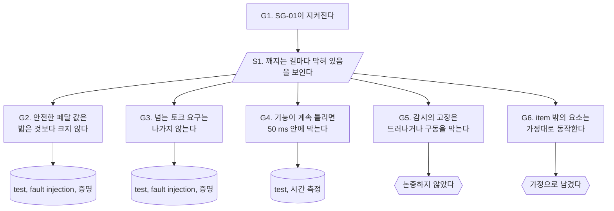

# 19장. Safety case와 assessment

## 핵심 질문

흩어진 산출물이 어떻게 "안전하다"는 하나의 주장이 되는가?

## 문서 더미는 논증이 아니다

여기까지 오면 산출물이 쌓여 있다: hazard 분석, 요구사항, 구조, test 결과, 분석 결과. 그것을 다 모아도 "그래서 안전한가"의 답은 되지 않는다. 답은 논증이다: 무엇을 주장하는가, 그 주장이 왜 성립하는가, 근거는 어디에 있는가.

이 논증을 safety case라고 한다. 널리 쓰는 정의로는, 정해진 환경과 쓰임에서 시스템이 뜻한 대로 동작한다는 것을 근거로 뒷받침해 조리 있게 설득하는 논증이다 (ACWG, 2021).

세 가지로 이루어진다.

| 요소 | 뜻 | 예 |
|---|---|---|
| 주장 (claim) | 참이라고 내세우는 것 | 허용 토크를 넘는 토크 요구는 나가지 않는다 |
| 논증 (argument) | 근거에서 주장이 따라 나오는 까닭 | 깨지는 길을 모두 들고, 길마다 막혀 있음을 보인다 |
| 근거 (evidence) | 가리킬 수 있는 사실 | test 결과, 증명, 분석 |

근거만 있고 논증이 없으면 읽는 사람이 논증을 지어내야 한다. 논증만 있고 근거가 없으면 말일 뿐이다.

ISO 26262에서는 개발하면서 만든 산출물을 모아 safety case를 이룬다고 한다 `(2차 자료)`. 같은 자료는 이 쓰임이 "규격을 따랐다"를 보이는 쪽으로 기울 수 있다고 짚는다. 안전하다는 결론을 먼저 두고 그것을 뒷받침하는 것만 모으게 된다는 것이다 (Van Eikema Hommes, 2016).

## GSN: 논증을 그린다

GSN (Goal Structuring Notation)은 논증의 구조를 그림으로 적는 표기법이다 (ACWG, 2021).

| 요소 | 하는 일 |
|---|---|
| goal | 주장. 맨 위의 goal이 전체 주장이고, 아래의 goal이 그것을 뒷받침한다 |
| strategy | 주장을 어떻게 나누어 보이는지 |
| solution | 근거를 가리킨다 |
| context | 주장이 성립하는 범위 |
| assumption | 입증하지 않고 두는 전제 |

표준은 위에서 아래로 만드는 여섯 걸음을 든다: 주장을 정한다, 그 주장이 성립하는 범위를 적는다, 나누는 방법을 정한다, 그 방법이 왜 맞는지 적는다, 아래 주장으로 나눈다, 더 나눌 수 없으면 근거를 가리킨다.

표기법은 논증이 충분하다는 것을 보장하지 않는다. 읽는 사람이 따져 볼 수 있게 할 뿐이다. 그림이 좋은 점은 빈 곳이 보인다는 것이다. 근거가 달리지 않은 주장, 범위가 적히지 않은 주장이 눈에 띈다.

## 읽는 사람은 무엇을 보는가

safety case를 검토하는 사람은 근거의 양을 세지 않는다. 논증의 약한 고리를 찾는다. GSN 표준이 드는 흔한 잘못이 좋은 점검표다.

| 잘못 | 모습 |
|---|---|
| 뭉뚱그린 주장 | "모든 hazard를 완화했다". 일부에만 참인 것을 전체처럼 적는다 |
| 모호한 주장 | 참인지 거짓인지 가릴 수 없다 |
| 건너뛰기 | 위의 주장을 뒷받침하지 않고 결론을 먼저 적는다 |
| 믿음의 도약 | 주장과 근거 사이가 너무 멀다. "test가 통과했다"에서 "안전하다"로 바로 간다 |
| 상자 속의 글 | 상자 하나에 논증 전체를 문단으로 적는다 |

여기에 세 가지를 더 본다.

- 가정은 어디에 있는가. 가정에 기댄 주장은 가정만큼만 참이다.
- 근거는 주장이 말하는 것을 정말 보이는가. PC에서 돌린 test는 target의 동작을 보이지 않는다.
- 논증하지 않은 가지가 적혀 있는가. 빈 곳을 숨긴 논증보다 빈 곳을 적은 논증이 믿을 만하다.

## 누가 확인하는가

논증은 쓴 사람이 아닌 사람이 봐야 한다. 쓴 사람은 자기 가정을 보지 못한다. 규격은 등급에 따라 산출물의 검토를 요구한다고 한다 `(2차 자료)`. 검토하는 사람이 만든 사람에게서 얼마나 떨어져 있어야 하는지도 등급에 따라 달라진다고 하는데, 이 책은 그 규칙을 원문으로 확인하지 못했다 `(확인 필요)`. 5장에서 다시 다룬다.

## 관통 예제에 적용

예제의 safety case는 `example/drive-torque/docs/safety-case.md`에 있다.

- 나누는 방법 (S1)은 fault tree다. `SG-01`이 깨지는 길을 들고, 길마다 주장 하나를 둔다.
- G2, G3, G4에는 근거가 있다. 근거는 test, fault injection, 증명을 가리킨다.
- G5와 G6에는 근거가 없다. 그림에 그대로 적었다.

이 논증은 닫히지 않았다. 감시 자신의 고장 (G5)을 다루지 않았기 때문이다. 감시가 고장 난 채로 기능이 틀리면 `SG-01`은 깨진다. 근거가 있는 주장도 범위가 좁다. G3의 근거는 소프트웨어의 논리에 관한 것이고, 기능이 감시를 방해하지 않는다는 가정 (`A-10`, `A-19`)에 기댄다.

`safety-case.md`의 3절은 근거의 종류마다 말해 주는 것과 말해 주지 않는 것을 적는다. 이 표가 논증에서 가장 중요한 부분이다.

| 근거 | 말해 주는 것 | 말해 주지 않는 것 |
|---|---|---|
| 요구사항에 따른 test | 요구사항에 적은 경우에 코드가 그대로 동작한다 | 요구사항이 옳고 빠짐없다는 것 |
| fault injection | 넣은 fault에 대해 정한 대응이 정한 시간 안에 일어난다 | 넣지 않은 fault에 대한 동작 |
| 증명 | 함수 하나가 가능한 모든 입력에서 성질을 지킨다 | compiler, 실행 시간, 하드웨어 |
| coverage | test가 코드를 빠짐없이 실행했다 | test가 옳은 것을 확인했다는 것 |

## 규격에서의 위치

- ISO 26262-2 (Management of functional safety): safety case, 확인 활동
- ISO 26262-8 (Supporting processes)
- GSN Community Standard: 표기법

## 흔한 오해

- "safety case는 마지막에 쓰는 보고서다." 논증의 뼈대는 처음에 세운다. 그래야 어떤 근거가 필요한지 알고 만든다. 마지막에 쓰면 있는 근거에 주장을 맞추게 된다.
- "근거가 많으면 강한 논증이다." 주장과 이어지지 않는 근거는 무게가 없다.
- "규격의 산출물을 다 만들었으니 안전하다." 산출물은 근거의 재료다. 그것이 무엇을 보이는지는 논증이 말해야 한다.
- "빈 곳을 적으면 약해 보인다." 빈 곳은 적지 않아도 있다. 적어야 다음 사람이 채운다.

## 확인 문제

1. "모든 test가 통과했다. 따라서 `SG-01`이 지켜진다"에서 빠진 주장을 둘 넘게 들어 보라.
2. 예제의 논증에서 가정 `A-02` (두 채널은 함께 틀리지 않는다)가 깨지면 어느 주장이 무너지는가? 그것을 보인 test는 무엇인가?
3. G5를 닫으려면 어떤 근거가 필요한가? PC 시뮬레이션으로 얻을 수 있는 것과 없는 것을 나눠 보라.
4. 자기가 쓴 코드의 safety case를 자기가 검토하면 무엇을 놓치기 쉬운가?
