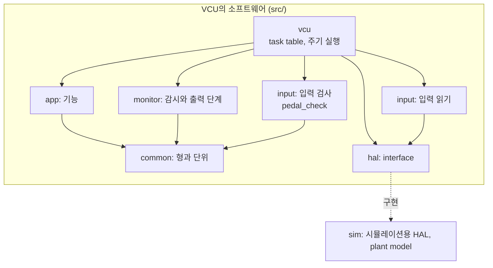
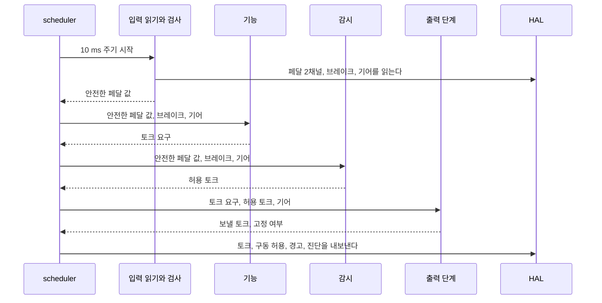

# software architecture

VCU 소프트웨어의 구조를 두 가지로 보인다: 무엇이 무엇에 기대는가 (정적 view), 한 주기에 무엇이 어떤 순서로 실행되는가 (동적 view). 구조를 이렇게 정한 이유는 [technical-safety-concept.md](technical-safety-concept.md)에 있다.

## 1. 정적 view

| 모듈 | 파일 | 하드웨어를 부르는가 | 상태가 있는가 | 요구사항 |
|---|---|---|---|---|
| 입력 읽기 | `src/input/input.c` | 부른다 | 없다 | (입력 검사와 함께 `SG-01`의 요구사항을 받는다) |
| 입력 검사 | `src/input/pedal_check.c` | 안 부른다 | counter 둘, 고장 표시 | `SWR-01` - `SWR-04` |
| 기능 | `src/app/app.c` | 안 부른다 | 지난 주기의 토크, 제동 우선 표시 | `SG-01`의 요구사항 없음 |
| 감시 | `src/monitor/monitor.c` | 안 부른다 | 없다 | `SWR-05`, `SWR-06` |
| 출력 단계 | `src/monitor/monitor.c` | 안 부른다 | counter, 고정 표시 | `SWR-07` - `SWR-09` |
| 주기 실행 | `src/vcu/vcu.c` | 부른다 | 위 모듈의 상태를 담는다 | `SWR-10`, `SWR-11`, `SWR-12` |

규칙

- 기능은 감시를 부르지 않고, 감시는 기능을 부르지 않는다. 둘은 주기 실행부가 넘겨 주는 값으로만 이어진다.
- 계산하는 모듈 (입력 검사, 기능, 감시, 출력 단계)은 하드웨어를 부르지 않는다. 그래서 그 모듈만으로 unit test와 증명을 할 수 있다.
- 전역 변수가 없다. 상태는 구조체 하나 (`vcu_t`)에 있고 주기 실행부가 가진다.
- 시뮬레이션은 VCU를 HAL로 나온 것으로만 본다. 안쪽의 값을 보려면 진단 메시지를 본다.

## 2. 동적 view

10 ms마다 task table의 순서대로 실행한다. thread는 하나이고 선점이 없다.

| 순서 | task | 주기 | 하는 일 |
|---|---|---|---|
| 1 | input | 10 ms | 입력을 한 번 읽고, 페달을 검사해 안전한 페달 값을 낸다 |
| 2 | app | 10 ms | 토크 요구를 만든다 |
| 3 | monitor_output | 10 ms | 허용 토크를 계산하고, 토크 요구를 깎고, 고정 여부를 정하고, 내보낸다 |

- 입력은 주기마다 한 번만 읽는다. 기능과 감시가 같은 값을 본다.
- 고장을 판정한 주기에 그 주기의 출력부터 바뀐다. 다음 주기까지 기다리지 않는다.

## 3. sim이 보이는 것과 못 보이는 것

| 보이는 것 | 못 보이는 것 |
|---|---|
| 모듈이 정한 순서로 실행될 때의 논리 | interrupt가 끼어들 때의 data 경합 |
| 모듈 사이로 넘어가는 값 | 기능이 감시의 메모리를 고쳐 쓰는 경우 |
| task의 순서 | task의 실행 시간, 마감 초과, task를 건너뛰는 경우 |
| | stack의 넘침 |
| | reset 직후의 동작. 고장 상태는 RAM에 있어 reset이 지운다 |

실제 제어기에서는 기능과 나머지를 메모리 보호로 나누고 실행 시간을 감시해야 한다 (가정 `A-19`). 이 예제는 그것을 가정으로만 둔다.
