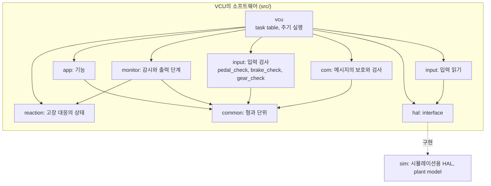
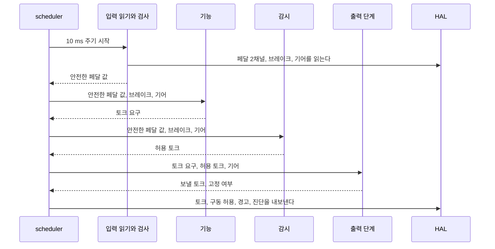

# software architecture

VCU 소프트웨어의 구조를 두 가지로 보인다: 무엇이 무엇에 기대는가 (정적 view), 한 주기에 무엇이 어떤 순서로 실행되는가 (동적 view). 구조를 이렇게 정한 이유는 [technical-safety-concept.md](technical-safety-concept.md)에 있다.

## 1. 정적 view

| 모듈 | 파일 | 하드웨어를 부르는가 | 상태가 있는가 | 요구사항 |
|---|---|---|---|---|
| 입력 읽기 | `src/input/input.c` | 부른다 | 없다 | (입력 검사와 함께 `SG-01`의 요구사항을 받는다) |
| 입력 검사 (페달) | `src/input/pedal_check.c` | 안 부른다 | counter 둘, 고장 표시, 최근 100주기의 검사 결과 | `SWR-01` - `SWR-04`, `SWR-14` |
| 입력 검사 (브레이크) | `src/input/brake_check.c` | 안 부른다 | counter 둘, 판정한 브레이크 상태, 고장 표시 | `SWR-15` |
| 입력 검사 (기어) | `src/input/gear_check.c` | 안 부른다. 차량 속도는 주기 실행부가 넘겨 준다 | 마지막으로 받아들인 방향, 받아들이지 못한 횟수 | `SWR-16` |
| 기능 | `src/app/app.c` | 안 부른다 | 지난 주기의 토크. 감시가 모르는 상태는 두지 않는다 | `SG-01`의 요구사항 없음 |
| 감시 | `src/monitor/monitor.c` | 안 부른다 | 없다. 지난 주기에 보낸 토크는 출력 단계가 기억하고, 주기 실행부가 넘겨 준다 | `SWR-05`, `SWR-06`, `SWR-13` |
| 출력 단계 | `src/monitor/monitor.c` | 안 부른다 | counter, 지난 주기에 보낸 토크 | `SWR-07` - `SWR-09` |
| 상태 기계 | `src/reaction/reaction.c` | 안 부른다 | 고장 대응의 상태 | `SWR-25` |
| 통신 | `src/com/e2e.c` | 안 부른다. 메시지를 주고받는 것은 주기 실행부가 HAL로 한다 | 보내는 counter. 받는 쪽마다 지난 counter와 지난 판정 | `SWR-17`, `SWR-18` |
| 주기 실행 | `src/vcu/vcu.c` | 부른다 | 위 모듈의 상태를 담는다 | `SWR-10`, `SWR-11`, `SWR-12` |

규칙

- 기능은 감시를 부르지 않고, 감시는 기능을 부르지 않는다. 둘은 주기 실행부가 넘겨 주는 값으로만 이어진다.
- 계산하는 모듈 (입력 검사, 기능, 감시, 출력 단계, 상태 기계, 통신)은 하드웨어를 부르지 않는다. 그래서 그 모듈만으로 unit test와 증명을 할 수 있다.
- 전역 변수가 없다. 상태는 구조체 하나 (`vcu_t`)에 있고 주기 실행부가 가진다.
- 시뮬레이션은 VCU를 HAL로 나온 것으로만 본다. 안쪽의 값을 보려면 진단 메시지를 본다.
- 감시는 상태를 갖지 않는다. 허용 토크가 오르는 속도를 제한하려면 지난 값이 필요한데 (`SWR-13`), 그 값은 감시의 지난 허용 토크가 아니라 출력 단계가 실제로 보낸 토크다. 감시가 자기 값을 기억하면 기능의 상태를 따라 갖는 둘째 사본이 되고, 두 사본이 어긋나는 길이 생긴다.

단계 2에서 모듈이 는다 (구현 예정. [technical-safety-concept.md](technical-safety-concept.md) 9절). 하드웨어와 만나는 신호는 [hsi.md](hsi.md)에 있다.

| 모듈 | 하는 일 | 요구사항 |
|---|---|---|
| 상태 기계 (넓힘) | 상태를 뒤집은 사본과 함께 두고, 비휘발성 memory에 적는다 | `SWR-22`, `SWR-23` |
| 입력 검사 (넓힘) | 줄여 감의 사건 | `SWR-24` |
| 감시 (넓힘) | inverter가 알린 토크를 견준다. 줄여 감 상태의 상한 | `SWR-19`, `SWR-24` |
| 주기 실행 (넓힘) | 실행의 순서와 횟수를 확인해 외부 watchdog에 답한다 | `SWR-20` |
| 출력 단계 (넓힘) | 구동 허용 신호를 되읽는다 | `SWR-21` |

## 2. 동적 view

10 ms마다 task table의 순서대로 실행한다. thread는 하나이고 선점이 없다.

| 순서 | task | 주기 | 하는 일 |
|---|---|---|---|
| 1 | input | 10 ms | 입력을 한 번 읽는다. 받은 메시지 (차량 속도, inverter의 상태)를 검사한다. 페달을 검사해 안전한 페달 값을 내고, 브레이크를 판정하고, 받아들인 기어를 정한다 |
| 2 | app | 10 ms | 토크 요구를 만든다 |
| 3 | monitor_output | 10 ms | 허용 토크를 계산하고, 토크 요구를 깎고, 고정 여부를 정한다. 구동 허용 신호를 쓰고, 토크 요구에 counter와 CRC를 붙여 보낸다 |

- 입력은 주기마다 한 번만 읽는다. 기능과 감시가 같은 값을 본다.
- 고장을 판정한 주기에 그 주기의 출력부터 바뀐다. 다음 주기까지 기다리지 않는다.

## 3. sim이 보이는 것과 못 보이는 것

| 보이는 것 | 못 보이는 것 |
|---|---|
| 모듈이 정한 순서로 실행될 때의 논리 | interrupt가 끼어들 때의 data 경합 |
| 모듈 사이로 넘어가는 값 | 기능이 감시의 메모리를 고쳐 쓰는 경우 |
| task의 순서 | task의 실행 시간, 마감 초과, task를 건너뛰는 경우 |
| | stack의 넘침 |
| | reset 직후의 동작. 고장 상태는 RAM에 있어 reset이 지운다 |

실제 제어기에서는 기능과 나머지를 메모리 보호로 나누고 실행 시간을 감시해야 한다 (가정 `A-19`). 이 예제는 그것을 가정으로만 둔다.
