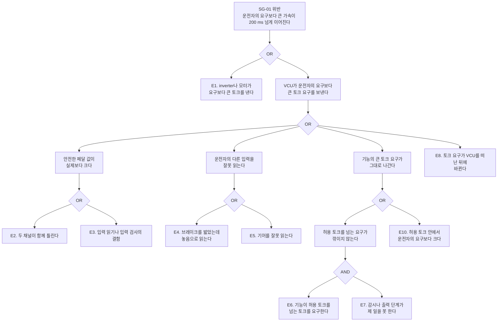

# FTA: safety goal SG-01

`SG-01`이 깨지는 길을 위에서 아래로 따라간다. 가지마다 무엇이 막는지와, 단계 1에서 그것을 보였는지를 적는다. 1절부터 4절까지는 단계 1의 설계를 분석한 기록이고 고치지 않는다. 단계 2에서 달라진 것은 5절에 모은다.

- 확률은 계산하지 않았다. 구조만 본다.
- 등급과 수치는 설명을 위한 가정이다.

## 1. fault tree

## 2. 가지마다 무엇이 막는가

| 사건 | 내용 | 막는 것 | 단계 1의 상태 |
|---|---|---|---|
| E1 | inverter나 모터가 요구보다 큰 토크를 낸다 | item 밖. 가정 `A-05`, `A-08`. VCU는 실제 토크를 보지 않는다 | 가정 |
| E2 | 페달의 두 채널이 함께 틀린다. 예: 센서의 전원이 함께 올라감, 페달이 걸려 돌아오지 않음 | 가정 `A-02`, `A-12`. 두 채널이 맞으면 믿으므로 소프트웨어는 알아채지 못한다 | 가정. `FI-03`이 알아채지 못함을 보인다 |
| E3 | 입력 읽기나 입력 검사가 틀려, 안전한 페달 값이 실제보다 크다 | 입력 검사에 준 요구사항 (`SWR-01` - `SWR-04`)과 그 검증 | test와 증명. 기능과 감시가 함께 기대는 단일 지점이다 |
| E4 | 두 페달을 함께 밟았는데 브레이크를 놓음으로 읽는다. 운전자는 멈추려는데 가속 페달만큼의 토크가 나간다 | 없다. 신호가 한 채널이고 검사하지 않는다 (`A-04`) | 막지 않는다. 평소에는 드러나지 않는다 |
| E5 | 기어 신호가 틀린다. N이나 P인데 D로 읽으면 운전자가 요구하지 않은 출발이 된다 | 없다. 신호가 한 채널이고 검사하지 않는다 | 막지 않는다. 주행 중에 R로 읽으면 반대 방향의 토크가 나간다 (`H-03`, `H-04`) |
| E6 | 기능이 허용 토크를 넘는 토크를 요구한다 (어떤 결함이든) | 출력 단계가 깎는다 (`SWR-07`). 이어지면 차단한다 (`SWR-08` - `SWR-10`) | test, fault injection (`FI-02`, `FI-04`, `FI-06`), 증명 |
| E7 | 허용 토크의 계산이 틀리거나, 깎기가 틀리거나, 감시가 실행되지 않거나, 기능이 감시의 메모리를 망가뜨린다 | 가정 `A-10`, `A-19`. 켤 때의 자가 시험은 없다 | 논증하지 않았다 |
| E8 | CAN에서 토크 요구가 바뀌거나, 오래된 값이 되풀이된다 | 가정 `A-06` (끊기면 inverter가 멈춘다)뿐이다. 메시지의 보호가 없다 | 막지 않는다. 단계 2에서 다룬다 |
| E10 | 기능이 운전자의 요구보다 크지만 허용 토크 이하인 토크를 요구한다. 감시는 알아채지 못한다 | 허용 토크와 정상인 기능의 토크 사이의 틈을 `SG-01`의 한계보다 작게 둔다 (`TSR-03`, `SWR-06`) | test (`TC-007`, `TC-011`). 입력이 그대로이면 틈은 5 Nm다. 입력이 한 번 바뀐 뒤 토크를 올리는 동안에는 70 ms까지 더 크다. 입력 (페달 한 채널, 브레이크, 기어)이 70 ms보다 빨리 거듭 바뀌는 간헐 고장과 겹치면 큰 틈이 이어지고, 차량의 가속 차이는 끊기지 않고 `SG-01`을 어긴다. 그것은 막지 않는다 (technical-safety-concept.md 3절) |

구동 허용 신호를 끊어도 토크가 나가는 경우 (가정 `A-07`이 깨짐)는 tree에 넣지 않았다. 그것만으로는 `SG-01`이 깨지지 않는다. 기능의 고장으로 고정한 뒤에 보낸 토크 0도 함께 무시되어야 한다.

## 3. 읽는 법

- E6과 E7은 AND로 묶여 있다. 기능이 틀려도 감시와 출력 단계가 제대로라면 넘는 토크는 나가지 않는다. 이것이 감시를 따로 둔 이유다.
- 그런데 AND는 두 사건이 따로 일어날 때만 값어치가 있다. 기능과 감시는 같은 MCU, 같은 메모리, 같은 입력을 쓴다. 한 가지 원인이 둘을 함께 틀리게 하면 AND는 OR이 된다. 이것을 따지는 것이 dependent failure analysis이고, 단계 2 (8장)에서 한다.
- E7은 고장이 나도 평소에는 드러나지 않는다. 기능이 정상인 동안 감시는 할 일이 없기 때문이다. 이런 고장을 숨은 고장 (latent fault)이라고 한다. 찾으려면 켤 때나 주기적으로 감시를 시험해야 한다.
- E10은 AND 아래에 있지 않다. 감시가 멀쩡해도 지나간다. 감시는 상한만 보기 때문이다. 그래서 상한을 어디에 두는지가 safety goal에서 나와야 한다. 이 가지는 처음의 tree에 없었고 단계 검토에서 찾았다.
- E3도 AND 아래에 있지 않다. 입력 검사가 틀리면 기능과 감시가 함께 틀린다. 그래서 입력 검사는 가장 단순하게 만들고 가장 꼼꼼히 검증한다.
- E4, E5, E8은 단계 1에서 막지 않는 가지다. 막는 것이 없는 단일 고장이다. [technical-safety-concept.md](technical-safety-concept.md)의 6절에 단순화로 적었다.

## 4. minimal cut set

tree에서 읽은 minimal cut set은 여덟 개다.

| cut set | 사건의 수 | 뜻 |
|---|---|---|
| {E1}, {E2}, {E3}, {E4}, {E5}, {E8}, {E10} | 하나 | 그 사건 하나로 `SG-01`이 깨진다. 막는 것이 없거나 가정이나 검증에만 기댄다 |
| {E6, E7} | 둘 | 기능의 고장과 감시 쪽의 고장이 겹쳐야 한다 |

- 사건이 하나인 cut set이 일곱이다. 단계 1의 구조에서 AND는 하나뿐이고, 그것이 막는 것은 기능의 고장 하나다. 단계 2에서 더하는 것은 이 일곱을 줄이거나, 줄이지 못하는 것을 열린 채로 적는 일이다.
- {E6, E7}도 두 사건이 독립일 때에만 둘이다. 기능과 감시가 함께 쓰는 것은 [dfa.md](dfa.md)의 D-2에 있다.
- 사건에 확률을 적지 않았다. E3, E6, E7, E10은 소프트웨어의 사건이고, 소프트웨어의 결함에는 확률을 붙이지 않는다 (8장).

요소마다 고장의 방식을 훑은 표는 [fmea.md](fmea.md)에, 고장 없이 위험해지는 경우를 본 것은 [stpa.md](stpa.md)에 있다.

FMEA의 표에서 혼자서 `SG-01`에 닿는 줄을 이 tree의 가지에 맞춰 보았다.

| FMEA의 줄 | tree의 가지 | 맞춰 본 결과 |
|---|---|---|
| FM-02 | E2 | 있다 |
| FM-07 | E3 | 있다 |
| FM-03, FM-04 | E4, E5 | 있다 |
| FM-10 | E10 | 있다. 다만 이 가지는 분석이 아니라 단계 검토에서 나와 뒤에 넣은 것이다 |
| FM-18, FM-19 | E8 | 있다 |
| FM-22 | E1 | 있다 |
| FM-06, FM-13, FM-21 (실행되지 않거나 늦는다) | 딱 맞는 가지가 없다 | tree는 "기능이 틀림" (E6)과 "감시가 실행되지 않음" (E7의 일부)을 따로 일어나는 두 사건으로 그렸다. 그런데 task가 실행되지 않으면 둘이 한 원인으로 함께 일어난다. AND가 OR이 되는 길이다. [dfa.md](dfa.md)의 D-2 (주기 실행, processor의 시간)에 적었고, M5가 맡는다 |

마지막 줄이 두 기법을 함께 쓰는 값이다. tree만 보았다면 AND 아래의 두 사건이 한 원인을 나눠 갖는다는 것이 보이지 않는다.

## 5. 단계 2에서 달라진 것

4절의 cut set 가운데 사건이 하나인 일곱을 줄이는 것이 단계 2의 일이다. 사건마다 무엇을 더했고 지금 어디까지 왔는지를 적는다. "구현 예정"은 요구사항만 있고 코드가 없다는 뜻이다 ([technical-safety-concept.md](technical-safety-concept.md) 9절).

| 사건 | 더하는 것 | 지금의 상태 | 더한 뒤에도 남는 것 |
|---|---|---|---|
| E10 | 허용 토크가 오르는 속도의 상한 (`SWR-13`) | 구현했다. 틈은 입력이 바뀌는 동안에도 5 Nm다. 정상인 기능에 대해서는 성질 6이, 틀린 기능의 출력에 대해서는 성질 7이 모든 입력에서 증명한다. `TC-011`, `TC-013`, `FI-07`이 같은 것을 test로 본다 | 출력 단계가 기억하는 지난 출력이 틀리고 기능의 고장이 겹친 경우. 70 ms까지다 |
| E4 | 브레이크의 접점 둘을 견준다 (`SWR-15`) | 구현했다 (`TC-016`, `FI-10`, `FI-12`, 증명한 성질 9). 접점 1이 "놓음"에 고착되어도 접점 2가 밟음을 알린다 | 두 접점이 함께 "놓음"으로 틀리는 경우. 접점 하나의 고착은 브레이크를 밟을 때에야 드러난다 (200 ms보다 짧게만 밟으면 판정하지 않는다. [fmea.md](fmea.md)의 FM-33). 브레이크를 판정하는 코드 자신의 결함: 판정을 입력 단계 한 곳에서 해서 기능과 감시에 같은 값을 주므로 (`SWR-15`), 그 코드가 "놓음"으로 틀리면 혼자서 맨 위 사건에 닿는다. E3와 같은 모양의 단일 지점이 하나 늘어난 것이다. 막는 것은 검증뿐이다 (FM-32) |
| E5 | 더하지 않는다 | - | N이나 P인데 D로 읽는 경우는 닫지 않는다. 막는 것이 없는 단일 고장으로 남는다. M2 (D와 R 사이의 바뀜에 속도 조건을 둔다. `SWR-16`, 구현했다)는 E5의 다른 쪽, 곧 주행 중에 반대 방향의 토크가 나가는 것을 막는다. 그것은 `SG-01`이 아니라 `SG-02`의 길이다 |
| E8 | 메시지에 counter, CRC, data ID를 붙인다 (`SWR-17`, `SWR-18`) | 구현했다 (`TC-017`, `TC-018`, `FI-13`, `FI-14`, 증명한 성질 10과 11). 전송 중에 값이 바뀐 메시지와 되풀이된 옛 메시지를 inverter가 버린다. 대조 `NC-002`가 inverter가 검사하지 않으면 두 경우 모두 `SG-01`을 어긴다는 것을 보인다 | inverter가 검사하지 않는 경우 (item 밖의 가정 `A-21`)는 `SWR-19`가 받는다 (`FI-20`: 구동 허용 차단까지 30 ms와 70 ms). 그 검사가 보지 못하는 것은 inverter가 요구보다 작게 내는 쪽이다. 넓게 바뀐 메시지의 CRC가 우연히 맞는 경우 (대략 256분의 1 이하, 한 주기). 옛 메시지가 되풀이되면 지난 토크가 50 ms 남는다 (`FI-14`에서 가속의 차이가 1.0 m/s^2를 넘은 시간 18 ms) |
| E1 | inverter가 알린 토크를 보낸 토크와 견준다 (`SWR-19`) | 구현했다 (`TC-020`, `FI-21`, 증명한 성질 13, 대조 `NC-004`). inverter가 요구보다 100 Nm 더 내면 가장 나빠도 36 ms 뒤에 구동 허용 신호를 끊는다. 판정할 때까지는 넘는 토크가 실제로 나간다 (가속의 차이가 1.0 m/s^2를 넘은 시간 24 ms). 판정은 새로 받은 상태 메시지에서만 나아가고, 새 메시지가 드물면 (최근 5주기에 3번보다 적으면) 그것으로 끊는다. 그래서 상태 메시지를 어떤 모양으로 잃든 알린 토크가 범위를 벗어난 때부터 5주기 안에 끊는다 (`FI-34`: 가장 나빠도 메시지가 주기마다 닿을 때보다 20 ms 늦다. 성질 15) | 알리는 값이 실제 토크와 같은 원인으로 틀리는 경우 (`FI-22`가 기록한다). 구동 허용 신호를 끊어도 inverter가 멈추지 않는 경우 (가정 `A-07`. 끊을 다른 수단이 없다). 30 Nm 안쪽으로 넘는 토크 |
| E7 | 실행의 순서와 횟수를 확인한다 (`SWR-20`). 구동 허용 신호를 되읽는다 (M6) | 실행의 확인은 구현했다 (`TC-021`, `FI-23` - `FI-26`, 증명한 성질 14, 대조 `NC-005`). task가 빠지거나 멈추거나 주기가 늘어지면 외부 watchdog이 15 ms 안에 구동 허용 신호를 끊는다. 출력 단계가 깎지 않는 결함도 답이 틀리게 나와 드러난다 (`FI-26`). 되읽기도 구현했다 (`SWR-21`, `FI-27` - `FI-29`). 끊는 선이 허용에 고착된 것을 켤 때 찾는다 | 허용 토크의 계산이 틀리는 경우. 설계와 코드의 결함은 검증에 기댄다. 달리는 중의 하드웨어 고장이 계산을 틀리게 하는 것은 외부 watchdog이 보지 못하고 (답을 같은 MCU가 자기가 계산한 허용 토크로 만든다), 하드웨어에 대한 가정 (`HA-02`, `HA-15`)에 기댄다. 독립은 하드웨어에 대한 가정이다. watchdog이 아닌 원인으로 MCU가 reset되면 소프트웨어는 정상 상태에서 시작해 3주기 뒤에 구동을 다시 허용하고, 이미 판정한 고장 (예: E1)에 다시 노출된다 (고장 기록 `SWR-23`을 구현하지 않았다. reset마다 가장 나빠도 151 ms). 상태 변수의 bit 반전은 `HA-02`에만 기댄다 (뒤집은 사본 `SWR-22`를 구현하지 않았다). 외부 watchdog이 끊을 수 있는지를 켤 때 시험하지 않는다. 끊지 못하는 watchdog은 숨는다 |
| E2, E3 | 더하지 않는다 | - | 가정 (E2)과 검증 (E3)에 기댄다 |

E10의 줄은 단계 1에서 이렇게 적혀 있었다: 입력이 한 번 바뀐 뒤 토크를 올리는 동안에는 틈이 70 ms까지 더 크고, 입력이 그보다 빨리 거듭 바뀌는 간헐 고장과 겹치면 `SG-01`을 어긴다. tree의 모양은 그대로다. E10은 여전히 AND 아래에 있지 않고, 달라진 것은 그 사건이 일어날 수 있는 범위다.
