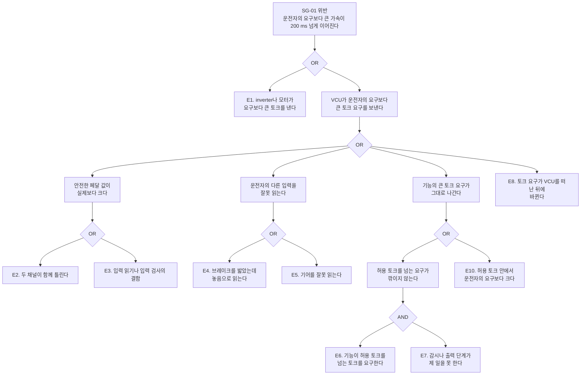

# FTA: safety goal SG-01

`SG-01`이 깨지는 길을 위에서 아래로 따라간다. 가지마다 무엇이 막는지와, 단계 1에서 그것을 보였는지를 적는다.

- 확률은 계산하지 않았다. 구조만 본다.
- 등급과 수치는 설명을 위한 가정이다.

## 1. fault tree

## 2. 가지마다 무엇이 막는가

| 사건 | 내용 | 막는 것 | 단계 1의 상태 |
|---|---|---|---|
| E1 | inverter나 모터가 요구보다 큰 토크를 낸다 | item 밖. 가정 `A-05`, `A-08`. VCU는 실제 토크를 보지 않는다 | 가정 |
| E2 | 페달의 두 채널이 함께 틀린다. 예: 센서의 전원이 함께 올라감, 페달이 걸려 돌아오지 않음 | 가정 `A-02`, `A-12`. 두 채널이 맞으면 믿으므로 소프트웨어는 알아채지 못한다 | 가정. `FI-03`이 알아채지 못함을 보인다 |
| E3 | 입력 읽기나 입력 검사가 틀려, 안전한 페달 값이 실제보다 크다 | 입력 검사에 준 요구사항 (`SWR-01` - `SWR-04`)과 그 검증 | test와 증명. 기능과 감시가 함께 기대는 단일 지점이다 |
| E4 | 두 페달을 함께 밟았는데 브레이크를 놓음으로 읽는다. 운전자는 멈추려는데 가속 페달만큼의 토크가 나간다 | 없다. 신호가 한 채널이고 검사하지 않는다 (`A-04`) | 막지 않는다. 평소에는 드러나지 않는다 |
| E5 | 기어 신호가 틀린다. N이나 P인데 D로 읽으면 운전자가 요구하지 않은 출발이 된다 | 없다. 신호가 한 채널이고 검사하지 않는다 | 막지 않는다. 주행 중에 R로 읽으면 반대 방향의 토크가 나간다 (`H-03`, `H-04`) |
| E6 | 기능이 허용 토크를 넘는 토크를 요구한다 (어떤 결함이든) | 출력 단계가 깎는다 (`SWR-07`). 이어지면 차단한다 (`SWR-08` - `SWR-10`) | test, fault injection (`FI-02`, `FI-04`, `FI-06`), 증명 |
| E7 | 허용 토크의 계산이 틀리거나, 깎기가 틀리거나, 감시가 실행되지 않거나, 기능이 감시의 메모리를 망가뜨린다 | 가정 `A-10`, `A-19`. 켤 때의 자가 시험은 없다 | 논증하지 않았다 |
| E8 | CAN에서 토크 요구가 바뀌거나, 오래된 값이 되풀이된다 | 가정 `A-06` (끊기면 inverter가 멈춘다)뿐이다. 메시지의 보호가 없다 | 막지 않는다. 단계 2에서 다룬다 |
| E10 | 기능이 운전자의 요구보다 크지만 허용 토크 이하인 토크를 요구한다. 감시는 알아채지 못한다 | 허용 토크와 정상인 기능의 토크 사이의 틈을 `SG-01`의 한계보다 작게 둔다 (`TSR-03`, `SWR-06`) | test (`TC-007`, `TC-011`). 입력이 그대로이면 틈은 5 Nm다. 입력이 한 번 바뀐 뒤 토크를 올리는 동안에는 70 ms까지 더 크다. 입력 (페달 한 채널, 브레이크, 기어)이 70 ms보다 빨리 거듭 바뀌는 간헐 고장과 겹치면 큰 틈이 이어지고, 차량의 가속 차이는 끊기지 않고 `SG-01`을 어긴다. 그것은 막지 않는다 (technical-safety-concept.md 3절) |

구동 허용 신호를 끊어도 토크가 나가는 경우 (가정 `A-07`이 깨짐)는 tree에 넣지 않았다. 그것만으로는 `SG-01`이 깨지지 않는다. 기능의 고장으로 고정한 뒤에 보낸 토크 0도 함께 무시되어야 한다.

## 3. 읽는 법

- E6과 E7은 AND로 묶여 있다. 기능이 틀려도 감시와 출력 단계가 제대로라면 넘는 토크는 나가지 않는다. 이것이 감시를 따로 둔 이유다.
- 그런데 AND는 두 사건이 따로 일어날 때만 값어치가 있다. 기능과 감시는 같은 MCU, 같은 메모리, 같은 입력을 쓴다. 한 가지 원인이 둘을 함께 틀리게 하면 AND는 OR이 된다. 이것을 따지는 것이 dependent failure analysis이고, 단계 2 (8장)에서 한다.
- E7은 고장이 나도 평소에는 드러나지 않는다. 기능이 정상인 동안 감시는 할 일이 없기 때문이다. 이런 고장을 숨은 고장 (latent fault)이라고 한다. 찾으려면 켤 때나 주기적으로 감시를 시험해야 한다.
- E10은 AND 아래에 있지 않다. 감시가 멀쩡해도 지나간다. 감시는 상한만 보기 때문이다. 그래서 상한을 어디에 두는지가 safety goal에서 나와야 한다. 이 가지는 처음의 tree에 없었고 단계 검토에서 찾았다.
- E3도 AND 아래에 있지 않다. 입력 검사가 틀리면 기능과 감시가 함께 틀린다. 그래서 입력 검사는 가장 단순하게 만들고 가장 꼼꼼히 검증한다.
- E4, E5, E8은 단계 1에서 막지 않는 가지다. 막는 것이 없는 단일 고장이다. [technical-safety-concept.md](technical-safety-concept.md)의 6절에 단순화로 적었다.
