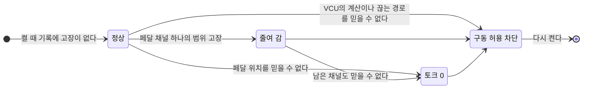

# functional safety concept

safety goal을 지키려면 item이 무엇을 해야 하는지를 정한다. 어떻게 만드는지는 [technical-safety-concept.md](technical-safety-concept.md)에서 정한다. 요구사항의 원본은 [requirements.yaml](requirements.yaml)이다.

- 등급과 수치는 설명을 위한 가정이다. 규격의 요구사항을 만족하는지 확인한 것이 아니다.
- 이 문서는 두 번에 걸쳐 썼다. 2절과 3절의 앞 다섯 요구사항이 단계 1의 concept이다. 그 설계를 분석해서 ([fmea.md](fmea.md), [stpa.md](stpa.md), [dfa.md](dfa.md), [fta.md](fta.md)) 찾은 빈 곳을 메우는 요구사항을 단계 2에서 더했다.
- 요구사항 파일에 "구현 예정" (`status: planned`)이라고 적힌 요구사항은 코드가 없다. 지금은 뒤집은 사본과 고장 기록에 관한 다섯 개다. 예제에서는 이 둘을 구현하지 않기로 했다 ([technical-safety-concept.md](technical-safety-concept.md) 9.1절). 지금 무엇이 구현되어 있는지는 추적 검사 (`make trace`)의 출력이 말해 준다.

## 1. 출발점

| ID | safety goal | 등급 |
|---|---|---|
| `SG-01` | 운전자의 요구보다 1.0 m/s^2 넘게 큰 가속이 200 ms 넘게 이어지지 않게 한다 | ASIL D (가정) |
| `SG-02` | 운전자가 요구하지 않은 감속이 1.0 m/s^2를 넘는 상태가 200 ms 넘게 이어지지 않게 하고, 운전자가 요구한 구동력을 경고 없이 잃지 않게 하고, 구동력이 줄거나 끊길 때 그 변화로 차의 안정이 흔들리지 않게 한다 | ASIL D (가정) |

`SG-02`는 hazard `H-04` (구동력의 감소나 상실)에서 나왔다 ([hara.md](hara.md) 6절). 두 safety goal은 서로 당긴다. `SG-01`은 의심스러우면 토크를 끊으라고 하고, `SG-02`는 운전자 모르게 끊지 말고, 끊을 때 차를 흔들지 말라고 한다. 이 문서의 요구사항은 그 사이에서 자리를 잡은 결과다.

`SG-02`의 원인은 `SG-01`만큼 분석하지 않았다. 아래의 요구사항은 분석이 찾은 데까지다. 그래서 `SG-02`의 요구사항을 모두 구현해도 그 safety goal이 지켜진다고 주장할 수 없다 (6절).

## 2. 생각의 순서

운전자의 요구보다 큰 토크가 inverter로 나가는 길은 셋이다.

1. 운전자의 요구를 잘못 읽는다. 가속 페달 위치를 실제보다 크게 읽는다.
2. 요구는 바로 읽었는데 토크 요구를 잘못 계산한다.
3. 토크를 내면 안 되는 상황 (브레이크를 밟음, 기어 P나 N)인데 토크를 요구한다.

그래서 item은 세 가지를 한다.

- 가속 페달 위치를 두 신호로 읽어 서로 견준다.
- 운전자의 입력에서 허용 토크를 따로 구해, 그것을 넘는 토크 요구를 내보내지 않는다.
- 고장을 알아채면 토크 요구를 끊고 운전자에게 알린다.

단계 1의 concept은 여기까지였다. 그 설계를 분석하자 이 세 가지가 기대고 있는 것이 드러났다. fault tree에서 사건 하나로 `SG-01`이 깨지는 길이 일곱이었다 ([fta.md](fta.md) 4절).

4. 브레이크나 기어를 잘못 읽는다. 감시도 같은 값을 쓰므로 알아채지 못한다.
5. 토크 요구가 VCU를 떠난 뒤에 바뀌거나, inverter가 요구보다 크게 낸다.
6. 감시와 출력 단계가 실행되지 않거나, 끊는 경로가 고장 나 있다. 평소에는 드러나지 않는다.
7. 고장을 알아챘는데 reset이 그 상태를 지운다.

단계 2에서 item이 더 하는 일은 이 넷에 대한 것이다. 여기에 방향이 반대인 일이 하나 붙는다. 대응을 더할수록 구동을 끊는 까닭이 늘어나므로, 끊지 않아도 될 때 끊지 않는다는 요구사항 (`SG-02`)을 함께 둔다.

## 3. functional safety requirement

단계 1의 요구사항 (모두 구현했다)

| ID | 요구사항 | 받는 요소 |
|---|---|---|
| `FSR-01` | VCU는 가속 페달 위치를 서로 독립된 두 신호로 읽고, 두 신호가 범위를 벗어나거나 서로 맞지 않으면 알아챈다 | 입력 검사 |
| `FSR-02` | VCU는 운전자의 입력 (가속 페달, 브레이크, 기어)에서 허용 토크를 구하고, inverter로 보내는 토크 요구가 허용 토크를 넘지 않게 한다 | 감시, 출력 단계 |
| `FSR-03` | 가속 페달 위치를 믿을 수 없으면 VCU는 토크 요구를 바로 0으로 하고 운전자에게 경고를 요청한다. 다시 켤 때까지 유지한다 | 입력 검사, 출력 단계 |
| `FSR-04` | 토크 요구가 허용 토크를 계속 넘으면 VCU는 기능의 고장으로 보고, 토크 요구를 0으로 하고 구동 허용 신호를 끊고 운전자에게 경고를 요청한다. 다시 켤 때까지 유지한다 | 출력 단계 |
| `FSR-05` | 가속 페달을 놓았거나, 브레이크를 밟았거나, 기어가 P 또는 N이면 VCU는 구동 토크를 요구하지 않는다 | 감시, 출력 단계 |

단계 2에서 더한 요구사항: `SG-01` 쪽

| ID | 요구사항 | 받는 요소 | 어디에서 나왔는가 | 상태 |
|---|---|---|---|---|
| `FSR-06` | VCU는 브레이크 페달의 상태를 서로 반대로 움직이는 두 접점으로 읽고, 둘이 어긋나면 알아챈다. 어긋나는 동안에는 밟은 것으로 본다. 어긋남이 이어지면 토크 요구를 0으로 하고 운전자에게 경고를 요청한다 | 입력 검사 | fault tree의 E4, FMEA의 FM-03 | 구현했다 |
| `FSR-08` | VCU와 inverter, 제동 제어기 사이에 오가는 값이 전송 중에 바뀌거나, 되풀이되거나, 끊기면 받는 쪽이 알아챌 수 있게 한다. VCU는 그런 값을 쓰지 않는다 | 통신 | E8, FM-18, FM-19 | 구현했다 |
| `FSR-09` | inverter가 낸 토크가 VCU가 요구한 토크의 범위를 계속 벗어나거나 inverter의 상태를 계속 알 수 없으면 VCU는 구동 허용 신호를 끊고 운전자에게 경고를 요청한다 | 감시 | E1, FM-22, STPA의 LS-12 (되돌려 받는 것이 없다) | 구현했다 |
| `FSR-10` | 입력 검사, 감시, 출력 단계가 정해진 순서와 주기로 실행되지 않으면, VCU의 소프트웨어와 따로 동작하는 요소가 구동을 막을 수 있게 한다 | 주기 실행, 외부 watchdog (가정) | E7, FMEA와 fault tree를 맞춰 보다 찾은 것 (실행되지 않으면 AND가 OR이 된다) | 구현했다. watchdog은 sim의 model이다 |
| `FSR-11` | VCU는 구동 허용 신호가 쓴 대로 나가는지를 확인하고, 그렇지 않으면 구동을 허용하지 않고 운전자에게 경고를 요청한다 | 출력 단계 | FM-20, STPA의 LS-13 (끊지 못하는 고장이 쓸 때까지 숨는다) | 구현했다 |
| `FSR-12` | 고장 상태는 reset이나 memory의 값이 바뀌는 것으로 풀리지 않는다. 기록된 고장 상태는 정비에서 지울 때까지 남는다 | 상태 기계 | FM-17, STPA의 LS-14, dependent failure analysis의 D-3 | 구현하지 않았다 (요구사항만 있다) |
| `FSR-13` | 고장 대응의 상태는 한 곳에서 정한다. 상태는 안전한 쪽으로만 바뀌고, 다시 켤 때까지 돌아가지 않는다 | 상태 기계 | 대응이 여럿이 되면서 생기는 다툼 | 구현했다 (증명한 성질 8) |

단계 2에서 더한 요구사항: `SG-02` 쪽

| ID | 요구사항 | 받는 요소 | 상태 |
|---|---|---|---|
| `FSR-07` | VCU는 구동 토크의 방향이 바뀌는 것 (D와 R 사이의 바뀜)을 차량 속도가 유효하고 정해진 값 아래일 때만 받아들인다. 받아들이지 못한 동안에는 구동 토크를 요구하지 않고, 그 상태가 이어지면 운전자에게 알린다 | 입력 검사 | 구현했다. FMEA의 FM-05와 STPA의 UCA-6에서 나왔다 |
| `FSR-14` | 고장이 없으면 감시와 출력 단계는 기능의 토크 요구를 깎지 않는다 | 감시, 출력 단계. 기능도 받는다 (아래) | 구현했다. 모든 입력에 대해 증명했다 (성질 6). 고장 대응의 상태가 정상일 때의 증명이다 |
| `FSR-15` | 한두 주기의 입력 이상 (잡음, 접점의 튐)으로는 고장으로 판정하지 않는다. 그 주기의 토크는 안전한 쪽으로 두지만, 이상이 사라지면 토크가 돌아온다 | 입력 검사, 출력 단계 | 구현했다 (페달, 브레이크, 출력 단계) |
| `FSR-16` | 가속 페달 채널 하나가 전압 범위를 벗어나고 다른 채널이 범위 안이면 VCU는 토크를 끊지 않고 제한된 토크로 계속 가며 운전자에게 주의를 요청한다. 제한은 남은 채널이 틀려도 `SG-01`을 어기지 않는 크기다. 두 채널이 범위 안에서 어긋나는 고장과 간헐 고장은 어느 채널이 틀렸는지 알 수 없으므로 토크 0으로 간다 | 입력 검사, 감시, 상태 기계 | 구현했다 |

요구사항은 무엇을 하는지만 적는다. 검사의 한계값, 주기, 세는 횟수는 다음 문서에서 정한다.

`FSR-06`과 `FSR-13`은 두 safety goal을 함께 부모로 갖는다 (위의 표에 있다).

요구사항을 읽을 때 볼 것이 넷 있다.

- `FSR-14`는 기능에도 닿는다. 감시의 허용 토크가 정상인 기능의 토크와 5 Nm밖에 차이 나지 않으므로, 기능이 요구사항에 적힌 것보다 조금만 크게 요구해도 깎인다. "기능에는 `SG-01`의 요구사항을 주지 않는다"는 말은 그대로지만, `SG-02`에 대해서는 기능이 요구사항을 받는다: 토크 요구는 목표를 넘지 않고, 한 주기에 25 Nm 넘게 오르지 않는다. 실제로 기능에 이 요구사항을 어기는 결함이 있었고, 감시가 그 한 주기를 깎았다 ([test-report.md](test-report.md) 6절).
- `FSR-16`은 설계의 선택이다. `SG-02`는 경고하고 토크를 0으로 하는 것을 금하지 않는다. 그래도 줄여서 가기로 한 것은, 달리는 중에 구동력을 다 잃는 것이 `H-04`의 표에서 등급을 받는 상황이기 때문이다. 줄여서 가는 것은 `SG-02` 쪽의 일이고, 얼마까지 허용하느냐는 `SG-01`의 일이어서 두 safety goal을 함께 부모로 갖는다. 채널 하나로 가는 동안에는 두 채널을 견준다는 `FSR-01`의 바탕이 없다. 그래서 남은 채널이 틀린 경우의 가장 큰 토크가 `SG-01`의 한계 아래에 있도록 상한을 정한다. 줄여서 가는 것은 선이 끊기거나 단락된 고장 (어느 채널이 틀렸는지 아는 고장)에만 쓴다.
- `FSR-07`은 `SG-02`의 아래에 있다. 달리는 중에 반대 방향의 토크가 걸리면 차가 급히 감속한다. `SG-02`의 첫째 구절이 그것이다. FMEA도 이 고장 (FM-05)이 `SG-01`에 닿지 않는다고 판정했다. 방향의 신호가 고장으로 바뀐 것인지 운전자가 달리는 중에 고른 것인지를 VCU는 가릴 수 없으므로, 어느 쪽이든 속도가 낮아질 때까지 받아들이지 않는다. 그리고 이 요구사항은 달리는 중에 방향이 바뀌는 것만 막는다. 기어의 값 자체가 틀린 경우 (N이나 P인데 D로 읽는다)는 `SG-01` 쪽의 길이고, 막지 않는다. 6절에 적는다.
- `FSR-06`의 대응 (어긋나면 밟은 것으로 본다)은 `SG-01`에는 안전하고 `SG-02`에는 대가가 있다. 접점 하나가 "밟음" 쪽으로 고장 나면 구동력을 잃는다. 그래서 어긋남이 이어지면 경고한다. 경고 없이 잃는 것이 `SG-02`가 금하는 것이다.

## 4. 고장과 대응

고장 대응의 상태는 넷이고, 안전한 쪽으로만 바뀐다 (`FSR-13`).

| 상태 | 토크 | 구동 허용 신호 | 경고 | `SG-02`에서 본 대가 |
|---|---|---|---|---|
| 정상 | 허용 토크 안에서 기능의 요구대로 | 허용 | 없음 | - |
| 줄여 감 | 허용 토크에 40 Nm의 상한 | 허용 | 주의 | 가속이 느리다. 길 밖으로 차를 뺄 수 있다 |
| 토크 0 | 0 | 허용 | 경고 | 구동력을 잃는다. 타력으로 간다 |
| 구동 허용 차단 | 0 | 차단 | 경고 | 구동력을 잃는다. inverter가 토크 요구를 무시해도 멈춘다 |

| 알아챈 것 | 가는 상태 | 요구사항 | 지금 |
|---|---|---|---|
| 페달 채널 하나가 전압 범위를 벗어나고 다른 채널은 범위 안이다 | 줄여 감 | `FSR-16` | 구현했다 |
| 페달의 두 채널이 범위 안에서 어긋난다, 두 채널이 모두 범위를 벗어난다 | 토크 0 | `FSR-03` | 구현했다 |
| 페달 검사가 가끔 실패한다 (간헐 고장) | 토크 0 | `FSR-03` | 구현했다 |
| 브레이크의 두 접점이 어긋난 채 이어진다 | 토크 0. 브레이크는 밟음으로 둔다 | `FSR-06` | 구현했다 |
| 토크 요구가 허용 토크를 넘는다 | 상태는 그대로. 그 주기의 토크 요구를 깎는다 | `FSR-02` | 구현했다 |
| 토크 요구가 허용 토크를 계속 넘는다 | 구동 허용 차단 | `FSR-04` | 구현했다 |
| inverter가 낸 토크가 요구한 범위를 계속 벗어난다 | 구동 허용 차단 | `FSR-09` | 구현했다 |
| inverter의 상태 메시지가 계속 무효다 (오지 않거나 검사에 실패한다) | 구동 허용 차단. inverter가 요구대로 내는지 확인할 수 없다 | `FSR-08`, `FSR-09` | 구현했다 |
| 구동 허용 신호가 쓴 대로 나가지 않는다 | 구동 허용 차단 (끊을 수 있는 것은 토크 요구뿐이다) | `FSR-11` | 구현했다 |
| 고장 대응의 상태를 담은 변수가 망가졌다 | 구동 허용 차단 | `FSR-12` | 구현하지 않았다 (요구사항만 있다) |
| 켤 때 지난 운행의 고장 기록이 있다 | 기록된 상태에서 시작한다 | `FSR-12` | 구현하지 않았다 (요구사항만 있다) |
| 켤 때 고장 기록의 두 사본을 모두 읽을 수 없다 | 구동 허용 차단에서 시작한다. 고장이 없었다고 볼 근거가 없다 | `FSR-12` | 구현하지 않았다 (요구사항만 있다) |
| 켤 때 reset의 원인이 외부 watchdog이다 | 구동 허용 차단에서 시작한다. 소프트웨어가 기록할 틈이 없었으므로 reset의 원인이 기록을 대신한다 | `FSR-10`, `FSR-12` | 구현하지 않았다 (요구사항만 있다) |

상태를 바꾸지 않는 것이 셋 있다. 고장이 아니라 조건이기 때문이다.

- 브레이크를 밟는 동안과, 방향의 바뀜을 받아들이지 못한 동안 (`FSR-07`)에는 토크가 0이다. 조건이 풀리면 토크가 돌아온다. 뒤의 것은 운전자가 요구한 구동력이 나가지 않는 것이므로, 이어지면 운전자에게 알린다 (주의. 조건이 풀리면 거둔다).
- 차량 속도의 메시지가 무효인 동안에는 방향의 바뀜을 받아들이지 못한다. 방향을 바꾸지 않고 달리는 동안에는 영향이 없다. 서서 방향을 바꾸려는 때에 속도가 무효이면 차가 출발하지 못하고, 위의 알림이 나간다.
- 입력 검사, 감시, 출력 단계가 실행되지 않으면 상태 기계도 실행되지 않는다. 그때 구동을 막는 것은 외부 watchdog이고, 상태 기계를 거치지 않는다 (`FSR-10`).

그 밖에 정한 것

- 토크 0으로 갈 때는 기울기를 두지 않고 한 주기에 0으로 한다. 이것은 `SG-01`만 보고 고른 것이고, `SG-02` 쪽에서는 확인하지 못한 가정에 기댄다: 구동 토크가 한 주기에 0으로 떨어져도 차의 안정을 흔들지 않는다 (`A-26`). 보고서가 safe state의 조건으로 든 "제어된 변화"를 예제는 보이지 못했다 ([hara.md](hara.md) 7절). 내리는 기울기를 요구사항으로 두면 닫을 수 있고, 그 값은 `SG-01` 쪽과의 맞바꿈이다. 정하지 않은 채로 둔다.
- 고장 상태는 다시 켤 때까지 유지한다 (지금의 코드). `FSR-12`를 구현하면 토크 0과 구동 허용 차단은 기록에 남아 다시 켠 뒤에도 이어지고, 정비에서 기록을 지워야 풀린다. reset이 고장 상태를 지우는 길을 막으려는 것인데, 대가가 크다. 한 번의 거짓 판정이 정비를 받을 때까지 차를 세운다. 그래서 `FSR-15` (잠깐의 이상으로 판정하지 않는다)가 더 무거워진다. 주행 중에 한 번 판정되면 구동력이 돌아오지 않는다. 이것은 `SG-02` 쪽의 대가이고, 실제 제어기는 복귀 조건을 둔다. 예제는 두지 않았다. 복귀 조건은 "고장이 사라졌다"를 판정하는 일이고, 그 판정이 틀리면 `SG-01`로 돌아가기 때문이다.
- 다시 켠 뒤에는 입력 검사를 통과하고 고장 기록을 읽기 전까지 토크를 허용하지 않는다.
- 페달 고장에서 구동 허용 신호를 끊지 않는 까닭: 이 고장에서 믿을 수 없는 것은 입력이고, VCU의 계산과 출력은 믿을 수 있다. 토크 요구 0이 그대로 나간다. 구동 허용 신호를 끊는 것은 VCU 자신을 믿을 수 없을 때를 위해 남겨 둔다.

## 5. 요구사항을 누구에게 주는가

- `SG-01`에서 나온 요구사항은 입력 검사, 감시, 출력 단계가 받는다. 입력 검사는 가속 페달, 브레이크, 기어를 읽고 검사하는 부분이다.
- 기능 (토크 요구를 만드는 부분)에는 `SG-01`에 대해서 안전 요구사항을 주지 않았다. 기능이 틀려도 `SG-01`을 어기지 않게 하는 것이 감시와 출력 단계의 일이다.
- 이렇게 할 수 있으려면 감시만으로 `SG-01`이 지켜져야 한다. 감시가 허용하는 토크와 정상인 기능이 내는 토크의 차이가 `SG-01`의 한계보다 작아야 한다. 차이가 크면 기능이 틀려 허용 토크까지 요구해도 감시는 알아채지 못하고, 그 차이만큼의 가속이 나간다. 이 조건은 [technical-safety-concept.md](technical-safety-concept.md) 3절에 있다.
- 이 말은 `SG-01`에 한정된다. 기능이 토크를 덜 내거나 끊는 것 (`H-04`, `H-05`)은 감시가 막지 못한다. `SG-02`에 대해서는 기능도 요구사항을 받는다 (`FSR-14`의 설명). 다만 `SG-02`의 원인을 끝까지 분석하지 않았으므로, 기능이 스스로 토크를 덜 내는 결함 (`FI-05`)은 여전히 어느 요구사항도 막지 않는다.
- 단계 2에서 요소가 둘 늘어난다. 통신 (메시지에 보호를 붙이고 검사한다)과 상태 기계 (고장 대응의 상태를 정한다)다. 둘 다 `SG-01`의 요구사항을 받는다.
- 입력 검사가 맡는 것이 커진다. 페달뿐 아니라 브레이크의 판정과 받아들인 기어도 여기에서 정해 기능과 감시에 같은 값을 준다. 따로 정하면 두 값이 어긋나는 동안 틈이나 거짓 깎기가 생기기 때문이다. 그 대가는 기능과 감시가 함께 기대는 지점이 커지는 것이다 ([dfa.md](dfa.md) 6절).
- 요구사항을 등급이 낮은 여러 요구사항으로 나누는 방법 (ASIL decomposition)은 쓰지 않았다. 그 조건을 규격의 원문으로 확인할 수 없기 때문이다.

### 등급이 다른 소프트웨어를 함께 싣기

AUTOSAR의 문서는 ISO 26262를 들어 이렇게 적는다 `(2차 자료)`. 등급이 다른 소프트웨어가 함께 있으면 전체를 가장 높은 등급으로 개발하거나, 낮은 쪽이 높은 쪽을 방해하지 않는다는 것 (freedom from interference)을 보인다. 방해는 메모리, 시간과 실행, 정보 교환에서 생긴다. 이 책은 이 내용을 이 문서 하나로만 확인했다.

- 근거: `autosar-safety-measures` 9쪽 (기준 판 ISO 26262:2018, 72쪽의 참고 문헌).
- 미국 정부의 보고서는 요구사항을 나눠 맡기는 경우에 대해 비슷한 말을 한다: 구현 사이의 독립을 보일 수 있으면 다른 등급으로 구현할 수 있다 (`nhtsa-etc-ev-fsa` 73쪽, 80쪽, 기준 판 FDIS 2011).

예제는 이렇게 한다.

- 실제 제어기라면 메모리, 시간과 실행, 정보 교환에서 방해가 없음을 보이거나, 기능도 같은 등급으로 개발한다. 같은 MCU 안의 하드웨어 고장이 둘을 함께 망가뜨리는 것은 이것으로 풀리지 않는다. 그것은 가정 `A-10`에 기댄다.
- PC 시뮬레이션은 방해가 없음을 보일 수 없다. 그래서 예제는 기능의 코드에도 같은 개발 방법을 적용한다: compiler 경고를 오류로 다루기, 정적 분석, test, coverage 측정. 이 방법이 규격이 그 등급에 요구하는 것을 채우는지는 확인하지 않았다.
- 요구사항 추적에서 `SWR-`은 입력 검사, 감시, 출력 단계에만 달린다.

## 6. 이 concept이 덮지 않는 것

단계 2의 요구사항을 모두 구현한 뒤에도 남는 것이다.

- 기어의 값이 틀린 경우. N이나 P인데 D로 읽으면 `FSR-05`가 힘을 잃고, 운전자가 요구하지 않은 출발이 된다. 기어 신호는 한 채널이고, 견줄 다른 신호가 예제에 없다. 막는 것이 없는 단일 고장으로 남는다. 그래서 safety case의 맨 위 주장은 단계 2 뒤에도 성립하지 않는다 ([safety-case.md](safety-case.md)).
- 두 페달 신호가 함께 틀리는 경우. 두 신호가 맞으면 믿기 때문이다. 가정 `A-02`에 기댄다.
- 입력 검사 자신의 결함. 기능과 감시가 함께 기대는 지점이고, 구조로 막을 수 없다. 검증에 기댄다.
- 차량 속도가 0에 얼어붙는 경우. `FSR-07`이 속도를 쓰면서 새로 생기는 길이다. 주행 중에 반대 방향을 받아들인다 (`H-04` 쪽). 모터의 속도와 견주면 닫을 수 있지만 하지 않았다.
- 허용 토크의 계산이 틀린 경우. `FSR-10`은 실행되었는지를 볼 뿐 값이 옳은지는 보지 못한다. 검증 (test, 증명, 변이 검사)에 기댄다.
- inverter가 알리는 토크가 실제 토크와 같은 원인으로 틀리는 경우 (`FSR-09`의 한계).
- inverter와 모터의 고장 가운데 VCU가 볼 수 없는 것. item 밖이다 (가정 `A-05` - `A-08`).
- `SG-02`에서 요구사항이 없는 것: 기능이 스스로 토크를 덜 내는 결함 (`FI-05`가 알아채지 못한다는 것을 보인다), inverter와 모터가 만드는 제동 토크, 토크를 한 주기에 끊는 변화가 차의 안정을 흔드는 경우 (셋째 구절. 가정 `A-26`뿐이다).
- 뒤로 구르는 차에서 마지막으로 받아들인 방향과 같은 방향을 고르는 경우. `FSR-07`은 방향이 바뀌었는지를 받아들인 이력으로 판정한다. 차량 속도의 신호에 방향이 없어서, 차가 실제로 어느 쪽으로 가는지는 알 수 없다. D로 달리다 N에서 비탈을 뒤로 구르는 차에서 D를 고르면 속도를 보지 않고 받아들이고, 차가 가는 방향과 반대인 토크가 나간다. `SG-02`의 원인을 끝까지 분석하지 않았으므로 이 목록도 빠짐없다고 할 수 없다.
- `H-02`, `H-03`, `H-05`. safety goal을 두지 않았다.
