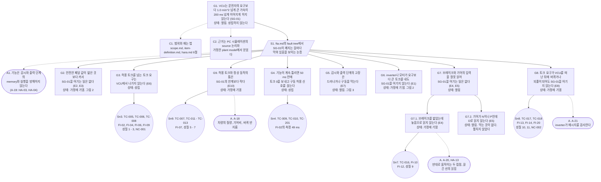
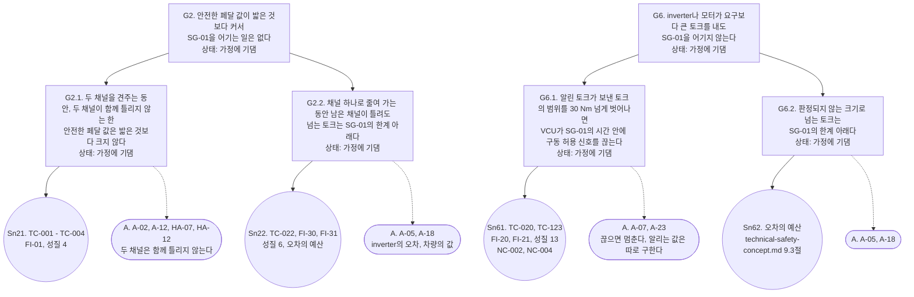
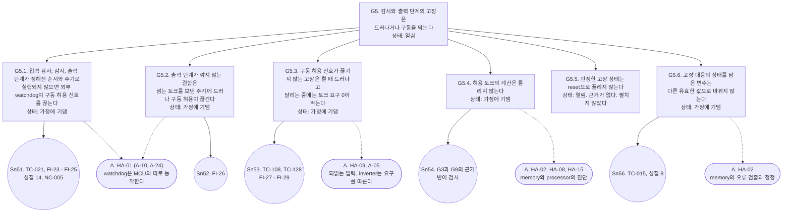
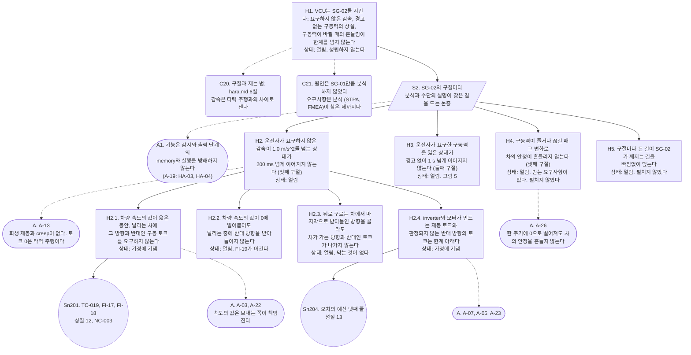

# safety case

VCU가 두 safety goal (`SG-01`, `SG-02`)을 지킨다는 주장과 그 근거를 한 논증으로 묶는다. 단계 2의 구현이 끝난 지금의 예제에 대한 논증이다. 표기는 GSN을 따른다: 주장 (goal), 주장을 나누는 방법 (strategy), 근거를 가리키는 것 (solution), 주장의 범위를 정하는 것 (context), 입증하지 않고 두는 전제 (assumption).

## 1. 이 문서가 주장하는 것과 주장하지 않는 것

이 논증은 닫히지 않는다. 두 safety goal의 맨 위 주장 (`SG-01`의 G1, `SG-02`의 H1)은 모두 성립하지 않는다.

- `SG-01`: 기어의 값이 틀린 경우 (N이나 P인데 D로 읽는다)가 막는 것 없는 단일 고장으로 남는다 (G7.2). 기어 신호는 한 채널이고, 견줄 다른 신호가 예제에 없다. 그리고 판정한 고장 상태를 reset이 지우는 길이 열려 있다 (G5.5). 고장 기록 (`SWR-23`)을 구현하지 않았기 때문이다.
- `SG-02`: 원인을 `SG-01`만큼 분석하지 않았다 ([hara.md](hara.md) 6절). 든 길이 빠짐없다고 할 수 없다 (H5). 셋째 구절 (구동력이 바뀔 때 차의 안정)은 받는 요구사항이 없고 가정 `A-26`뿐이다 (H4). 둘째 구절을 그대로 어기는 길도 하나 있다 (H3.14).

단계 2가 한 일은 열린 가지를 모두 닫는 것이 아니라, 닫을 수 있는 것을 닫고 남는 것을 정확히 적는 것이다.

주장마다 상태를 셋 가운데 하나로 적는다. 그림의 label에도 글로 적었다.

| 상태 | 뜻 | `SG-01`의 주장 | `SG-02`의 주장 |
|---|---|---|---|
| 성립 | 근거가 주장을 덮는다. 다만 모든 주장은 맥락 C2 (근거는 PC 시뮬레이션의 source 논리다)와 가정 A1 (기능이 감시를 방해하지 않는다) 위에 있다 | G3, G4 (둘) | H3.1, H3.2, H3.4, H3.9, H3.10, H3.11 (여섯) |
| 가정에 기댐 | 근거가 주장을 덮으려면 이 논증이 확인하지 않은 가정 (`A-`, `HA-`)이 더 필요하다 | G2, G2.1, G2.2, G5.1, G5.2, G5.3, G5.4, G5.6, G6, G6.1, G6.2, G7.1, G8, G9 (열넷) | H2.1, H2.4, H3.8 (셋) |
| 열림 | 근거도 가정도 주장을 덮지 못한다. 막는 것이 없거나, 근거가 없거나, 펼치지 않았다 | G1, G5, G5.5, G7, G7.2 (다섯) | H1, H2, H2.2, H2.3, H3, H3.3, H3.5, H3.6, H3.7, H3.12, H3.13, H3.14, H4, H5 (열넷) |

이 문서가 주장하지 않는 것

- item이 안전하다는 것. 범위는 VCU 하나와 safety goal 둘이다 ([scope.md](scope.md), [item-definition.md](item-definition.md)). `H-02`, `H-03`, `H-05`에는 safety goal을 두지 않았다.
- 규격을 만족한다는 것. 등급과 수치는 설명을 위한 가정이다. 산출물은 ISO 26262의 용어와 흐름을 따랐지만 규격의 요구사항을 만족하는지 확인한 것이 아니다.
- 하드웨어와 차량에서의 동작. 근거는 모두 PC 시뮬레이션에서 나왔다. 보이는 것은 source 코드의 논리와, 가정한 plant model (`A-14` - `A-18`)에서의 차량 수준의 값이다. 실행 시간, memory 보호, 감시 요소의 독립, target의 compiler가 만든 기계어는 보이지 않는다 (4절).
- 근거를 믿어도 된다는 것. 어떤 도구도 qualification되지 않았다 ([tools.md](tools.md)).
- 독립된 눈이 확인했다는 것. 이 논증은 사람의 검토를 받지 않았다. 같은 계열의 모델인 두 역할의 에이전트가 검토했고, audit과 assessment는 하지 않았다 ([safety-plan.md](safety-plan.md) 4절, 5절).

그림을 읽는 법

| 요소 | 그림에서 |
|---|---|
| goal | 네모. 참이나 거짓인 명제로 적고, 끝에 상태를 적는다 |
| strategy | 평행사변형 |
| solution | 원. 근거의 ID를 가리킨다 |
| context | 모서리가 둥근 네모. `C`로 시작한다 |
| assumption | 양 끝이 둥근 네모. `A`로 시작한다 |
| 아직 펼치지 않은 goal | label에 "펼치지 않았다"를 적는다 |
| SupportedBy | 실선 화살표 |
| InContextOf | 점선 화살표. GSN은 속이 빈 화살촉으로 그리는데 Mermaid에 그 모양이 없다 |

주장의 번호: `SG-01` 쪽은 단계 1의 번호 (G1 - G9)를 그대로 쓰고, 단계 2에서 나눈 하위 주장에 G2.1처럼 점 붙은 번호를 준다. 다른 문서가 G2 - G5를 가리킨다 ([dfa.md](dfa.md) 1절). `SG-02` 쪽은 H1부터 쓴다.

## 2. `SG-01`의 논증

### 2.1 goal structure

나누는 방법 (S1)은 fault tree다 ([fta.md](fta.md)). `SG-01`이 깨지는 길을 들고, 길마다 주장 하나를 둔다. 그림 1이 위쪽이고, G2와 G6은 그림 2에서, G5는 그림 3에서 펼친다.

그림 1. `SG-01`의 위쪽

그림 2. G2와 G6의 아래

그림 3. G5의 아래

### 2.2 주장과 근거

근거의 ID는 [test-report.md](test-report.md)의 것이다. "성질"은 그 문서 5절의 증명한 성질이다. 가정의 요지와 깨질 때의 결과는 5절에 모았다.

| 주장 | 상태 | fault tree의 가지 | 근거 | 기대는 가정 | 남는 것 |
|---|---|---|---|---|---|
| G1 VCU는 운전자의 요구보다 1.0 m/s^2 넘게 큰 가속이 200 ms 넘게 이어지게 하지 않는다 | 열림 | 맨 위 | 아래의 주장들 | A1, 그리고 아래의 가정들 | G7.2와 G5.5가 열려 있어 성립하지 않는다 |
| G2 안전한 페달 값이 밟은 것보다 커서 `SG-01`을 어기는 일은 없다 | 가정에 기댐 | E2, E3 | G2.1, G2.2 | 아래 | 입력 검사 자신의 결함 (E3). 기능과 감시가 함께 기대는 단일 지점이다. 구조로 막을 수 없고 검증 (`SWR-01` - `SWR-04`의 test, 성질 4, 변이 검사)에 기댄다 |
| G2.1 두 채널을 견주는 동안, 두 채널이 함께 틀리지 않는 한 안전한 페달 값은 밟은 것보다 크지 않다 | 가정에 기댐 | E2, E3 | `TC-001` - `TC-004`, `TC-102`, `TC-103`, `TC-105`, `FI-01` (토크 요구 0까지 29 ms, 모터의 토크가 5% 아래로 내려갈 때까지 88 ms), 성질 4. 간헐 고장의 판정 (`SWR-14`): `TC-014`, `TC-109`, `FI-08` | `A-02`, `A-12`, `HA-07`, `HA-12` | 근거가 보이는 것은 "두 채널의 값 가운데 작은 쪽을 낸다"까지다. 그것이 밟은 것보다 크지 않다는 것은 가정에서 나온다 (성질 4도 이것을 증명하지 않는다). 가정이 깨지면 성립하지 않는다 (`FI-03`: 페달 30%를 38.5%로 읽고 알아채지 못한다). 실패가 100주기에 10번 이하인 간헐 고장은 판정하지 않는다. 그동안의 틈은 G9가 막으므로 `SG-01`이 아니라 경고 쪽의 문제다 (H3.3) |
| G2.2 채널 하나로 줄여 가는 동안 남은 채널이 틀려도 넘는 토크는 `SG-01`의 한계 아래다 | 가정에 기댐 | E2 | `TC-022`, `TC-130` - `TC-132`, `FI-30`, `FI-31` (남은 채널이 100%에 고착된 채 페달을 놓음: 넘는 토크 35 Nm, 가속의 차이 0.63 m/s^2, 알아채지 못한다), 성질 6 (줄여 감에서 나가는 토크는 35 Nm를 넘지 않는다). 오차의 예산 (상한 40 + inverter의 오차 10 = 50 Nm, 여유 5 Nm. [technical-safety-concept.md](technical-safety-concept.md) 9.3절) | `A-05`, `A-18` | 채널 둘을 견주어 지키던 것을 크기의 상한으로 바꾼 것이다. 여유 5 Nm는 이름값의 차량 하나로 계산했다. 질량이 1452 kg보다 가벼우면 50 Nm가 1.0 m/s^2를 넘는다. 가장 나쁜 쪽의 값으로 다시 세지 않았다. 줄여 가는 상태에서 inverter도 크게 내면 80 Nm로 넘는다 (두 고장이 겹친 경우는 범위 밖이다) |
| G3 허용 토크를 넘는 토크 요구는 VCU에서 나가지 않는다 | 성립 | E6 | `TC-005`, `TC-006`, `TC-008`, `TC-104`, `TC-106`, `TC-107`, `TC-202`, `TC-203`, `TC-206`, `FI-02`, `FI-04`, `FI-06`, `FI-09`, `FI-33`, 성질 1 - 3. 대조 `NC-001` | A1 | 소프트웨어의 논리에 한한다. "넘는 토크는 한 번도 나가지 않는다"는 하드웨어의 고장, compiler의 오류, 주기를 놓치는 경우를 덮지 않는다. 그것은 G5와 4절의 몫이다 |
| G9 허용 토크와 정상인 기능의 토크 요구의 틈은 `SG-01`의 한계보다 작다 | 가정에 기댐 | E10 | `TC-007` (틈 5 Nm, 무작위 운전 10만 주기), `TC-011` (입력이 바뀌어 토크를 올리는 동안에도 5 Nm), `TC-012`, `TC-013`과 `FI-07` (입력이 거듭 바뀌는 동안 기능이 틀린 경우. 가속의 차이가 1.0 m/s^2를 넘은 시간 0 ms), `TC-204`, `TC-205`, 증명한 성질 5, 6, 7 (7이 틀린 기능의 출력에 대한 것이다) | `A-18`. 증명의 전제: 기능과 감시가 같은 주기에 같은 입력을 받고, 주기마다 한 번씩 순서대로 실행되고, 두 모듈의 변수를 다른 코드가 바꾸지 않는다 (A1과 G5.1) | 55 Nm라는 한계는 가정한 차량에서 계산한 값이다. 출력 단계가 기억하는 지난 출력이 큰 쪽으로 틀리고 (memory의 고장) 숨어 있던 기능의 고장과 겹치면 틀린 값이 이어진다. 55 Nm를 넘는 차이는 7주기, 70 ms까지다. 이 변수는 보호 대상에 넣지 않았다 |
| G4 기능이 계속 틀리면 50 ms 안에 토크 0을 보내고 구동 허용 신호를 끊는다 | 성립 | E6 | `TC-009`, `TC-010`, `TC-101`, `TC-201`, `TC-202`, 성질 3, `FI-02`의 측정 (고정과 차단까지 49 ms) | A1 | 49 ms는 VCU의 출력이 바뀌는 때까지다. 모터의 토크가 5% 아래로 내려가는 것은 108 ms 뒤이고, 그것은 가정 `A-07`, `A-14` - `A-16`과 plant model에서 나온 값이다. 토크 0과 구동 허용 차단은 상태 변수 하나에서 나온다 ([dfa.md](dfa.md) D-3). 그 변수가 망가지는 것은 G5.6의 몫이다 |
| G5 감시와 출력 단계의 고장은 드러나거나 구동을 막는다 | 열림 | E7 | G5.1 - G5.6 | 아래 | G5.5가 열려 있다. 켤 때 시험하는 숨은 고장은 하나다 (소프트웨어가 구동 허용 신호를 끊을 수 있는가) |
| G5.1 입력 검사, 감시, 출력 단계가 정해진 순서와 주기로 실행되지 않으면 외부 watchdog이 구동 허용 신호를 끊는다 | 가정에 기댐 | E7 | `TC-021`, `TC-101`, `TC-124` - `TC-127`, `FI-23` (입력의 task가 멈춤: 끊을 때까지 15 ms, 모터의 토크가 5% 아래까지 73 ms, 예산 76 ms), `FI-24` (여섯 경우), `FI-25` (주기가 두 배: 16 ms), 성질 14, 대조 `NC-005` | `HA-01` (`A-10`, `A-24`), `HA-06`, `A-17` | 독립은 하드웨어에 대한 가정이다. sim의 watchdog은 제품의 코드와 같은 process에서 도는 코드이고, test가 보이는 것은 "옳은 답이 제때 가지 않으면 끊는다"는 논리까지다. 외부 watchdog이 끊을 수 있는지를 켤 때 시험하지 않으므로, 끊지 못하는 watchdog은 숨는다. 창이 잡는 것은 크게 어긋난 clock뿐이다. 1.4배 느린 clock은 창을 지나고, inverter 검사의 예산 151 ms가 187 ms가 된다 (`HA-06`이 맡아야 하고, 허용 폭은 정하지 않았다) |
| G5.2 출력 단계가 깎지 않는 결함은 넘는 토크를 보낸 주기에 드러나 구동 허용이 끊긴다 | 가정에 기댐 | E7 | `FI-26` (같은 주기에 끊는다. 가속의 차이 0.00 m/s^2) | `HA-01` | 답은 출력 단계와 같은 값 (허용 토크)을 쓴다. 그래서 허용 토크의 계산이 틀린 것은 잡지 못한다 (G5.4) |
| G5.3 구동 허용 신호가 끊기지 않는 고장은 켤 때 드러나고, 달리는 중에는 토크 요구 0이 막는다 | 가정에 기댐 | E7 | `TC-108`, `TC-125`, `TC-127` - `TC-129`, `TC-208`, `FI-27` (첫 주기), `FI-28` (경고까지 9 ms), `FI-29` (가속의 차이 0.08 m/s^2, 1.0 m/s^2를 넘은 시간 0 ms) | `HA-09`, `A-05` | 선이 허용에 고착되는 고장은 달리는 동안 드러나지 않는다. 드러나는 때는 끊으려고 할 때와 다음에 켤 때다. 그 사이에 기능의 고장이 겹치면 구동을 막는 것은 토크 요구 0 하나뿐이고, 그것은 inverter가 토크 요구를 따른다는 가정 위에서다 |
| G5.4 허용 토크의 계산은 틀리지 않는다 | 가정에 기댐 | E7 | 설계와 코드의 결함: G3과 G9의 근거 (test, 증명, 변이 검사) | `HA-02`, `HA-08`, `HA-15` | 달리는 중의 하드웨어 고장 (processor, memory)이 계산을 틀리게 하는 것은 검증으로 덮을 수 없고, 외부 watchdog도 보지 못한다. 답을 만드는 것이 같은 MCU이고, 그 MCU가 계산한 허용 토크와 보낸 토크를 견주어 답을 만들기 때문이다. 허용 토크의 계산이 틀린 경우를 넣은 fault injection은 없다 |
| G5.5 판정한 고장 상태는 reset으로 풀리지 않는다 | 열림 | E7 | 없다. 고장 기록 (`SWR-23`)을 구현하지 않았다 | - | watchdog이 아닌 원인 (고치지 못한 memory 오류, 전압, clock, 소프트웨어의 예외)으로 MCU가 reset되면 소프트웨어는 정상 상태에서 시작해 3주기 뒤에 구동을 다시 허용하고, 이미 판정한 고장에 다시 노출된다. inverter가 요구보다 크게 내는 고장이면 다시 판정할 때까지 넘는 토크가 나가고, reset마다 가장 나빠도 151 ms다. reset의 원인이 그 고장과 뿌리가 같으면 되풀이된다. watchdog이 끊은 뒤의 reset은 구멍이 아니다. watchdog은 MCU를 reset하지 않고 끊은 것을 유지하며 (`HA-01`), 되읽기 (`SWR-21`)가 끊김을 읽는다. sim에 달리는 중에 VCU를 다시 켜는 실행기가 없어 test로 보지 못했다 |
| G5.6 고장 대응의 상태를 담은 변수는 다른 유효한 값으로 바뀌지 않는다 | 가정에 기댐 | E7 | `TC-015`, 성질 8 (알 수 없는 값은 구동 허용 차단으로 읽힌다) | `HA-02` | 유효한 값 넷 가운데 다른 값으로 바뀌는 것 (예: 구동 허용 차단이 정상으로)은 알 수 없다. 뒤집은 사본 (`SWR-22`)을 구현하지 않았으므로 막는 것은 `HA-02` 하나다. memory에 고장을 넣는 수단이 sim에 없다 |
| G6 inverter나 모터가 요구보다 큰 토크를 내도 `SG-01`을 어기지 않는다 | 가정에 기댐 | E1 | G6.1, G6.2 | 아래 | 구동 허용 신호를 끊어도 inverter가 멈추지 않는 경우 (`A-07`). 끊을 다른 수단이 없다 |
| G6.1 inverter가 알린 토크가 보낸 토크의 범위를 30 Nm 넘게 벗어나면 VCU가 `SG-01`의 시간 안에 구동 허용 신호를 끊는다 | 가정에 기댐 | E1 | `TC-020`, `TC-115`, `TC-120` - `TC-123`, `TC-209`, `FI-21` (100 Nm 더 냄: 차단까지 36 ms, 1.0 m/s^2를 넘은 시간 24 ms), `FI-20` (inverter가 메시지를 검사하지 않음: 차단까지 30 ms와 70 ms), `FI-33`, 성질 13, 대조 `NC-002`, `NC-004`. 고장이 없을 때 끊지 않는다는 것은 `TC-123` (H3.8) | `A-07`, `A-23`, `A-22`, `A-14` - `A-16`, `HA-14` | 알리는 값이 실제 토크와 같은 원인으로 틀리면 알 수 없다 (`FI-22`: 1.81 m/s^2, 985 ms. `SG-01`을 어긴다). 판정할 때까지는 넘는 토크가 실제로 나간다. 예산은 151 ms이고 여유는 49 ms다. 무효인 주기 9번마다 유효한 주기가 하나씩 끼면 판정하지 못한다 |
| G6.2 판정되지 않는 크기로 넘는 토크는 `SG-01`의 한계 아래다 | 가정에 기댐 | E1 | 오차의 예산 (판정값 30 + 알리는 값의 오차 10 = 40 Nm, 여유 15 Nm. [technical-safety-concept.md](technical-safety-concept.md) 9.3절). 계산이고 test가 아니다 | `A-05`, `A-18`, `A-23` | 이름값의 차량 하나로 계산했다 |
| G7 브레이크와 기어의 입력을 잘못 읽어 `SG-01`을 어기는 일은 없다 | 열림 | E4, E5 | G7.1, G7.2 | 아래 | G7.2 |
| G7.1 브레이크를 밟았는데 놓음으로 읽지 않는다 | 가정에 기댐 | E4 | `TC-016`, `TC-110`, `TC-111`, `TC-207`, `FI-10` (접점 1이 놓음에 고착되어도 밟은 주기에 접점 2가 알린다), `FI-12`, 성질 9 | `A-20`, `HA-13` | 두 접점이 함께 놓음으로 틀리는 경우. 접점 하나의 고착은 브레이크를 밟을 때에야 드러난다 |
| G7.2 기어가 N이나 P인데 D로 읽지 않는다 | 열림 | E5 | 없다 | - | 막는 것이 없는 단일 고장이다. 기어 신호는 한 채널이고 기능과 감시가 같은 값을 쓴다. 방향의 판정 (`SWR-16`)은 E5의 다른 쪽, 곧 주행 중에 반대 방향의 토크가 나가는 것을 막는다. 그것은 `SG-02`의 길이다 (H2.1). 이 가지 때문에 G1은 성립하지 않는다 |
| G8 토크 요구가 VCU를 떠난 뒤에 바뀌거나 되풀이되어도 `SG-01`을 어기지 않는다 | 가정에 기댐 | E8 | `TC-017`, `TC-018`, `TC-112` - `TC-114`, `FI-13` (가속의 차이 0.00 m/s^2), `FI-14` (1.0 m/s^2를 넘은 시간 18 ms), 성질 10, 11, 대조 `NC-002` | `A-21`. 이 가정이 틀려도 G6.1이 받는다 (`FI-20`). 그때는 G6.1의 가정에 기댄다 | 넓게 바뀐 메시지의 CRC가 우연히 맞는 경우 (대략 256분의 1 이하. 우연히 맞은 메시지는 한 주기 동안 쓰인다). 이 확률이 등급에 맞는지는 계산하지 않았다. 옛 메시지가 되풀이되면 지난 토크가 50 ms 남는다 |

G3과 G9는 짝이다. G3만으로는 `SG-01`이 따라 나오지 않는다. 허용 토크가 운전자의 요구보다 훨씬 크면, 허용 토크를 넘지 않는 토크도 `SG-01`을 어긴다. G9가 그 틈을 막는다. 그리고 G9의 증명은 기능과 감시가 주기마다 순서대로 실행된다는 전제에 서 있으므로, G9는 G5.1과도 이어진다.

G3과 G4를 "성립"으로 적은 것은 맥락 C2와 가정 A1 안에서의 말이다. 두 주장의 근거는 source 코드의 논리와 sim의 주기 수에 관한 것이고, 기능이 감시의 memory와 실행을 방해하지 않는다는 것 (A1)은 PC 시뮬레이션으로 보일 수 없다.

## 3. `SG-02`의 논증

### 3.1 goal structure

`SG-02`는 구절이 셋이다 ([hara.md](hara.md) 6절): 운전자가 요구하지 않은 감속이 1.0 m/s^2를 넘는 상태가 200 ms 넘게 이어지지 않는다 (첫째), 운전자가 요구한 구동력을 잃은 상태가 경고 없이 1 s 넘게 이어지지 않는다 (둘째), 구동력이 줄거나 끊길 때 그 변화로 차의 안정이 흔들리지 않는다 (셋째). 나누는 방법 (S2)은 구절이다. 구절마다 분석 (FMEA, STPA)과 수단의 설명이 찾은 길을 들고, 길마다 주장 하나를 둔다. 그래서 든 길이 빠짐없다는 주장 (H5)이 따로 필요하고, 그것이 열려 있다.

둘째 구절의 길은 두 무리로 나눈다 (그림 5). 하나는 분석이 찾은 길이고, 다른 하나는 구동을 끊거나 막는 수단이 만든 길이다. 수단을 하나 더할 때마다 구동력을 잃는 길이 하나씩 생겼다.

그림 4. `SG-02`의 위쪽과 첫째, 셋째 구절

H4에서 가정 `A-26`은 주장을 받치는 근거가 아니다. 이 구절이 가정 하나에만 기대고 있다는 것을 보이려고 그렸다. 가정은 입증하지 않은 말이므로, 그것만 달린 goal은 펼치지 않은 goal로 둔다.

그림 5. `SG-02`의 둘째 구절

```mermaid
flowchart TD
    H3["H3. 운전자가 요구한 구동력을 잃은 상태가<br/>경고 없이 1 s 넘게 이어지지 않는다<br/>상태: 열림"]
    C30("C30. 재는 법: 구동력이 나가지 않게 된 때부터<br/>주의나 경고를 요청한 때까지. hara.md 6절")
    S3[/"S3. 분석이 찾은 길마다 보이는 논증"/]
    S4[/"S4. 구동을 끊거나 막는 수단이<br/>만든 길마다 보이는 논증"/]
    H3_1["H3.1. 고장이 없으면 감시와 출력 단계는<br/>기능의 토크 요구를 깎지 않는다<br/>상태: 성립"]
    H3_2["H3.2. 한두 주기의 입력 이상으로는<br/>고장으로 판정하지 않는다<br/>상태: 성립"]
    H3_3["H3.3. 판정되지 않는 페달의 간헐 고장이<br/>경고 없이 토크를 거듭 끊지 않는다<br/>상태: 열림"]
    H3_4["H3.4. 페달 채널 하나가 범위를 벗어나면<br/>주의를 요청하고 줄여서 간다<br/>상태: 성립. SG-02가 요구하는 것은 아니다"]
    H3_5["H3.5. 기능은 스스로 토크를 덜 내지 않는다<br/>상태: 열림. FI-05가 알아채지 못한다"]
    H3_6["H3.6. inverter나 모터가 토크를 덜 내거나 끊으면<br/>운전자가 경고를 받는다<br/>상태: 열림. 막는 요구사항이 없다"]
    H3_7["H3.7. 토크 요구 메시지가 전송 중에 계속 바뀌어 inverter가<br/>토크를 내지 않으면 운전자가 경고를 받는다<br/>상태: 열림. A-21에만 기댄다"]
    H3_8["H3.8. 고장이 없으면 inverter의 검사는<br/>구동 허용 신호를 끊지 않는다<br/>상태: 가정에 기댐"]
    H3_9["H3.9. inverter의 상태 메시지가 무효여서<br/>구동 허용을 끊으면 경고한다<br/>상태: 성립"]
    H3_10["H3.10. 브레이크 접점 하나가 밟음 쪽으로 고장 나<br/>구동력을 잃으면 1 s 안에 경고한다<br/>상태: 성립"]
    H3_11["H3.11. 고른 방향을 받아들이지 못해 토크가 나가지 않으면<br/>1 s 안에 주의를 요청한다<br/>상태: 성립"]
    H3_12["H3.12. 달리는 중의 MCU reset 뒤 구동력이 돌아오지 않는 동안<br/>1 s 안에 주의를 요청한다<br/>상태: 열림. 근거가 없다"]
    H3_13["H3.13. 고장이 없으면 외부 watchdog은<br/>구동 허용 신호를 끊지 않는다<br/>상태: 열림. 근거가 없다"]
    H3_14["H3.14. 외부 watchdog이 구동 허용 신호를 끊으면<br/>운전자가 경고를 받는다<br/>상태: 열림. A-28에만 기대고 맡는 쪽이 없다"]
    Sn301(("Sn301. 성질 6<br/>TC-007"))
    Sn302(("Sn302. TC-003<br/>TC-009, TC-016"))
    Sn303(("Sn303. TC-014<br/>FI-08"))
    Sn304(("Sn304. TC-022<br/>FI-30"))
    Sn308(("Sn308. TC-123"))
    Sn309(("Sn309. FI-16"))
    Sn310(("Sn310. FI-11"))
    Sn311(("Sn311. FI-17, FI-18"))
    A308(["A. A-16, A-23<br/>inverter의 응답과 알리는 값의 오차"])
    H3 -.-> C30
    H3 --> S3
    H3 --> S4
    S3 --> H3_1
    S3 --> H3_2
    S3 --> H3_3
    S3 --> H3_4
    S3 --> H3_5
    S3 --> H3_6
    S3 --> H3_7
    S3 --> H3_8
    S4 --> H3_9
    S4 --> H3_10
    S4 --> H3_11
    S4 --> H3_12
    S4 --> H3_13
    S4 --> H3_14
    H3_1 --> Sn301
    H3_2 --> Sn302
    H3_3 --> Sn303
    H3_4 --> Sn304
    H3_8 --> Sn308
    H3_8 -.-> A308
    H3_9 --> Sn309
    H3_10 --> Sn310
    H3_11 --> Sn311
```

H3.3에 단 근거는 주장을 덮지 못하고 주장의 일부 (실패가 100주기에 10번을 넘는 간헐 고장)만 보인다. 그래서 상태가 열림이다.

### 3.2 주장과 근거

| 주장 | 구절 | 상태 | 근거나 수단 | 기대는 가정 | 남는 것 |
|---|---|---|---|---|---|
| H1 VCU는 `SG-02`를 지킨다 | 셋 | 열림 | 아래의 주장들 | A1, 그리고 아래의 가정들 | H4와 H5가 열려 있고, H3.14는 둘째 구절을 그대로 어기는 길이다 |
| H2 운전자가 요구하지 않은 감속이 1.0 m/s^2를 넘는 상태가 200 ms 넘게 이어지지 않는다 | 첫째 | 열림 | H2.1 - H2.4 | `A-13` | 고장을 알아채고 토크를 0으로 하는 것 자체는 이 구절을 어기지 않는다. 회생 제동이 없어 구동 토크 0은 타력 주행이기 때문이다. H2.2, H2.3이 열려 있다 |
| H2.1 차량 속도의 값이 옳은 동안, 달리는 차에 그 방향과 반대인 구동 토크를 요구하지 않는다 | 첫째 | 가정에 기댐 | 속도가 낮을 때만 방향의 바뀜을 받아들인다 (`SWR-16`). `TC-019`, `TC-116` - `TC-119`, `FI-17` (반대 방향의 토크가 한 번도 나가지 않았다. 타력 주행보다 더 감속한 크기 0.00 m/s^2), `FI-18`, 성질 12, 대조 `NC-003` (판정을 빼면 1.81 m/s^2, 966 ms) | `A-03`, `A-22` | 방향의 신호가 고장으로 바뀐 것인지 운전자가 고른 것인지를 VCU는 가릴 수 없으므로, 어느 쪽이든 속도가 낮아질 때까지 받아들이지 않는다 (그 대가는 H3.11) |
| H2.2 차량 속도의 값이 0에 얼어붙어도 달리는 중에 반대 방향을 받아들이지 않는다 | 첫째 | 열림 | 없다 | - | `FI-19`가 기록한다: 반대 방향의 토크가 나가 타력 주행보다 1.81 m/s^2 더 감속하고, 시나리오가 끝날 때까지 (966 ms) 이어진다. 경고도 없다. 방향의 판정이 속도를 쓰면서 새로 생긴 가지이고, `FSR-07`을 채우지 못하는 경우다. 메시지의 보호는 보내는 쪽이 얼어붙은 값을 옳은 counter와 CRC로 보내는 것을 잡지 못한다 (`FI-15`의 마지막 구간) |
| H2.3 뒤로 구르는 차에서 마지막으로 받아들인 방향을 골라도 차가 가는 방향과 반대인 토크가 나가지 않는다 | 첫째 | 열림 | 없다. 속도의 신호에 방향이 없어 가릴 수 없다 | - | `FSR-07`을 채우지 못하는 경우다. 마지막으로 받아들인 방향과 같은 방향을 고르면 속도를 보지 않는다. plant model에 비탈이 없어 test로 넣어 보지 못했다 |
| H2.4 inverter와 모터가 만드는 제동 토크와 판정되지 않는 반대 방향의 토크는 한계 아래다 | 첫째 | 가정에 기댐 | inverter가 만드는 제동 토크: 없다 (item 밖, `A-07`). inverter가 반대 방향으로 조금 내는 것: `SWR-19`가 범위를 벗어나는 것을 보고 (성질 13), 판정되지 않는 크기는 오차의 예산 넷째 줄이 덮는다 (30 + 10 = 40 Nm, 0.73 m/s^2, 한계까지 0.27 m/s^2) | `A-07`, `A-05`, `A-23`, `A-18` | 오차의 예산은 계산이다. inverter가 반대 방향으로 크게 내는 fault는 [test-report.md](test-report.md)에 없다 |
| H3 운전자가 요구한 구동력을 잃은 상태가 경고 없이 1 s 넘게 이어지지 않는다 | 둘째 | 열림 | H3.1 - H3.14 | 아래 | 한두 주기 끊겼다가 돌아오는 것은 이어진 것으로 세지 않는다. 그것이 되풀이되는 경우는 H3.3이 맡는다 |
| H3.1 고장이 없으면 감시와 출력 단계는 기능의 토크 요구를 깎지 않는다 (`FSR-14`) | 둘째 | 성립 | 성질 6 (모든 입력), `TC-007`의 무작위 운전 10만 주기 (깎인 주기 0). 기능이 받는 요구사항 (`SWR-26`): `TC-007`, `TC-011`, `TC-022` | A1. 증명의 전제는 G9와 같다 | 성질 6은 고장 대응의 상태가 정상일 때와 줄여 감일 때의 증명이다. 출력 단계가 기억하는 지난 출력이 작은 쪽으로 틀리면 (memory의 고장) 정상인 기능이 깎이고, 토크를 올리는 중이면 5주기 안에 고정되어 구동력을 잃는다. 경고는 나가는 쪽이다 ([technical-safety-concept.md](technical-safety-concept.md) 3절). memory에 고장을 넣는 수단이 sim에 없어 test로 보지 못했다 |
| H3.2 한두 주기의 입력 이상으로는 고장으로 판정하지 않는다 (`FSR-15`) | 둘째 | 성립 | 이어지는 횟수와 창으로 센다. 페달 (`SWR-03`, `TC-003`), 브레이크 (`SWR-15`, `TC-016`), 출력 단계 (`SWR-08`, `TC-009`) | - | 판정의 숫자가 실제의 잡음에 맞는지는 보이지 못한다. sim의 입력에는 잡음, 튐, 두 채널을 읽는 시각의 차이가 없다 |
| H3.3 판정되지 않는 페달의 간헐 고장이 경고 없이 토크를 거듭 끊지 않는다 | 둘째 | 열림 | 간헐 고장의 판정 (`SWR-14`). `TC-014`, `TC-109`, `FI-08` (80 ms마다 한 주기씩 끊김: 판정 전에 10번 토크가 0으로 떨어졌고, 처음 끊긴 때부터 판정과 경고까지 800 ms), 성질 4 | - | 실패가 100주기에 10번 이하인 간헐 고장은 판정하지 않고 경고도 없다. 두 값은 임시다. 넣어 본 간헐 고장의 모양은 하나뿐이다 |
| H3.4 페달 채널 하나가 범위를 벗어나면 주의를 요청하고 줄여서 간다 | 둘째 (`SG-02`가 요구하는 것은 아니다) | 성립 | 줄여서 간다 (`FSR-16`). 설계의 선택이다. `TC-022`, `TC-130` - `TC-132`, `FI-30` (줄여 감까지 29 ms. 판정 전의 두 주기에는 토크 요구가 0), 성질 4, 6 | - | `SG-02`는 경고하고 토크를 0으로 하는 것을 금하지 않는다. 줄여 가는 동안 남은 채널이 틀려도 `SG-01`을 어기지 않는다는 것은 G2.2 (`FI-31`, 성질 6)다. 줄여 감에는 시간의 한계가 없다. 그동안 남은 채널이 낮은 쪽으로 틀리면 주의 하나만 켜진 채 구동력을 잃는다 ([functional-safety-concept.md](functional-safety-concept.md) 4절). 첫 실패가 두 채널의 불일치이면 줄여 감이 아니라 토크 0으로 간다. 이것은 unit test (`TC-022`)로만 보았다 |
| H3.5 기능은 스스로 토크를 덜 내지 않는다 | 둘째 | 열림 | 없다 | - | `FI-05`가 알아채지 못함을 보인다. 감시는 상한만 본다. 막는 요구사항이 없다 |
| H3.6 inverter나 모터가 토크를 덜 내거나 끊으면 운전자가 경고를 받는다 | 둘째 | 열림 | 없다 | - | inverter와 모터의 고장을 막는 요구사항이 없다 ([hara.md](hara.md) 6절). inverter가 알린 토크의 검사 (`SWR-19`)는 덜 내는 쪽을 보지 않는다 (`TSR-13`) |
| H3.7 토크 요구 메시지가 전송 중에 계속 바뀌어 inverter가 토크를 내지 않으면 운전자가 경고를 받는다 | 둘째 | 열림 | 없다. 경고는 inverter가 한다는 가정 (`A-21`)뿐이다 | `A-21` | `FI-13`이 VCU가 경고를 요청하지 않음을 보인다. VCU는 자기가 보낸 메시지가 바뀐 것을 알 수 없다 |
| H3.8 고장이 없으면 inverter의 검사는 구동 허용 신호를 끊지 않는다 (`FSR-09`) | 둘째 | 가정에 기댐 | 판정의 값에 한 주기의 여유 (`TC-123`. 가장 나쁜 경우: 알리는 값이 10 Nm 크고 한 주기 묵으면 이어진 횟수가 2, 끊는 것은 3). 끊으면 경고는 나간다 | `A-16`, `A-23` | 근거가 가정의 숫자에 묶여 있다. inverter의 시정수가 25 ms이면 고장이 없는데 페달을 놓은 뒤 70 ms에 끊는다는 것을 같은 test가 기록한다. 켠 직후에 inverter의 상태 메시지가 100 ms 안에 오지 않으면 끊기고 다시 켤 때까지 풀리지 않는다. sim에서는 메시지가 처음 주기부터 온다 |
| H3.9 inverter의 상태 메시지가 무효여서 구동 허용을 끊으면 경고한다 | 둘째 | 성립 | `SWR-19`. `FI-16` (끊긴 때부터 무효까지 50 ms, 구동 허용 차단과 경고까지 140 ms) | - | 지킨다. 통신의 일시 장애가 그 운행 끝까지의 구동력 상실이 된다. `FSR-15`의 "한두 주기"보다는 길지만 대가다 |
| H3.10 브레이크 접점 하나가 밟음 쪽으로 고장 나 구동력을 잃으면 1 s 안에 경고한다 | 둘째 | 성립 | 어긋남이 200 ms 이어지면 고장으로 판정하고 경고한다 (`SWR-15`). `FI-11` (구동력을 잃은 때부터 경고까지 190 ms) | - | 지킨다. 구동력은 다시 켤 때까지 돌아오지 않는다. 판정을 빨리 하면 190 ms가 줄고, 밟는 동안 두 접점이 잠깐 어긋나는 것을 고장으로 볼 위험이 는다 |
| H3.11 고른 방향을 받아들이지 못해 토크가 나가지 않으면 (속도가 무효이거나 높다) 1 s 안에 주의를 요청한다 | 둘째 | 성립 | 50주기 이어지면 주의를 요청한다 (`SWR-16`). `FI-17`, `FI-18` (주의까지 490 ms) | - | 지킨다. 조건이 풀리면 주의를 거둔다 |
| H3.12 달리는 중의 MCU reset 뒤 구동력이 돌아오지 않는 동안 1 s 안에 주의를 요청한다 | 둘째 | 열림 | 500 ms 뒤에 주의가 나간다 (`SWR-16`). 설계까지다 | `HA-02`, `HA-05`, `HA-06` (reset을 일으키는 반응) | 켠 직후에는 받아들인 방향이 없어, 속도가 5 km/h 아래로 내려갈 때까지 구동력이 돌아오지 않는다. 경고는 설계대로이면 나간다. test로 보지 못했다 (sim에 달리는 중에 VCU를 다시 켜는 실행기가 없다). `H-04`가 등급 D를 받은 줄 (고속)이 이 상황이다. 구동력을 잃는 대가를 줄이는 수단은 없다. 고장 기록 (`TSR-17`)을 구현하면 이 경우는 그 운행 끝까지 구동 허용 차단이 된다. reset을 고장으로 보는 쪽을 고른 대가다. 외부 watchdog이 MCU를 reset하지 않는다는 결정 (`HA-01`)에도 같은 대가가 있다. 일시적인 고장으로 멈춘 MCU는 전원을 껐다 켤 때까지 다시 돌지 않는다 |
| H3.13 고장이 없으면 외부 watchdog은 구동 허용 신호를 끊지 않는다 (`FSR-10`) | 둘째 | 열림 | 요구사항은 두었다 (`TSR-14`: 실행 시간이 정한 범위 안이면 답이 창 안에 닿는다). 끊기면 되읽기가 알아채 경고한다 (`SWR-21`). `TC-101`은 고장이 없는 운전에서 끊지 않는다는 논리까지다 | `HA-01` | 실행 시간의 범위를 정하지 않았고, sim에서 실행 시간은 0이어서 보이지 못한다. 늦거나 이른 답 한 번, 실행 시간의 흔들림으로 끊으면 다시 켤 때까지 풀리지 않는다 |
| H3.14 외부 watchdog이 구동 허용 신호를 끊으면 운전자가 경고를 받는다 | 둘째 | 열림 | task가 살아 있으면 되읽기 (`SWR-21`)가 다음 주기에 알아채 경고한다 (`FI-24`의 네 경우, `FI-26`). 입력이나 출력의 task가 멈춘 경우에는 없다. 가정 `A-28` (끊긴 것이 VCU의 소프트웨어를 거치지 않는 길로 운전자에게 전해진다)뿐이다 | `A-28` | 둘째 구절을 어기는 길이다. `FI-23`과 `FI-24`의 두 경우 (감시와 출력의 task가 빠짐, task가 모두 멈춤)가 경고 없음을 보인다. 소프트웨어가 멈춘 제어기는 스스로 알릴 수 없으므로 VCU 안에서는 닫을 수 없다. 알리는 것을 누가 맡는지 정하지 않았다 |
| H4 구동력이 줄거나 끊길 때 그 변화로 차의 안정이 흔들리지 않는다 | 셋째 | 열림 | 없다. 셋째 구절을 받는 요구사항이 없다. 가정 `A-26`뿐이다 | `A-26` | 등급 D의 근거가 된 사건이 이 가지에 있다. 예제는 토크 0으로 갈 때 기울기를 두지 않고 한 주기에 0으로 끊는다. 보고서가 safe state의 조건으로 든 "제어된 변화"를 보이지 못했다. 가정은 차량의 시험으로만 확인할 수 있다 |
| H5 구절마다 든 길이 `SG-02`가 깨지는 길을 빠짐없이 덮는다 | 셋 | 열림 | 없다 | - | `H-04`의 원인을 `SG-01`만큼 분석하지 않았다. 요구사항은 분석 (STPA, FMEA)이 찾은 데까지다. 위의 표도 빠짐없다고 할 수 없다 |

H3.9 - H3.14의 여섯은 구동을 끊거나 막는 수단이 만든 길이다. 넷은 `SG-01`을 위해 더한 수단에서 나왔다: inverter의 검사 (`SWR-19`)에서 H3.9, 브레이크의 접점 둘 (`SWR-15`)에서 H3.10, 실행의 확인과 외부 watchdog (`SWR-20`)에서 H3.13과 H3.14. 둘은 `SG-02`의 첫째 구절을 위해 더한 방향의 판정 (`SWR-16`)에서 나왔다: H3.11, 그리고 reset 뒤에 받아들인 방향이 없어지는 H3.12. 처음에는 이 줄들이 표에 없었고, 수단마다의 설명 ([technical-safety-concept.md](technical-safety-concept.md) 9.1절)에 흩어져 있었다 (7절).

둘째 구절은 경고를 요구할 뿐 구동력을 잃는 것 자체를 금하지 않는다. 그래서 H3.9 - H3.11은 "성립"이지만, 셋 모두 운전자는 다시 켤 때까지 (H3.11은 조건이 풀릴 때까지) 구동력을 잃는다. 그 대가가 `H-04`의 표에서 등급을 받는 상황 (달리는 중)에 일어난다는 것은 이 논증이 다루지 않는다.

## 4. 근거의 종류와 한계

근거는 모두 PC 시뮬레이션에서 나왔다. 그래서 아래 표는 "sim이 보이는 것과 못 보이는 것"이기도 하다. 숫자는 2026-11-23에 돌린 결과를 옮긴 [test-report.md](test-report.md)의 것이다.

| 근거 | 이 논증에서 | 말해 주는 것 | 말해 주지 않는 것 |
|---|---|---|---|
| 요구사항에 따른 test (`TC-`) | 65개, 모두 통과. 구현한 software safety requirement 24개가 모두 test에 이어진다 | 요구사항에 적은 경우에 코드가 그대로 동작한다 | 요구사항이 옳고 빠짐없다는 것. test의 입력이 고른 것이라는 것 (6절의 기록: 기능이 제동 우선 상태를 기억한 것은 `TC-007`의 격자에 없는 순서에서만 드러났다) |
| fault injection (`FI-`) | `FI-01` - `FI-33`. fault는 HAL의 뒤에서 넣거나 모듈을 바꿔 끼운다. `FI-03`, `FI-05`, `FI-19`, `FI-22`, `FI-31`, `FI-15`의 마지막 구간은 "알아채지 못한다"를 기록하는 test다 | 넣은 fault에 대해 정한 대응이 정한 주기 안에 일어난다 | 넣지 않은 fault에 대한 동작 (넣지 않은 것은 [test-report.md](test-report.md) 8절). 실제 시간. sim의 외부 watchdog은 제품의 코드와 같은 process에서 도는 코드여서, watchdog에 관한 fault injection은 논리까지만 보인다. 간헐 고장의 모양은 하나 (80 ms마다 한 주기)뿐이다 |
| 대조 test (`NC-`) | `NC-001` - `NC-005`. 수단을 뺀 채 같은 fault를 넣어 safety goal을 어기는 것을 보인다 | 그 fault에서 지켜진 것은 그 수단이 한 일이다 | 다른 fault에서도 그렇다는 것. 수단을 더하면 대조의 뜻이 바뀐다: `NC-002`와 `NC-001`은 새 수단이 같은 fault를 막기 시작해 두 번 다시 만들었다 |
| 증명 | CBMC 6.11로 성질 14개가 모든 32-bit 입력에서 성립한다. overflow, 0으로 나누기, 값이 잘리는 형 변환, 배열 밖의 접근이 없다는 것도 함께 | 증명한 코드가 가능한 모든 입력에서 성질을 지킨다. 성질 6, 7은 기능, 감시, 출력 단계를 제품과 같은 순서로 이은 한 주기의 걸음이고, 시작 상태와 걸음을 함께 증명했으므로 몇 주기를 돌아도 성립한다 | source 수준이다. compiler가 만든 기계어, 실행 시간, 하드웨어의 고장, 주기를 놓치는 경우를 덮지 않는다. 성질 6, 7에는 전제가 있다 (G9). 성질 1 - 5는 한 주기이고 여러 주기의 동작은 test로 본다. 성질 4는 "안전한 페달 값이 밟은 것보다 크지 않다"를 증명하지 않는다. 성질 11은 bit 하나가 바뀐 메시지까지다. 배열 밖의 접근은 배열이 구조체의 끝에 있다는 조건에서 본다 (도구가 pointer로 받은 구조체의 끝만 본다) |
| 증명의 변이 | `make proof-mutation`: 9개 가운데 9개를 증명이 잡았다. 증명 전에 작은 예 둘로 도구를 확인한다 | 적어 둔 성질이 넣어 본 결함을 가릴 만큼 촘촘하다 | 다른 결함도 가린다는 것. 증명이 통과했다는 것은 적어 둔 성질이 성립한다는 것까지다 |
| coverage | 제품 코드 11개 파일 모두 statement, branch, MC/DC 100% (GCC의 masking MC/DC) | test가 코드를 빠짐없이 실행했다 | test가 옳은 것을 확인했다는 것. `-O0` build의 source 수준 측정이고 제품에 실릴 기계어가 아니다. 100%인 상태에서 검토자가 넣은 변이를 test가 놓친 일이 여러 번 있었다 |
| 변이 검사 | 넣은 결함 235개 (손으로 고른 것 186개, 상수를 1 올린 것 49개) 가운데 231개를 test가, 4개를 build가 잡았다. test가 잡은 것은 모두 값의 검사가 실패를 찍은 것이다. 따로 둔 변이 2개 (동등한 것 하나, 보호가 겹쳐 test로 가릴 수 없는 것 하나)는 세지 않았다 | 넣어 본 결함을 test가 잡는다 | 다른 결함도 잡는다는 것. 처음의 10개는 모두 잡았지만 검토자가 21개를 더 넣자 4개를 놓쳤다. 다른 사람이 넣은 변이가 구멍을 찾은 일이 모두 네 번 있었고, 네 번 모두 그 직전의 결과는 "모두 잡음"이었다. "잡음"은 어떻게 잡았는지를 말해 주지 않는다. 따로 둔 변이의 이유는 사람이 적은 것이고 두 번 틀렸다 |
| 다른 compile option의 test | `-O2`, `-Os`, GCC의 `-O0`과 `-O2`, AddressSanitizer와 UndefinedBehaviorSanitizer를 넣은 build에서 test가 모두 통과하고 출력 (잰 시간과 가속까지)이 Apple clang의 `-O0`과 한 줄도 다르지 않다 | host의 두 compiler에서 최적화가 동작을 바꾸지 않았다. test가 지나간 길에 sanitizer가 알린 memory 오류와 정의되지 않은 동작이 없다 | target의 compiler와 그 최적화, target의 정수 폭과 memory 배치. sanitizer는 test가 지나간 길만 보고, 같은 stack 변수 안의 이웃에 떨어진 쓰기와 초기화하지 않은 변수의 읽기는 알리지 않는다 (뒤의 것은 `TC-023`, `TC-133`이 값으로 본다) |
| 단계의 확인 | `make step-check`: 단계마다 알려진 결함을 넣은 열두 가지 모두에서 그 단계가 실패를 알렸다 | 검사 단계가 넣어 본 결함에서 실패를 밖으로 알린다 | 다른 결함에서도 알린다는 것. 단계가 실패를 덮은 일이 세 번 있었고 셋 모두 만든 쪽이 아닌 눈이 찾았다 ([tools.md](tools.md) 3절) |
| 차량 수준의 측정 | `SG-01`: 고장이 없을 때 같은 입력에서 나오는 가속과 견준다. `SG-02`의 첫째 구절: 같은 때에 페달을 놓고 타력으로 가는 실행과 견준다 ([test-report.md](test-report.md) 3절의 두 표) | 가정한 plant model에서 가속의 차이가 한계 안에 있다 | 실제 inverter, 모터, 차량에서의 값. plant는 1차 지연뿐이고 구동계의 출렁임, 노면의 기울기, 타이어의 미끄러짐이 없다. 차량의 값은 이름값 하나 (`A-18`)다. 셋째 구절 (차의 안정)은 이 model로 잴 수 없다 |

근거가 주장보다 좁은 곳은 표마다 "남는 것"에 적었다. 같은 꼴이 되풀이된다: test는 넣어 본 fault까지, 증명은 source와 전제까지, 측정은 가정한 plant까지다.

## 5. 가정

논증이 기대는 가정이다. 본문은 [scope.md](scope.md) 4절 (`A-01` - `A-13`), [technical-safety-concept.md](technical-safety-concept.md) 4절과 9.5절 (`A-14` - `A-28`), [hardware-assumptions.md](hardware-assumptions.md) 1절 (`HA-01` - `HA-15`)에 있다. "깨지면"은 그 문서들과 test가 적은 것이고, 적힌 것이 없으면 그렇게 적었다.

| 가정 | 요지 | 기대는 주장 | 깨지면 |
|---|---|---|---|
| `A-02` | 페달의 두 채널은 독립이고 전원과 접지도 따로다 | G2.1 | 두 채널이 함께 틀린 것을 알아채지 못한다 (`FI-03`: 30%를 38.5%로 읽는다) |
| `A-03` | 차량 속도의 값이 옳은지는 보내는 쪽이 책임진다 | H2.1 | 얼어붙은 값을 그대로 믿는다. 달리는 중에 반대 방향을 받아들인다 (`FI-19`, H2.2) |
| `A-05` | inverter는 토크 요구를 정해진 시간과 오차 (10 Nm) 안에서 낸다 | G2.2, G5.3, G6.2, H2.4 | 오차의 예산이 맞지 않는다. `FI-29`에서 토크 요구 0이 막은 것도 이 가정 위에서다 |
| `A-07` | 구동 허용 신호가 끊기면 inverter는 토크를 내지 않고 제동 토크도 만들지 않는다. scope.md는 이 가정에 아직 확인하지 못했다는 표시를 달았다 | G4, G5.1, G5.2, G6, G6.1, H2.4 | 끊는 수단이 듣지 않는다. 끊을 다른 수단이 없다. 제동 토크가 생기면 첫째 구절을 어긴다 |
| `A-09` | 제동 시스템은 따로 동작하고 운전자는 브레이크로 차를 멈출 수 있다 | G1, H1 (등급의 controllability) | controllability의 값이 여기에 기댄다 ([hara.md](hara.md) 8절). 평가를 다시 해야 한다 |
| `A-10`, `A-24`, `HA-01` | MCU와 따로 동작하는 외부 watchdog이 있다. 옳은 답이 제때 오지 않으면 구동 허용 신호를 끊고, MCU를 reset하지 않고, 끊은 것을 전원을 껐다 켤 때까지 유지한다 | G5.1, G5.2, G5.5, H3.13, H3.14 | 실행의 확인 (`SWR-20`)이 뜻을 잃는다. MCU가 멈추면 마지막 출력이 남는다. 끊은 것이 reset에 풀리면 다시 켜진 소프트웨어가 3주기 뒤에 구동을 다시 허용한다 |
| `A-11` | VCU의 전원이 끊기면 구동 허용 신호도 끊긴다 | G4 | 다른 문서에 적혀 있지 않다 |
| `A-12` | 운전자의 입력은 옳다 | G2.1 | 페달이 걸려 돌아오지 않으면 두 채널이 함께 밟음이다. item 밖이고, 제동 우선이 운전자의 대응을 받친다 ([dfa.md](dfa.md) D-1) |
| `A-13` | 다른 시스템은 토크를 요구하지 않는다. 회생 제동과 creep이 없다 | H2 | 토크 요구 0이 타력 주행이라는 것이 성립하지 않는다. 토크를 0으로 하는 대응이 첫째 구절을 어기지 않는다는 말을 다시 따져야 한다 |
| `A-14`, `A-15` | 토크 요구는 2 ms, 구동 허용 신호는 1 ms 뒤에 inverter에 닿는다 | G4, G6.1 | 시간의 예산이 맞지 않는다 |
| `A-16` | inverter의 토크 응답은 시정수 20 ms다 | G4, G6.1, H3.8 | 시간의 예산이 맞지 않는다. 시정수가 25 ms이면 고장이 없는데 inverter의 검사가 끊는다 (`TC-123`) |
| `A-17` | inverter는 토크 요구가 50 ms 끊기면 토크를 내지 않는다 | G5.1, G8 | task가 멈춘 경우의 시간 예산 (76 ms)과, 버린 메시지 뒤에 토크가 내려가는 것이 맞지 않는다 |
| `A-18` | 차량: 1600 kg, 기어비 9.0, 바퀴 반지름 0.31 m | G2.2, G6.2, G9, H2.4 | `SG-01`의 한계 55 Nm가 바뀐다. 1452 kg보다 가벼우면 줄여 감의 여유가 없어진다 |
| `A-19` (`HA-03`, `HA-04`) | memory 보호와 실행 시간 감시가 기능과 나머지를 나눈다 | 그림의 A1 (S1, S2). 특히 G3, G4, G9, H3.1 | 기능의 결함이 감시를 틀리게 하고 fault tree의 AND가 값을 잃는다 (`HA-03`). 기능이 오래 걸려 감시가 늦는다. 그때는 실행의 확인과 `HA-01`이 뒤에서 잡는다 (`HA-04`) |
| `A-20` | 브레이크 스위치에는 서로 반대로 움직이는 접점이 둘 있다 | G7.1 | 다른 문서에 적혀 있지 않다 |
| `A-21` | inverter는 토크 요구 메시지를 검사해 틀린 것을 쓰지 않고, 그래서 토크를 내지 않게 된 것을 운전자에게 알린다 | G8, H3.7 | `SG-01` 쪽은 VCU의 검사 (`SWR-19`)가 받는다 (`FI-20`: 30 ms와 70 ms). 두 검사가 모두 없으면 어긴다 (`NC-002`). 운전자에게 알리는 것은 받는 쪽이 없다 |
| `A-22` | 제동 제어기와 inverter가 보내는 메시지에도 같은 보호가 붙어 있다 | G6.1, H2.1 | 다른 문서에 적혀 있지 않다 |
| `A-23` | inverter가 알리는 토크는 실제 토크와 10 Nm 안에서 맞고, 토크 요구와 따로 구한 값이다 | G6.1, G6.2, H2.4, H3.8 | 알리는 값이 같은 원인으로 틀리면 `SG-01`을 어긴다 (`FI-22`: 1.81 m/s^2, 985 ms) |
| `A-26` | 구동 토크가 한 주기에 0으로 떨어져도 차의 안정을 흔들지 않는다 | H4 | 토크 0과 구동 허용 차단으로 가는 모든 대응이 셋째 구절을 어길 수 있다 |
| `A-28` | 외부 watchdog이 끊은 것이 VCU의 소프트웨어를 거치지 않는 길로 운전자에게 전해진다. 맡는 쪽을 정하지 않았다 | H3.14 | 입력이나 출력의 task가 멈춘 경우에 둘째 구절을 어긴다 (`FI-23`, `FI-24`의 두 경우) |
| `HA-02` | memory는 bit 하나의 오류를 고치고 둘을 알아채며, 고치지 못하면 MCU를 reset한다 | G5.4, G5.6, G9, H3.12 | bit 반전이 조용히 틀린 값이 된다. 상태 변수의 bit 반전을 막는 것은 이 가정 하나다 |
| `HA-05` | 전압이 범위를 벗어나면 MCU를 reset 상태로 잡고, 그동안 구동 허용 신호는 끊겨 있다 | G5.5, H3.12 | 전압이 낮은 동안 MCU가 틀린 계산을 내보낸다 |
| `HA-06` | MCU의 clock을 감시하고, 멈추거나 크게 벗어나면 reset한다 | G5.1, G5.5, H3.12 | 판정의 횟수로 센 시간이 모두 틀려진다. watchdog의 창은 1.5배보다 크게 어긋난 것만 잡는다 |
| `HA-07` | ADC가 알려진 기준 전압을 읽어 변환을 확인할 수 있다 | G2.1 | 두 채널이 함께 틀리고 입력 검사는 알아채지 못한다 |
| `HA-08` | 켤 때 processor, RAM, 프로그램 memory를 시험한다 | G5.4 | 하드웨어의 고장이 숨은 채로 달리기 시작한다 |
| `HA-09` | 구동 허용 신호의 선을 되읽는 입력이 있다 | G5.3 | 끊지 못하는 고장이 쓸 때까지 숨는다 |
| `HA-12` | 페달의 선이 끊기면 0 V 근처로 읽힌다 | G2.1 | 범위 검사가 알아채지 못하고 두 채널의 견줌만 남는다 |
| `HA-13` | 브레이크 접점의 선이 끊기면 접점 1은 밟음, 접점 2는 놓음으로 읽힌다 | G7.1 | 두 접점이 함께 끊겼을 때 서로 맞게 읽히면 견줌이 알아채지 못한다 |
| `HA-14` | CAN의 송신은 주기를 막지 않고, 밀린 토크 요구는 새 것으로 덮는다 | G4, G6.1 | 출력 단계가 늦어지고 시간의 예산이 깨진다 |
| `HA-15` | processor의 고장으로 계산이 틀리게 되는 것을 달리는 중에 정해진 시간 안에 알아챈다 (예: lockstep) | G5.4 | 허용 토크가 조용히 틀린다. 외부 watchdog은 보지 못한다. 기능의 고장과 겹치면 `SG-01`을 어긴다 |

이 논증이 기대지 않는 가정도 있다. `A-01`과 `A-04`는 item의 모양을 정하는 것이고, `A-06`은 `A-17`과 `A-21`이 값과 범위를 좁혔다. `A-08`은 위의 주장이 직접 쓰지 않는다. `A-25`, `A-27`, `HA-10`은 구현하지 않은 고장 기록 (M8)을 위한 것이다. `HA-11`이 깨지면 켤 때마다 페달 고장으로 시작하는데, 서 있는 차가 출발하지 못하는 것은 `H-04`의 평가에서 등급이 없다 ([hara.md](hara.md) 4절).

## 6. 열린 가지와 닫는 데 필요한 것

| 열린 주장 | 닫는 데 필요한 것 |
|---|---|
| G7.2 기어의 값 | 기어 신호를 검사한다. 예: 신호를 둘로 받는다, 다른 신호와 견준다. 예제에는 견줄 신호가 없고 닫지 않기로 했다 |
| G5.5 reset 뒤의 고장 상태 | 고장 기록 (`SWR-23`)을 구현한다. sim에는 달리는 중에 VCU를 다시 켜는 실행기와 비휘발성 memory의 model이 있어야 한다. 대가: 한 번의 거짓 판정이 정비를 받을 때까지 차를 세운다 (H3.12) |
| G5의 숨은 고장 | 외부 watchdog이 끊을 수 있는지를 켤 때 시험한다. watchdog에 시험 뒤에 한 번 풀어 주는 방식이 있어야 하고, 그것을 `HA-01`에 적어야 한다 ([hardware-assumptions.md](hardware-assumptions.md) 4절) |
| G5.6 상태 변수 (가정에 기댐) | 뒤집은 사본 (`SWR-22`)을 구현한다. sim에 memory에 고장을 넣는 수단이 있어야 한다 |
| G5.4, A1 (가정에 기댐) | 실제 제어기에서 memory 보호와 실행 시간 감시를 설정하고 시험한다. processor의 진단 (`HA-15`)을 하드웨어에서 받는다. PC 시뮬레이션으로는 할 수 없다 |
| G6 (가정에 기댐) | inverter 쪽의 요구사항으로 넘기고 그쪽의 근거를 받는다. 이 책의 범위 밖이다 |
| H2.2 속도가 0에 얼어붙음 | 모터의 속도와 견준다. 하지 않았다 |
| H2.3 뒤로 구르는 차 | 예제의 신호로는 가릴 수 없다. 닫는 길을 정하지 않았다 |
| H3.3 간헐 고장 (10% 이하) | 정하지 않았다. 판정의 두 값은 임시다 |
| H3.5 기능이 덜 냄, H3.6 inverter와 모터가 덜 냄 | 막는 요구사항이 없다. `H-04`의 원인 분석 (H5)에서 나와야 한다 |
| H3.7 메시지가 계속 바뀜 | `A-21`을 inverter 쪽의 요구사항으로 넘긴다. VCU 안에서는 알 수 없다 |
| H3.12 달리는 중의 reset | 달리는 중에 VCU를 다시 켜는 실행기로 경고를 test한다. 구동력을 잃는 대가를 줄이는 수단은 정하지 않았다 |
| H3.13 watchdog의 거짓 차단 | 실행 시간의 범위를 정하고 실제 MCU에서 잰다 |
| H3.14 watchdog이 끊은 것의 경고 | `A-28`을 맡을 쪽 (예: inverter가 계기판에 알린다, 계기판이 VCU의 메시지가 끊긴 것을 본다)을 정한다 |
| H4 셋째 구절 | 토크를 내리는 기울기를 요구사항으로 두고, 가정 `A-26`을 차량의 시험으로 확인한다. 기울기가 완만할수록 `SG-02`에는 좋고 토크가 남아 있는 시간이 길어진다. 그 맞바꿈은 정하지 않았다 |
| H5 원인 분석 | `H-04`의 원인을 `SG-01`만큼 분석한다 |

열린 주장 밖에도 이 논증 전체에 걸린 것이 있다.

- 사람의 검토. 이 논증은 사람의 확인을 받지 않았다.
- 도구의 qualification, target의 compiler로 build하고 target에서 test하기 ([tools.md](tools.md) 4절).
- 오차의 예산을 가장 나쁜 쪽의 차량 값으로 다시 세기. CRC가 우연히 맞을 확률이 등급에 맞는지의 계산.
- 켠 직후에 inverter의 상태 메시지를 기다리는 유예. 실제 inverter가 켜지는 데 걸리는 시간에 맞춰야 한다.

## 7. 이 논증이 고쳐진 경위

이 논증은 검토를 받을 때마다 고쳐졌다. 틀린 곳은 근거와 주장 사이, 또는 safety goal과 hazard 사이에 있었다.

단계 1의 첫 논증은 근거보다 많이 주장했다. 맨 위의 주장을 성립한다고 그렸고, "허용 토크를 넘는 요구는 나가지 않는다" (G3)에서 "`SG-01`이 지켜진다"로 바로 갔다. 허용 토크가 운전자의 요구보다 훨씬 큰 운전 상태 (후진, 높은 속도)가 있었으므로 이 걸음은 성립하지 않았다. 틈을 말하는 주장 G9가 빠져 있었던 것이다. 브레이크와 기어의 입력 (G7)과 전송 (G8)의 가지도 없었다. G2에는 "두 채널이 함께 틀리지 않는 한"이라는 조건이 없었다. 그때 test, coverage 100%, 증명, 변이 검사는 모두 통과하고 있었다. 검토 (`reviews/2026-11-22-stage1/`)가 이것들을 찾았고, 맨 위의 주장이 성립하지 않는다고 적고 열린 가지 넷을 그렸다.

G9는 더한 뒤에도 근거가 주장보다 좁았다. 기능이 제동 우선이 걸린 상태를 기억하고 있었고, `TC-007`의 격자에는 브레이크를 밟았다 놓는 순서가 없었다. 그 상태에서 틈은 5 Nm가 아니라 허용 토크 전부였다. 기능에서 그 상태를 빼고 `TC-011`에 입력이 바뀌는 경우 열 가지를 넣었다. 세 번째도 근거가 주장보다 좁은 것이었다. 입력이 한 번 바뀌는 경우만 보았고, 입력이 70 ms보다 빨리 거듭 바뀌면 틈이 이어졌다. 단계 2에서 감시의 허용 토크가 오르는 속도에 상한을 두고 (`SWR-13`), 근거를 test에서 모든 입력에 대한 증명으로 넓혔다.

그 증명에 관한 말도 증명보다 넓었다. 처음에는 "틈이 5 Nm라는 것을 증명했다"고 적었는데, 그때 증명한 것은 정상인 기능이 깎이지 않는다는 것 (성질 6, `SG-02` 쪽)이었다. `SG-01`에 필요한 것은 틀린 기능의 출력이 정상인 기능을 5 Nm 넘게 앞서지 않는다는 것이고, 그것은 test (`TC-013`, `FI-07`)로만 본 것이었다. 검토에서 지적을 받아 그 성질을 따로 증명했다 (성질 7). 증명이 무엇을 보였는지를 적을 때에도 근거가 주장보다 좁을 수 있다.

`SG-02`는 세 번 적었다 (`reviews/2026-11-23-stage2-part2/`). 처음에는 분석이 닿은 데까지로 목표를 좁혔고 ("VCU의 고장 대응이 스스로 만드는 부분만"), 해결 방법 (줄여서 간다)을 목표에 적었다. 근거에 맞춰 safety goal을 쓴 것이다. 고친 뒤에는 감속을 타력 주행과의 차이로 재게 하자 경고하고 끊기만 하면 언제나 지켜지는 목표가 되었고, 등급 D의 근거가 된 사건 (끊는 순간에 차가 흔들린다)이 어느 구절에도 걸리지 않았다. 그래서 셋째 구절을 넣었다. 그 구절은 지금도 가정 하나뿐이어서, 이 논증에서 열린 주장 (H4)으로 남는다.

마지막은 남는 것의 목록이 좁았던 것이다 (`reviews/2026-11-23-stage2-part3/`). 구동을 끊는 수단을 더할 때마다 구동력을 잃는 길이 하나씩 생겼는데, 그 길들이 `SG-02`의 표에 없고 수단마다의 설명에 흩어져 있었다. 그 가운데 하나 (H3.14)는 목표를 그대로 어기는 길이었다. 둘째 구절에는 시간이 없어서, 구동력을 잃고 190 ms 뒤에 경고한 것 (`FI-11`)이 지킨 것인지 어긴 것인지 가릴 기준도 없었다. 그때 1 s를 넣었다. 같은 검토에서 둘이 더 나왔다. 허용 토크의 계산이 틀리는 경우를 검증과 외부 watchdog에 맡겼는데, 달리는 중의 하드웨어 고장은 검증으로 덮을 수 없고 watchdog도 보지 못한다 (G5.4, `HA-15`). 고장 기록이 없어서 남는 구멍의 예로 "외부 watchdog이 MCU를 다시 켜면 정상에서 시작한다"를 들었는데, 가정을 따라가 보면 그 길은 막혀 있었고 열린 것은 다른 원인의 reset이었다 (G5.5).

이 잘못들은 모양이 같다. 가진 근거와 설계에 맞춰 주장이나 목표나 남는 것의 목록을 적었다. `SG-02`를 두 번 잘못 적었을 때에도 문서끼리는 서로 맞았고, 어긋난 것은 목표와 hazard의 표 사이였다.
