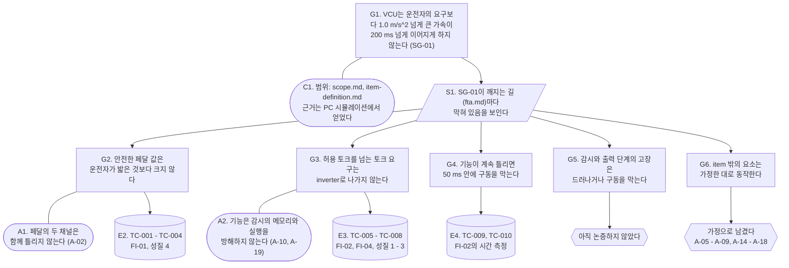

# safety case (단계 1)

`SG-01`이 지켜진다는 주장과 그 근거를 한 장으로 묶는다. 표기는 GSN을 따랐다: 주장 (goal), 주장을 나누는 방법 (strategy), 근거를 가리키는 것 (solution), 가정 (assumption).

- 이 논증은 닫히지 않았다. 감시 자신의 고장을 다루는 가지 (G5)와 item 밖의 요소에 관한 가지 (G6)는 근거 없이 남아 있다.
- 등급과 수치는 설명을 위한 가정이다. 규격의 요구사항을 만족하는지 확인한 것이 아니다.
- 근거는 PC 시뮬레이션에서 얻었다. 어떤 도구도 qualification되지 않았다.

## 1. 논증의 구조

## 2. 주장과 근거

| 주장 | fault tree의 가지 | 근거 | 기대는 가정 | 상태 |
|---|---|---|---|---|
| G2 안전한 페달 값은 운전자가 밟은 것보다 크지 않다 | E2, E3 | `TC-001` - `TC-004`, `FI-01`, 증명한 성질 4 | 두 채널은 함께 틀리지 않는다 (`A-02`). 운전자의 입력은 옳다 (`A-12`) | 근거 있음. 가정이 깨지면 성립하지 않는다 (`FI-03`) |
| G3 허용 토크를 넘는 토크 요구는 inverter로 나가지 않는다 | E6 | `TC-005` - `TC-008`, `FI-02`, `FI-04`, 증명한 성질 1 - 3 | 기능이 감시를 방해하지 않는다 (`A-10`, `A-19`) | 근거 있음. 소프트웨어의 논리에 한한다 |
| G4 기능이 계속 틀리면 50 ms 안에 구동을 막는다 | E6 | `TC-009`, `TC-010`, `FI-02`의 측정 (49 ms) | 구동 허용 신호가 끊기면 토크가 나가지 않는다 (`A-07`) | 근거 있음. 시뮬레이션의 시간이다 |
| G5 감시와 출력 단계의 고장은 드러나거나 구동을 막는다 | E7 | 없음 | - | 논증하지 않았다 |
| G6 item 밖의 요소는 가정한 대로 동작한다 | E1, E9 | 없음 | `A-05` - `A-09`, `A-14` - `A-18` | 가정으로 남겼다 |

fault tree의 E4, E5, E8 (브레이크와 기어를 잘못 읽음, 전송 중에 바뀜)은 이 논증에 가지가 없다. 단계 1에서 막지 않기로 한 것이다 ([technical-safety-concept.md](technical-safety-concept.md) 6절).

## 3. 근거의 종류와 한계

| 근거 | 말해 주는 것 | 말해 주지 않는 것 |
|---|---|---|
| 요구사항에 따른 test | 요구사항에 적은 경우에 코드가 그대로 동작한다 | 요구사항이 옳고 빠짐없다는 것 |
| fault injection | 넣은 fault에 대해 정한 대응이 정한 시간 안에 일어난다 | 넣지 않은 fault에 대한 동작 |
| 증명 | 함수 하나가 가능한 모든 입력에서 성질을 지킨다 | compiler, 실행 시간, 하드웨어, 주기를 놓치는 경우 |
| coverage | test가 코드를 빠짐없이 실행했다 | test가 옳은 것을 확인했다는 것 |
| 변이 검사 | 넣어 본 결함 10개를 test가 잡는다 | 다른 결함도 잡는다는 것 |

## 4. 이 논증을 닫으려면

- G5: 켤 때 깎기와 구동 허용 차단을 시험한다. 감시의 실행을 따로 동작하는 요소가 지켜본다. 감시가 고장인 채로 기능이 틀리는 경우를 넣어 본다 (단계 2).
- G6: inverter 쪽의 요구사항으로 넘기고, 그쪽의 근거를 받는다. 이 책의 범위 밖이다.
- A2: 실제 제어기에서 메모리 보호와 실행 시간 감시를 설정하고 시험한다. PC 시뮬레이션으로는 할 수 없다.
- 사람의 검토: 이 논증은 누구의 확인도 받지 않았다.
