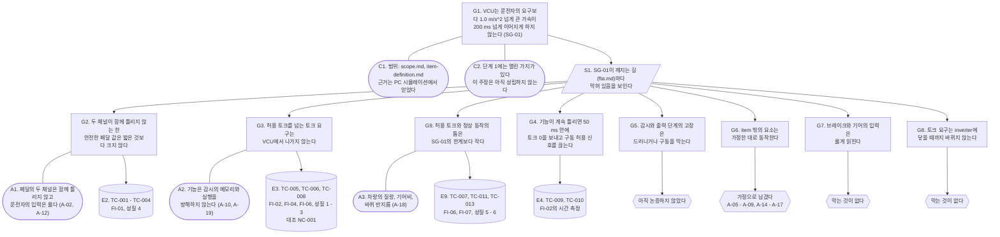

# safety case (단계 1의 논증, 단계 2에서 달라진 것을 5절에 적는다)

`SG-01`이 지켜진다는 주장과 그 근거를 한 장으로 묶는다. 표기는 GSN을 따랐다: 주장 (goal), 주장을 나누는 방법 (strategy), 근거를 가리키는 것 (solution), 가정 (assumption).

- 이 논증은 닫히지 않았다. 맨 위의 주장 (G1)은 단계 1에서 아직 성립하지 않는다. 열린 가지가 넷 있다.
  - G5: 감시와 출력 단계 자신의 고장
  - G6: item 밖의 요소 (inverter, 모터)
  - G7: 브레이크와 기어의 입력. 한 채널이고 검사하지 않는다
  - G8: VCU를 떠난 뒤의 토크 요구. 메시지의 보호가 없다
- 등급과 수치는 설명을 위한 가정이다. 규격의 요구사항을 만족하는지 확인한 것이 아니다.
- 근거는 PC 시뮬레이션에서 얻었다. 어떤 도구도 qualification되지 않았다.

## 1. 논증의 구조

## 2. 주장과 근거

| 주장 | fault tree의 가지 | 근거 | 기대는 가정 | 상태 |
|---|---|---|---|---|
| G2 두 채널이 함께 틀리지 않는 한, 안전한 페달 값은 운전자가 밟은 것보다 크지 않다 | E2, E3 | `TC-001` - `TC-004`, `FI-01`, 증명한 성질 4 | 두 채널은 함께 틀리지 않는다 (`A-02`). 운전자의 입력은 옳다 (`A-12`) | 근거 있음. 근거가 보이는 것은 "두 채널의 값 가운데 작은 쪽을 낸다"까지다. 그것이 밟은 것보다 크지 않다는 것은 가정에서 나온다. 가정이 깨지면 성립하지 않는다 (`FI-03`) |
| G3 허용 토크를 넘는 토크 요구는 VCU에서 나가지 않는다 | E6 | `TC-005`, `TC-006`, `TC-008`, `FI-02`, `FI-04`, `FI-06`, 증명한 성질 1 - 3. 대조 `NC-001` | 기능이 감시를 방해하지 않는다 (`A-10`, `A-19`) | 근거 있음. 소프트웨어의 논리에 한한다 |
| G9 허용 토크와 정상인 기능의 토크 요구의 틈은 `SG-01`의 한계보다 작다 | E10 | `TC-007` (틈은 5 Nm. 무작위 운전 10만 주기), `TC-011` (입력이 바뀌어 토크를 올리는 동안에도 5 Nm), `TC-013`과 `FI-07` (입력이 거듭 바뀌는 동안 기능이 틀린 경우), 증명한 성질 5와 6, `FI-06`의 측정 | 차량의 가정값 (`A-18`). 기능, 감시, 출력 단계가 주기마다 순서대로 실행된다 (G5). 출력 단계가 기억하는 지난 출력이 옳다 | 근거 있음. 55 Nm라는 한계는 가정한 차량에서 계산한 값이다. 단계 1에서는 근거가 입력이 한 번 바뀌는 경우까지였다. 입력이 70 ms보다 빨리 거듭 바뀌는 간헐 고장이 기능의 고장과 겹치면 `SG-01`을 어겼다. 단계 2에서 허용 토크가 오르는 속도에 상한을 두어 닫았다 (`SWR-13`). 남은 것: 지난 출력이 틀리고 기능의 고장이 겹친 경우. 70 ms까지다 |
| G4 기능이 계속 틀리면 50 ms 안에 토크 0을 보내고 구동 허용 신호를 끊는다 | E6 | `TC-009`, `TC-010`, `FI-02`의 측정 (49 ms) | - | 근거 있음. 49 ms는 VCU의 출력이 바뀌는 때까지다. 모터의 토크가 내려가는 것은 108 ms 뒤이고, 그것은 가정 `A-07`, `A-16`과 plant model에서 나온 값이다 |
| G5 감시와 출력 단계의 고장은 드러나거나 구동을 막는다 | E7 | 없음 | - | 논증하지 않았다 |
| G6 item 밖의 요소는 가정한 대로 동작한다 | E1 | 없음 | `A-05` - `A-09`, `A-14` - `A-17` | 가정으로 남겼다 |
| G7 브레이크와 기어의 입력은 옳게 읽힌다 | E4, E5 | 없음 | - | 막는 것이 없다. 한 채널이고 검사하지 않는다 |
| G8 토크 요구는 inverter에 닿을 때까지 바뀌지 않는다 | E8 | 없음 | - | 막는 것이 없다. 메시지의 보호가 없다 |

G3과 G9는 짝이다. G3만으로는 `SG-01`이 따라 나오지 않는다. 허용 토크가 운전자의 요구보다 훨씬 크면, 허용 토크를 넘지 않는 토크도 `SG-01`을 어긴다. G9가 그 틈을 막는다.

G9는 두 번 틀렸었다. 처음에는 주장 자체가 없었다. 더한 뒤에도 근거 (`TC-007`)가 주장보다 좁았다. 기능이 제동 우선이 걸린 상태를 기억하고 있었고, test의 격자에는 브레이크를 밟았다 놓는 순서가 없었다. 그 상태에서 틈은 5 Nm가 아니라 허용 토크 전부였다. 기능에서 그 상태를 빼고 `TC-011`에 입력이 바뀌는 경우 열 가지를 넣었다. 세 번째도 근거가 주장보다 좁은 것이었다. 입력이 한 번 바뀌는 경우만 보았고, 거듭 바뀌면 틈이 이어졌다. 단계 2에서 감시의 허용 토크가 오르는 속도에 상한을 두고 (`SWR-13`), 근거를 test에서 모든 입력에 대한 증명으로 넓혔다.

## 3. 근거의 종류와 한계

근거는 모두 PC 시뮬레이션에서 나왔다. 그래서 아래 표는 "sim이 보이는 것과 못 보이는 것"이기도 하다.

| 근거 | 말해 주는 것 | 말해 주지 않는 것 |
|---|---|---|
| 요구사항에 따른 test | 요구사항에 적은 경우에 코드가 그대로 동작한다 | 요구사항이 옳고 빠짐없다는 것 |
| fault injection | 넣은 fault에 대해 정한 대응이 정한 주기 안에 일어난다 | 넣지 않은 fault에 대한 동작. 실제 시간 |
| 대조 test (`NC-001`) | 감시를 빼면 같은 fault가 `SG-01`을 어긴다. 그래서 지켜진 것은 감시가 한 일이다 | 다른 fault에서도 그렇다는 것 |
| 증명 | 함수 하나가 가능한 모든 입력에서 성질을 지킨다 | compiler, 실행 시간, 하드웨어, 주기를 놓치는 경우 |
| coverage | test가 코드를 빠짐없이 실행했다 | test가 옳은 것을 확인했다는 것 |
| 변이 검사 | 넣어 본 결함 54개를 test가 잡는다 | 다른 결함도 잡는다는 것. 처음의 10개는 모두 잡았지만 검토자가 21개를 더 넣자 4개를 놓쳤다 |
| 차량 수준의 측정 | 가정한 plant model에서 가속의 차이가 한계 안에 있다 | 실제 inverter, 모터, 차량에서의 값 |

## 4. 이 논증을 닫으려면

- G5: 켤 때 깎기와 구동 허용 차단을 시험한다. 감시의 실행을 따로 동작하는 요소가 지켜본다. 감시가 고장인 채로 기능이 틀리는 경우를 넣어 본다 (단계 2).
- G6: inverter 쪽의 요구사항으로 넘기고, 그쪽의 근거를 받는다. 이 책의 범위 밖이다.
- G7: 브레이크와 기어의 신호를 검사한다. 예: 신호를 둘로 받는다, 다른 신호와 견준다 (단계 2).
- G8: 토크 요구 메시지에 검사 정보를 붙이고 inverter가 검사한다 (단계 2).
- A2: 실제 제어기에서 메모리 보호와 실행 시간 감시를 설정하고 시험한다. PC 시뮬레이션으로는 할 수 없다.
- 사람의 검토: 이 논증은 사람의 확인을 받지 않았다. 두 역할의 에이전트가 검토했고, 그 검토에서 G9와 G7, G8이 빠져 있다는 것이 드러났다 (`reviews/2026-11-22-stage1/`).

## 5. 단계 2에서 달라지는 것

1절부터 4절은 단계 1의 논증이다. 단계 2의 구현이 끝나면 이 문서를 다시 쓴다. 그때까지 달라진 것과 달라질 것을 여기에 모은다.

먼저 적어 둘 것이 있다. G1은 단계 2가 끝난 뒤에도 성립하지 않는다. 기어의 값이 틀린 경우 (N이나 P인데 D로 읽는다)가 막는 것 없는 단일 고장으로 남기 때문이다. 기어 신호는 한 채널이고, 견줄 다른 신호가 예제에 없다. 단계 2가 하는 일은 열린 가지를 모두 닫는 것이 아니라, 닫을 수 있는 것을 닫고 남는 것을 정확히 적는 것이다.

| 주장 | 단계 1 | 단계 2에서 더하는 것 | 지금 | 더한 뒤에도 남는 것 |
|---|---|---|---|---|
| G9 틈 | 입력이 한 번 바뀌는 경우까지 | 허용 토크가 오르는 속도의 상한 (`SWR-13`) | 했다. 2절의 표를 고쳤다 | 지난 출력이 틀리고 기능의 고장이 겹친 경우 |
| G2 페달 | 간헐 고장은 판정하지 않는다 | 간헐 고장의 판정 (`SWR-14`) | 했다. 근거: `TC-014`, `FI-08` | 실패가 100주기에 10번 이하인 간헐 고장. 두 채널이 함께 틀리는 경우 |
| G5 감시 자신 | 논증하지 않았다 | 실행의 순서와 횟수 (`SWR-20`), 구동 허용 신호의 되읽기 (`SWR-21`), 뒤집은 사본 (`SWR-22`), 고장 기록 (`SWR-23`) | 구현 예정 | 허용 토크의 계산이 틀린 경우 (검증에 기댄다). 독립은 하드웨어에 대한 가정이다 |
| G6 item 밖 | 가정으로 남겼다 | inverter가 알린 토크를 견준다 (`SWR-19`) | 구현 예정 | 알리는 값이 실제와 같은 원인으로 틀리는 경우 |
| G7 브레이크와 기어 | 막는 것이 없다 | 브레이크의 접점 둘 (`SWR-15`), 방향의 바뀜에 속도 조건 (`SWR-16`) | 구현 예정 | 기어의 값이 틀린 경우. 닫지 않는다. 속도가 0에 얼어붙는 경우 (새로 생기는 가지) |
| G8 전송 | 막는 것이 없다 | 메시지의 보호 (`SWR-17`, `SWR-18`) | 구현 예정 | inverter가 검사한다는 가정 |

새로 생기는 주장도 있다. `SG-02` (고장이 없으면 구동 토크를 줄이거나 끊지 않는다)의 논증이다. 지금 근거가 있는 것은 "정상인 기능의 토크 요구는 깎이지 않는다" 하나다 (증명한 성질 6, `TC-007`의 무작위 운전 10만 주기). 이 safety goal은 hazard `H-04`의 일부만 다루므로, 논증도 그만큼만 말한다 ([hara.md](hara.md)).
