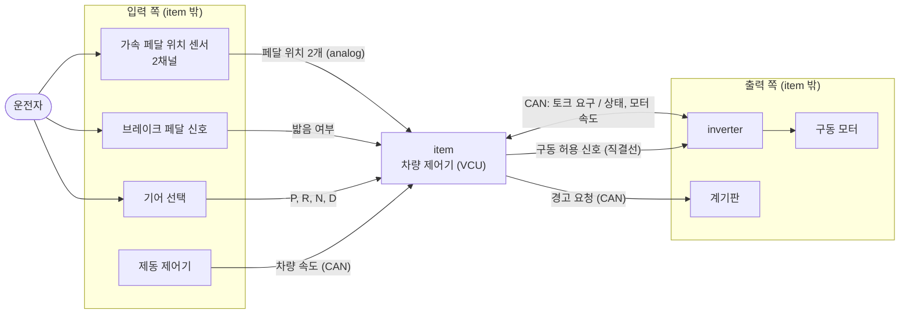

# 관통 예제의 범위: 전기차의 구동 토크 제어

이 문서는 예제가 무엇을 다루고 무엇을 다루지 않는지를 정한다. item definition (`item-definition.md`)은 이 문서를 바탕으로 2장과 6장에서 쓴다.

- 예제의 등급과 수치는 설명을 위한 가정이다. 실제 제품에 쓸 수 없다.
- 예제의 산출물은 ISO 26262의 용어와 흐름을 따르지만, 규격의 요구사항을 만족하는지 확인한 것이 아니다.
- 같은 주제를 다룬 미국 정부의 보고서 (문서 id `nhtsa-etc-ev-fsa`, 아래에서 "보고서")와 견주어 썼다. 보고서가 따른 규격은 ISO 26262의 2011년 최종 초안 (FDIS)이다. 보고서도 자기 요구사항이 예시일 뿐이라고 밝힌다.

## 1. item이 하는 일

item은 차량 제어기 (VCU, vehicle control unit) 하나다. 보고서는 같은 역할의 제어기를 EV PCM (EV powertrain control module)이라고 부른다.

| 기능 | 내용 |
|---|---|
| 토크 요구 계산 | 가속 페달 위치와 기어 선택으로 구동 토크 요구의 크기와 방향을 정한다 |
| 제동 우선 (brake override) | 가속 페달과 브레이크 페달을 함께 밟으면 가속 페달의 요구를 따르지 않고 토크 요구를 낮춘다 |
| 토크 요구 전송 | 토크 요구를 CAN으로 inverter에 보낸다 |
| 감시와 고장 대응 | 입력에서 허용 토크를 따로 계산해 토크 요구와 비교한다. 벗어나면 토크를 제한하거나 구동을 막는다. 고장을 운전자에게 알리도록 요청한다 |

VCU 안의 소프트웨어는 기능과 감시로 나눈다. 이것은 예제의 설계 선택이다. 구조는 11장에서 정한다.

## 2. 경계

- item 안: VCU의 하드웨어와 소프트웨어.
- item 밖: 센서, 제동 제어기, inverter, 구동 모터, 계기판, 고전압 배터리. 이들에 대해 기대하는 것은 4절의 가정으로 적는다.
- 차량 속도와 inverter의 상태는 받지만, 단계 1의 소프트웨어는 쓰지 않는다. 기능이 속도에 따라 토크를 줄이면 감시도 속도를 봐야 하기 때문이다 ([technical-safety-concept.md](technical-safety-concept.md) 3절).
- 구동 허용 신호는 CAN과 별개인 선이다. VCU가 이 신호를 끊으면 inverter가 토크를 내지 않는다고 가정한다. 보고서의 구성도에도 제어기가 inverter의 제어부를 거치지 않고 모터 구동을 막는 경로가 있다.

### 보고서와 다른 점

| 항목 | 보고서 | 예제 |
|---|---|---|
| 경계 | 페달부터 inverter와 그 센서까지. 모터의 토크 생성부터 뺀다 | VCU만. inverter부터는 가정으로 받는다 |
| 제어기 이름 | EV PCM, TICM (inverter의 제어부) | VCU, inverter |
| 다른 시스템의 토크 요구 | cruise control, 운전자 보조 시스템의 요구를 받아 조정한다 | 받지 않는다 |
| 제동 우선 | 범위 안의 기능 | 범위 안의 기능 |
| 회생 제동 | 범위 밖 | 없다. 페달을 놓으면 토크 요구는 0이다 |
| creep (페달을 놓아도 천천히 움직이는 동작) | 소프트웨어로 흉내 낸다고 설명한다 | 없다 |
| 감전 | hazard에 넣는다 | 다루지 않는다 |

경계가 다르므로 보고서의 요구사항 가운데 inverter 쪽 몫은 예제에서 가정이 된다.

## 3. hazard

HARA에 올리는 hazard는 다섯 개다. 책 전체에서 끌고 가는 것은 `H-01` 하나이고, 나머지는 6장의 표와 7장의 safe state 논의에만 쓴다.

| ID | hazard | 뜻 | 보고서의 hazard | 보고서의 ASIL |
|---|---|---|---|---|
| `H-01` | 의도하지 않은 가속 | 운전자가 요구하지 않았거나 요구한 것보다 크게 가속한다 | H1, H1.a | D (H1.a는 B) |
| `H-02` | 감속 부족 | 가속 페달을 덜 밟거나 놓았는데 그만큼 감속하지 않는다 | H5 | C |
| `H-03` | 잘못된 방향으로 움직임 | 운전자가 고른 방향과 반대로 가속한다 | H3 | C |
| `H-04` | 구동력의 감소나 상실 | 운전자가 요구하지 않았는데 감속하거나 구동력을 잃는다 | H4 | D |
| `H-05` | 구동 부족 | 가속을 요구했는데 그만큼 가속하지 않는다 | H2 | C |

- 보고서의 ASIL은 참고로 적었다 `(2차 자료)`. 기준 판은 ISO 26262 FDIS 2011이다. 예제의 등급은 6장에서 예제의 가정으로 다시 매긴다.
- 보고서는 H2와 H5의 등급이 분석자마다 달랐다고 적는다.
- 정지 상태에서의 의도하지 않은 출발은 따로 두지 않고 `H-01`의 운전 상황 하나로 다룬다. 보고서가 H1.a에 준 B는 차량 속도가 0일 때만 동작하는 기능에 대한 등급이다. 구동 토크 제어는 정지에서 고속까지 동작하므로 그 등급을 그대로 쓸 수 없다. 6장에서 운전 상황에 따라 등급이 달라지는 예로 쓴다.
- 주행 중에 반대 방향의 토크가 걸리면 차가 급히 감속한다. 이 경우는 `H-03`이 아니라 `H-04`로 본다.
- `H-04`와 `H-05`를 넣은 것은 고장 대응이 새 hazard를 만들 수 있어서다. 토크를 줄이거나 끊는 대응은 겉으로는 이 둘과 같다.
- 다루지 않는 hazard: 감전, 운전자 보조 시스템의 요구보다 운전자의 요구를 따르는 것 (보고서의 H6, H7). 예제에는 그런 입력과 고전압 제어가 없다.

## 4. 가정

item 밖의 요소와 사용 조건에 대한 가정이다. 가정이 깨지면 분석을 다시 해야 한다. 값은 6장과 7장에서 정한다.

| ID | 가정 |
|---|---|
| `A-01` | 구동 모터는 하나이고 감속기는 단수다 |
| `A-02` | 가속 페달 위치 센서는 서로 독립된 두 채널이다. 전원과 접지도 따로다 |
| `A-03` | 차량 속도는 제동 제어기가 CAN으로 보낸다. 값이 옳은지는 보내는 쪽이 책임진다. VCU는 값이 제때 왔는지와 범위 안인지만 본다 |
| `A-04` | 브레이크 페달 신호와 기어 선택 신호는 VCU가 직접 읽는다 |
| `A-05` | inverter는 받은 토크 요구를 정해진 시간과 오차 안에서 낸다 |
| `A-06` | inverter는 토크 요구 메시지가 끊기거나 손상된 것을 알아채면 스스로 토크를 내지 않는 상태로 간다 |
| `A-07` | 구동 허용 신호가 끊기면 inverter는 VCU의 소프트웨어와 무관하게 토크를 내지 않는다. 그때 원치 않는 제동 토크가 생기지 않게 하는 것은 inverter의 몫이다 `(확인 필요)` |
| `A-08` | inverter는 자기 고장과 모터 속도를 VCU에 알린다 |
| `A-09` | 제동 시스템은 구동 계통과 따로 동작한다. 운전자는 브레이크로 차를 멈출 수 있다 |
| `A-10` | VCU의 하드웨어에는 주 MCU와 따로 동작하는 감시 요소 (예: 외부 watchdog)가 있고, 이 요소가 구동 허용 신호를 끊을 수 있다 |
| `A-11` | VCU의 전원이 끊기면 구동 허용 신호도 끊긴다 |
| `A-12` | 운전자의 입력은 옳다. 페달을 잘못 밟는 경우는 다루지 않는다 |
| `A-13` | 다른 시스템은 토크를 요구하지 않는다. 회생 제동과 creep은 없다 |

`A-07`과 `A-10`은 PC 시뮬레이션으로 보일 수 없다. 감시의 독립성에 관한 주장은 이 두 가정에 기댄다.

## 5. 고장이 났을 때 가는 상태

safe state는 "토크 0" 하나가 아니다. 토크를 끊으면 `H-04`가 되기 때문이다. 보고서도 고장마다 safe state를 고르고 토크 0을 다른 상태를 보장할 수 없을 때의 수단으로 둔다. 예제는 세 단계를 쓴다.

| 단계 | 상태 | 쓰는 때의 예 |
|---|---|---|
| 1 | 토크 요구를 제한한다 (크기 또는 변화율) | 페달 센서 한 채널의 고장 |
| 2 | 토크 요구를 0으로 한다 | 페달 위치를 믿을 수 없음 |
| 3 | 구동 허용 신호를 끊는다 | VCU 자신의 계산을 믿을 수 없음 |

- 단계 1에서는 표의 1번을 구현하지 않았다. 페달 센서 한 채널의 고장도 토크 요구 0으로 간다.
- 어느 고장에 어느 단계를 쓰는지와 시간 조건은 7장에서 정한다.
- 보고서는 시간 조건을 거의 모두 정하지 않고 남겼다. 값이 나오는 곳은 두 군데이고, 둘 다 업계의 관행으로 200 ms를 든다. 그 200 ms는 고장이 난 때부터 safe state로 갈 때까지의 시간이다. 예제가 쓰는 시간 값은 설명을 위한 가정이다.

## 6. PC 시뮬레이션의 범위

- VCU의 소프트웨어만 실제 코드다. 센서, inverter, 모터, 차량은 plant model이다.
- 소프트웨어는 HAL의 interface만 부른다: analog 입력, digital 입력, CAN 송수신, 구동 허용 출력, 시간.
- fault는 HAL의 뒤에서만 넣는다.
- 시뮬레이션이 보이는 것은 논리다. 실행 시간, 메모리 보호, 감시 요소의 독립성은 보이지 못한다.

## 7. 다루지 않는 것

- inverter와 모터의 제어, 고전압 배터리, 충전, 냉각
- 회생 제동, creep, cruise control, 운전자 보조 시스템의 토크 요구
- 둘 이상의 고장이 겹치는 경우. 다만 감시가 숨은 고장을 놓치는 경우는 8장에서 본다
- cybersecurity. 23장에서 경계만 다룬다

## 8. ID

접두어는 [example/README.md](../../README.md)의 표를 따른다. 이 문서가 정한 것은 `H-01` - `H-05`와 `A-01` - `A-13`이다.

## 9. 근거

문서 id `nhtsa-etc-ev-fsa` (DOT HS 812 656). 쪽은 PDF 파일의 몇 번째 쪽인지다.

| 내용 | 쪽 |
|---|---|
| 요구사항이 예시라는 것 | 13, 17 |
| 범위 안과 밖 | 27-28 |
| 전기차와 내연기관 차량의 차이 (creep, 방향) | 30-31 |
| 구성도 | 32 |
| 제동 우선의 동작, inverter의 제어부를 거치지 않는 경로 | 34-35 |
| 회생 제동이 범위 밖이라는 것 | 28, 36 |
| hazard의 정의 | 37 |
| hazard별 ASIL과 주석 | 57 |
| safety goal | 58 |
| safe state의 종류, hazard와의 차이 | 67-68 |
| 시간 값 200 ms | 80-81 |
| 따른 규격의 판 | 107 |
