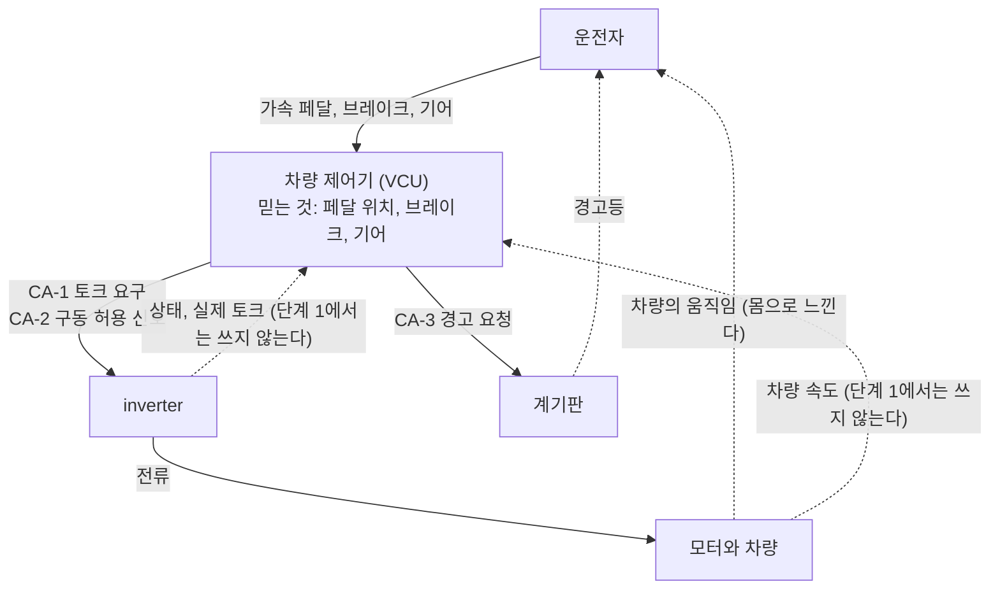

# STPA: 제어의 눈으로 본 분석

누가 무엇을 제어하고 무엇을 되돌려 받는지를 그리고, 명령이 위험해지는 경우와 그 까닭을 찾는다. 대상은 단계 1의 설계다. [fmea.md](fmea.md)가 "요소가 틀리면"을 물었다면, 이 문서는 "아무것도 고장 나지 않았는데 명령이 위험해지는 경우"까지 묻는다.

- 등급과 수치는 설명을 위한 가정이다. 규격의 요구사항을 만족하는지 확인한 것이 아니다.
- 방법은 STPA Handbook (Leveson과 Thomas, 2018)의 네 단계를 따랐다. 넷째 단계 (loss scenario)는 `SG-01`에 닿는 것만 했다.

## 1. 목적

- 잃으면 안 되는 것: 사람이 다치거나 죽는 것.
- 시스템 수준의 hazard: [scope.md](scope.md)의 `H-01` - `H-05`. 이 문서가 끝까지 따라가는 것은 `H-01` (의도하지 않은 가속)이다.

## 2. control structure

실선은 명령이고 점선은 feedback이다. 그림만으로 보이는 것이 둘 있다.

- VCU는 제어하는 대상에서 아무것도 되돌려 받지 않는다. 토크 요구를 보내고, 그대로 되었다고 믿는다. inverter가 알려 주는 실제 토크와 차량 속도는 받을 수 있지만 쓰지 않는다.
- 구동 계통의 바깥 고리를 닫는 것은 운전자다. 차가 뜻과 다르게 움직이면 운전자가 페달을 놓거나 브레이크를 밟는다. 그 입력이 다시 VCU로 온다. 그래서 VCU가 브레이크와 페달을 옳게 읽는다는 것이 운전자의 대응이 듣는 조건이다.

## 3. unsafe control action

상황은 VCU가 믿는 상태가 아니라 실제의 상태로 적었다.

| 번호 | 명령 | 유형 | unsafe control action | hazard |
|---|---|---|---|---|
| UCA-1 | 토크 요구 | 내리지 않는다 | 운전자가 페달을 밟았고 고장이 없는데 토크를 요구하지 않는다 | `H-04`, `H-05` |
| UCA-2 | 토크 요구 | 내린다 | 운전자가 페달을 놓았는데 0보다 큰 토크를 요구한다 | `H-01` |
| UCA-3 | 토크 요구 | 내린다 (값이 넘친다) | 운전자가 밟은 것보다 큰 토크를 요구한다 | `H-01` |
| UCA-4 | 토크 요구 | 내린다 | 운전자가 브레이크를 밟고 있는데 토크를 요구한다 | `H-01` |
| UCA-5 | 토크 요구 | 내린다 | 기어가 P나 N인데 토크를 요구한다 | `H-01` |
| UCA-6 | 토크 요구 | 내린다 (방향이 틀리다) | 운전자가 고른 방향과 반대의 토크를 요구한다 | `H-03`, `H-04` |
| UCA-7 | 토크 요구 | 늦다 | 운전자가 페달을 놓았는데 토크 요구를 늦게 줄인다 | `H-01`, `H-02` |
| UCA-8 | 토크 요구 | 너무 오래 이어진다 | 고장을 알아챈 뒤에도 토크 요구를 이어 간다 | `H-01` |
| UCA-9 | 구동 허용 신호 | 내리지 않는다 (끊지 않는다) | 기능의 고장으로 고정했는데 구동 허용 신호를 끊지 않는다 | `H-01` |
| UCA-10 | 구동 허용 신호 | 내린다 (끊는다) | 고장이 없는데 주행 중에 구동 허용 신호를 끊는다 | `H-04` |
| UCA-11 | 경고 요청 | 내리지 않는다 | 고장을 판정했는데 경고를 요청하지 않는다 | 모든 hazard (운전자가 대응할 기회를 잃는다) |

UCA-1과 UCA-10은 `SG-01`의 반대쪽이다. 고장에 대응해 토크를 끊는 mechanism은 모두 이 둘을 일으킬 수 있다. `SG-01`을 지키려고 더하는 것이 `H-04`를 만든다는 것이 표에서 보인다.

## 4. 왜 일어나는가 (`H-01`에 닿는 것)

Handbook은 controller가 위험한 명령을 내리는 까닭을 넷으로 든다. UCA-2, 3, 4, 5, 7, 8에 대어 본다.

### 4.1 controller 자신의 고장

| 번호 | 시나리오 | 단계 1의 상태 | 조치 |
|---|---|---|---|
| LS-01 | MCU나 memory가 고장 나 토크 요구가 틀린 값이 된다 | 가정 `A-10` (따로 동작하는 감시 요소)에 기댄다 | M5, M7. 나머지는 하드웨어에 대한 가정 |
| LS-02 | task가 실행되지 않아 지난 주기의 값이 나간다 | 막는 것이 없다 | M5 |

### 4.2 algorithm의 잘못

| 번호 | 시나리오 | 단계 1의 상태 | 조치 |
|---|---|---|---|
| LS-03 | 기능의 코드에 결함이 있어 큰 토크를 요구한다 | 출력 단계가 깎는다 | - |
| LS-04 | 감시가 허용하는 범위가 정상 동작보다 넓다. 그 사이에서 기능이 틀리면 지나간다 | 입력이 그대로이면 5 Nm. 입력이 거듭 바뀌면 열린다 | D2 |
| LS-05 | 감시나 출력 단계의 코드에 결함이 있다 | 검증에 기댄다 | 증명을 넓힌다 |

### 4.3 다른 controller에서 온 입력

| 번호 | 시나리오 | 단계 1의 상태 | 조치 |
|---|---|---|---|
| LS-06 | 다른 시스템이 토크를 요구한다 | 가정 `A-13`: 다른 시스템은 토크를 요구하지 않는다 | 없다. cruise control이나 운전자 보조 기능을 더하면 이 가정이 깨진다 |

### 4.4 믿음이 실제와 어긋난다 (process model)

VCU는 센서로 세상을 믿는다. 믿음마다 그것이 틀릴 수 있는 길을 본다.

| 번호 | VCU가 믿는 것 | 믿음이 틀리는 길 | 단계 1의 상태 | 조치 |
|---|---|---|---|---|
| LS-07 | 페달이 이만큼 밟혔다 | 한 채널이 틀리다 | 두 채널을 견준다 | - |
| LS-08 | 페달이 이만큼 밟혔다 | 두 채널이 함께 틀리다 | 가정 `A-02`. `FI-03`은 알아채지 못한다는 것을 보인다 | [dfa.md](dfa.md)의 D-1 |
| LS-09 | 페달이 이만큼 밟혔다 | 한 채널이 가끔 틀리다 | 판정하지 않는다 | M9 |
| LS-10 | 브레이크를 밟지 않았다 | 스위치가 "놓음"에 고착되었다 | 막는 것이 없다 | M1 |
| LS-11 | 기어가 D다 | 기어 신호가 틀리다 | 막는 것이 없다 | 닫지 않는다 |
| LS-12 | 지난 주기에 보낸 토크 요구대로 모터가 돌고 있다 | 메시지가 전송 중에 바뀌었다. inverter가 요구와 다르게 낸다 | 되돌려 받는 것이 없다 | M3, M4 |
| LS-13 | 구동 허용 신호를 끊었으니 구동이 멈췄다 | 신호가 고착되어 끊기지 않았다 | 되돌려 받는 것이 없다 | M6 (되읽기) |
| LS-14 | 고장을 판정한 적이 없다 | reset이 고장 상태를 지웠다 | RAM에만 있다 | M8 |

## 5. 이 분석이 찾은 것

FMEA의 표와 견주면 겹치는 줄이 많다. 따로 얻은 것은 셋이다.

- LS-12와 LS-13은 고장의 방식으로 찾은 것이 아니라 그림에서 찾았다. VCU는 명령을 내리고 결과를 확인하지 않는다. 앞에 내린 명령이 제대로 실행되었다고 가정하는 것은 Handbook이 흔한 잘못으로 드는 것이다. M4와 M6이 그 feedback을 쓴다.
- LS-04는 어느 요소의 고장도 아니다. 기능도 감시도 저마다 요구사항대로인데 둘의 맞물림이 틀린 경우다. 단계 1의 가장 무거운 결함이 이 종류였다.
- UCA-1과 UCA-10은 `SG-01`만 보는 fault tree에는 나오지 않는다. 고장 대응의 대가를 따지려면 반대쪽 명령을 함께 적어야 한다.

## 6. 이 분석이 못 본 것

- control structure는 기능의 관계를 그린다. 두 채널이 같은 ADC를 쓴다거나 기능과 감시가 같은 MCU에 있다는 것은 그림에 없다. [dfa.md](dfa.md)에서 본다.
- 넷째 단계를 `H-01`에 대해서만 했다. UCA-1과 UCA-10의 원인은 따지지 않았다.
- 상황 (context)을 손으로 골랐다. 미국 정부의 보고서는 상황 변수의 조합을 모두 늘어놓고 줄였다 (Becker 외, 2020). 이 문서는 그렇게 하지 않았으므로 빠진 조합이 있을 수 있다.
