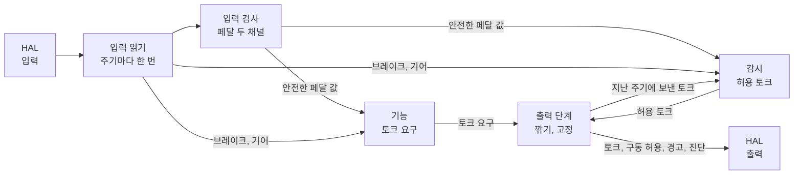

# technical safety concept

[functional-safety-concept.md](functional-safety-concept.md)의 요구사항을 어떻게 만들지를 정한다: 구조, 한계값, 시간, 가정. 요구사항의 원본은 [requirements.yaml](requirements.yaml)이다.

- 등급과 수치는 설명을 위한 가정이다. 규격의 요구사항을 만족하는지 확인한 것이 아니다.
- 이 구조는 이 책의 설계다. 특정한 업계 표준 구조를 옮긴 것이 아니다.

## 1. 구조

| 요소 | 하는 일 | `SG-01`의 요구사항 |
|---|---|---|
| 입력 읽기 | 주기마다 한 번 입력을 읽어 구조체 하나에 담는다 | 받는다 |
| 입력 검사 | 페달 두 채널을 같은 단위로 바꾸고 검사해 안전한 페달 값을 낸다 | 받는다 |
| 기능 | 안전한 페달 값, 브레이크, 기어로 토크 요구를 만든다 | 받지 않는다 |
| 감시 | 안전한 페달 값, 브레이크, 기어, 지난 주기에 보낸 토크로 허용 토크를 계산한다 | 받는다 |
| 출력 단계 | 토크 요구를 허용 토크로 깎고, 계속 넘으면 고정하고 구동 허용 신호를 끊는다 | 받는다 |

이렇게 나눈 이유와 대가

- 감시는 기능을 다시 계산하지 않는다. 운전자의 입력에서 토크의 상한을 계산하고, 그 상한이 오르는 속도를 지난 주기에 실제로 보낸 토크에서 센다. 감시가 단순해야 믿을 수 있다.
- 상한만 계산하는 감시에는 조건이 붙는다. 상한과 정상인 기능의 토크 사이의 틈이 `SG-01`의 한계보다 작아야 한다. 틈이 크면 기능이 틀려 상한까지 요구해도 감시는 알아채지 못한다. 이 조건은 3절에 있다.
- 기능과 감시가 같은 안전한 페달 값을 쓴다. 그래서 고장이 없으면 토크 요구는 허용 토크를 넘지 않는다. 페달 고장이면 기능도 0을 요구한다.
- 대가: 입력 검사는 기능과 감시가 함께 기대는 지점이다. 감시는 페달을 읽는 길의 고장을 잡지 못한다. 감시가 따로 계산하는 것은 코드를 나눈 것이지 입력을 나눈 것이 아니다.
- 출력 단계가 넘는 토크를 깎으면 기능의 결함이 겉으로 드러나지 않을 수 있다. 그래서 깎은 횟수를 진단 메시지로 내보내고, 깎는 주기가 이어지면 기능의 고장으로 본다.
- 감시가 지켜보기만 하고 넘는 상태가 이어질 때 끊는 구조도 있다. 그 구조에서는 판정이 날 때까지 기능의 값이 그대로 나간다.

## 2. technical safety requirement

| ID | 요구사항 | 위 |
|---|---|---|
| `TSR-01` | 두 채널의 전압을 페달 위치 (0-1000)로 바꾼다. 채널마다 전압의 범위를 검사하고, 두 채널의 차이가 50을 넘는지 검사한다 | `FSR-01` |
| `TSR-02` | 검사에 실패한 주기가 3번 이어지면 페달 고장으로 판정하고, 그 주기의 출력부터 반영한다. 한 주기라도 통과하면 다시 센다. 가장 나쁜 경우 30 ms다 | `FSR-01`, `FSR-03` |
| `TSR-03` | 허용 토크는 둘 가운데 작은 값이다: 안전한 페달 값에 비례하는 상한 (후진은 그 40%, 오차 5 Nm를 더하고 최대 토크에서 자른다)과, 지난 주기에 보낸 토크의 크기에 25 Nm를 더한 값. `FSR-05`의 조건에서는 0이다. 허용 토크와 정상인 기능의 토크 요구는 두 방향으로 맞물려야 한다. 입력이 바뀌어 기능이 토크를 올리는 동안에도 그렇다 (3절) | `FSR-02`, `FSR-05` |
| `TSR-04` | 출력 단계는 10 ms마다 토크 요구를 허용 토크와 기어가 정한 방향 안으로 깎아서 보낸다 | `FSR-02` |
| `TSR-05` | 깎인 주기가 5번 이어지면 기능의 고장으로 고정한다. 그 주기에 토크 0을 보내고 구동 허용 신호를 끊는다. 한 주기라도 깎이지 않으면 다시 센다. 가장 나쁜 경우 50 ms다 | `FSR-04` |
| `TSR-06` | 페달 고장이나 기능의 고장을 판정한 주기에 경고 요청을 보낸다 | `FSR-03`, `FSR-04` |
| `TSR-07` | 켠 뒤에는 입력 검사를 3주기 이어서 통과하기 전까지 토크를 허용하지 않는다. 구동 허용 신호도 끊어 둔다 | `FSR-01` |
| `TSR-08` | 최근 100주기 (1초) 가운데 검사에 실패한 주기가 10번을 넘으면 페달 고장으로 판정한다. 이어지지 않고 가끔 실패하는 간헐 고장을 잡는다. 두 값은 임시다 | `FSR-01`, `FSR-03` |

세는 규칙: N번째로 이어서 고장을 본 주기에, 그 주기의 출력부터 반영한다. 고장이 주기와 주기 사이에 나면 다음 주기까지 기다리므로, 가장 나쁜 시간은 N x 10 ms다.

간헐 고장: 실패와 통과가 번갈아 나오면 N번 이어지지 못해 이 규칙으로는 판정되지 않는다. 단계 1은 그것을 한계로 두었다. 기능이 정상이면 그 주기마다 깎기와 작은 쪽 고르기가 막으므로 `SG-01`은 지켜지지만, 경고 없이 고장이 숨었고, 기능의 고장과 겹치면 `SG-01`도 지켜지지 않았다. 단계 2에서 둘을 따로 닫았다.

- 겹쳤을 때의 틈은 허용 토크가 오르는 속도의 상한 (`SWR-13`)이 막는다 (3절).
- 숨는 것은 간헐 고장의 판정 (`TSR-08`, `SWR-14`)이 막는다. 페달 검사의 실패가 최근 100주기 가운데 10번을 넘으면 페달 고장이다. 이 판정은 `SG-01`의 시간 (200 ms) 안에 나지 않는다. 80 ms마다 한 주기씩 끊기는 선은 처음 끊긴 뒤 800 ms에 판정된다 (`FI-08`). 그래서 `SG-01`을 지키는 일은 맡기지 않았다. 맡는 것은 발견과 경고다.
- 남은 한계: 실패가 100주기에 10번 이하인 간헐 고장은 판정하지 않는다. 출력 단계의 깎기가 가끔 일어나는 경우 (기능이 가끔 틀림)는 여전히 이어지는 횟수로만 센다.

이 규칙은 검토에서 합의되지 않았고 저자가 정했다: 이어지는 횟수를 그대로 세고, 간헐 고장의 판정을 따로 더한다 (`notes/disputes.md`의 1번).

## 3. 값

| 이름 | 값 | 뜻 |
|---|---|---|
| 제어 주기 | 10 ms | 입력 읽기부터 출력까지 한 번 |
| 최대 토크 | 250 Nm | 모터가 낼 수 있는 토크 |
| 페달 놓음 구간 | 30 아래 (3%) | 이 아래는 페달을 놓은 것으로 본다 |
| 두 채널의 차이 | 50 (5%) | 이것을 넘으면 불일치 |
| 채널 1의 전압 범위 | 250-4750 mV | 벗어나면 단선이나 단락 |
| 채널 2의 전압 범위 | 125-2375 mV | 벗어나면 단선이나 단락 |
| 허용 오차 | 5 Nm | 최대 토크의 2% |
| 후진의 비율 | 40% | 후진에서 기능이 내는 토크와 감시가 허용하는 토크는 전진의 40%다 |
| 토크를 올리는 속도 | 주기마다 25 Nm | 기능은 토크를 천천히 올리고, 내릴 때는 바로 내린다 |
| 허용 토크가 오르는 속도 | 주기마다 25 Nm | 감시의 값이다. 기능의 값과 같아야 하고, 상수는 따로 둔다 |
| `SG-01`의 가속 한계에 해당하는 토크 | 55 Nm | 1.0 m/s^2 x 1600 kg x 0.31 m / 9.0 |
| 페달 고장 판정 | 3주기 | 검사 실패가 이어진 횟수 |
| 간헐 고장 판정 | 100주기 가운데 10번을 넘으면 | 임시 값이다. 실패의 비율이 10%를 넘는 고장을 1초 안에 판정한다 |
| 기능 고장 고정 | 5주기 | |

계산의 규칙: 모두 32-bit 정수다. 페달은 0-1000, 토크는 0.1 Nm 단위다. 빼거나 곱하기 전에 입력을 범위로 자른다. 나눗셈은 내림이다.

### 허용 토크와 정상 동작 사이의 틈

"기능에는 `SG-01`의 요구사항을 주지 않는다"는 말은 감시만으로 `SG-01`이 지켜질 때만 성립한다. 그러려면 두 조건이 함께 필요하다.

1. 정상인 기능의 토크 요구는 허용 토크를 넘지 않는다. 넘으면 감시가 정상인 기능을 고장으로 판정해 구동을 끊는다 (`H-04`).
2. 허용 토크와 정상인 기능의 토크 요구의 차이는 `SG-01`의 가속 한계에 해당하는 토크보다 작다. 크면 기능이 틀려 허용 토크까지 요구해도 깎이지도 고정되지도 않고, 그 차이만큼의 가속이 나간다 (`SG-01`).

둘째 조건이 `SG-01`과 감시를 잇는 고리다. 허용 토크의 식은 여기에서 나와야 한다.

| 운전 상태 | 정상인 기능의 토크 | 허용 토크 | 차이 | 가속으로는 |
|---|---|---|---|---|
| 전진, 페달 50% | 125 Nm | 130 Nm | 5 Nm | 0.09 m/s^2 |
| 후진, 페달 50% | 50 Nm | 55 Nm | 5 Nm | 0.09 m/s^2 |
| 페달을 한 번에 끝까지 밟은 직후 | 25 Nm씩 올라간다 | 지난 주기에 보낸 토크 + 25 Nm. 함께 올라간다 | 0 Nm | - |
| 페달을 밟은 채 브레이크를 놓은 직후, 기어를 N에서 D로 옮긴 직후 | 0에서 25 Nm씩 올라간다 | 0에서 함께 올라간다 | 0 Nm | - |

- 토크 5 Nm는 바퀴에서 5 x 9.0 / 0.31 = 145 N의 힘이고, 차량 1600 kg에서 0.09 m/s^2의 가속이다. 기어비, 바퀴 반지름, 질량은 가정이다 (4절).
- 이 조건 때문에 기능을 단순하게 했다. 기능은 속도에 따라 토크를 줄이지 않는다. 실제 구동 제어는 높은 속도에서 토크를 줄이고, 그러면 감시의 상한도 속도를 따라가야 한다. 속도가 감시의 입력이 되고, 속도 신호의 검사가 새 요구사항이 된다. 단계 2에서 다룬다.
- 후진의 비율은 감시에도 넣었다. 기어는 이미 감시의 입력이다. 기능과 감시는 이 비율의 상수를 따로 갖는다. 함께 쓰면 기능의 값을 바꿀 때 감시의 한계가 검토 없이 따라 바뀐다. 두 값이 어긋나면 `TC-007`이 실패한다.
- 기능은 감시가 모르는 상태를 갖지 않는다. 제동 우선은 브레이크를 밟는 동안만 듣는다. 처음의 기능은 브레이크를 놓은 뒤에도 가속 페달을 놓을 때까지 토크 0을 유지했다. 감시는 그 상태를 모르고 페달 값대로 허용했으므로, 그동안 차이가 허용 토크 전부 (페달 80%에서 205 Nm, 3.7 m/s^2)였다. 유지하려면 감시도 같은 상태를 가져야 한다.
- 허용 토크는 오르는 속도에도 상한이 있다 (`SWR-13`). 지난 주기에 보낸 토크의 크기에 25 Nm를 더한 값을 넘지 않는다. 기능이 토크를 올리는 속도와 같은 값이다. 기준은 감시가 기억하는 지난 허용값이 아니라 실제로 보낸 토크다. 그래서 감시가 기능의 내부 상태를 따라 갖지 않아도 되고, 기능이 토크를 올리다 만 곳에서 허용 토크도 다시 시작한다. 지난 주기에 보낸 토크의 방향이 지금 기어와 다르면 0에서 센다. 내려가는 쪽은 제한하지 않는다.
- 이 값은 기능의 값과 같아야 한다. 감시의 값이 크면 그 차이가 주기마다 쌓여, 토크를 다 올릴 때의 틈이 최대 토크 x (감시의 값 - 기능의 값) / 감시의 값이 된다. 작으면 정상인 기능이 깎인다. 여유가 0이므로 두 상수가 어긋나면 바로 드러나야 한다. `TC-012`와 증명한 성질 5, 6이 그것을 본다. 상수를 1씩 바꿔 넣어 실패하는 것을 확인했다.
- 기능의 결함이 올리는 속도의 제한을 없애면 (목표를 바로 요구하면) 토크를 올리는 동안 깎이고, 5주기 이어지면 고정된다. 단계 1은 이것을 막지 않았다. 넘는 시간이 200 ms보다 짧다는 이유였다. 지금은 `SG-01`을 어기지 않는 결함에도 구동을 끊는다. `H-04` 쪽의 대가다.
- 닫은 한계: 단계 1의 허용 토크는 페달에서 나온 상한뿐이었다. 입력이 바뀐 뒤 기능이 토크를 올리는 동안 (70 ms까지) 틈이 55 Nm보다 컸고, 입력 (페달, 브레이크, 기어)이 그보다 빨리 거듭 바뀌면 큰 틈이 끝없이 이어졌다. 그때 기능이 틀려 상한까지 요구하면 `SG-01`을 어겼다.
  - 크기: 페달 100%에서 입력이 80 ms마다 한 주기씩 바뀌는 경우 (브레이크가 "밟음"으로, 기어가 N으로, 페달이 0으로)를 계산해 보았다. 토크 요구로 보면 차이가 큰 주기가 7주기씩 이어지고 한 주기 끊긴다. 차량의 가속으로 보면 끊기지 않는다. 가정한 inverter의 응답 (`A-16`)으로는 10 ms 동안 가속이 내려가지 않아, 4000 ms 가운데 3995 ms 동안 가속의 차이가 1.0 m/s^2를 넘었다. 기어가 D와 R 사이를 오가는 경우에는 4000 ms 가운데 3159 ms였다.
  - 원인: 입력의 간헐 고장이다. 페달 한 채널의 간헐 단선은 입력 검사가 판정하지 못한다 (이어지는 횟수를 세므로. 80 ms마다 한 주기씩 끊기면 400주기 동안 판정이 없고, 그 주기마다 안전한 페달 값은 0이 된다). 브레이크와 기어의 신호는 검사하지 않고 debounce도 없다 (6절).
  - 닫는 길은 셋이었다. 감시가 같은 변화율 제한을 갖거나, 기능에서 그 제한을 빼거나, 입력의 간헐 고장을 판정한다. 첫째를 골랐다. 둘째는 기능을 바꾸는 것이다. 셋째만으로는 판정이 날 때까지의 시간이 남는다. 셋째는 경고 없이 고장이 숨는 것을 막으려고 따로 더한다 (9절의 M9).
  - 확인: `TC-013`은 입력이 거듭 바뀌는 네 모양에서 틀린 기능 둘을 돌린다. 허용 토크까지 요구하는 기능은 깎이지 않고 고정되지도 않지만, 나간 토크가 정상인 기능을 5 Nm 넘게 앞선 주기가 없다 (상한만 볼 때는 400주기 가운데 350-400주기에서 55 Nm 이상 앞섰다). 목표를 바로 요구하는 기능은 5주기 안에 고정된다. 증명한 성질 7은 이것을 모든 입력과 모든 틀린 요구로 넓힌다: 기능이 무엇을 요구하든, 나가는 토크는 정상인 기능이 같은 입력에서 요구했을 토크를 5 Nm 넘게 앞서지 않는다. 정상인 기능의 궤적과 실제로 나간 토크의 궤적을 나란히 도는 귀납 증명이다. `FI-07`은 같은 것을 시나리오로 본다: 페달 채널 1이 80 ms마다 한 주기씩 끊기는 동안 기능이 최대 토크를 요구한다. 40 ms 안에 고정하고, 가속의 차이가 1.0 m/s^2를 넘은 시간은 0 ms다. 감시를 부르는 줄을 빼면 이 test가 실패한다 (변이 검사).
- 남은 한계
  - 출력 단계가 기억하는 지난 출력이 틀리면 (memory의 고장) 그 주기의 허용 토크가 틀린다. 큰 쪽으로 틀리면: 기능이 정상이면 출력은 달라지지 않는다. 숨어 있던 기능의 고장과 겹치면 틀린 값이 출력을 거쳐 이어지고, 정상인 기능이 토크를 다 올릴 때까지 (최대 10주기) 간다. 55 Nm를 넘는 차이는 7주기까지다. 200 ms 안이므로 이 변수는 보호 대상 (M7)에 넣지 않았다 ([dfa.md](dfa.md) 6절). 작은 쪽으로 틀리면: 정상인 기능이 깎이고, 토크를 올리는 중이면 5주기 안에 고정되어 구동을 잃는다. `SG-01`에는 안전하고 `SG-02`에는 대가다.
  - "정상인 기능은 깎이지 않는다"의 증명 (성질 6)과 "틀린 기능의 출력이 5 Nm 넘게 앞서지 않는다"의 증명 (성질 7)에는 전제가 있다. 기능과 감시가 같은 주기에 같은 입력을 받고, 주기마다 한 번씩 순서대로 실행되고, 두 모듈의 변수를 다른 코드가 바꾸지 않는다. 이 전제는 M5와 하드웨어에 대한 가정이 맡는다. 감시와 출력 단계를 잇는 순서는 함수 하나로 묶여 있어서 제품과 증명이 같은 코드를 부른다. 증명의 밖에 남는 것은 제품이 그 함수에 무엇을 넘기는가 (기능의 토크 요구, 안전한 페달 값, 브레이크, 기어)이고, 시나리오 test (`TC-205`, `TC-206`)와 변이 검사가 지킨다.
  - 기준은 VCU가 보낸 토크이지 inverter가 실제로 낸 토크가 아니다. inverter가 요구보다 크게 내는 것은 이 제한이 보지 못한다 (M4).
- 이 조건은 단계 검토에서 찾았다. 처음의 설계는 첫째 조건만 요구했고, 후진과 높은 속도에서 차이가 1.1-2.4 m/s^2였다. 제동 우선의 유지는 그 반영을 확인하는 검토에서 찾았다 (`reviews/2026-11-22-stage1/`).

## 4. 가정 (더한 것)

[scope.md](scope.md)의 `A-01` - `A-13`에 더한다. 시뮬레이션의 plant model이 이 값을 쓴다.

| ID | 가정 | 값 |
|---|---|---|
| `A-14` | 토크 요구가 CAN으로 inverter에 닿는 데 걸리는 시간 | 2 ms |
| `A-15` | 구동 허용 신호의 변화가 inverter에 닿는 데 걸리는 시간 | 1 ms |
| `A-16` | inverter의 토크 응답 (`A-05`를 값으로 적은 것) | 시정수 20 ms. 60 ms 뒤에는 바뀐 양의 95%를 따라간다 |
| `A-17` | inverter는 토크 요구가 끊기면 토크를 내지 않는다 (`A-06`을 값으로 적은 것) | 50 ms |
| `A-18` | 차량 | 질량 1600 kg, 기어비 9.0, 바퀴 반지름 0.31 m |
| `A-19` | VCU의 메모리 보호와 실행 시간 감시가 기능과 나머지를 나눈다 | 시뮬레이션에 없다 |

## 5. 시간 예산

`SG-01`의 시간은 200 ms다. 고장이 난 때부터 차량의 가속이 한계 안으로 돌아올 때까지의 합이 이보다 작아야 한다.

| 고장 | 다음 주기까지 | 판정 | 전달 | inverter의 응답 | 합 | 그동안의 출력 |
|---|---|---|---|---|---|---|
| 페달 채널 하나가 틀림 | 최대 10 ms | 20 ms (3번째 주기) | 2 ms | 60 ms | 92 ms | 작은 쪽을 따르므로 넘지 않는다 |
| 기능이 큰 토크를 요구: 깎기 | 최대 10 ms | 0 ms (같은 주기) | - | - | 10 ms | 넘는 토크는 한 번도 나가지 않는다 |
| 기능이 큰 토크를 요구: 차단 | 최대 10 ms | 40 ms (5번째 주기) | 1 ms | 60 ms | 111 ms | 허용 토크까지만 나간다 |

- 세 줄 모두 200 ms보다 작다.
- "넘는 토크는 한 번도 나가지 않는다"는 VCU의 소프트웨어 논리에 대한 말이다. 하드웨어의 고장, compiler의 오류, 주기를 놓치는 경우는 덮지 않는다.
- 측정한 값은 [test-report.md](test-report.md)에 있다.

## 6. 단순화한 것

실제 제어기와 다른 점이다. 예제를 작게 유지하려고 뺐다.

| 단순화 | 놓치는 것 |
|---|---|
| 브레이크를 밟으면 속도와 상관없이 허용 토크가 0이다 | 보고서의 제동 우선은 속도 조건과 예외를 둔다. 브레이크 신호는 한 채널이어서 "밟음"에 고착되면 구동력을 잃는다 (`H-04`) |
| 브레이크 신호를 검사하지 않는다 (단계 1. 단계 2에서 접점 둘을 견준다) | "놓음"에 고착되면 제동 우선이 듣지 않는다. 평소에는 드러나지 않는다 (`SG-01` 쪽) |
| 기어 신호를 검사하지 않는다 | N이나 P인데 D로 읽으면 운전자가 요구하지 않은 출발이 된다 (`SG-01` 쪽). 한 채널이고 기능과 감시가 같은 값을 쓴다 |
| 기능이 속도에 따라 토크를 줄이지 않는다 | 실제 구동 제어와 다르다. 높은 속도에서도 페달 값대로 토크를 낸다. 줄이려면 감시도 속도를 봐야 한다 (3절) |
| 제동 우선이 걸린 상태를 유지하지 않는다 | 브레이크를 놓으면 가속 페달 값대로 토크가 다시 올라간다. 유지하려면 감시도 같은 상태를 가져야 한다 (3절) |
| 차량 속도를 읽지 않는다 | HAL에 받는 함수는 있지만 쓰지 않는다. `A-03`의 검사 (제때 왔는가, 범위 안인가)도 하지 않는다 |
| inverter의 상태와 실제 토크를 보지 않는다 | 보낸 토크 요구와 실제 토크를 견주지 않는다. inverter가 요구보다 큰 토크를 내도 모른다 |
| 고장 상태를 RAM에만 둔다 | 주행 중에 reset이 나면 고장 상태가 지워지고, 3주기 뒤에 토크를 다시 낸다 |
| 허용 토크가 속도를 보지 않는다 | 주행 중에 기어 신호가 R로 바뀌면 반대 방향의 토크가 허용된다 (`H-03`, `H-04`) |
| 고장 상태를 다시 켤 때까지 유지한다 | 잠깐의 이상으로도 구동력이 돌아오지 않는다 (`H-04`) |
| 페달 채널 하나만 고장이어도 토크 0으로 간다 | 남은 채널로 토크를 제한해 계속 가는 상태가 없다 |
| CAN 메시지에 보호 (E2E)가 없다 | 토크 요구가 전송 중에 바뀌거나 멈춰도 알아채지 못한다 |
| 켤 때의 자가 시험이 없다 | 깎기와 구동 허용 차단이 고장 나 있어도 쓸 때까지 모른다 |

## 7. 독립에 관한 주장

감시가 기능과 다른 함수에 있다고 해서 독립적인 것은 아니다. 아래는 이 concept이 기대는 주장과 그것을 보인 정도다.

| 주장 | 기대는 것 | 단계 1에서 보였는가 |
|---|---|---|
| 페달의 두 채널은 함께 틀리지 않는다 | `A-02` (전원과 접지가 따로) | 아니다. 가정이다. `FI-03`은 이 가정이 깨지면 알아채지 못한다는 것을 보인다 |
| 기능의 결함은 허용 토크의 계산을 틀리게 하지 못한다 | `A-19` (메모리 보호), 감시가 기능의 결과를 쓰지 않는 구조 | 구조만 보였다. 메모리 보호는 시뮬레이션에 없다 |
| 기능이 오래 걸려도 감시와 출력 단계는 제때 실행된다 | `A-19` (실행 시간 감시), `A-10` | 아니다. 시뮬레이션에서 실행 시간은 0이다 |
| 감시와 출력 단계가 실행되지 않으면 구동이 막힌다 | `A-10` (따로 동작하는 감시 요소) | 아니다. 그 요소는 살아 있는지만 보고, 계산이 옳은지는 보지 못한다 |
| MCU의 고장이 기능과 감시를 함께 틀리게 해도 구동이 막힌다 | `A-10` | 아니다 |
| 구동 허용 신호를 끊으면 토크가 나가지 않는다 | `A-07`, `A-11` | plant model이 그렇게 만들어져 있을 뿐이다 |

## 8. sim이 보이는 것과 못 보이는 것

| 보이는 것 | 못 보이는 것 |
|---|---|
| 입력 검사, 감시, 출력 단계의 논리가 요구사항대로 동작한다 | 감시가 기능에서 독립적이라는 것 |
| 고장을 넣은 때부터 출력이 바뀔 때까지의 주기 수 | 실제 실행 시간, jitter, 마감 초과 |
| 넘는 토크 요구가 출력으로 나가지 않는다는 논리 | 메모리가 망가졌을 때의 동작 |
| 가정한 plant에서 차량의 가속이 한계 안에 있다 | inverter와 모터의 실제 응답. plant는 1차 지연뿐이고 구동계의 출렁임, 노면의 기울기, 타이어의 미끄러짐이 없다 |
| | startup과 reset 직후의 동작, watchdog |
| | 두 ADC 채널을 읽는 시각의 차이, 잡음, 양자화. 시뮬레이션의 두 채널은 같은 순간의 오차 없는 값이다 |
| | 입력을 읽은 때부터 출력을 낼 때까지의 지연. 모든 task가 같은 순간에 실행된다 |
| | 브레이크와 기어 신호의 튐 |
| | 간헐 고장이 차량에서 어떻게 보이는가. 넣어 본 것은 한 가지 모양 (80 ms마다 한 주기씩 끊김)뿐이다. 실제 접촉 불량의 모양은 모른다 |

## 9. 단계 2에서 더하는 것

단계 1이 남긴 열린 가지와 한계를 닫으려고 더하는 것이다. 어디에서 나왔는지는 분석 문서에 있다: [fmea.md](fmea.md), [stpa.md](stpa.md), [dfa.md](dfa.md), [fta.md](fta.md)의 minimal cut set. 무엇을 넣고 뺄지는 두 검토자의 토론으로 정했다 (`reviews/2026-11-23-example-stage2/`). functional safety requirement는 [functional-safety-concept.md](functional-safety-concept.md) 3절에 있다.

- 숫자는 임시다. 코드와 plant로 재서 굳힌다.
- "상태"가 "구현 예정"인 것은 요구사항만 있고 코드가 없다. 추적 검사가 그 수를 찍는다.

### 9.1 더하는 것의 목록

| 번호 | 더하는 것 | 요구사항 | 닫는 것 | 상태 |
|---|---|---|---|---|
| D2 | 감시의 허용 토크에 변화율의 상한을 둔다: min(페달에서 나온 상한, 지난 주기에 보낸 토크의 크기 + 25 Nm). 방향이 바뀌면 0에서 다시 센다 | `TSR-03`, `TSR-09`, `SWR-13` | 입력이 거듭 바뀔 때의 틈 (3절의 닫은 한계) | 구현했다 (`TC-012`, `TC-013`, `FI-07`, 증명한 성질 5, 6, 7) |
| M9 | 최근 100주기 가운데 실패가 10번을 넘으면 페달 고장으로 판정한다 | `TSR-08`, `SWR-14` | 간헐 고장이 경고 없이 숨는 것 | 구현했다 (`TC-014`, `FI-08`, 증명한 성질 4) |
| 상태 기계 | 고장 반응의 주인을 하나로 둔다: 정상 -> 줄여 감 -> 토크 0 -> 구동 허용 차단. 안전한 쪽으로만 간다 | `TSR-19`, `SWR-25` | 반응이 여럿일 때의 다툼 | 구현했다 (`TC-015`, 증명한 성질 3과 8). 줄여 감에 들어가는 사건은 아직 없다 (M10) |
| M1 | 브레이크의 접점 둘을 견준다. "밟음"은 바로, "놓음"은 두 접점이 맞고 3주기 이어진 뒤에 받아들인다 | `TSR-10`, `SWR-15` | 브레이크 신호의 고장 (fault tree의 E4) | 구현했다 (`TC-016`, `FI-10`, `FI-11`, `FI-12`, 증명한 성질 9) |
| M3 | 토크 요구 메시지에 counter, CRC, data ID를 붙인다. 받는 메시지에는 같은 보호와 timeout | `TSR-12`, `SWR-17`, `SWR-18` | 전송 중의 고장 (E8) | 구현했다 (`TC-017`, `TC-018`, `FI-13` - `FI-16`, 증명한 성질 10과 11, 대조 `NC-002`) |
| M2 | D와 R 사이의 바뀜은 차량 속도가 유효하고 문턱 아래일 때만 받아들인다. 받아들이지 못한 동안은 토크 0이다 | `TSR-11`, `SWR-16` | 주행 중에 반대 방향의 토크가 나가는 것 (`SG-02`) | 구현했다 (`TC-019`, `FI-17`, `FI-18`, `FI-19`, 증명한 성질 12, 대조 `NC-003`) |
| M4 | inverter가 알린 토크를 최근 50 ms에 보낸 값의 범위와 견준다. 범위를 30 Nm 넘게 벗어난 채 이어지면 구동 허용을 끊는다. 상태 메시지가 계속 무효여도 끊는다 | `TSR-13`, `SWR-19` | inverter가 요구보다 크게 내는 경우 (E1)의 일부 | 구현했다 (`TC-020`, `TC-123`, `FI-16`, `FI-20`, `FI-21`, `FI-22`, 증명한 성질 13, 대조 `NC-002`, `NC-004`) |
| M5 | task마다 지나간 표시를 남기고, 순서와 횟수를 확인해 외부 watchdog에 답한다 | `TSR-14`, `SWR-20` | 실행되지 않거나 순서가 틀린 경우 (E7의 일부) | 구현했다 (`TC-021`, `FI-23` - `FI-26`, 증명한 성질 14, 대조 `NC-005`) |
| M6 | 구동 허용 신호를 되읽는다 | `TSR-15`, `SWR-21` | 끊는 경로의 숨은 고장 | 구현했다 (`FI-27`, `FI-28`, `FI-29`. `FI-24`와 `FI-26`에서 watchdog이 끊은 것도 이것으로 드러난다) |
| M7 | 상태 기계의 상태와 받아들인 기어를 뒤집은 사본과 함께 둔다 | `TSR-16`, `SWR-22` | 고른 변수의 bit 반전 | 구현 예정 |
| M8 | 고장 상태를 비휘발성 memory에 적고 켤 때 읽는다 | `TSR-17`, `SWR-23` | reset이 고장 상태를 지우는 것 | 구현 예정 |
| M10 | 페달 채널 하나가 범위를 벗어나고 다른 채널이 범위 안이면 줄여서 간다. 감시의 허용 토크에 40 Nm의 상한을 건다 | `TSR-18`, `SWR-24` | 채널 하나의 고장에도 구동력을 다 잃는 것 (`SG-02`) | 구현 예정 |

M3이 닫지 못하는 것이 셋 있다.

- CRC는 8 bit다. 값, counter, CRC 가운데 bit 하나가 바뀐 메시지와 다른 종류의 메시지는 반드시 걸린다 (성질 11). 그보다 넓게 바뀐 메시지는 256개에 하나쯤 CRC가 우연히 맞는다. 그 메시지는 한 주기 동안 쓰인다. 이 남은 확률이 등급에 맞는지는 통신의 고장률과 CRC의 길이를 견주는 계산이 있어야 말할 수 있고, 예제는 그 계산을 하지 않는다.
- 보내는 쪽이 틀린 값을 옳은 counter와 CRC로 보내면 받는 쪽은 알 수 없다. `FI-15`의 마지막 구간 (속도 값이 얼어붙은 채 메시지가 계속 온다)이 이것을 기록한다. 값이 옳은지는 보내는 쪽의 몫이다 (`A-03`).
- 토크 요구 메시지가 전송 중에 계속 바뀌면 inverter는 메시지를 버리고 50 ms 뒤에 토크를 내지 않는다. `SG-01` 쪽에는 안전하지만 차는 구동력을 잃는다. VCU는 자기가 보낸 메시지가 바뀐 것을 알 수 없으므로 경고를 요청하지 않는다 (`FI-13`). 운전자에게 알리는 것은 inverter의 몫으로 둔다 (`A-21`).

sim의 inverter와 제동 제어기는 제품의 코드와 따로 쓴 CRC (표를 쓰는 방식)로 메시지를 만들고 검사한다. 같은 코드를 양쪽에 쓰면 그 코드의 결함이 보내는 쪽과 받는 쪽에서 맞아떨어져 드러나지 않기 때문이다. 다만 두 구현을 쓴 것은 같은 진행자다. 규칙 자체를 잘못 이해했다면 둘이 같이 틀린다.

M6에 대해 적어 둘 것이 셋 있다.

- 되읽기는 따로 모듈을 두지 않고 주기 실행부의 몇 줄로 넣었다. 지난 주기에 쓴 값과 이번 주기에 읽은 값을 견줄 뿐이어서 기억할 상태가 없다. 켤 때 끊으라고 쓰는 것 (`SWR-12`)과 켠 뒤 세 주기 동안 허용하지 않는 것이 이미 있으므로, 처음 주기들의 되읽기는 저절로 "끊기는지를 먼저 확인한다"가 된다 (`FI-27`).
- 선이 허용에 고착되는 고장은 달리는 동안에는 드러나지 않는다. 허용이라고 쓰는 동안에는 되읽은 값이 쓴 값과 같기 때문이다. 드러나는 때는 끊으려고 할 때 (그때는 이미 늦다)와 다음에 켤 때다. 그 사이에 기능의 고장이 겹치면 구동을 막는 것은 토크 요구 0 하나뿐이다 (`FI-29`). 끊는 길을 둘 두는 까닭이고, 숨은 고장을 켤 때마다 찾는 까닭이다.
- 되읽는 곳은 외부 watchdog을 지난 뒤의 선이다. 그래서 watchdog이 끊은 것도 이 되읽기에 걸린다. 되읽는 입력 자체가 고장 나면 (늘 끊김으로 읽힌다) 허용을 쓴 다음 주기에 구동 허용 차단이 된다. 구동력을 잃고 경고가 나가는 쪽이다.

M5에 대해 적어 둘 것이 다섯 있다.

- 보호가 둘 겹쳐 있다. 주기의 끝에서 표시의 순서와 수를 확인하고, 맞을 때에만 답을 쓴다. 그리고 그 답은 남은 표시에서 만든다. 그래서 확인하는 줄이 틀려서 답을 쓰더라도, 순서가 틀렸으면 답이 틀리게 나온다. 변이 검사는 이 겹침을 가리지 못한다: 확인을 빼도 답이 틀려 watchdog이 끊으므로 test의 결과가 같다. 그 변이는 이유를 적어 따로 두었다. 답이 8 bit이므로 틀린 표시가 우연히 옳은 답을 내는 조합이 있고, 그래서 확인을 빼면 안 된다.
- 답에는 그 주기에 보낸 토크가 허용 토크 안에 있는지도 들어간다. 출력 단계가 깎지 않는 결함이 있으면 (감시의 고장) 답이 틀리게 나오고 watchdog이 끊는다. `FI-26`이 그 경우다. 이 확인은 출력 단계와 같은 값 (허용 토크)을 쓰므로, 허용 토크의 계산이 틀린 것은 잡지 못한다.
- watchdog이 구동 허용 신호를 끊어도 VCU의 소프트웨어는 그것을 스스로 알지 못한다. 구동 허용 신호의 되읽기 (M6)가 다음 주기에 쓴 값과 다른 것을 알아채고, 구동 허용 차단과 경고로 간다 (`FI-24`의 두 경우, `FI-26`). 되읽기는 입력의 task에 있고 경고는 출력의 task가 쓴다. 둘 가운데 하나가 멈춘 경우 (`FI-23`, `FI-24`의 다른 두 경우)에는 경고가 나가지 않는다. 그때 운전자에게 알리는 것은 VCU 밖의 몫으로 남는다.
- 소프트웨어는 자기 clock이 틀린 것을 알 수 없다. 주기가 두 배로 늘어지면 소프트웨어가 세는 시간이 모두 두 배가 된다 (고장의 판정 50 ms가 100 ms가 된다). 답이 창보다 늦어져 watchdog이 끊는다 (`FI-25`). 이것이 watchdog의 clock이 MCU의 것과 달라야 하는 까닭이다 (`HA-01`).
- 이 독립은 sim으로 보일 수 없다. sim의 watchdog은 제품의 코드와 같은 process에서 도는 코드다. test가 보이는 것은 "옳은 답이 제때 가지 않으면 끊는다"는 논리까지이고, 따로 동작한다는 것은 가정이다 ([dfa.md](dfa.md) 6절). sim의 watchdog은 기다리는 답을 제품의 코드와 따로 쓴 식으로 계산한다.

M4에 대해 적어 둘 것이 넷 있다.

- 이 검사는 `A-21` (inverter가 메시지를 검사한다)이 틀린 경우도 덮는다. inverter가 전송 중에 바뀐 값이나 옛 값을 그대로 쓰면, 알린 토크가 VCU가 보낸 토크의 범위를 벗어난다. `FI-20`이 그 경우다 (차단까지 30 ms와 70 ms). 대조 `NC-002`는 inverter의 검사도 VCU의 검사도 없으면 `SG-01`을 어긴다는 것을 보인다. 가정 하나에 수단 하나만 걸려 있지 않게 된 것이다.
- 알리는 값이 실제 토크와 같은 원인으로 틀리면 알 수 없다. `FI-22`가 그 경우다: inverter가 100 Nm 더 내는데 알리는 값은 요구와 같다. VCU는 끝까지 알아채지 못하고 `SG-01`을 어긴다. `A-23`이 이 가지를 받치고 있고, 열려 있다.
- 무효인 주기는 범위를 벗어난 횟수를 지우지 않는다. 지우면 벗어난 주기와 무효인 주기가 번갈아 올 때 어느 쪽도 한계에 닿지 않는다. 반대로, 무효인 주기 9번마다 유효한 주기가 하나씩 끼면 판정하지 못한다 (통신의 간헐 고장. 페달의 `SWR-14` 같은 창이 여기에는 없다).
- 켠 직후에 inverter의 상태 메시지가 100 ms 안에 오지 않으면 구동 허용 차단이 되고, 다시 켤 때까지 풀리지 않는다. sim에서는 메시지가 처음 주기부터 온다. 실제로는 inverter가 켜지는 데 걸리는 시간에 맞춘 유예가 필요하다.

M2에 대해 적어 둘 것이 넷 있다.

- 차량 속도가 무효인 동안 VCU가 쓰는 값은 0이다 (`SWR-18`). 방향의 판정에서는 0이 "낮은 속도"로 읽히는 위험한 쪽의 값이다. 그래서 판정은 값과 함께 유효한지를 따로 받고, 무효이면 값을 보지 않고 받아들이지 않는다. `FI-18`이 이 경우다. 유효한지를 넘기지 않게 바꾼 변이를 그 test가 잡는다.
- 속도의 값이 0에 얼어붙은 채 메시지가 계속 오면 달리는 중에도 반대 방향을 받아들인다. `FI-19`가 이것을 기록한다 (타력 주행보다 1.81 m/s^2 더 감속하고, 그 상태가 시나리오가 끝날 때까지 이어진다). 방향의 판정이 속도를 쓰면서 새로 생긴 길이고, 열려 있다. 모터의 속도와 견주면 닫을 수 있다.
- 방향이 바뀌었는지는 받아들인 이력으로 판정한다. 뒤로 구르는 차에서 마지막으로 받아들인 방향과 같은 방향을 고르면 속도를 보지 않는다. 속도의 신호에 방향이 없어 가릴 수 없다. 열려 있다.
- 켠 직후에는 받아들인 방향이 없다. 달리는 중에 VCU가 다시 켜지면 (전원이 잠깐 끊긴 경우) 운전자가 D에 두고 있어도 속도가 5 km/h 아래로 내려갈 때까지 받아들이지 않는다. 차는 타력으로 가고 500 ms 뒤에 주의가 나간다. 다시 켜진 까닭을 알 수 없는 제어기가 달리는 차에 바로 토크를 내는 것보다 안전한 쪽이지만, 구동력을 잃는 대가다.

구현하는 순서는 표의 순서다. 상태 기계를 먼저 넣는다. 뒤의 것들이 사건을 알릴 곳이 있어야 하기 때문이다.

상태 기계를 넣으면서 코드에서 옮겨 간 것이 있다. 출력 단계가 가졌던 고정 표시 (`latched`)와 주기 실행부가 정하던 구동 허용 신호와 경고가 상태 기계로 갔다. 출력 단계는 깎고 세고 사건을 알리는 일만 한다. 페달 고장은 주기 실행부가 토크 0의 사건으로 알린다. 요구사항의 뜻 (`SWR-08` - `SWR-11`)은 그대로이고, 그것을 보는 test (`TC-009`, `TC-010`, `TC-201`)와 증명한 성질 3을 새 interface에 맞춰 고쳤다. 감시와 출력 단계를 잇는 네 줄도 함수 하나 (`monitor_output_cycle`)로 묶어 제품과 unit test와 증명이 함께 부른다.

상태를 담은 변수가 알 수 없는 값이면 구동 허용 차단으로 읽는다. 변수가 망가졌을 때 "정상"으로 읽히는 길을 두지 않으려는 것이다. 유효한 값 넷 가운데 다른 값으로 바뀌는 고장 (예: 구동 허용 차단이 정상으로)은 이것으로 막지 못하고, 뒤집은 사본 (M7)이 맡는다.

줄여 감 상태 (M10)는 지금의 판정 규칙과 그대로는 맞지 않는다. 채널 하나가 범위를 벗어난 채이면 검사가 주기마다 실패하므로, 3주기의 판정 (`SWR-03`)이 줄여 감이 서기도 전에 페달 고장으로 보낸다. 그래서 `TSR-18`은 그 3주기의 판정에 갈래를 둔다. 세 주기가 모두 같은 채널 하나의 범위 실패였고 다른 채널이 범위 안이었으면 페달 고장 대신 줄여 감이다. 한 주기의 실패로 줄여 감에 들어가지는 않는다. 줄여 감도 다시 켤 때까지 풀리지 않으므로, 잠깐의 이상으로 판정하지 않는다는 `FSR-15`가 여기에도 적용된다. 줄여 감에 들어간 뒤에는 범위를 벗어난 채널을 빼고 남은 채널의 범위만 보고, `SWR-03`과 `SWR-14`가 세는 실패도 그것뿐이다. M10을 구현할 때 두 요구사항의 문장을 함께 고친다. 구현할 때 test로 볼 경우가 하나 있다. 선이 끊길 때 전압이 범위 안을 지나며 내려가면, 처음 실패한 주기는 범위의 실패가 아니라 두 채널의 불일치일 수 있다. 그러면 세 주기가 모두 범위 실패라는 조건에 들지 않아 줄여 감이 아니라 토크 0으로 간다. `SG-01`에는 안전하고, 줄여서 갈 수 있었던 고장에 구동력을 잃는다. 순서도 정한다. 줄여 감에 들어가는 주기에 허용 토크는 바로 40 Nm로 내려가므로, 기능이 그 상태를 같은 주기에 받지 못하면 깎인다. 3절의 규칙 (기능이 상태를 가지면 감시도 알아야 한다)이 거꾸로 필요한 곳이다: 감시 쪽이 상태를 가지면 기능도 알아야 한다.

### 9.2 닫지 않는 것

- 기어의 값이 틀린 경우 (N이나 P인데 D로 읽는다). 막는 것이 없는 단일 고장으로 남는다. safety case의 맨 위 주장은 단계 2 뒤에도 성립하지 않는다.
- 페달의 두 채널이 함께 틀리는 경우 (E2). 가정에 기댄다.
- 입력 검사 자신의 결함 (E3). 구조로 막을 수 없고 검증에 기댄다.
- 차량 속도가 0에 얼어붙는 경우. M2가 속도를 쓰면서 새로 생기는 가지다 (`H-04` 쪽).

### 9.3 오차의 예산

고장의 경우마다 따로 더한다. `SG-01`의 한계는 55 Nm다. 한 경우에 넘는 토크의 가장 큰 값이 이 아래에 있어야 한다.

| 고장의 경우 | 더하는 것 | 합 | 여유 |
|---|---|---|---|
| 기능이 틀림 | 감시의 허용 오차 5 + inverter의 오차 10 | 15 Nm | 40 Nm |
| inverter가 요구보다 조금 크게 냄 (판정되지 않는 크기) | M4의 판정값 30 + 알리는 값의 오차 10 | 40 Nm | 15 Nm |
| 줄여 가는 상태에서 남은 채널이 틀림 | 상한 40 + inverter의 오차 10 | 50 Nm | 5 Nm |
| inverter가 반대 방향으로 조금 냄 (판정되지 않는 크기. `SG-02`의 첫째 구절) | M4의 판정값 30 + 알리는 값의 오차 10 | 40 Nm (0.73 m/s^2) | 한계 1.0 m/s^2까지 0.27 m/s^2 |

- inverter의 오차 10 Nm는 가정 `A-05`에 준 값이다.
- 둘째 줄은 inverter가 요구보다 30 Nm 안쪽으로 크게 내는 경우다. 이 크기는 끝까지 판정되지 않으므로 크기로 덮는다. inverter가 그보다 크게 내는 경우는 크기에 한계가 없다. 예: 운전자가 페달을 놓아 요구가 0이 되었는데 inverter가 지난 토크 (최대 250 Nm)를 계속 낸다. 이 경우는 크기가 아니라 시간으로 덮는다 (9.4절).
- 경우를 서로 더하지 않는다. 두 고장이 겹친 경우는 범위 밖이다 ([scope.md](scope.md) 7절). 예: 줄여 가는 상태에서 기능도 틀리면 40 + 10 = 50 Nm 그대로다 (상한이 감시의 값이므로). 줄여 가는 상태에서 inverter도 크게 내면 40 + 30 + 10 = 80 Nm로 넘는다.
- 셋째 줄의 여유 5 Nm가 가장 작다. 상한을 더 낮추면 여유가 커지고, 줄여서 갈 때의 가속이 더 느려진다. 40 Nm는 가정한 차량에서 0.73 m/s^2다.

### 9.4 시간의 예산 (더하는 것)

5절의 표에 줄이 는다. 판정의 시간은 임시 값에서 계산했다.

| 고장 | 다음 주기까지 | 판정 | 전달 | inverter의 응답 | 합 | 그동안의 출력 |
|---|---|---|---|---|---|---|
| inverter가 요구보다 크게 냄 (M4) | 최대 10 ms | 견주는 창 50 ms + 30 ms (3번째 주기) | 1 ms | 60 ms | 151 ms | inverter가 내는 대로 나간다. 막는 것은 판정 뒤의 구동 허용 차단뿐이다 |
| 구동 허용 신호가 끊기지 않음 (M6) | 최대 10 ms | 10 ms (다음 주기의 되읽기) | - | - | 20 ms | 토크 요구는 이미 0이다. 알아챈 뒤에 할 수 있는 것은 경고뿐이다. 켤 때에는 허용하기 전에 드러난다 |
| task가 실행되지 않음 (M5) | - | 외부 watchdog의 창 15 ms (가정) | 1 ms | 60 ms | 76 ms | 마지막 출력이 남는다. inverter는 토크 요구가 50 ms 끊기면 멈춘다 (`A-17`). 입력의 task만 멈추면 토크 요구는 끊기지 않고 지난 입력으로 계속 나간다 |
| 페달의 간헐 고장 (M9) | - | 실패 11번 (1초 안) | 2 ms | 60 ms | 1초를 넘을 수 있다 | 실패한 주기마다 안전한 페달 값이 0이다. 넘는 토크는 `SWR-13`이 막는다 |

- M4의 줄은 다른 줄과 다르다. 판정할 때까지 넘는 토크가 실제로 나간다. 그리고 판정에 창의 길이가 더해진다. 이 검사는 inverter가 알린 토크를 최근 50 ms에 보낸 값과 견준다. inverter의 응답이 늦는 것을 고장으로 보지 않으려는 것이다. 그 대가로, 요구가 내려간 뒤 50 ms 동안은 inverter가 지난 토크를 그대로 내도 차이로 보이지 않는다. 합은 151 ms로 200 ms 안이지만 여유가 49 ms뿐이다. 창을 줄이면 여유가 늘고 거짓 차단이 는다.
- 판정값보다 작게 넘는 토크는 끝까지 판정되지 않고, 그 크기는 오차의 예산표의 둘째 줄이 덮는다.
- 거짓 차단의 여유는 한 주기다. 검토자가 먼저 계산했고, 구현한 뒤에 sim으로 쟀다 (`TC-123`). 토크가 가장 크게 바뀌는 운전 (250 Nm에서 한 주기에 0으로)에서, 알리는 값이 옳고 묵지 않으면 범위를 벗어난 주기가 없다. 알리는 값이 10 Nm 크고 (`A-23`의 끝) 한 주기 묵으면 2번 이어진다. 3번이면 차단이다. 같은 조건에서 inverter의 시정수가 가정 (`A-16`)의 20 ms가 아니라 25 ms이면 3번이 되어, 고장이 없는데 페달을 놓은 뒤 70 ms에 구동 허용 차단이 난다. 그 test는 이것을 알려진 한계로 기록한다. 판정의 값 (30 Nm, 3주기, 50 ms)은 여전히 임시이고, 실제 inverter의 응답을 재야 굳힐 수 있다.
- M4의 줄을 잰 값은 이렇다. 요구가 내려간 뒤에 inverter가 지난 토크를 계속 내는 경우 (`FI-20`의 되풀이)에 차단까지 70 ms, 모터의 토크가 5% 아래로 내려갈 때까지 128 ms다. 요구는 그대로인데 inverter가 더 내는 경우 (`FI-21`)에는 차단까지 가장 나빠도 36 ms, 5% 아래까지 109 ms다. 둘 다 합 151 ms 안에 있다.
- M5의 창은 하드웨어의 값이다. 예제는 sim의 model에 임시 값을 둔다 (지난 답에서 5 - 15 ms). 잰 값은 이렇다 (`FI-23`): 입력의 task가 멈춘 때부터 watchdog이 끊을 때까지 가장 나빠도 15 ms, 모터의 토크가 5% 아래로 내려갈 때까지 73 ms.
- M9는 `SG-01`의 시간 안에 닫지 못한다. 맡는 것은 발견과 경고다.

### 9.5 가정 (단계 2에서 더한 것)

| ID | 가정 | 기대는 것 |
|---|---|---|
| `A-20` | 브레이크 스위치에는 서로 반대로 움직이는 접점이 둘 있다 (밟으면 하나는 닫히고 하나는 열린다) | M1 |
| `A-21` | inverter는 토크 요구 메시지의 counter, CRC, data ID를 검사하고, 틀린 메시지를 쓰지 않는다. 옳은 메시지가 50 ms 오지 않으면 토크를 내지 않는다 (`A-06`, `A-17`을 좁힌 것). 그렇게 토크를 내지 않게 된 것을 운전자에게 알리는 것도 inverter가 한다 | M3 |
| `A-22` | 제동 제어기와 inverter가 보내는 메시지에도 같은 보호 (counter, CRC, data ID)가 붙어 있다 | M3 |
| `A-23` | inverter가 알리는 토크는 실제 토크와 10 Nm 안에서 맞는다. 토크 요구를 받아 쓰는 길과 따로 구한 값이다 (예: 전류의 측정에서) | M4 |
| `A-24` | 외부 watchdog은 정해진 창 안에 옳은 답을 받지 못하면 구동 허용 신호를 끊는다 ([hardware-assumptions.md](hardware-assumptions.md)의 `HA-01`) | M5 |
| `A-25` | 비휘발성 memory에 쓴 값은 전원이 끊겨도 남는다. 쓰는 중에 전원이 끊기면 그 자리의 값은 알 수 없다. 쓰기를 요청하는 함수는 바로 돌아오고, 주기의 실행을 막지 않는다 | M8 |
| `A-26` | 구동 토크가 한 주기에 0으로 떨어져도 차의 안정을 흔들지 않는다. 운전자가 가속 페달을 급히 놓을 때와 같은 변화이고, 제동 토크는 생기지 않는다. 차량의 시험으로만 확인할 수 있다 | 토크 0과 구동 허용 차단으로 가는 모든 대응. `SG-02`의 셋째 구절은 이 가정에만 기댄다 |
| `A-27` | 고장 기록은 정비의 도구가 지운다. 지우기 전에 원인이 없어졌는지 확인하는 것은 정비 절차의 몫이다. 새 차의 기록은 "고장 없음"으로 써서 내보낸다. 예제에는 지우는 길이 없고, sim에서는 test가 기록을 직접 쓴다 | M8 |

하드웨어에 대한 가정 (`HA-01` - `HA-10`)과 하드웨어와 소프트웨어 사이의 신호는 [hsi.md](hsi.md)에 있다.
