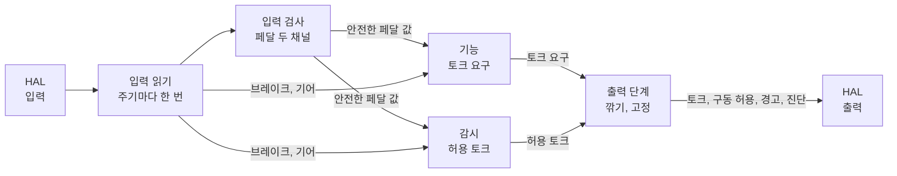

# technical safety concept

[functional-safety-concept.md](functional-safety-concept.md)의 요구사항을 어떻게 만들지를 정한다: 구조, 한계값, 시간, 가정. 요구사항의 원본은 [requirements.yaml](requirements.yaml)이다.

- 등급과 수치는 설명을 위한 가정이다. 규격의 요구사항을 만족하는지 확인한 것이 아니다.
- 이 구조는 이 책의 설계다. 특정한 업계 표준 구조를 옮긴 것이 아니다.

## 1. 구조

| 요소 | 하는 일 | `SG-01`의 요구사항 |
|---|---|---|
| 입력 읽기 | 주기마다 한 번 입력을 읽어 구조체 하나에 담는다 | 받는다 |
| 입력 검사 | 페달 두 채널을 같은 단위로 바꾸고 검사해 안전한 페달 값을 낸다 | 받는다 |
| 기능 | 안전한 페달 값, 브레이크, 기어로 토크 요구를 만든다 | 받지 않는다 |
| 감시 | 안전한 페달 값, 브레이크, 기어로 허용 토크를 계산한다 | 받는다 |
| 출력 단계 | 토크 요구를 허용 토크로 깎고, 계속 넘으면 고정하고 구동 허용 신호를 끊는다 | 받는다 |

이렇게 나눈 이유와 대가

- 감시는 기능을 다시 계산하지 않는다. 운전자의 입력에서 토크의 상한만 계산한다. 감시가 단순해야 믿을 수 있다.
- 상한만 계산하는 감시에는 조건이 붙는다. 상한과 정상인 기능의 토크 사이의 틈이 `SG-01`의 한계보다 작아야 한다. 틈이 크면 기능이 틀려 상한까지 요구해도 감시는 알아채지 못한다. 이 조건은 3절에 있다.
- 기능과 감시가 같은 안전한 페달 값을 쓴다. 그래서 고장이 없으면 토크 요구는 허용 토크를 넘지 않는다. 페달 고장이면 기능도 0을 요구한다.
- 대가: 입력 검사는 기능과 감시가 함께 기대는 지점이다. 감시는 페달을 읽는 길의 고장을 잡지 못한다. 감시가 따로 계산하는 것은 코드를 나눈 것이지 입력을 나눈 것이 아니다.
- 출력 단계가 넘는 토크를 깎으면 기능의 결함이 겉으로 드러나지 않을 수 있다. 그래서 깎은 횟수를 진단 메시지로 내보내고, 깎는 주기가 이어지면 기능의 고장으로 본다.
- 감시가 지켜보기만 하고 넘는 상태가 이어질 때 끊는 구조도 있다. 그 구조에서는 판정이 날 때까지 기능의 값이 그대로 나간다.

## 2. technical safety requirement

| ID | 요구사항 | 위 |
|---|---|---|
| `TSR-01` | 두 채널의 전압을 페달 위치 (0-1000)로 바꾼다. 채널마다 전압의 범위를 검사하고, 두 채널의 차이가 50을 넘는지 검사한다 | `FSR-01` |
| `TSR-02` | 검사에 실패한 주기가 3번 이어지면 페달 고장으로 판정하고, 그 주기의 출력부터 반영한다. 한 주기라도 통과하면 다시 센다. 가장 나쁜 경우 30 ms다 | `FSR-01`, `FSR-03` |
| `TSR-03` | 허용 토크는 안전한 페달 값에 비례하는 상한 (후진은 그 40%)에 오차 5 Nm를 더한 값이고, 최대 토크를 넘지 않는다. `FSR-05`의 조건에서는 0이다. 허용 토크와 정상인 기능의 토크 요구는 두 방향으로 맞물려야 한다 (3절) | `FSR-02`, `FSR-05` |
| `TSR-04` | 출력 단계는 10 ms마다 토크 요구를 허용 토크와 기어가 정한 방향 안으로 깎아서 보낸다 | `FSR-02` |
| `TSR-05` | 깎인 주기가 5번 이어지면 기능의 고장으로 고정한다. 그 주기에 토크 0을 보내고 구동 허용 신호를 끊는다. 한 주기라도 깎이지 않으면 다시 센다. 가장 나쁜 경우 50 ms다 | `FSR-04` |
| `TSR-06` | 페달 고장이나 기능의 고장을 판정한 주기에 경고 요청을 보낸다 | `FSR-03`, `FSR-04` |
| `TSR-07` | 켠 뒤에는 입력 검사를 3주기 이어서 통과하기 전까지 토크를 허용하지 않는다. 구동 허용 신호도 끊어 둔다 | `FSR-01` |

세는 규칙: N번째로 이어서 고장을 본 주기에, 그 주기의 출력부터 반영한다. 고장이 주기와 주기 사이에 나면 다음 주기까지 기다리므로, 가장 나쁜 시간은 N x 10 ms다.

알려진 한계: 실패와 통과가 번갈아 나오는 간헐 고장은 N번 이어지지 못해 판정되지 않는다. 기능이 정상이면 그 주기마다 깎기와 작은 쪽 고르기가 막으므로 `SG-01`은 지켜지지만, 경고 없이 고장이 숨는다. 기능의 고장과 겹치면 지켜지지 않는다 (3절의 알려진 한계). 이 규칙은 검토에서 합의되지 않았다 (`notes/disputes.md`의 1번).

## 3. 값

| 이름 | 값 | 뜻 |
|---|---|---|
| 제어 주기 | 10 ms | 입력 읽기부터 출력까지 한 번 |
| 최대 토크 | 250 Nm | 모터가 낼 수 있는 토크 |
| 페달 놓음 구간 | 30 아래 (3%) | 이 아래는 페달을 놓은 것으로 본다 |
| 두 채널의 차이 | 50 (5%) | 이것을 넘으면 불일치 |
| 채널 1의 전압 범위 | 250-4750 mV | 벗어나면 단선이나 단락 |
| 채널 2의 전압 범위 | 125-2375 mV | 벗어나면 단선이나 단락 |
| 허용 오차 | 5 Nm | 최대 토크의 2% |
| 후진의 비율 | 40% | 후진에서 기능이 내는 토크와 감시가 허용하는 토크는 전진의 40%다 |
| 토크를 올리는 속도 | 주기마다 25 Nm | 기능은 토크를 천천히 올리고, 내릴 때는 바로 내린다 |
| `SG-01`의 가속 한계에 해당하는 토크 | 55 Nm | 1.0 m/s^2 x 1600 kg x 0.31 m / 9.0 |
| 페달 고장 판정 | 3주기 | |
| 기능 고장 고정 | 5주기 | |

계산의 규칙: 모두 32-bit 정수다. 페달은 0-1000, 토크는 0.1 Nm 단위다. 빼거나 곱하기 전에 입력을 범위로 자른다. 나눗셈은 내림이다.

### 허용 토크와 정상 동작 사이의 틈

"기능에는 `SG-01`의 요구사항을 주지 않는다"는 말은 감시만으로 `SG-01`이 지켜질 때만 성립한다. 그러려면 두 조건이 함께 필요하다.

1. 정상인 기능의 토크 요구는 허용 토크를 넘지 않는다. 넘으면 감시가 정상인 기능을 고장으로 판정해 구동을 끊는다 (`H-04`).
2. 허용 토크와 정상인 기능의 토크 요구의 차이는 `SG-01`의 가속 한계에 해당하는 토크보다 작다. 크면 기능이 틀려 허용 토크까지 요구해도 깎이지도 고정되지도 않고, 그 차이만큼의 가속이 나간다 (`SG-01`).

둘째 조건이 `SG-01`과 감시를 잇는 고리다. 허용 토크의 식은 여기에서 나와야 한다.

| 운전 상태 | 정상인 기능의 토크 | 허용 토크 | 차이 | 가속으로는 |
|---|---|---|---|---|
| 전진, 페달 50% | 125 Nm | 130 Nm | 5 Nm | 0.09 m/s^2 |
| 후진, 페달 50% | 50 Nm | 55 Nm | 5 Nm | 0.09 m/s^2 |
| 페달을 한 번에 끝까지 밟은 직후 | 25 Nm씩 올라간다 | 250 Nm | 55 Nm 이상인 시간이 70 ms | `SG-01`의 200 ms보다 짧다 |
| 페달을 밟은 채 브레이크를 놓은 직후, 기어를 N에서 D로 옮긴 직후 | 0에서 25 Nm씩 올라간다 | 페달 값대로 | 55 Nm 이상인 시간이 70 ms 이하 | `SG-01`의 200 ms보다 짧다 |

- 토크 5 Nm는 바퀴에서 5 x 9.0 / 0.31 = 145 N의 힘이고, 차량 1600 kg에서 0.09 m/s^2의 가속이다. 기어비, 바퀴 반지름, 질량은 가정이다 (4절).
- 이 조건 때문에 기능을 단순하게 했다. 기능은 속도에 따라 토크를 줄이지 않는다. 실제 구동 제어는 높은 속도에서 토크를 줄이고, 그러면 감시의 상한도 속도를 따라가야 한다. 속도가 감시의 입력이 되고, 속도 신호의 검사가 새 요구사항이 된다. 단계 2에서 다룬다.
- 후진의 비율은 감시에도 넣었다. 기어는 이미 감시의 입력이다. 기능과 감시는 이 비율의 상수를 따로 갖는다. 함께 쓰면 기능의 값을 바꿀 때 감시의 한계가 검토 없이 따라 바뀐다. 두 값이 어긋나면 `TC-007`이 실패한다.
- 기능은 감시가 모르는 상태를 갖지 않는다. 제동 우선은 브레이크를 밟는 동안만 듣는다. 처음의 기능은 브레이크를 놓은 뒤에도 가속 페달을 놓을 때까지 토크 0을 유지했다. 감시는 그 상태를 모르고 페달 값대로 허용했으므로, 그동안 차이가 허용 토크 전부 (페달 80%에서 205 Nm, 3.7 m/s^2)였다. 유지하려면 감시도 같은 상태를 가져야 한다.
- 감시는 토크가 변하는 속도를 보지 않는다. 기능의 결함이 올리는 속도의 제한을 없애면, 정상이면 70 ms에 걸쳐 올라갔을 토크가 한 번에 나간다. 이것은 막지 않는다. 넘는 시간이 `SG-01`의 200 ms보다 짧기 때문이다.
- 알려진 한계: 표의 시간은 입력이 한 번 바뀐 뒤 그대로일 때의 값이다. 입력 (페달, 브레이크, 기어)이 70 ms보다 빨리 거듭 바뀌면 정상인 기능은 토크를 다 올리지 못하고, 그동안 틈이 크다. 그때 기능이 틀려 허용 토크까지 요구하면 `SG-01`을 어긴다.
  - 크기: 페달 100%에서 입력이 80 ms마다 한 주기씩 바뀌는 경우 (브레이크가 "밟음"으로, 기어가 N으로, 페달이 0으로)를 계산해 보았다. 토크 요구로 보면 차이가 큰 주기가 7주기씩 이어지고 한 주기 끊긴다. 차량의 가속으로 보면 끊기지 않는다. 가정한 inverter의 응답 (`A-16`)으로는 10 ms 동안 가속이 내려가지 않아, 4000 ms 가운데 3995 ms 동안 가속의 차이가 1.0 m/s^2를 넘었다. 기어가 D와 R 사이를 오가는 경우에는 4000 ms 가운데 3159 ms였다.
  - 원인: 입력의 간헐 고장이다. 페달 한 채널의 간헐 단선은 입력 검사가 판정하지 못한다 (이어지는 횟수를 세므로. 80 ms마다 한 주기씩 끊기면 400주기 동안 판정이 없고, 그 주기마다 안전한 페달 값은 0이 된다). 브레이크와 기어의 신호는 검사하지 않고 debounce도 없다 (6절).
  - 판단: 입력의 간헐 고장과 기능의 고장이 겹친 경우다. 예제의 범위는 고장이 둘 겹치는 경우를 다루지 않는다 (scope.md). 단계 1은 막지 않는다.
  - 닫는 길: 감시가 같은 변화율 제한을 갖거나, 기능에서 그 제한을 빼거나, 입력의 간헐 고장을 판정한다. 입력에 debounce를 달면 튄 신호가 기능에 닿지 않아 이 조건이 줄어든다. 그 대신 브레이크를 밟은 뒤 토크가 끊기는 때가 그만큼 늦어진다. 단계 2에서 고른다.
- 이 조건은 단계 검토에서 찾았다. 처음의 설계는 첫째 조건만 요구했고, 후진과 높은 속도에서 차이가 1.1-2.4 m/s^2였다. 제동 우선의 유지는 그 반영을 확인하는 검토에서 찾았다 (`reviews/2026-11-22-stage1/`).

## 4. 가정 (더한 것)

[scope.md](scope.md)의 `A-01` - `A-13`에 더한다. 시뮬레이션의 plant model이 이 값을 쓴다.

| ID | 가정 | 값 |
|---|---|---|
| `A-14` | 토크 요구가 CAN으로 inverter에 닿는 데 걸리는 시간 | 2 ms |
| `A-15` | 구동 허용 신호의 변화가 inverter에 닿는 데 걸리는 시간 | 1 ms |
| `A-16` | inverter의 토크 응답 (`A-05`를 값으로 적은 것) | 시정수 20 ms. 60 ms 뒤에는 바뀐 양의 95%를 따라간다 |
| `A-17` | inverter는 토크 요구가 끊기면 토크를 내지 않는다 (`A-06`을 값으로 적은 것) | 50 ms |
| `A-18` | 차량 | 질량 1600 kg, 기어비 9.0, 바퀴 반지름 0.31 m |
| `A-19` | VCU의 메모리 보호와 실행 시간 감시가 기능과 나머지를 나눈다 | 시뮬레이션에 없다 |

## 5. 시간 예산

`SG-01`의 시간은 200 ms다. 고장이 난 때부터 차량의 가속이 한계 안으로 돌아올 때까지의 합이 이보다 작아야 한다.

| 고장 | 다음 주기까지 | 판정 | 전달 | inverter의 응답 | 합 | 그동안의 출력 |
|---|---|---|---|---|---|---|
| 페달 채널 하나가 틀림 | 최대 10 ms | 20 ms (3번째 주기) | 2 ms | 60 ms | 92 ms | 작은 쪽을 따르므로 넘지 않는다 |
| 기능이 큰 토크를 요구: 깎기 | 최대 10 ms | 0 ms (같은 주기) | - | - | 10 ms | 넘는 토크는 한 번도 나가지 않는다 |
| 기능이 큰 토크를 요구: 차단 | 최대 10 ms | 40 ms (5번째 주기) | 1 ms | 60 ms | 111 ms | 허용 토크까지만 나간다 |

- 세 줄 모두 200 ms보다 작다.
- "넘는 토크는 한 번도 나가지 않는다"는 VCU의 소프트웨어 논리에 대한 말이다. 하드웨어의 고장, compiler의 오류, 주기를 놓치는 경우는 덮지 않는다.
- 측정한 값은 [test-report.md](test-report.md)에 있다.

## 6. 단순화한 것

실제 제어기와 다른 점이다. 예제를 작게 유지하려고 뺐다.

| 단순화 | 놓치는 것 |
|---|---|
| 브레이크를 밟으면 속도와 상관없이 허용 토크가 0이다 | 보고서의 제동 우선은 속도 조건과 예외를 둔다. 브레이크 신호는 한 채널이어서 "밟음"에 고착되면 구동력을 잃는다 (`H-04`) |
| 브레이크 신호를 검사하지 않는다 | "놓음"에 고착되면 제동 우선이 듣지 않는다. 평소에는 드러나지 않는다 (`SG-01` 쪽) |
| 기어 신호를 검사하지 않는다 | N이나 P인데 D로 읽으면 운전자가 요구하지 않은 출발이 된다 (`SG-01` 쪽). 한 채널이고 기능과 감시가 같은 값을 쓴다 |
| 기능이 속도에 따라 토크를 줄이지 않는다 | 실제 구동 제어와 다르다. 높은 속도에서도 페달 값대로 토크를 낸다. 줄이려면 감시도 속도를 봐야 한다 (3절) |
| 제동 우선이 걸린 상태를 유지하지 않는다 | 브레이크를 놓으면 가속 페달 값대로 토크가 다시 올라간다. 유지하려면 감시도 같은 상태를 가져야 한다 (3절) |
| 차량 속도를 읽지 않는다 | HAL에 받는 함수는 있지만 쓰지 않는다. `A-03`의 검사 (제때 왔는가, 범위 안인가)도 하지 않는다 |
| inverter의 상태와 실제 토크를 보지 않는다 | 보낸 토크 요구와 실제 토크를 견주지 않는다. inverter가 요구보다 큰 토크를 내도 모른다 |
| 고장 상태를 RAM에만 둔다 | 주행 중에 reset이 나면 고장 상태가 지워지고, 3주기 뒤에 토크를 다시 낸다 |
| 허용 토크가 속도를 보지 않는다 | 주행 중에 기어 신호가 R로 바뀌면 반대 방향의 토크가 허용된다 (`H-03`, `H-04`) |
| 고장 상태를 다시 켤 때까지 유지한다 | 잠깐의 이상으로도 구동력이 돌아오지 않는다 (`H-04`) |
| 페달 채널 하나만 고장이어도 토크 0으로 간다 | 남은 채널로 토크를 제한해 계속 가는 상태가 없다 |
| CAN 메시지에 보호 (E2E)가 없다 | 토크 요구가 전송 중에 바뀌거나 멈춰도 알아채지 못한다 |
| 켤 때의 자가 시험이 없다 | 깎기와 구동 허용 차단이 고장 나 있어도 쓸 때까지 모른다 |

## 7. 독립에 관한 주장

감시가 기능과 다른 함수에 있다고 해서 독립적인 것은 아니다. 아래는 이 concept이 기대는 주장과 그것을 보인 정도다.

| 주장 | 기대는 것 | 단계 1에서 보였는가 |
|---|---|---|
| 페달의 두 채널은 함께 틀리지 않는다 | `A-02` (전원과 접지가 따로) | 아니다. 가정이다. `FI-03`은 이 가정이 깨지면 알아채지 못한다는 것을 보인다 |
| 기능의 결함은 허용 토크의 계산을 틀리게 하지 못한다 | `A-19` (메모리 보호), 감시가 기능의 결과를 쓰지 않는 구조 | 구조만 보였다. 메모리 보호는 시뮬레이션에 없다 |
| 기능이 오래 걸려도 감시와 출력 단계는 제때 실행된다 | `A-19` (실행 시간 감시), `A-10` | 아니다. 시뮬레이션에서 실행 시간은 0이다 |
| 감시와 출력 단계가 실행되지 않으면 구동이 막힌다 | `A-10` (따로 동작하는 감시 요소) | 아니다. 그 요소는 살아 있는지만 보고, 계산이 옳은지는 보지 못한다 |
| MCU의 고장이 기능과 감시를 함께 틀리게 해도 구동이 막힌다 | `A-10` | 아니다 |
| 구동 허용 신호를 끊으면 토크가 나가지 않는다 | `A-07`, `A-11` | plant model이 그렇게 만들어져 있을 뿐이다 |

## 8. sim이 보이는 것과 못 보이는 것

| 보이는 것 | 못 보이는 것 |
|---|---|
| 입력 검사, 감시, 출력 단계의 논리가 요구사항대로 동작한다 | 감시가 기능에서 독립적이라는 것 |
| 고장을 넣은 때부터 출력이 바뀔 때까지의 주기 수 | 실제 실행 시간, jitter, 마감 초과 |
| 넘는 토크 요구가 출력으로 나가지 않는다는 논리 | 메모리가 망가졌을 때의 동작 |
| 가정한 plant에서 차량의 가속이 한계 안에 있다 | inverter와 모터의 실제 응답. plant는 1차 지연뿐이고 구동계의 출렁임, 노면의 기울기, 타이어의 미끄러짐이 없다 |
| | startup과 reset 직후의 동작, watchdog |
| | 두 ADC 채널을 읽는 시각의 차이, 잡음, 양자화. 시뮬레이션의 두 채널은 같은 순간의 오차 없는 값이다 |
| | 입력을 읽은 때부터 출력을 낼 때까지의 지연. 모든 task가 같은 순간에 실행된다 |
| | 브레이크와 기어 신호의 튐 |
| | 간헐 고장이 차량에서 어떻게 보이는가. 시나리오에 넣지 않았다 |
