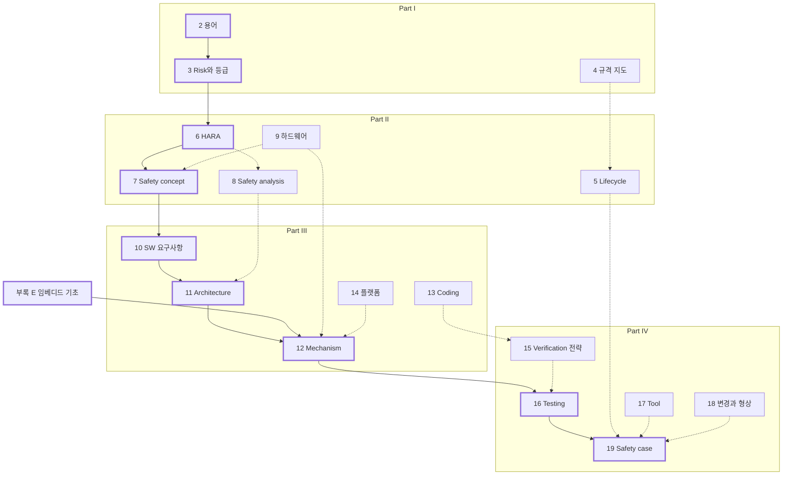

# FuSa 전문가 검토 (2차, 판정과 통합)

검토자: FuSa 전문가 역할 에이전트 (opus), 주도 검토자, 2026-11-22

## 0. 이 문서에 대하여

- 입력
  - 1차 독립 검토: [fusa-lead-round1.md](fusa-lead-round1.md) (F-01 - F-36)
  - 임베디드 엔지니어의 독립 검토: [embedded-engineer.md](embedded-engineer.md) (E-01 - E-29, 3절의 예제 설계안)
  - 1차 검토 뒤에 만든 [references/README.md](../../references/README.md)와, 받은 문서 가운데 내가 이번에 직접 읽은 것
    - easa-moc-light-uas-2510 (SAIL IV)
    - easa-moc-light-uas-high-risk-2510 (SAIL V, VI)
    - koopman-toyota-ua
    - sora-2-5-main-body
    - misra-compliance-2020
    - autosar-safety-measures
- 근거 표시
  - 받은 문서로 확인한 것은 문서 id를 적는다.
  - 웹에서 확인한 것은 주소를 적는다.
  - 나머지는 "기억에 의존, 미확인"이다.
  - 이 문서의 모든 의견은 RULES 5.2에 따라 원고에 쓸 때 `(확인 필요)`로 다룬다.
- 저자의 결정에 달린 변경에는 [D]를 붙였다. [D]가 붙은 항목에는 결정 전에 해도 해가 없는 형태를 함께 적었다.

### 0.1 1차 보고서의 정오

1차 보고서는 원문을 그대로 보존했으므로, 고칠 곳을 여기 적는다.

1. 총평의 상호 참조 번호가 틀렸다. 바른 번호는 다음과 같다.
   - (b) safety analysis와 하드웨어 가정: F-05, F-06
   - (c) 드론 열: F-07, F-08, F-09
   - (d) 전기 구동의 safe state: F-04
2. F-08을 보강한다 (받은 문서로 확인).
   - SAIL IV용 MoC Light-UAS.2510-01 (Issue 1, 2024-02-01)
     - 7.1절: ED-79B, AMC 20-115D, AMC 20-152A의 DAL C objective를 acceptable means로 든다. "이보다 덜 엄격한 objective도 받아들여질 수 있다"는 단서가 붙어 있다.
     - "UAS에 비례하는 수단을 표준화 기구가 개발 중"이라고 적는다. 즉 SAIL IV에서도 ASTM F3201이 EASA의 인정 경로로 명시되어 있지 않다.
     - 아키텍처로 development error를 가두면 item 수준의 development assurance를 덜 수 있다고 적는다. 11장의 monitor 구조와 같은 생각이다.
   - SAIL V, VI용 MoC (High Risk.2510-01)
     - 1차에서 본 대로, failure condition의 분류에 따라 FDAL D/C/B를 정한다.
   - 근거: references/easa-moc-light-uas-2510, references/easa-moc-light-uas-high-risk-2510
3. F-17을 보강한다 (받은 문서로 확인).
   - Koopman (2014)은 두 가지를 함께 적는다.
     - NASA 조사가 "smoking gun"을 찾지 못했다.
     - 2013년 Bookout 재판에서 배심이 ETCS 결함이 사망의 원인이라고 판단했다. Koopman은 "배심은 기술 전문가가 아니다"라는 단서도 단다.
   - 1차의 결론(원인을 단정하지 말 것)은 그대로다.
   - 근거: references/koopman-toyota-ua
4. F-31의 MC/DC compiler 지원은 임베디드 검토자가 웹에서 확인했다 (E-17). 내 "기억에 의존" 표시는 E-17의 출처로 대체한다.

## 1. 판정: E-01 - E-29

집계: 채택 16, 수정 채택 13, 기각 0.
다만 E-03 (장을 둘로 나누기), E-04 (4장을 5장과 합치기), E-28 (`end` 누락)의 일부 주장은 기각했다.

| ID | 판정 | 이유 | 겹치는 F |
|---|---|---|---|
| E-01 | 수정 채택 [D] | 독자 가정과 실제 목차의 공백은 내 F-24보다 넓고 정확한 지적이다. 다만 새 장을 둘지는 독자 가정에 달려 있다. 결정 전에는 장 번호를 바꾸지 않는 부록 E로 시작하고, 각 장에 짧은 설명 상자를 둔다. 차량 E/E 기초(F-24)도 이 부록에 둔다. | F-24 |
| E-02 | 채택 | 같은 모순을 독립적으로 찾았다. C14->C12와 C9->C7을 더하자는 제안도 맞다. | F-06 |
| E-03 | 수정 채택 | 방향(계산보다 safety manual 읽기와 소프트웨어 진단 중심)은 맞다. 장을 둘로 나누는 것은 기각한다. 한 장 안에서 순서와 비중을 바꾼다. demand mode는 3장으로 옮긴다. | F-13, F-27 |
| E-04 | 수정 채택 | 1장 끝의 "안전 장치 없는 제어기 + 센서 고착 그래프"는 매우 좋은 동기 장면이라 채택한다. 4장을 5장과 합치는 것은 기각한다. 규격 읽는 법은 독자의 목표("조항을 직접 찾아 읽는다")에 필요하다. 대신 분량을 8-10쪽으로 줄인다. | - |
| E-05 | 채택 | 실제로 혼동이 생긴다. 이 책에서는 test 환경을 "SIL"로 줄여 쓰지 않는다. | - |
| E-06 | 채택 | startup과 reset 이후 상태, NVM, bootloader는 이 독자가 꼭 알아야 하고 빠져 있었다. 초기화와 startup 시 safe state는 안전 요구사항의 단골 항목이다 (기억에 의존, 미확인). | F-26 (18장) |
| E-07 | 채택 | test로 거의 잡히지 않는 결함이라 이 책의 주제("테스트만으로 부족한 것")와 직결된다. | - |
| E-08 | 수정 채택 | 측정, 여유, 런타임 감시 중심은 맞다. 다만 측정 기반이면 "최악 경로를 실제로 밟았는가"를 따로 논증해야 한다는 점을 함께 쓴다. 정적 WCET 분석도 높은 ASIL에서 쓰이는 방법이라 1문단이 아니라 1쪽 정도로 둔다 (기억에 의존, 미확인). | F-12 |
| E-09 | 채택 | "test한 binary가 출하한 binary인가"는 configuration management의 핵심 질문이다. 13, 14, 16, 17장에 나누어 넣는다. | - |
| E-10 | 수정 채택 | 채택한다. 단 "healing 조건"에 FuSa 주의를 단다. 안전 반응으로 들어간 latch는 보통 같은 driving cycle 안에서 저절로 풀리지 않게 하고, 해제 조건 자체를 안전 요구사항으로 쓴다 (기억에 의존, 미확인). | - |
| E-11 | 채택 | Classic 중심이 맞다. references/autosar-safety-measures (등급 A)에 Watchdog Manager (alive, deadline, logical supervision), Memory Partitioning, Timing Protection, E2E가 있음을 확인했다. 12장 mechanism과의 대응표를 바로 만들 수 있다. | - |
| E-12 | 채택 | HAL 경계가 곧 fault injection 지점이자 이식 경계라는 점은 F-31과 같은 결론이다. | F-31 |
| E-13 | 채택 | FuSa 답은 아래 1.1절에 있다. | - |
| E-14 | 수정 채택 | 대부분 동의한다. 차이가 나는 곳은 셋이다. (1) 1장은 사례 4건을 유지하되 깊이를 나눈다. Toyota와 737 MAX는 깊게, Therac-25와 Ariane 5는 각 1-2쪽. 받은 조사 보고서가 있어 근거가 좋다. (2) 8장의 STPA는 1쪽이 아니라 2-3쪽으로 둔다. 소프트웨어 제어의 결함을 찾는 데 가장 맞는 기법이고 handbook이 등급 A다. (3) 13장의 Rust는 독자의 관심을 생각해 1-2쪽으로 둔다. | F-27 |
| E-15 | 채택 | F-05와 같은 문제를 더 구체적인 목록으로 보였다. 12장과 16장의 표를 채택한다. | F-05 |
| E-16 | 채택 | FuSa 답은 1.1절에 있다. | F-05, F-14 |
| E-17 | 채택 | 사실 확인까지 되어 있다. MC/DC 변형에 대한 FuSa 답은 1.1절에 있다. | F-31 |
| E-18 | 채택 | "MISRA 준수 주장"과 "일부 규칙 검사"를 구분하는 것이 핵심이다. 받은 MISRA Compliance:2020에 guideline enforcement plan, guideline re-categorization plan, deviation record, deviation permit, guideline compliance summary가 정의되어 있음을 확인했다. 13장은 이 문서를 등급 A 근거로 쓸 수 있다. | F-03 (규칙 문구 저작권) |
| E-19 | 채택 | CBMC 우선, 감시 함수는 고정소수점 정수로. | - |
| E-20 | 수정 채택 [D] | 선택 단계로 두는 것에 동의한다. 시점은 14장을 쓰는 단계 2 후반이다. 다만 "보일 4가지" 가운데 HardFault 후 safe state와 독립 watchdog reset은 emulator에서 실제 하드웨어와 다르게 동작할 수 있다. 그래서 보드를 우선 후보로 둔다 (기억에 의존, 미확인). | F-31 |
| E-21 | 채택 | 내 F-22와 같은 결론이다. "소프트웨어가 안전 기능에서 하지 않는 일"을 비교표 맨 위에 둔다는 제안은 특히 좋다. | F-22 |
| E-22 | 수정 채택 | AMR 중심에 동의한다. 다만 ISO 10218:2025에서 달라진 점(용어 "collaborative application", Class I/II, safety function 목록)은 1쪽 상자로 남긴다. 독자가 가장 자주 마주칠 로봇 안전 화제이기 때문이다. | F-20 |
| E-23 | 수정 채택 | 범위 축소, PX4 failsafe 표와의 대응, 위치 상실 포함에 동의한다. 다만 미국과 한국 제도는 부록이 아니라 장 안의 "쓰는 시점에 확인" 상자로 둔다. 부록을 늘리지 않기 위해서다. 소프트웨어 보증 경로(F-08)는 꼭 넣는다. | F-09, F-23, F-08 |
| E-24 | 채택 [D] | 같은 계산이다. 70-80주 또는 250쪽 가운데 무엇을 할지는 저자가 정한다. | F-32 |
| E-25 | 수정 채택 | 단계 0.5를 신설한다. 내 "단계 0 안의 1-2주 항목"보다 완료 기준이 분명하다. 단계 1의 장 목록은 9개를 유지하고 2, 3, 19장의 목표 분량만 줄인다 (2절). | F-32 |
| E-26 | 수정 채택 | `make check`와 추적 스크립트를 완료 기준에 넣는다. 폴더 구조도 채택한다. README의 `reviews/`와 `references/README.md`는 이제 있으므로 그 부분은 해결되었다. 장 계획과 본문을 나누는 문제는 출판 형태가 정해질 때까지 보류한다 [D]. | - |
| E-27 | 채택 | 기계로 확인할 수 있는 규칙은 자동화한다. FuSa 답은 1.1절에 있다. | F-01 |
| E-28 | 수정 채택 | `end` 누락은 사실이 아니다. 진행자가 렌더링으로 확인했으므로 기각한다. 의존 그림의 가독성, "읽는 순서"와 "의존"이 섞인 문제, 누락된 화살표는 채택한다. Mermaid 파싱을 lint에 넣는 것도 채택한다. 이번처럼 잘못된 의심을 빨리 정리할 수 있다. | F-06 |
| E-29 | 수정 채택 | F-28과 합친다. 15장과 16장을 분리하고, "내 코드 아래 층" 띠를 두고, 단계 1 표시를 하고, 글자를 키운다. 6장과 19장의 짝에 대한 FuSa 답은 1.1절에 있다. | F-28 |

### 1.1 "FuSa 확인 필요"로 넘어온 질문에 대한 답

- E-03: 하드웨어 지표의 목표값
  - 답: 내 기억으로는 대략 다음과 같다 (기억에 의존, 미확인).
    - SPFM: ASIL B >= 90%, C >= 97%, D >= 99%
    - LFM: ASIL B >= 60%, C >= 80%, D >= 90%
    - PMHF: ASIL B, C < 10^-7 /h, D < 10^-8 /h
  - 출처는 ISO 26262-5의 표들이다. 이 수치는 원문이나 OBP로 확인하기 전에는 원고에 쓰지 않는다.
  - 9장은 "어디에 있고 어떻게 읽는가"만 쓰면 되므로, 수치를 몰라도 장 계획은 확정할 수 있다.
- E-10: fault 기록과 healing
  - 답: 위 표의 E-10 행.
  - DTC나 UDS 같은 진단 자체는 ISO 26262의 요구가 아니다. 다만 fault reaction과 warning은 functional safety concept의 항목이다 (기억에 의존, 미확인).
- E-13: host 결과를 target으로 옮길 때의 요구
  - 답: ISO 26262-6은 test 환경이 target 환경을 충분히 대표하도록 요구하고, 둘의 차이를 분석해 정당화하라고 요구한다. 그래서 host에서 잰 structural coverage도 근거를 대면 쓸 수 있다 (기억에 의존, 미확인, 조항 번호 모름).
  - 16장의 "host 결과가 말해 주는 것과 못 말해 주는 것" 표가 바로 그 정당화의 모양이다.
- E-16: E-Gas 3단계의 세부
  - 답 (기억에 의존, 미확인)
    - Level 2는 Level 1과 같은 제어기에서 돌되, 보호된 memory 영역에서 다른 계산으로 허용 토크를 구한다.
    - Level 3은 별도 감시 IC(monitoring module)와 질의-응답을 주고받는다. 명령어 집합 test, memory test, program flow 점검 같은 제어기 자체의 점검을 포함한다.
    - Level 3이 이상을 찾으면 감시 IC가 독립 경로로 출력단을 끈다.
  - 원문(E-Gas v4.0 또는 v6.0)을 구하기 전에는 모두 `(확인 필요)`다 (references/README.md, C 등급).
- E-17: MC/DC의 변형(masking과 unique-cause)
  - 답: ISO 26262-6은 MC/DC를 방법으로 이름만 들고 변형을 정하지 않는다고 기억한다. 항공에서는 CAST-6 position paper가 masking MC/DC를 받아들였다 (모두 기억에 의존, 미확인).
  - 책에서는 "이 예제는 GCC의 masking MC/DC로 측정했다"를 명시한다. 그리고 두 도구의 결과가 다를 수 있다는 점을 16장의 흔한 오해로 쓴다.
- E-21: ISO 3691-4의 구체 요구
  - 답: ISO 3691-4가 안전 기능별로 요구 PL을 정하는 구조라는 것은 기억한다. 사람 감지 기능의 PL 값은 확인하지 못했다 (기억에 의존, 미확인).
  - 그래서 예제의 PLr은 ISO 13849-1의 risk graph로 직접 도출하는 연습으로 쓰고, "3691-4의 값과 비교할 것 `(확인 필요)`"을 남긴다.
- E-27: `(확인 필요)` 0개라는 최종 기준 때문에 책이 얇아질 위험
  - 답: 그 위험은 실제로 있다. 그래서 규격 원문 확보를 단계 1 전의 관문으로 둔다 (A-09, B-01).
  - 원문을 구하지 못한 Part는 `(2차 자료)`로 남기는 것을 정상 경로로 인정한다. 이때 그 2차 자료의 판과 질 조건(A-01)을 지킨다.
  - 확인하지 못했다는 이유만으로 내용을 지우는 것이 기본값이 되면 안 된다. 지울지 남길지는 "이 문장이 틀리면 독자가 무엇을 잘못하게 되는가"로 판단한다.
- E-29: 6장(safety goal)과 19장(safety case)의 짝
  - 답: 틀린 짝이다. safety goal의 짝은 차량 수준의 safety validation이다. safety case와 functional safety assessment는 lifecycle 전체에 걸친 활동이다 (F-28, 기억에 의존, 미확인).

## 2. 충돌 해소

### 2.1 임베디드 기초를 어디에 둘 것인가 (E-01 대 F-24 대 부록)

- 결론 [D]
  - 결정 전: 부록 E "임베디드 시스템과 차량 E/E 최소 지식" (12-15쪽)을 만든다.
  - 독자 가정이 확정되면: 이 부록을 Part I 끝(4장 다음)의 장으로 올린다. 장 번호 변경은 단계 2 시작 시점에 한 번만 한다.
- 이유
  - 9장 확장(F-24)은 기각한다. 9장의 주제는 "고장"이고, 9장은 단계 2에 쓴다. 그런데 이 기초는 단계 1의 7, 11, 12장이 필요로 한다.
  - 새 장(E-01의 1순위)은 독자 가정이 확정되어야 정당하다. 저자가 "임베디드 경험이 있다"로 바꾸면 장을 만든 비용이 버려진다.
  - 부록은 장 번호를 바꾸지 않으므로 결정 전에도 해가 없다. 부록을 건너뛰는 독자 문제(E-01 (b)의 우려)는 각 장의 "임베디드 상자" 2-3문단으로 보완한다.
- 내용 (E-01 (a)와 F-24를 합침)
  - MCU 한 장 그림(CPU, flash, RAM, peripheral, clock, reset), memory map, 시작 순서
  - 주기 task와 interrupt
  - 센서 신호가 ADC 값이 되는 경로, PWM 출력
  - ECU와 차량 network: CAN frame과 CAN의 약점, CAN FD와 Ethernet은 한 문단
  - hardware watchdog, MPU
  - HAL과 AUTOSAR Classic의 층
  - 관통 예제의 E/E 구성도: 페달 센서 2채널 -> VCU -> CAN -> inverter
- 단계 1에서는 이 부록의 뼈대 3-4쪽을 쓴다(12장과 같은 시기).

### 2.2 단계 1의 범위와 예제 골격 (E-25 대 F-32, F-06 대 E-02)

- 단계 0.5를 신설한다 (E-25 채택). 기간은 2-3주. 완료 기준은 "깨끗한 container에서 `make check`가 통과하고 coverage와 정적 분석 보고서가 생성된다".
- 단계 1의 장은 9개를 유지한다 (E-25의 축소안은 기각). 대신 목표 분량을 차등한다.
  - 2, 3장: 각 1-2쪽 (정의와 등급의 뼈대)
  - 19장: 1-2쪽
  - 6, 7, 10, 11, 12, 16장: 각 2-3쪽
  - 부록 E: 3-4쪽 (2.1절)
- 단계 1에 넣을 최소 분석은 F-06과 E-02를 합친다. 모두 "장 원고가 아니라 예제 산출물"로 만든다.
  - FTA 1개: safety goal 1개, 1쪽
  - DFA/FFI 주장 목록 1쪽: 각 주장 옆에 "sim이 보이는 것과 못 보이는 것"
  - 하드웨어 가정 목록 5-10줄
  - 시간 예산표: FTTI 가정값, FDTI, FRTI, task 주기
  - ASIL decomposition 또는 coexistence 판단 1줄과 근거

### 2.3 9장의 구성 (E-03, F-13, F-27)

- 장은 하나로 유지한다. 순서와 비중은 다음과 같다. 목표 10-12쪽.
  1. 하드웨어 고장의 종류: permanent, transient, latent. random과 systematic의 구분 다시 보기.
  2. 하드웨어가 이미 잡아 주는 것과 소프트웨어의 몫: lockstep, ECC, 전압과 clock 감시
  3. MCU safety manual에서 찾는 것: assumption of use, 소프트웨어가 해야 하는 진단, FIT와 diagnostic coverage 표가 있는 곳
  4. 소프트웨어가 하는 진단: startup test, 주기 self-test (RAM, flash CRC, ADC reference, clock, watchdog 점검)
  5. 지표 읽는 법 (2-3쪽): SPFM, LFM, PMHF와 HFT, SFF, PFD, PFH. 계산은 하지 않는다.
- demand mode와 "등급은 요구사항의 속성"은 3장으로 옮긴다 (F-13).

### 2.4 로봇 보조 예제와 드론 장의 범위

- 로봇 (E-21, E-22, F-22, F-20, F-21)
  - 보조 예제: "자율 이동 로봇의 속도에 따른 보호 영역 전환과 정지"
  - 산출물은 다섯 가지다.
    1. 안전 기능의 정의
    2. ISO 13849-1의 risk graph로 정한 PLr
    3. Category 구조
    4. 정지 거리 예산: 응답 시간 + 제동 거리 <= 감지 거리
    5. 일반 소프트웨어(ROS 2)와 safety controller의 경계 그림
  - 소프트웨어 요구사항은 safety controller의 작은 응용 논리(field 전환, 재시작 interlock)로 한정한다.
  - 비교표 맨 위에 "소프트웨어가 안전 기능에서 하지 않는 일"을 둔다.
  - 협동 로봇과 ISO 10218:2025의 변화는 1쪽 상자로 쓴다.
- 드론 (E-23, F-09, F-23, F-08)
  - 21장의 중심 사슬: SORA -> SAIL -> OSO -> SC Light-UAS -> 소프트웨어 보증
  - 예제는 세 부분이다.
    1. 소형 multicopter 운용 하나의 SAIL 결정
    2. link 상실, geofence, 위치 상실의 상태 기계. PX4 failsafe 표와 대응시킨다. "geofence는 위반 뒤에 작동한다"와 "여럿이 걸리면 가장 심각한 동작이 선택된다"를 포함한다.
    3. RTA 1절 (2쪽 이내)
  - 소프트웨어 보증 경로는 EU와 미국을 나란히 적는다.
    - EU: SAIL IV는 DAL C objective가 acceptable means다. SAIL V-VI는 failure condition에 따라 FDAL B-D다.
    - 미국: ASTM F3201이 FAA 규칙의 means of compliance로 쓰인다.
    - 미국을 한 문단 이상 다룰지는 [D].
  - 미국과 한국의 제도는 "쓰는 시점에 확인" 상자로 둔다.
  - PX4 소스 코드 읽기는 하지 않는다. 문서와 상태 기계 그림으로 대신한다.

### 2.5 줄일 곳, 분량, 일정 (E-14, F-27, E-24, F-32)

- 장별 목표 쪽수 (합계 약 290쪽 + 부록)

| 장 | 목표 | 장 | 목표 | 장 | 목표 |
|---|---|---|---|---|---|
| 1 | 12 | 9 | 10-12 | 17 | 12 |
| 2 | 10 | 10 | 14 | 18 | 12 |
| 3 | 12 | 11 | 18 | 19 | 12 |
| 4 | 8-10 | 12 | 20 | 20 | 14 |
| 5 | 10 | 13 | 16 | 21 | 14 |
| 6 | 16 | 14 | 12 | 22 | 8 |
| 7 | 16 | 15 | 12 | 23 | 8 |
| 8 | 14 | 16 | 18 | 24 | 6 |

- 부록 E는 12-15쪽이다.
- 일정은 [D]다. 같은 시간(주 6-8시간)이면 약 75주가 현실적이다.
  - 단계 0: 2주
  - 단계 0.5: 3주
  - 단계 1: 18주 (장당 2주)
  - 단계 2: 32주
  - 단계 3: 12주
  - 단계 4: 6주
  - 단계 검토(합계 4주)를 각 단계 기간 안에 포함한다.
- 45주를 지키려면 목표를 약 180쪽으로 줄여야 한다. 그러면 Part V를 비교표 중심의 짧은 장으로 바꾸는 수준이 된다. 권고는 75주와 290쪽이다.

### 2.6 책 지도와 의존 그래프 (E-29, F-28, E-02, E-28, F-06)

- 책 지도: A-13
- 의존 그래프: A-07
  - "쓰기 전에 필요"(실선)와 "깊게 고칠 때 필요"(점선)를 나눈다.
  - 읽는 순서는 의존에서 뺀다.
  - Part별로 묶고, 단계 1 장에 표시를 한다.

### 2.7 예제 설계안과 toolchain (임베디드 보고서 3절, F-31)

- PLAN 8절에 "결정"으로 넣는 것 (설계 원칙이라 바뀔 일이 적다)
  - C, 단일 process 단일 thread, 가상 시계(1 ms tick), 정적 task table
  - HAL 경계와 그 뒤에서만 하는 fault injection
  - 감시 함수는 고정소수점 정수 연산
  - 이중 페달 센서는 서로 다른 특성과 별도 채널. 공통 원인 고장 case 1개 포함.
  - 시나리오마다 CSV 로그와 그래프
  - 반응 시간을 FTTI 가정값과 비교하는 assertion
  - "sim이 보이는 것과 못 보이는 것" 표 (임베디드 보고서 3.2절)
  - 모든 도구는 qualification되지 않았다는 명시
- 단계 0의 확인 항목(spike)으로 두는 것 (도구의 실제 동작에 달렸다)
  - devcontainer: Linux, GCC >= 14, Clang >= 18
  - `gcov --conditions`가 감시 함수에서 동작하는가. gcovr이 MC/DC를 보고하는가.
  - `llvm-cov --show-mcdc`로 교차 확인
  - CBMC가 감시 함수의 "출력 <= 한도"와 "overflow 없음"을 증명하는가
  - cppcheck misra add-on: MISRA를 구입한 경우에만. 규칙 텍스트는 git에 넣지 않는다.
  - unit test framework 선택 (Unity 또는 CMocka)
- 단계 2의 선택 사항으로 두는 것 [D]: 보드 또는 Renode에서 4가지 보이기 (E-20)

## 3. 통합 변경 목록

### A. 단계 1을 시작하기 전에 문서를 고칠 것

**A-01. RULES.md 5.2와 5.3: 근거 표시와 조항 번호** (F-01, F-02, E-27)

5.2의 표 아래에 다음 문장을 더한다.

> - 조항 번호와 Annex 번호는 원문, ISO Online Browsing Platform, IEC webstore의 미리보기 가운데 하나로 확인한 것만 쓴다. 그 밖에는 Part 단위까지만 쓴다.
> - Claude의 기억에서 나온 조항 번호는 `(확인 필요)`를 달아도 최종 원고에 남기지 않는다.
> - `(2차 자료)`에는 그 자료가 기준으로 삼은 규격의 판을 함께 적는다. 판을 알 수 없는 2차 자료는 조항 번호의 근거로 쓰지 않는다.
> - shall 수준의 주장은 업체 블로그 하나만으로 확인하지 않는다. 2차 자료 둘 이상, 또는 발행 기관이나 인증 기관의 자료로 확인한다.
> - "표시 없음"의 근거는 `notes/claims.md`에 남긴다. 적는 것은 ID, 주장, 근거 문서와 판, 확인한 사람, 날짜다.
> - 확인하지 못한 문장을 지울지 남길지는 "이 문장이 틀리면 독자가 무엇을 잘못하게 되는가"로 판단한다.

5.3에 형식을 하나 더한다: `ISO 26262-6:2018, Clause 9 (2차 자료: 저자, 연도, 쪽, 기준 판)`.

**A-02. RULES.md 6절: 저작권의 단계** (F-03, E-18)

6절을 다음으로 바꾼다.

> - 규격의 문장, 표, 그림을 옮기지 않는다. 조항 번호를 밝히고 자기 말로 쓴다.
> - 표를 설명할 때는 축, 등급, 읽는 법만 쓰고 칸의 값을 채운 표를 다시 싣지 않는다. 예제에서는 자기 예제에 대한 판정 결과만 보인다.
> - 출판할 경우, 꼭 필요한 표가 있으면 국가 표준 기관을 통해 복제 허락을 받는다. 그 목록은 `notes/permissions.md`에 둔다.
> - MISRA 규칙은 번호와 자기 말로 쓴 요지만 쓴다. 규칙 문구를 담은 파일은 git에 넣지 않는다.
> - 받은 문서는 references/README.md의 재배포 조건을 따른다. 조건이 없으면 인용만 한다.
> - 출판 전에 이 절은 출판사와 법률 검토를 받는다.

**A-03. OUTLINE.md 2절 비교표** (F-07, F-08, F-09, F-20, E-21, E-23)

"등급", "소프트웨어 요구의 출처", "대표적인 safe state" 행을 아래 다섯 행으로 바꾼다.

| 비교 항목 | 자동차 | 로봇 | 드론 |
|---|---|---|---|
| 위험 평가의 결과 | safety goal의 ASIL (A-D) | safety function의 PLr (a-e) 또는 SIL (1-3) | 운용의 SAIL (I-VI) |
| 소프트웨어의 엄격함을 정하는 것 | 요구사항이 물려받은 ASIL | 그 safety function의 PL 또는 SIL | SAIL에 따라 정해지는 OSO의 robustness. SAIL IV 이상은 failure condition에 따른 DAL |
| 규격이 기본 등급을 미리 정해 주는가 | 아니다. 항상 HARA로 정한다 | 로봇 규격이 safety function과 요구 등급을 정해 두는 경우가 많다 | SORA가 SAIL별 요구를 정해 둔다 |
| 소프트웨어 요구의 출처 | ISO 26262-6 | ISO 13849-1 Clause 7, IEC 62061, IEC 61508-3 | EU: SC Light-UAS와 그 MoC -> ARP4754B와 DO-178C (AMC 20-115). 미국: ASTM F3201 |
| safe state와 그에 이르는 방법 | 토크 제한, 기능 축소, 정지. 조향과 제동처럼 끌 수 없는 기능도 있다 | 정지. 다만 정지에도 거리, 시간, 짐, 경사가 걸린다 | 공중에서 동력을 끊는 것은 safe state가 아니다. 제자리 비행, 복귀, 착륙처럼 기능을 유지하는 대응이 필요하다. 비행 종료는 지상 위험을 가두는 최후 수단이다 |

"주의할 점"에 한 줄을 더한다.

> - SAIL은 제품이나 기능의 등급이 아니라 운용의 등급이다. ASIL과 같은 종류의 값으로 읽지 않는다.

**A-04. OUTLINE.md 2절 "개념의 뿌리"의 이유** (F-10)

이유 칸을 다음으로 바꾼다.

> 분야 공통의 기본 규격이다. ISO 26262, IEC 62061, IEC 61511 같은 분야별 규격의 공통 기반이다. ISO 13849, DO-178C, IEC 62304는 다른 계보다.

**A-05. OUTLINE.md 3절 관통 예제** (F-04, F-05, F-17, E-16, E-04)

"고른 이유" 둘째와 셋째 줄을 다음으로 바꾼다.

> - 감시 구조의 공개된 본보기가 있다 (E-Gas monitoring concept: 엔진 제어기용 3단계 감시 구조. 원문은 아직 구하지 못했고, 구할 때까지 이 구조에 관한 문장은 `(확인 필요)`다).
> - 1장의 Toyota 사례와 같은 hazard (의도하지 않은 가속)를 다룬다. 그 사례의 원인은 공식 조사와 재판의 결론이 갈린다.

"대표 hazard" 아래에 다음을 더한다.

> - item의 경계: VCU가 가속 페달에서 토크 요구를 만들어 inverter에 보내는 경로. inverter와 모터는 가정 (assumption of use)으로 받는 외부 요소다.
> - HARA에 올리는 hazard: 의도하지 않은 가속, 의도하지 않은 감속 (회생 제동), 잘못된 방향, 정지 상태에서의 의도하지 않은 출발, 구동력 상실. 책 전체에서 끌고 가는 것은 의도하지 않은 가속 하나다.
> - safe state는 "토크 0"이 아니라 "토크 요구를 허용 범위 안으로 제한하고, inverter에 토크 없는 상태로의 전환을 요청하는 것"이다. 전기 모터는 끄는 방법에 따라 고속에서 원치 않는 제동 토크가 생길 수 있어서, inverter 쪽 전략은 가정 목록에 남긴다.
> - 예제의 ASIL과 수치는 controllability 가정(예: 운전자가 제동하면 제동이 우선한다)에 달린 설명용 값이다.

"산출물의 흐름" Mermaid에서 `E --> F` 사이에 노드 하나를 더한다: `E --> E2["safety analysis (FTA, DFA)"] --> F`.

**A-06. PLAN.md 5절 단계** (F-06, E-02, E-25, F-32)

1. 단계 그림에 `P0 --> P05["단계 0.5 예제 골격"] --> P1`을 넣는다.

2. 단계 0.5를 새로 둔다.

> ### 단계 0.5. 예제 골격
> - 할 일: devcontainer, build, plant 모델, HAL, fault injection API, unit test, coverage, 정적 분석, CI, 요구사항 YAML과 추적 스크립트. 단계 0의 tool spike 결과를 반영한다.
> - 완료 기준: 깨끗한 container에서 `make check`가 통과하고, coverage 보고서와 정적 분석 보고서가 생성되고, 추적 스크립트가 빈 요구사항 목록에 대해 동작한다.

3. 단계 1을 고친다.

> - 쓰는 장: 2, 3, 6, 7, 10, 11, 12, 16, 19장과 부록 E의 뼈대. 목표 분량: 2, 3, 19장은 1-2쪽, 6, 7, 10, 11, 12, 16장은 2-3쪽, 부록 E는 3-4쪽.
> - 예제: item definition (E/E 구성도 포함), HARA (hazardous event 4-5개), safety goal 1개, functional safety concept, technical safety concept (3단계 감시 구조, 하드웨어 가정 목록, 시간 예산표, decomposition 또는 coexistence 판단), FTA 1개, DFA/FFI 주장 목록 1쪽, software safety requirement 5-10개 (ID 있음), software architecture (응용, 감시, HAL의 3층과 task table), 감시 기능 구현 (토크 감시와 페달 plausibility), requirements-based test, fault injection 3건 이상 (센서 고착, CAN 값 정지, task 지연), 반응 시간 측정, 한 쪽짜리 safety case (FTA와 DFA를 증거로 가리킨다), "sim이 보이는 것과 못 보이는 것" 표.
> - 완료 기준에 더한다: 단계 1 검토에 사람 FuSa 실무자 한 명의 검토를 포함한다 (12절 결정에 따름).

**A-07. PLAN.md 7절 의존 그래프** (F-06, E-02, E-28)

그래프를 다음으로 바꾼다. 화살표의 뜻도 함께 적는다.

> 실선은 "앞 장의 내용이 있어야 뒤 장의 뼈대를 쓸 수 있다", 점선은 "앞 장이 있어야 뒤 장을 깊게 고칠 수 있다"는 뜻이다. 읽는 순서는 목차를 따른다. 굵은 테두리는 단계 1에서 쓰는 장이다.

Part V는 그래프에서 빼고 다음 문장으로 대신한다.

> 20, 21장은 6, 7, 11, 12장을, 22장은 20, 21장을, 23장은 6장을, 24장은 19장을 바탕으로 한다.

**A-08. PLAN.md 8절 예제 계획** (F-30, F-31, E-15, E-12, E-19)

1. 산출물 표에 아래 행을 더한다.

| 산출물 | 장 | 단계 1 | 단계 2 |
|---|---|---|---|
| hazard/fault 정리표 | 2 | 한 쪽 | 그대로 |
| safety plan | 5 | 없음 | 한 쪽 |
| 조항 대응표 틀 | 4 | 없음 | 전체 |
| E/E 구성도와 item 경계 | 6, 부록 E | 한 쪽 | 그대로 |
| 가정 목록 (inverter, MCU) | 7, 9 | 5-10줄 | 전체 |
| 시간 예산표 (FTTI, FDTI, FRTI, task 주기) | 7, 14 | 한 쪽 | 측정값 포함 |
| FTA | 8 | safety goal 1개 | FMEA, STPA 추가 |
| DFA/FFI 주장 목록 | 8, 11 | 한 쪽 | 전체 |
| 아키텍처 수준 software safety analysis | 11 | 없음 | 1건 |
| HSI 명세 | 7 | 없음 | 전체 |
| verification plan과 report | 15, 16 | 없음 | 한 쪽씩 |
| startup과 reset 동작 | 12 | 없음 | 구현과 test |
| confirmation review 기록 예 | 19 | 없음 | 1건 |

2. "기술 선택"을 다음으로 바꾼다.

> - 언어: C. 감시 함수는 고정소수점 정수 연산으로 쓴다.
> - 실행 모델: 단일 process, 단일 thread, 1 ms 가상 시계, 정적 task table. 실행 시간은 sim이 주입하는 값이다.
> - HAL 경계: ADC, 토크 출력과 enable, CAN, 시간, NVM, watchdog, reset 원인. fault injection은 HAL 뒤에서만 한다.
> - fault injection: 센서 (고착, 튐, offset, 단선, 공통 원인), CAN (소실, 값 정지, CRC 불일치, 지연), 실행 (task 건너뜀, 지연 초과), memory (선택 변수의 bit 반전), NVM (쓰기 중 중단), startup (센서 안정 전 구간), 감시 기능 자체의 고장.
> - 도구 후보: GCC >= 14, Clang >= 18, CBMC, cppcheck, clang-tidy, Unity 또는 CMocka. 단계 0의 확인 결과로 확정한다. 모든 도구는 qualification되지 않았다.

3. "알고 있는 한계"에 다음을 더한다.

> - 독립성은 시뮬레이션되지 않는다. 감시를 다른 함수나 thread에 두는 것은 partitioning이 아니다. 각 장의 예제는 "sim이 보이는 것과 못 보이는 것" 표를 단다.

**A-09. PLAN.md 9절 검증과 검토** (F-33)

"단계 검토" 끝에 두 줄을 더한다.

> - 두 역할 에이전트는 같은 계열의 모델이므로 오류가 서로 상관될 수 있다. 에이전트 검토의 일치를 사실 확인으로 여기지 않는다.
> - 단계 1이 끝나면 사람 FuSa 실무자의 검토를 한 번 받는다 (범위: 단계 1의 9개 장과 예제, 몇 시간 분량). 받지 못하면 그 사실을 검토 기록에 적는다.

**A-10. PLAN.md 10절 분량과 일정** [D] (F-32, E-24)

- 결정 전: 표 위에 다음 문장을 넣고, 표는 2.5절의 75주안으로 바꾼다.

> 이 일정은 2026-11-22 검토에서 다시 추정한 것이다. 단계 1에서 장마다 쓴 시간과 쪽 수를 기록해 다시 계산한다.

- 분량 목표 "350쪽 안팎"은 "290쪽 안팎 (장별 목표는 OUTLINE 4절)"로 바꾼다.

**A-11. PLAN.md 11절 위험** (F-34)

다음 행을 더한다.

| 위험 | 영향 | 대응 |
|---|---|---|
| 예제의 코드와 ASIL이 실제 제품에 재사용된다 | 책임 문제 | 본문과 코드 license에 면책 문구를 둔다 |
| Claude가 초고를 쓰면서 저자가 배우지 못한다 | 학습 목표 실패 | 1차 완료 기준에 "저자가 핵심 질문의 답을 자료 없이 다시 쓸 수 있다"를 둔다 |
| 2차 자료가 ISO 26262:2011 기준이다 | 조항 번호 오류 | RULES 5.2의 판 기록 규칙 |
| ISO 26262 3판이 원고 완성 전에 나온다 | 내용이 낡는다 | 12절의 기준 판 결정을 따른다 |
| EU Machinery Regulation (2027-01-20 적용) | 20장의 틀이 바뀐다 | 20장을 쓸 때 다시 확인한다 |
| 에이전트 검토의 오류가 서로 상관된다 | 틀린 내용이 검토를 통과한다 | 9절의 사람 검토 |

**A-12. PLAN.md 6절 완료 기준** (E-26, F-34, E-05)

1차 완료 기준에 다음을 더한다.

> - [ ] 예제 산출물이 있는 장은 `example/`에서 `make check`가 통과한다
> - [ ] 이 장이 다루는 요구사항 ID가 코드와 test에 있음을 추적 스크립트가 확인한다
> - [ ] 저자가 핵심 질문의 답을 자료 없이 다시 쓸 수 있다
> - [ ] `tools/lint`가 통과한다

**A-13. figures/book-map.svg** (F-28, E-29)

1. 오른쪽 맨 위 상자를 "safety validation (개요만 다룸)"으로 바꾸고 점선 상자로 한다. 6장과의 짝 문구는 "safety goal을 달성했는가"를 유지한다.
2. 19장을 5장처럼 가로 막대로 옮긴다: "19장. Safety case와 assessment (전체에 걸친 논증과 평가)".
3. 7장 상자 안을 두 줄로 쓴다: "functional safety concept / technical safety concept".
4. 맨 아래 오른쪽 상자를 둘로 나눈다: "15장. 정적 분석과 formal verification", "16장. Unit test".
5. "V 전체에 입력을 주는 장"을 둘로 나눈다.
   - "분석": 8장
   - "내 코드 아래 층": 9장 하드웨어, 14장 플랫폼, 부록 E 임베디드 기초
6. 단계 1에서 쓰는 장의 상자를 굵은 테두리로 하고 범례에 더한다.
7. 글자는 14px 이상, 폭은 800 안팎으로 한다.
8. 하드웨어 V는 그리지 않고, "하드웨어 개발 (Part 5)은 소프트웨어와 나란히 진행된다"는 한 줄 주석만 둔다. 그림이 복잡해지는 것을 피한다.

**A-14. OUTLINE.md 4절 목차** (F-27, E-14, E-01)

- 목차 표마다 "목표 쪽수" 열을 더한다 (2.5절의 표).
- 부록 표에 행 하나를 더한다: `| E | 임베디드 시스템과 차량 E/E 최소 지식 |`.
- Part IV 제목을 "안전함을 보이고 유지하기"로 바꾼다 (F-29).

**A-15. OUTLINE.md 1절 "다루지 않는 것"** (E-01, E-06)

다음 한 줄을 더한다.

> - 임베디드 개발 자체 (부록 E와 장 안의 상자에서 이 책을 읽는 데 필요한 만큼만 다룬다)

### B. 단계 0에서 할 작업 (PLAN 5절 단계 0의 "할 일"에 넣는다)

| ID | 할 일 | 근거 |
|---|---|---|
| B-01 | 규격 원문 확보를 결정한다 (D-01). 결정 전이라도 ISO OBP로 ISO 26262-1의 용어(FTTI, FDTI, FRTI, EOTI, safe state, FFI, SEooC)를 확인한다. ISO 26262-6과 IEC 61508-3의 목차와 Annex 제목도 미리보기로 확인한다. 결과는 `notes/claims.md`에 적는다. | F-01, F-11, F-12, F-33 |
| B-02 | E-Gas 원문: NHTSA 문서철의 v4.0을 사람이 직접 받아 본다. 받으면 등급, 판, 재배포 조건을 references/README.md에 적는다. 못 받으면 A-05의 문장을 유지한다. | F-05, E-16 |
| B-03 | 예제 범위 문서 한 쪽: item 경계, E/E 구성도, hazard 목록 5개, 가정 목록 초안, 요구사항 ID 체계 (예: `SG-01`, `FSR-01`, `TSR-01`, `SWR-01`, `TC-01`). | F-04, F-30, F-24 |
| B-04 | tool spike (하루씩): (1) GCC 14의 `gcov --conditions`와 gcovr의 MC/DC 보고, (2) `llvm-cov --show-mcdc`, (3) 감시 함수 시제품에 CBMC, (4) cppcheck misra add-on (MISRA를 구입한 경우). 결과를 PLAN 8절의 도구 후보에 반영한다. | E-17, E-18, E-19, F-31 |
| B-05 | `example/` 폴더 구조를 정한다 (임베디드 보고서 E-26의 안). 구현은 단계 0.5에서 한다. | E-26 |
| B-06 | `tools/lint`: 한글을 뺀 비ASCII 문자, `(확인 필요)` 개수, 장 파일의 필수 제목, Mermaid 파싱, 깨진 링크. pre-commit이나 CI에 둔다. | E-27, E-28 |
| B-07 | standards.md를 갱신한다. 1차 F-18의 상태와 F-19의 빠진 문서를 넣는다. 그 밖에 SAIL IV MoC Light-UAS.2510-01 (Issue 1, 2024), AMC 20-115D, AMC 20-152A, ED-79B/ARP4754B, ED-135/ARP4761A, Regulation (EU) 2019/945, (EU) 2023/1230, UN R155, R156, ISO 24089, IEC 60204-1, IEC 61496-3, ISO 13850, IEC TS 61508-3-1, IEC TR 61508-3-3을 넣는다. Part별 normative/informative 열을 둔다. | F-18, F-19 |
| B-08 | `notes/claims.md`의 틀과 `notes/permissions.md`의 틀을 만든다. | A-01, A-02 |
| B-09 | 용어집 초안 30개에 다음을 반드시 넣는다: SIL (두 가지 뜻), FTTI, FDTI, FRTI, FHTI, EOTI, safe state, FFI, QM, SAIL, OSO, robustness. | E-05, F-12, F-07 |
| B-10 | 단계 1 뒤에 검토해 줄 사람 실무자를 찾는다 (D-07). | F-33 |

### C. 장 계획에 반영할 것 (장 번호별)

| 장 | 반영할 내용 | 근거 |
|---|---|---|
| 1 | 4개 사례의 깊이를 나눈다 (Toyota, 737 MAX 깊게, Therac-25, Ariane 5 짧게). 각 사례에 "공식 조사의 결론 / 다툼이 있는 부분"을 따로 적는다. 장 끝에 "안전 장치 없는 토크 제어기 약 100줄 + 센서 고착 그래프"를 둔다. 근거에 받은 문서 id를 적는다. | F-17, E-04, E-14 |
| 2 | "소프트웨어 failure는 모두 systematic이지만 bit flip 같은 random hardware fault는 소프트웨어 동작으로 나타난다"를 흔한 오해에 넣는다. Avizienis는 기술 보고서 판임을 근거에 적는다. | F-13 |
| 3 | demand mode (low, high, continuous)와 PFD/PFH가 둘인 이유, "등급은 제품이 아니라 safety function과 요구사항의 속성", QM의 뜻, systematic capability, "SAIL은 제품 등급이 아니다"를 넣는다. 근거에 IEC 61508-1 (목표값)을 넣는다. | F-13, F-07 |
| 4 | 규격 지도를 세 묶음으로 그린다 (61508의 분야별 구현 / 참조 / 독립 계보). Part별 normative와 informative. 목표 8-10쪽. | F-10, E-04 |
| 5 | 무엇을, 언제, 누가 하는가 (독립성 수준 I0-I3)로 confirmation measure를 정리한다. verification review와 confirmation review를 구분한다. | F-16 |
| 6 | 다룰 내용에 넣을 것: item 경계와 가정 (assumption of use), hazard 5개 목록, "끄면 안전하다"는 오해, controllability 가정 명시. FTTI는 "hazard의 시간 성질"로만 쓴다. ASIL 결정표는 구조만 설명한다 (RULES 6절). | F-04, F-12, F-03 |
| 7 | 시간 모델 (FTTI, FDTI, FRTI, FHTI, EOTI) 그림 하나. ASIL decomposition의 5가지 조건 (F-14). E-Gas 구조에서 decomposition과 coexistence의 차이. fault reaction과 warning, fault 기록. | F-12, F-14, E-10 |
| 8 | FTA와 FMEA는 충분히, STPA 2-3쪽, HAZOP은 언급. DFA는 11장의 FFI 주장과 연결한다. | E-14, F-06 |
| 9 | 2.3절의 구성으로 바꾼다. 근거에 IEC 61508-1, -6을 더한다. | E-03, F-13 |
| 10 | 요구사항 ID 체계와 YAML. 시간, 범위, 고장 시 동작에 더해 "startup과 reset 직후의 동작"을 빠뜨리지 않는 항목으로 둔다. | E-06, E-26 |
| 11 | 응용, 감시, HAL의 3층 구조를 정적 view의 기본 예로 둔다. "thread 분리는 partitioning이 아니다"를 흔한 오해에 넣는다. "모델이 설계인가 코드인가" (model-based development) 2쪽. 아키텍처에 아키텍처 수준의 safety analysis 1건을 적용한다. RTA (21장)와의 연결 상자. | E-12, F-05, F-25, E-15 |
| 12 | startup과 reset 동작 절 (safe state 기본값, self-test 순서, reset 원인, boot loop). NVM 절 (이중 저장, CRC와 version, 쓰기 중 전원 상실). fault 기록 (DTC, debounce, 해제 조건). "12장 mechanism -> AUTOSAR 모듈" 대응표 (autosar-safety-measures). E2E와 SecOC 비교 한 문단. "sim이 보이는 것과 못 보이는 것" 표. | E-06, E-10, E-11, E-15, F-26 |
| 13 | interrupt와 공유 data 절 (깨지는 예 1개와 대책). build 설정 절 (warning, 최적화, volatile, 정수 크기). "MISRA 준수 주장"과 "규칙 검사"의 구분 (근거 misra-compliance-2020: enforcement plan, re-categorization plan, deviation permit, compliance summary). Ada/SPARK는 한 문단, Rust는 1-2쪽. 근거에 IEC 61508-3 Annex A, B. | E-07, E-09, E-18, E-14, F-13 |
| 14 | AUTOSAR는 Classic 중심, Adaptive는 한 문단. 실행 시간은 측정, 여유, 런타임 감시 중심. 정적 WCET은 1쪽. stack painting과 MPU guard. map file 읽기. ELISA와 hypervisor는 상자 하나. 근거에 받은 FAA AC 20-193을 넣는다 (AMC 20-193의 짝). | E-08, E-09, E-11, F-27 |
| 15 | CBMC를 1순위로 감시 함수 1개를 증명한다. abstract interpretation은 "도구가 무엇을 보장하는가"까지만. 근거에 IEC 61508-3 Annex A, B. | E-19, F-27 |
| 16 | MIL/SIL/PIL/HIL 표 (이 책에서는 test 환경을 "SIL"로 줄여 쓰지 않는다). "host 결과가 target에 대해 말해 주는 것과 못 말해 주는 것" 표. "test한 build가 양산 build인가" 점검 항목. MC/DC 변형 (masking과 unique-cause)과 도구별 결과 차이. back-to-back test와 model-based development의 연결. safety validation은 한 문단. | E-05, E-13, E-09, E-17, F-25, F-28 |
| 17 | "네 갈래 길" 표 (SEooC, component qualification, proven in use, 격리). TCL과 T1-T3의 비교. code generator의 TCL. compiler가 안전 코드를 바꾸는 사례 1개. 예제 toolchain의 tool 분류표 ("qualification되지 않았다"). 근거에 IEC TS 61508-3-1. | F-15, F-25, E-09, E-17 |
| 18 | bootloader와 software update (갱신 중 전원 상실, 호환 검사, rollback). calibration이 안전 요구사항을 깨뜨릴 수 있다는 점 (예제의 최대 토크 parameter와 범위 검사). CI 절. 근거에 UN R156, ISO 24089. Part IV 제목 변경에 맞춘다. | E-06, E-10, E-13, F-26, F-29 |
| 19 | GSN으로 쓴 한 쪽짜리 safety case가 FTA와 DFA를 증거로 가리키게 한다. 5장과의 중복을 없애고 "평가자가 보는 것"에 집중한다. | F-06, F-16 |
| 20 | 2.4절의 보조 예제. ISO 13849-1:2023 Clause 7 (SRESW, SRASW, LVL과 FVL, Annex N). risk graph로 PLr 도출. ISO 10218:2025 변화 상자. EU Machinery Regulation 2023/1230 한 절. 근거에 ifa-report-2-2017e를 넣되 "2015년 판 기준"임을 밝힌다. | F-20, F-21, F-22, E-21, E-22, F-19 |
| 21 | 2.4절의 구성. 핵심 질문을 "동력을 끊는 것이 안전하지 않은 기계는 어떻게 안전해지는가?"로 바꾼다. 근거에 받은 SORA 2.5 본문, ED Decision 2025/018/R 부록, 두 MoC를 넣는다. JARUS 원 사이트의 문제는 references/README.md를 따른다. | F-07, F-08, F-09, F-23, E-23 |
| 22 | 목표 8쪽, 비교표 중심. IEC 62304 2판의 변화 (health software, 등급 체계 변경)를 "달라지는 점"으로 둔다. | F-18, E-14 |
| 23 | 목표 8쪽, 지도 수준. | E-14, F-27 |
| 24 | "흔한 오해"는 장별 항목의 색인으로 바꾼다. | F-27 |
| 부록 E | 2.1절의 내용. 결정 전에는 부록으로 둔다. | E-01, F-24 |

### D. 저자가 결정할 것

| ID | 결정할 것 | 선택지 | 권고 | 결정 전에 해가 없는 형태 |
|---|---|---|---|---|
| D-01 | 규격 원문 확보 | (a) 구입하지 않음, (b) ISO 26262-6만 (CHF 225), (c) -3, -6, -9, (d) 위에 IEC 61508-3 더함 | (c). IEC 61508-3은 Ed3 발행을 기다린다 (references/README.md의 권고와 같음). KS 번역본의 가격과 열람 조건을 먼저 확인한다. | OBP와 미리보기로 용어와 목차만 확인한다 (B-01) |
| D-02 | 독자의 임베디드 경험 가정 | (a) 없음 확정 -> 부록 E를 장으로 올림, (b) 있음 -> 부록 E를 줄이고 9, 14장 축소 | (a). 이 책이 가장 다르게 줄 수 있는 가치가 여기 있다 | 부록 E로 둔다. 장 번호는 바꾸지 않는다 |
| D-03 | 분량과 일정 | (a) 75주와 290쪽, (b) 45주와 약 180쪽, (c) 주당 시간 늘림 | (a) | 단계 1의 장당 시간을 기록한다 |
| D-04 | 기준 판 | (a) ISO 26262:2018로 끝까지, (b) 3판 발행 뒤 옮김 | (a) + 장마다 "새 판에서 달라지는 점" 상자. IEC 61508은 Ed3가 나오면 비교 부분만 옮긴다 | 2018년 판으로 쓴다 |
| D-05 | 출판 형태 | 개인, 공개, 출판 | 출판할 수도 있다고 보고 RULES 6절 (A-02)을 지킨다 | A-02의 기본 단계 |
| D-06 | 예제의 item 경계 | (a) VCU만, (b) inverter 포함 | (a). inverter는 가정으로 받는다 | A-05의 문장 |
| D-07 | 사람 실무자 검토 | 단계 1 뒤 / 단계 4만 / 받지 않음 | 단계 1 뒤에 한 번 (비용이 들면 몇 시간 범위로) | 검토 기록에 "받지 않았다"를 적는다 |
| D-08 | 보드나 emulator로 옮기기 | 하지 않음 / Renode / 저가 Cortex-M 보드 | 단계 2 후반에 보드로 4가지만 보인다 (약 2주) | HAL 경계를 지킨다 |
| D-09 | 드론 장의 미국 경로 | EU만 / EU와 미국 한 문단 / 둘 다 자세히 | EU 중심 + 미국 한 문단 | EU로 쓴다 |
| D-10 | 로봇 보조 예제 | 속도에 따른 보호 영역 전환 (AMR) / 협동 로봇 / 서비스 로봇 | AMR 보호 영역 전환 | 2.4절의 안 |
| D-11 | 장 계획과 본문의 분리 | 같은 파일 / front matter / 별도 파일 | 출판 형태 (D-05)가 정해지면 정한다 | 지금처럼 같은 파일 |
| D-12 | MISRA C:2025 구입 (약 15 파운드) | 구입 / 구입하지 않음 | 구입. 13장과 B-04 spike에 필요하다 | 규칙 번호만 쓴다 |

## 4. 구조에 대한 결론

### 4.1 장의 변경

- 지금은 장 번호를 바꾸지 않는다.
- 추가: 부록 E (임베디드 시스템과 차량 E/E 최소 지식).
- D-02가 (a)로 정해지면, 단계 2를 시작할 때 부록 E를 Part I 끝의 장으로 올리고 번호를 한 번 바꾼다. 그 경우 최종 목록은 다음과 같다.
- 합치거나 빼는 장은 없다. 4장과 5장을 합치는 안(E-04)은 기각했다.
- Part IV 제목은 "안전함을 보이고 유지하기"로 바꾼다.

| Part | 장 (D-02가 (a)일 때의 번호) |
|---|---|
| I. 사고방식과 기본 개념 | 1 사고, 2 용어, 3 Risk와 integrity level, 4 규격 지도, 5 임베디드 시스템과 차량 E/E 최소 지식 (부록 E에서 올림) |
| II. Hazard에서 소프트웨어 요구사항까지 | 6 lifecycle, 7 HARA, 8 safety concept, 9 safety analysis, 10 하드웨어 |
| III. 안전한 소프트웨어 만들기 | 11 SW 요구사항, 12 architecture, 13 mechanism, 14 coding, 15 플랫폼 |
| IV. 안전함을 보이고 유지하기 | 16 verification 전략, 17 testing, 18 tool과 기존 SW, 19 변경과 형상, 20 safety case |
| V. 넓히기 | 21 로봇, 22 드론, 23 그 밖의 분야, 24 경계, 25 실무 |
| 부록 | A 용어집, B 조항 대응표, C 예제 산출물, D 참고 문헌 |

D-02가 (b)이면 지금 번호(1-24)와 부록 A-E를 유지한다.

### 4.2 단계 1의 최종안

- 장 (현재 번호): 2, 3, 6, 7, 10, 11, 12, 16, 19장과 부록 E의 뼈대
- 분량: 2, 3, 19장은 1-2쪽, 6, 7, 10, 11, 12, 16장은 2-3쪽, 부록 E는 3-4쪽
- 앞선 단계: 단계 0 (B-01 - B-10), 단계 0.5 (예제 골격)
- 예제 산출물

| 산출물 | 장 | 크기 |
|---|---|---|
| item definition과 E/E 구성도, item 경계 | 6, 부록 E | 한 쪽 |
| HARA | 6 | hazardous event 4-5개 |
| safety goal과 safe state, FTTI 가정값 | 6 | 1개 |
| functional safety concept | 7 | safety goal 1개에 대해 |
| technical safety concept: 3단계 감시 구조, 하드웨어 가정 목록, 시간 예산표, decomposition 또는 coexistence 판단 | 7 | 한두 쪽 |
| FTA | 7 (8장 원고는 단계 2) | safety goal 1개 |
| DFA/FFI 주장 목록 ("sim이 보이는 것과 못 보이는 것" 포함) | 11 | 한 쪽 |
| software safety requirements (ID, YAML) | 10 | 5-10개 |
| software architecture: 응용, 감시, HAL의 3층과 task table | 11 | 정적 view와 동적 view 각 1개 |
| 감시 기능 구현: 토크 감시, 페달 plausibility | 12 | 코드 |
| requirements-based test, fault injection 3건 이상, 반응 시간 측정, coverage 보고서 | 16 | `make check` 통과 |
| safety case (GSN, FTA와 DFA와 test를 증거로 가리킴) | 19 | 한두 쪽 |

## 5. 최종 판정과 조건

판정: **조건부 가능**. 1차 판정과 같다. 임베디드 검토가 더해지면서 조건이 구체화되었다.

단계 1 시작 조건은 다음과 같다.

1. A-01 - A-15를 반영한다. 반드시 먼저 할 것은 다음 다섯이다.
   - A-01, A-02: 근거와 저작권 규칙
   - A-03, A-05: 비교표와 예제 정의
   - A-06, A-07: 단계와 의존
   - A-08: 예제 계획
2. 단계 0의 B-01 (최소한 OBP 확인), B-03, B-04를 마친다.
3. 단계 0.5의 완료 기준을 통과한다.
4. D-01 (원문 확보)과 D-02 (독자 가정)는 단계 1 시작 전에 정하기를 강하게 권고한다.
   - D-02를 정하지 않아도 부록 E로 시작할 수 있다.
   - D-01을 정하지 않으면 단계 1 원고의 상당 부분이 `(확인 필요)`로 남는다는 점을 받아들여야 한다.
5. 단계 1을 마치면 사람 실무자 검토 (D-07)를 받는다. 결과에 따라 단계 2의 범위를 다시 정한다.

이 검토도 에이전트의 검토이므로 원고에 옮길 때는 `(확인 필요)`로 다룬다. 특히 1.1절의 답은 기억에 의존한 것이 많다.
